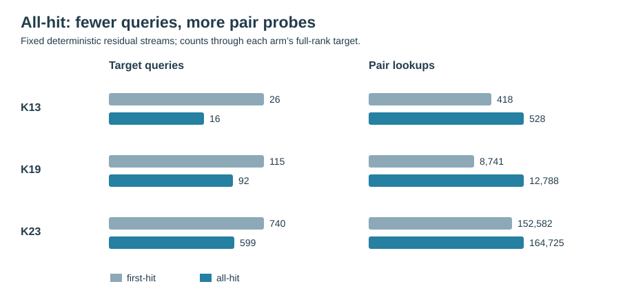

# Multiple decompositions per target: bounded relation screen

Recorded 2026-11-16. This [frozen protocol](PROTOCOL.md) and
[before-data correction](AMENDMENT-1.md) compare the first valid
three-summand decomposition with every valid decomposition on identical
deterministic residual streams. The source committed at `aa129e0ab0`
passed one library-only release test, which checked all triple group
equations, collision seed equations, modular row consistency, pinned curve
and factor-base identities, and recovery of the planted scalar whenever
the matrix reached full rank. The [raw stdout](run-locked.stdout),
[stderr](run-locked.stderr), [UTC/resource log](run-locked.meta),
[machine record](RESULTS.json), [result derivation](derive_results.py),
[editable flow](diagram.dot), [tradeoff chart](tradeoff.svg), and
[PDF](report.pdf) are retained together. [pcc:unverified]

The original protocol is frozen at commit `15a7782ef3`. A
[post-run editorial annotation](AMENDMENT-2.md) added two prose evidence
tags without changing its executed terms; `RESULTS.json` binds both
versions. [pcc:unverified]

## Mechanism and observed tradeoff

The current batch oracle returns after its first verified
`P_i + P_j + P_k = R`. The generic relation collector accepts several
rows from one target. This screen continued the ordered scan after the
first hit, using the production torsion pair table's first witness for
each key. Both arms began with the same verified collision rows and
torsion seed. The test independently re-added every reported triple and
reduced its row over the registered subgroup order. [pcc:unverified]

| Curve | Seed / full rank | First-hit queries | All-hit queries | First-hit pair lookups | All-hit pair lookups | Additional independent rows from later hits |
|:--|--:|--:|--:|--:|--:|--:|
| K13 | 5 / 18 | 26 | 16 | 418 | 528 | 3 |
| K19 | 11 / 71 | 115 | 92 | 8,741 | 12,788 | 18 |
| K23 | 23 / 139 | 740 | 599 | 152,582 | 164,725 | 19 |

The counts stop at each arm's first full-rank target, with scalar 641
verified in both arms on every cell. K13 traversed every nonidentity
point of its order-2,003 subgroup; K19 and K23 used the first 1,024
distinct points of the fixed stride-37 stream. The all-hit arm saved
10, 23, and 141 distinct target queries, respectively, but required
110, 4,047, and 12,143 additional pair lookups. It also incurred 27,
165, and 458 additional pair re-additions. These counts show a query/probe
tradeoff, not a complete runtime advantage. [pcc:unverified]

Every residual with a hit in this fixed sample had more than one hit:
998/998 at K13, 611/611 at K19, and 337/337 at K23. Yet 3,106, 2,065,
and 912 hits beyond each target's first yielded only 3, 18, and 19
independent rows in the all-hit arm's arrival order. Permutations and
signed variants of a triple plausibly explain much of the redundancy;
this screen did not classify every hit's equivalence class. The row
counts include arrivals after the matrix reached full rank, so their
quotient is not an intrinsic independent-row probability. [pcc:unverified]

## Scope and next discriminator

The scan model counts one point subtraction per examined factor-base
point, an actual pair-table lookup for each nonidentity rest, and each
pair re-addition made by `PairTable::probe`. The first-hit control stops
at its scalar hit position. Production's eight-point batch forms the
whole hit block, so this model is not its exact operation count. It also
omits target generation, native field operations, row reduction time,
allocation, setup, memory and answer verification cost. The test runner's
wall time is harness time, not a collector timing. The result is a
same-producer deterministic screen, not independent replay or an
F4/F5/F6 comparison. [pcc:unverified]

`dominated_by`: the current first-hit collector remains the deployed
reference; this screen does not establish that all-hit beats it.
`sota_delta`: no exponent change and no complete-call performance claim.
The next discriminating candidate is a rank-aware continuation that
stops scanning when a newly independent row has been obtained or a
frozen per-target probe cap is reached. It must preserve the exact group
checks, row order and answer, then face a same-target complete-call
comparison with first-hit and F4/F5/F6 under the frozen isolation gate.
The production collector and adapter remain reserved by Conductor T-6708.
The canonical `docs/ic/LEADERBOARD.md`, `docs/ic/progress-timeline.json`,
and `docs/ic-leaderboard.html` were checked for scope. None was changed:
this record has no admitted complete-cost or timing edge. [pcc:unverified]

## Custody of the failed first launch

The initial root-level `cargo test --release --test` command exited 101
before executing the test because Cargo compiled a Linux-only binary on
macOS. Its [stdout](run.stdout), [stderr](run.stderr) and [metadata](run.meta)
remain intact. The locked library-only harness was committed before the
passing run. Neither output was overwritten. [pcc:unverified]
