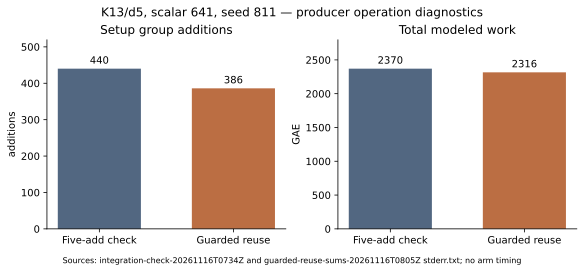

# Guarded pair-sum reuse: source-pinned correctness receipt

**Producer observation only.** Source commit
`d85f6a9107d2fcef09be530f6fd327c184335969` reuses independently
recomputed pair sums in the final four-point group identity check and
validates the factor base's negative-index map before building an equal-sum
row. The fixed census control rejects both a modified collision witness and
a corrupted negative index. The release `ecbench` binary suite passed 21
tests, with one ignored and no failures. Exact command, test-binary SHA-256,
environment, dirty state, stdout, stderr and exit are beside this report.
The bound data statement `PCC-20261116-28659f` is unverified.
[pcc:unverified]

The three fixed standard-subspace bases retained their earlier collision
candidate counts and independent ranks: K13/d5 27 and 5, K19/d7 99 and 11,
K23/d8 201 and 23. The test asserts exactly three charged group additions
per candidate in the verifier, verifies every full group equation, and
exercises the corrupted-index rejection on an equal-sum collision. The
same-target K13/d5 fixture recovered and group-verified planted scalar 641
under the existing and guarded harvest engines. [pcc:unverified]

| Recorded K13 diagnostic | Five-addition verifier | Guarded reuse |
| --- | ---: | ---: |
| Source | `a9fa59faf5e11b223efdbff47eb55408a8f150fb` | `d85f6a9107d2fcef09be530f6fd327c184335969` |
| Collision candidates; independent seed rows | 27; 5 | 27; 5 |
| Target trials; target-bearing relations | 23; 13 | 23; 13 |
| Setup group additions | 440 | 386 |
| Total modeled GAE | 2,370 | 2,316 |

The table is transcribed from the two source-pinned stderr lines. The 54
fewer charged additions equal two saved additions for each of 27
collisions; the native index checks add non-group work that this GAE count
does not price. This is a fixed-fixture operation-count observation, not
per-arm timing or an admitted F4/F5/F6 comparison. No such performance
claim is made. [pcc:unverified]

The earlier intermediate receipt is
[`../reuse-sums-20261116T0751Z/`](../reuse-sums-20261116T0751Z/).
Its separate full release library run was interrupted after eight
`ecbench` band, compare, spec and workload tests failed; it has no complete
suite census. The final edit touches only the binary module, and this
source-pinned binary suite passed. The canonical IC leaderboard, scoreboard
and progress timeline were checked for scope and are unchanged: the frozen
L2 F4/F5/F6 panel and independent verification remain the next evidence
gates. [pcc:unverified]
