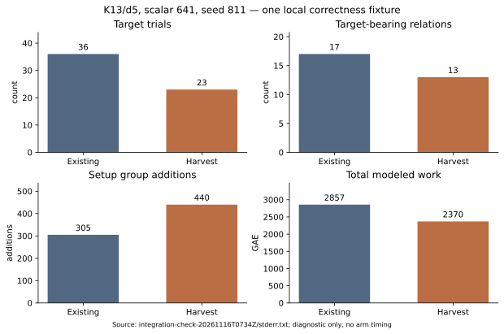

# Opt-in collision harvest: source-pinned integration check

**Observation only.** The release `ecbench` binary test suite completed on a
shared local macOS ARM64 host: 21 passed, 1 ignored, 0 failed. The fixed
K13/d5 same-target check recovered planted scalar 641 with both the existing
`rootfind-negfold-batch` engine and the opt-in
`rootfind-negfold-batch-harvest` engine. The source commit is
`a9fa59faf5e11b223efdbff47eb55408a8f150fb`; the exact test command,
environment, pre-run dirty state, stdout, stderr, and exit code are beside
this report. [pcc:unverified]

The fixture uses the public K13 curve
`ICV1:f2m-13-752c6463:181:8012:0x1:-7:unk:r:515ee5696294`, standard
subspace dimension 5, target source `walk`, seed 811, and a 20,000-trial
ceiling. The test requires equal pair-table entry counts, 27 harvest
candidates, 5 independent seed rows, both recovered scalars equal to 641,
and both full group verifications. The companion fixed-base test checks the
K13/K19/K23 collision counts and ranks against the census and rejects a
modified witness. These are automated producer checks in one session;
independent validation is pending. [pcc:unverified]

| Recorded K13 diagnostic | Existing engine | Harvest engine |
| --- | ---: | ---: |
| Target trials (count) | 36 | 23 |
| Target-bearing relations (count) | 17 | 13 |
| Final matrix rank (count) | 17 | 18 |
| Setup group additions (count) | 305 | 440 |
| Total modeled group-addition equivalents (GAE) | 2,857 | 2,370 |
| Independent homogeneous seed rows (count) | 0 | 5 |

The table is transcribed from the one diagnostic line in `stderr.txt`.
`render.py` reads that line to produce the quantitative graph below. The
harvest engine charges five extra full point additions per duplicate witness
to setup, row construction to native work, and matrix seeding to linear
algebra. The 135-addition setup difference agrees with 27 witnesses at five
additional additions apiece. That arithmetic is derived from the recorded
counts; it is not a separate measurement. [pcc:unverified]

No per-engine wall or CPU measurement was recorded. The 1.45-second figure
in `stdout.txt` is the whole test suite, not either arm. The GAE values are
model outputs of this one fixture; this report makes no performance ratio or
F4/F5/F6 comparison. The independent EKS performance panel remains gated by
the current spend limit. `PCC-20261116-fdce53` is **unverified** because
signed independent verification and matched benchmark evidence are absent.

The full library suite was attempted earlier in this worktree but did not
complete cleanly because two existing workload-registry assertions failed;
the source-pinned receipt here covers the `ecbench` binary suite only.
The canonical IC leaderboard, scoreboard, and progress timeline were checked
for scope and are unchanged: this correctness fixture supplies no comparable
end-to-end performance entry. [pcc:unverified]
