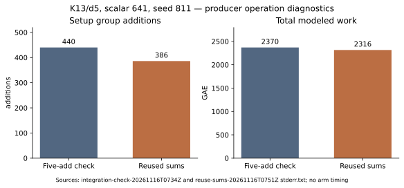

# Reusing verified pair sums in collision rows

**Producer observation only.** Source commit
`6ab9a48d4f729b3178d2f273d8501e837ba3f1a8` changed the opt-in
collision-row verifier to reuse its two independently recomputed pair sums
in the final four-point identity check. The full group equation is still
checked and a modified witness is still rejected. The release `ecbench`
binary suite passed 21 tests with one ignored. Exact command, environment,
dirty state, stdout, stderr and exit are beside this report. [pcc:unverified]
The bound data statement is `PCC-20261116-bcb6f9`, currently unverified.

The fixed K13/d5 known-answer fixture uses public scalar 641, walk targets,
seed 811, the same 33-point standard-subspace base and 17 columns. The
existing engine and both harvest revisions recovered and group-verified the
same scalar. The fixed K13/K19/K23 census test checked 27, 99 and 201
collision candidates and ranks 5, 11 and 23, and asserted exactly three
additional group additions per candidate in the new verifier. The prior
five-addition receipt is
[`../integration-check-20261116T0734Z/`](../integration-check-20261116T0734Z/).
All checks here are from this producer session; independent verification
remains pending. [pcc:unverified]

| K13 diagnostic | Prior harvest | Reused sums |
| --- | ---: | ---: |
| Source commit | `a9fa59faf5e11b223efdbff47eb55408a8f150fb` | `6ab9a48d4f729b3178d2f273d8501e837ba3f1a8` |
| Collision candidates | 27 | 27 |
| Independent seed rows | 5 | 5 |
| Target trials | 23 | 23 |
| Target-bearing relations | 13 | 13 |
| Setup group additions | 440 | 386 |
| Total modeled GAE | 2,370 | 2,316 |

The two stderr diagnostic lines supply the table. Reusing the pair sums
changes five setup additions per collision to three; for 27 collisions,
the recorded difference is 54 additions and 54 modeled GAE. This is a
same-fixture operation-count observation, not an admitted wall-time or
end-to-end F4/F5/F6 performance comparison. No per-arm wall or CPU time
was recorded. [pcc:unverified]

This intermediate source trusted the factor base's `neg_index` when converting
an equal-sum collision to a row. A subsequent source revision adds an explicit
negative-index integrity guard; its own receipt is required before calling
that guard tested. [pcc:unverified]

The source-pinned binary test receipt passed. The separate release library
gate was interrupted after eight `ecbench` band, compare, spec and workload
tests reported failures. Its `lib.stdout`, `lib.stderr`, and
`lib-exit.txt` retain the partial output (exit 101); it has no complete suite
census. This binary-only edit does not touch those library modules. The
282,709-byte `lib.stdout` has SHA-256
`7318f950c7e9a729b878fed8a7092d1e5a0646aac66854c071680acd22aa3cb8`
and requires the PR artifact-store migration; a local store push received
S3 403 under this session's credential. The
canonical IC leaderboard, scoreboard and progress timeline remain unchanged
because these operation counts have no independently validated performance
entry. [pcc:unverified]
