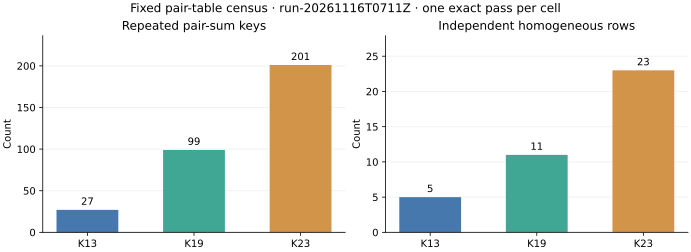

# Pair-sum collision census — run-20261116T0711Z

**Status:** Three fixed cells completed. The first-witness counts match the
production scalar table in all three. Every repeated-key witness passed a
full group-sum check; the deliberately perturbed control failed as expected.
The signed Frobenius row ranks are positive in every cell.

This is an exact relation-rank screen on a local shared macOS ARM host, not a
timing comparison. The reported wall values in stderr are diagnostics only.
Protocol: [PROTOCOL.md](../../PROTOCOL.md). Source commit:
`880d8717cce6b69ac6281192a6456a1c5c8758b3`; binary SHA-256 is in
`binary_sha256.txt`. The pre-run worktree had the unrelated untracked
`research/rootfind_k13_local_f456_screen_20261116/` directory, recorded in
`dirty_tree_before_run.txt`.

| Cell and exact curve | Field/base | Group order; subgroup order; cofactor | Base points; columns | Pair additions; repeated keys | Nonzero rows; independent rank |
| --- | --- | ---: | ---: | ---: | ---: |
| K13 `ICV1:f2m-13-752c6463:181:8012:0x1:-7:unk:r:515ee5696294` | GF(2^13), d=5 | 8,012; 2,003; 4 | 33; 17 | 305; 27 | 27; **5** |
| K19 `ICV1:f2m-19-87f45376:797:523492:0x1:-7:unk:r:b6cf2467887c` | GF(2^19), d=7 | 523,492; 130,873; 4 | 139; 70 | 4,969; 99 | 99; **11** |
| K23 `ICV1:f2m-23-c07a6b8c:5197:8383412:0x1:-7:unk:r:69e76b739aa7` | GF(2^23), d=8 | 8,383,412; 2,095,853; 4 | 275; 138 | 19,181; 201 | 201; **23** |

Each row is directly observed in the corresponding `k13.json`, `k19.json`,
or `k23.json`. Zero vectors were 0 in every cell. All three exits were 0,
the scalar-table insertion and entry counts matched, and the negative control
was `passed`. Maximum resident sets from `/usr/bin/time -l` were 7,045,120,
8,765,440 and 13,074,432 bytes, below the 512 MiB ceiling; the executable's
120-second and 200,000-pair limits did not trigger.

The rows are homogeneous: they constrain the base logarithms after cofactor
projection, but do not contain a target coefficient. Their positive rank
passes the protocol's integration trigger. A separately compiled dense
Gauss-Jordan replay of all saved row vectors returned ranks 5, 11 and 23
(`k13.replay-rank.txt`, `k19.replay-rank.txt`, `k23.replay-rank.txt`). This is a
second algorithm in the same session, not an independent reviewer. The next
implementation must charge collision detection, full point reconstruction,
verification and rank updates, then compare the number of target-bearing
relations needed on matched public fixtures. No speed effect has been
measured here.

The current rootfinding manuscript and binary pair table are in
`papers/rootfinding-decomposition/rootfinding_decomposition.tex` and
`src/cryptanalysis/ic_boundary.rs`; established adjacent harvesting is in
`src/cryptanalysis/koblitz_index_calculus.rs`. The shared KB source IDs and
refresh boundary are in the protocol. This run changes no canonical
performance graph or leaderboard: `docs/ic-leaderboard.html`,
`docs/index-calculus-scoreboard.html`, and `docs/ic/progress-timeline.json` were
checked for scope, and this rank-only diagnostic supplies no comparable speed
or solve-cost entry.

The group equalities are concrete witness checks in the raw rows, rather than
a new polynomial identity over the fixed prime field accepted by the
`identity.certificate/v1` format.
