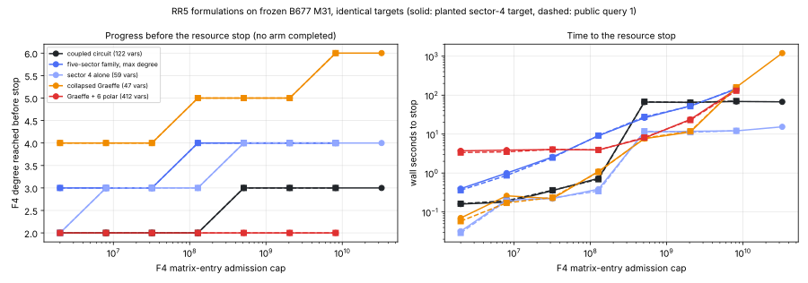

# RR5 on B677 M31: deflation, five-sector and coupled formulations on identical inputs

2026-11-25/26, Claude Code. Development runs on one shared 4-vCPU, 15 GiB cloud VM.
Unsigned. [pcc:unverified]

## Question

Owner priority 3: compare differential deflation (PR #5136), the five-sector selectors
(PR #5119) and the existing coupled RR5 system (PR #4974) on identical inputs. Does any of
them turn the frozen B677 algebraic extraction into relations, and which gets furthest for
the same resources?

## Instrument: one driver, identical inputs

[`native/formulation_compare.rs`](native/formulation_compare.rs) and
[`native/graeffe_jets.rs`](native/graeffe_jets.rs) are compiled as a binary of the RR5
native crate. They build against #5119's exact source-pinned closure (commit
`e4c64edc`; see [BUILD.md](BUILD.md)). Every arm goes through the same steps:

1. The frozen `Hybrid677` fixture: 509 Dickson and 168 Y7 abscissae on
   p = 2^31 − 1, y² = x³ + 847514846x + 2087444724.
2. The same public target R.
3. The same native bounded F4 visitor, `solve_visit_traced`, in Grevlex. Every
   non-univariate enumeration branch is refused, so nothing enumerates leaves.
4. Quartic root extraction and signed replay to R, which is the extractor's lift.
5. The same caps: the frozen #4974 protocol caps, then the resource ladder below.

| Arm | Presentation | Variables / equations | Max input degree |
| --- | --- | ---: | ---: |
| `coupled` | unchanged structured circuit, U \| D_1024·G(f^7) (`extract_hybrid677`) | 122 / 123 | 2 |
| `sectors` | the five #5119 systems U = A_k·B_(4−k), **one shared deadline** | 59/60, 53/54, 56/57, 58/59, 59/60 | 2 |
| `sector4` | the pure-Dickson sector alone (diagnostic; one sector is not complete) | 59 / 60 | 2 |
| `graeffe` | collapsed Graeffe presentation from #5136, as quadratic gates | 47 / 48 | 2 |
| `deflated` | the same circuit as second-order jets plus the six polar Hessians of F3 (#5136) | 412 / 419 | 2 |

The two Graeffe presentations did not exist as F4 inputs, so this study builds them.

- **Construction:** θ = (b, c, d), the RR5 quartic, ten root-squaring steps x ↦ x² − 2, and
  the centered residuals F1..F4. They use the exact formulas of the #5136 checker. Every
  non-constant intermediate is lifted to a variable with one quadratic defining equation.
- **Deflated version:** it carries each intermediate as a 10-component jet (value, three
  first and six second derivatives in b, c, d) with product-rule equations.

The Graeffe and deflated arms cover only the pure-Dickson sector, all four leaves in the
509 Dickson points. That is where #5136 defines them, and their sector-level comparator is
`sector4`.

**Targets** (frozen in the driver):

- `planted4`: Dickson points 37, 138, 239 and 340 with signs (+, −, +, +).
- `planted2`: two Dickson and two Y7 leaves.
- `query1`, `query2`: public aG + bQ from the B677 seed of crypto #5097/#5184.
- `h0`: the registered #4974 public target (18, 221278090).

## Local regularity (identical planted witness)

At the `planted4` witness, θ = (555368639, 730235472, 1830916434), both Graeffe systems
vanish exactly on all equations (forward-evaluation control). The Jacobian ranks of the
full lifted systems are:

| Presentation | Jacobian rank at the witness | Regular? |
| --- | --- | --- |
| collapsed Graeffe | **45 / 47** | no: the F_j block has rank 1 in θ, as #5136 states |
| Graeffe + six polar equations | **412 / 412** | **yes** |

This confirms #5136's claim on a new, independently chosen witness. The coupled and sector
systems use the remainder presentation, whose reducedness is argued in
`prime31_four_summand_20261122/scaling-b677/MATHEMATICS.md`. #5136 itself notes that those
formulations already avoid the multiplicity problem.

## Resource ladder

The three resource caps (pairs, symbolic monomials, matrix entries) were scaled together,
from the frozen #4974 values (×1: 20,000 / 8,192 / 2,000,000) up to ×16,384. Each run is a
fresh process with a 300–1200 s deadline and a 12–13 GiB address-space cap.

- **Runs:** 125 at ×1–×256 on five targets (`ladder-01`), 23 at ×1024–×16384 (`ladder-02`).
- **Outcome:** every run stopped incomplete and **no arm extracted a single relation on any
  target**.
- **What the cap measures:** the matrix-entry cap is admission bookkeeping, not memory. Peak
  RSS was 264 MB for the coupled arm at every scale, 2.4 GB for the five-sector family at
  ×4096, and 4.5 GB for Graeffe at ×16384.

| Arm | F4 degree reached at ×1 | ×64 | ×256 | ×4096 | ×16384 | Stop at the largest scale |
| --- | ---: | ---: | ---: | ---: | ---: | --- |
| coupled (122 vars) | 2 | 2 | 3 | 3 | 3 | degree-4 matrix admission > 3.28·10¹⁰ entries, 67 s |
| five sectors, max per family | 3 | 4 | 4 | 4 | – | each sector at its admission cap, 144 s, 2.4 GB |
| sector 4 alone (59) | 2 | 3 | 4 | 4 | 4 | degree-5 admission > 3.28·10¹⁰, 15 s |
| collapsed Graeffe (47) | 4 | 5 | 5 | 6 | 6 | **deadline** at 1200 s, 4.5 GB |
| deflated (412) | 2 | 2 | 2 | 2 | – | degree-3 admission > 8.2·10⁹, 141 s |

The table uses the `planted4` target. `query1` gives the same degrees, `query2`, `h0` and
`planted2` agree at the scales run, and each degree is the per-run maximum.



## Findings

1. **None of the three formulations produces relations at B677,** even at 16,384× the frozen
   F4 budget. The planted targets, whose witnesses are known to exist, fail just like the
   public ones, so this is not an emptiness signal. Each 4× of budget buys at most half a
   degree.
2. **Five-sector beats coupled at equal caps.** Each sector system reaches degree 4 where
   the coupled circuit stays at 3, because its systems are less than half as large (53–59
   variables against 122). Completing the family still requires every one of the five
   systems to complete, and none did. Wall time to the stop is mixed: the family took
   about 26 s against coupled's 66 s at ×256, but 144 s against 69 s at ×4096.
3. **Deflation repairs regularity and makes F4 progress the worst of all arms.** Its
   Jacobian is full rank where the collapsed system's is not, but the second-order jet
   circuit has 412 variables and stalls at degree 2 through ×4096. As an F4 input,
   deflation is dominated by both the collapsed Graeffe system and the remainder sectors.
4. **The collapsed Graeffe presentation progresses furthest** (degree 6), simply because
   it is the smallest system (47 variables). It is non-reduced at its solutions, so even a
   completed basis would carry the multiplicity #5136 describes. It also covers only the
   pure-Dickson sector.
5. **Against the pair table, there is no contest yet.** On the same base and the same kind
   of query, the generic signed pair table (crypto #5202) recovers the B677 target
   logarithm in 78 ms single-threaded, about 690 relations. No algebraic formulation here
   produces one relation in 20 minutes.

## What would change this conclusion

- **A solving-degree certificate.** A completion bound for any one of these systems that
  sits within reach, about degree 6–7 for 47–59 variables on this host, would justify a
  larger run. The ladder shows no sign of one.
- **Smaller selector families.** Lower Dickson depth with fewer Y7 cosets would give sizes
  where at least one arm completes and its cost growth can be fitted. The constructors are
  currently hard-wired to B677.
- **Order 1 instead of order 2 for deflation.** Only the Hessian components are needed, but
  first derivatives are needed to form them. A circuit that keeps just the derivatives F3
  actually uses could shrink the 412 variables.

## Scope and limits

- **Host:** a shared development VM, so wall times are indicative. No isolated host was
  used; the EKS route is blocked.
- **No completeness claim:** a stop is never UNSAT.
- **Ladder shape:** one deadline per run, and the five-sector deadline is shared, as #5119
  requires. The deflated and sector-family arms were not run at ×16384 because their
  memory would exceed this host.
- **New code:** the Graeffe/deflated constructions are new in this study. Their correctness
  check is the exact-vanishing control at the planted witness plus the rank computation.
  They are not independently reviewed.

## Replay

See [BUILD.md](BUILD.md). Then:

```
X=<rr5-formulation-compare>
$X --arm coupled|sectors|sector4|graeffe|deflated --target planted4|planted2|query1|query2|h0 --scale 1 --seconds 300
X=$X tools/ladder.sh            # ladder-01
X=$X tools/ladder2.sh           # ladder-02 (plus the x16384 commands listed in evidence/README.md)
python3 tools/summarize.py evidence/ladder-02
```
