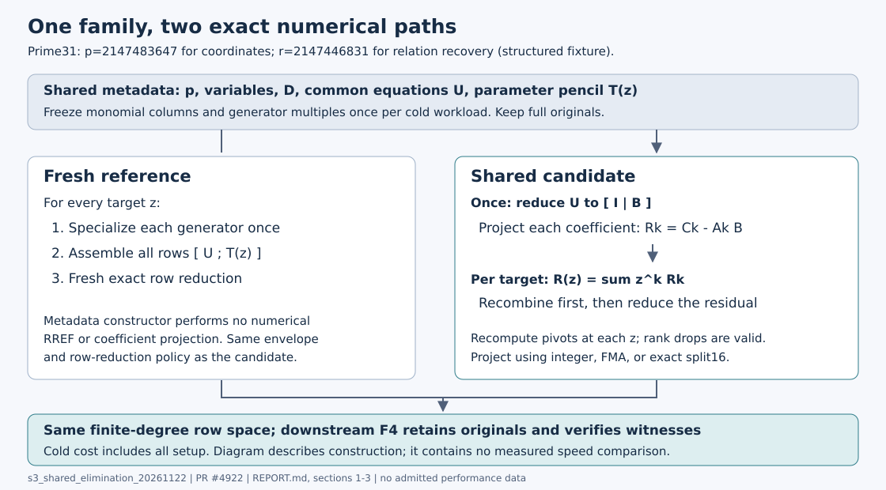

# Exact modular matrices with shared S3 elimination

## Construction and scope

The implementation has two opt-in components. `exact_modular_matrix` computes
canonical residues using an integer backend, exact FMA arithmetic, or bounded
split16 dot products. `shared_macaulay` prepares a target-independent row space,
projects the coefficient matrices of a parameter pencil, and recombines them
before reducing each target's residual matrix. The default F4 dispatcher is
unchanged. These are established algebraic constructions implemented behind
checked Rust interfaces; this report makes no novelty claim.

The shared component is a finite-degree preconditioner. It returns polynomial
consequences and exposes all original equations. It does not assert that the
chosen degree completes a Groebner basis. Factor-base membership, full original
equations, domains, point lifting, signs, and scalar verification remain the
downstream solver's responsibility. Resource refusal is an error, not UNSAT.



### Requirements and evidence

| Requested component | Implementation | Evidence / remaining requirement |
| --- | --- | --- |
| Exact floating-point modular matrices | Three bounded backends; matrix product, subtract-product, scalar and row operations | Independent integer-oracle tests; final command receipts recorded below |
| Shared elimination across relation targets | Common RREF, union-support envelope, projected coefficient matrices, target recombination | Source-row and rank-drop tests; S3 integration checks |
| A fair reference | `FreshMacaulay` prepares metadata without numerical elimination or projection | Fresh and shared use the same envelope and exact reduction policy |
| Relation correctness | Original equations retained alongside consequences | Small-field polynomial and signed-point fixtures; finite auxiliary chart scoped explicitly |
| Full relation-solving and cold ECDLP cost | Prospective design in `PROTOCOL.md` | Admitted performance execution and full pipeline adapter remain open |
| Reproducible publication | PR #4922, source, development logs, diagram, report source | PCC standing must come from signed CI, not these producer checks |

## 1. Exact arithmetic contracts

The public matrix boundary accepts canonical `u32` residues for an odd prime
`3 <= p < 2^32`. Dimensions, lengths, storage, operation limits, and canonical
inputs are checked before an output is mutated. The scalar helpers state their
canonical-input precondition explicitly. Coordinate elimination uses the field
prime `p`; relation equations use the subgroup order, which is a separate modulus.

### Integer reference

For `p = 2^31 - 1`, a `u64` product is reduced by the standard Mersenne fold.
Other admitted primes use the existing `fp_backend::Fp32` arithmetic. Wide limb
sums receive the additional fold required by their larger range. This is an
optimized integer reference, rather than an artificially slow big-integer loop.

### FMA backend

For canonical inputs `a,b`, let `h = fl(a*b)` and
`lo = fma(a,b,-h)`. Estimate `q = floor(fl(h * fl(1/p)))` and form
`r = fma(-q,p,h) + lo`, followed by a correction into `[0,p)`.

With binary64 unit roundoff `u = 2^-53`, the absolute quotient-estimation error
is bounded by `p(3u + 3u^2 + u^3) < 1` for the admitted moduli. Thus `q` differs
from the exact floor quotient by at most one. The cancellation residuals are
small exactly representable integers; the product error is retained by the
fused operation. One modular correction suffices. The code uses Rust
`f64::mul_add` explicitly and does not require unsafe fast-math reassociation.

This argument relies on fused semantics and the stated input range. Merely
casting a full 31-bit product to binary64 and applying a remainder would lose
low bits. Mathemagix's modular arithmetic paper is the relevant prior art [2].

### Split16 backend

Write each operand as `a0 + 2^16*a1`. Accumulate the four limb products in
binary64, with a hard chunk cap `k <= 2^21`. Every product and partial sum is an
integer bounded by `k*65535^2 < 2^53`, so all additions are exact. Reduce each
limb sum before integer recombination. For the Mersenne prime, `2^32 = 2 mod p`;
the general prime path uses Horner recombination and does not assume this identity.

Default chunks are smaller than the mathematical cap. Dimension, payload, and
work caps bound actual calls independently of that cap. The current kernel is
a blocked native reference. A future BLAS/GPU implementation must preserve
the same bounds and exact accumulation format; this change supplies neither
a GPU implementation nor a hardware speed measurement.

`KernelCounts` reports named components: logical matrix field operations,
selected float products/additions/conversions, fused operations, reductions,
and input checks. It excludes primality/setup, inversion internals, allocation,
sorting, quotient floors, conditional corrections, and caller work. These
counts are not retired instructions or complete solving cost.

## 2. What the shared matrix actually computes

Let `U` be the common Macaulay rows at a fixed degree `D`, and let a dynamic
generator family be `T(z) = sum_k z^k T_k`. The monomial universe and permitted
multiplier rows are fixed from the union of coefficient supports, not from one
calibration target. In common pivot/free coordinates, reduce `U` to `[I | B]`.
Project every dynamic block `[A_k | C_k]` to `R_k = C_k - A_k B`.

At a target `z`, first compute `R(z) = sum_k z^k R_k`, then row-reduce `R(z)`.
The union of the common basis and the resulting residual basis has the same
row space as the freshly assembled fixed-envelope matrix `[U; T(z)]`.
The rank identity is `rank([U;T(z)]) = rank(U) + rank(R(z))`.

Projection is linear, which permits coefficient-wise projection. Polynomial
ideal solving is not linear in the parameter coefficients: treating the
coefficients of `x-z` as separate equations would incorrectly add `1`.
The implementation recombines before any residual elimination. It recomputes
pivots for each target, so zero coefficients and rank drops are allowed.

An exact normalized `FamilyKey` contains the field, variable count, degree,
common equations, and full pencil. It is a structural identity, not a lossy
hash or a key based only on dimensions. High-degree generators omitted from
the bounded Macaulay envelope remain available in `original_equations`.

### Fresh baseline

`FreshMacaulay::prepare` builds only normalized family metadata and the fixed
row/column envelope. Each target specializes each generator once, expands its
monomial multiples, and performs a fresh numerical reduction of the common
and dynamic rows. It does not construct coefficient projections or reuse
numerical pivots. Its constructor remains available when a candidate-specific
projection storage/work limit rejects preparation. Both paths use the same
reduction policy; the primary caching comparison holds the integer backend fixed.

## 3. S3 integration and verification boundary

The integration fixture represents a finite-auxiliary three-point chain:

```
S3(x1,x2,u) = 0
S3(u,x3,t) = 0
F_V(x1) = F_V(x2) = F_V(x3) = 0
```

Only the final generator depends on target parameter `t`. The fixture's sparse
expansion is checked against the existing `eval_s3_u64`; it is not a replacement
for the production chained-S3 adapter being developed in #4920. Original F4
inputs are compared with original inputs plus fresh/shared consequences.

The small-field fixture is `y^2=x^3+2x+2` over `F_17`, with `G=(5,1)` and order
19. The existing principal fixture is
`p=2147483647, a=847514846, b=2087444724, n=2147446831, h=1,
G=(625037715,2100627251)`, as used by the committed
`examples/prime31_batched_ic_same_1024q.rs` and
`examples/prime31_wz_rho_frontier.rs`. No new registry slug is assigned here.

A finite coordinate `u` cannot encode an intermediate point at infinity.
The fixture distinguishes checked finite-chart witnesses from exceptional
prefix cancellation; a successful toy recovery is not a completeness claim
for every S3 chart. Production integration must preserve #4920's explicit
chart coverage and final group checks. A 31-bit arithmetic/row-space check is
also not a 31-bit unknown-scalar recovery.

## 4. Development evidence

The commands, exit statuses, build/source bindings, and raw outputs are recorded
in `evidence/development-receipt.json` and its referenced files. Every pass here
is local producer evidence, not signed PCC verification. [pcc:unverified]

| Development check | Recorded outcome | Scope |
| --- | --- | --- |
| Component qualifier, opt-level 0 | 16 passed, zero failed | Actual new modules and verbatim production Fp32/primality/type closure |
| Same component tests, opt-level 3 | 16 passed, zero failed | Optimized arithmetic correctness; the same 16 cases, not 16 additional cases |
| Corrected integration qualifier | Five passed, zero failed | Actual example with existing F4, root finder, group operations, and relation linear algebra |
| Delivered CLI `--plan` and `--check` | Both exited zero | Bounded correctness report, no performance measurement |
| Unmodified full library test build | Compiler SIGKILL, exit 101 | Failed before the new module declarations were added |
| Full production-library check | Compiler SIGKILL, exit 101 | Repository-wide gate remains open |

These outcomes are tagged `[pcc:unverified]`; neither a source hash nor the
same-team review supplies a signed verdict. The compiler signals alone do not
establish an out-of-memory diagnosis. Both source-bound qualifiers contain
the actual new modules and byte-preserving production dependency ranges.
The integration qualifier additionally contains the complete production F4
modules; the component qualifier contains only its polynomial type alias.
Neither substitutes arithmetic or a solver. Their manifests state which
parts of the root library are excluded.

The executable correctness report records 9,826 numeric S3 identity evaluations;
all 17 target parameters with 459 candidate assignments each for the integer,
FMA, and split16 preconditioners; and 15 solutions at target x=7 from each of
original, fresh-preconditioned, and shared-preconditioned F4. It replays 180
signed finite-chart witnesses. The toy solver receives Q=(7,6) and recovers
k=9 modulo 19 using two three-term relations plus the explicit G anchor, then
checks kG=Q. The 31-bit fixture checks G+2G+4G=7G and its equations/consequences;
it does not recover an unknown 31-bit scalar. [pcc:unverified]

### Failures retained and corrections

The first narrow integration build failed because Rust resolved child modules
of a path-bound F4 file in the wrong directory. The qualifier now copies the
complete F4 files unchanged into their expected module layout and hashes the
copies. No F4 algorithm or child declaration was edited.

The first executed integration suite reported four passes and one failure.
The exhaustive visitor returned true after its first solution, while the
existing API uses true to stop. The completeness guard correctly rejected that
partial traversal. The analogous relation callback also had inverted polarity.
Both callbacks were corrected; the relation test now asserts successful early
stopping after a checked witness. Degree, domains, caps, and full-solution-set
acceptance stayed unchanged. The failed and corrected binary/source manifests
and logs are both retained; the source review acknowledges missing this API
contract. [pcc:unverified]

The native metadata-registration helper also had a shell-argument defect,
reproduced and corrected in a disposable administrative fixture. Its nine
administrative controls are distinct from scientific tests. It only appends
unsigned statement metadata; it does not run a verifier or sign a verdict.

Checks cover near-boundary modular products, largest admitted 32-bit prime,
matrix tails/chunks, invalid-input atomicity, parameter recombination, support
cancellation, rank drops after static projection, exact source-row-space
equality, retained high-degree originals, and bounded refusals. The final
receipt names the cases that actually ran. Kernel counters in the raw CLI
report remain explicitly incomplete and are not a calibrated cost comparison.

## 5. Performance status and next execution

No performance run has been launched for this study. Local compilation and
unit checks are development work. Performance requires the repository's EKS
source-publication, checkpoint, finite budget, live pool, L2, replay, and A/A
admission. Live budget/capacity and an authenticated runner are unavailable in
this session. Installing a CLI would not establish either.

The maintained GitHub workflow is another potential route. Its latest inspected
run [44577926579](https://github.com/isogeny-labs/crypto/actions/runs/44577926579)
failed in required store-data retrieval before experiment execution: the
manifest-matching `research/five_leads_e2e_20261019/sessions.tar.zst` was absent.
Earlier publication-only runs succeeded, so the audit does not conclude that
OIDC is broken. This example additionally needs a supported immutable workload
adapter; the current workflow is not a general arbitrary-example launcher.

The canonical autoresearcher protocol skill/checker/schema were retrieved through
the connector and a sparse Git checkout at
`808b08bcb0a53cb9ddfa7b6c4b4181d9e11d2445`; their files are non-UTF-8 binary data,
and the checkout declares a vault filter for the skill. No configured unlock
client is available in this session.
The readable local schema does not establish that the canonical freeze checker
ran. `PROTOCOL.md` is therefore a prospective design, not a claimed admitted
or frozen `experiment.protocol/v1` record. The required comparison stays open.

No measured row is added to `benchmarks/README.md`, IC leaderboards, or canonical
performance graphs. No performance graph or ranking changes on component
correctness evidence alone. No T0/T1/T2/T3 claim is made.

## 6. Sources and overlap

1. J.-G. Dumas, P. Giorgi, C. Pernet, *Dense Linear Algebra over Finite Fields*,
   [arXiv:cs/0601133](https://arxiv.org/abs/cs/0601133). Exact floating-point
   linear algebra over finite fields is established prior work.
2. J. van der Hoeven, G. Lecerf, G. Quintin, *Modular SIMD arithmetic in
   Mathemagix*, [author text](https://www.texmacs.org/joris/simd/simd.html).
3. I. Semaev, *Summation polynomials and the discrete logarithm problem on
   elliptic curves*, [ePrint 2004/031](https://eprint.iacr.org/2004/031).
4. Existing repository exact-FP64/OpenBLAS work:
   `research/ecgfp5_quotient_bw_finish_20261102/src/bwfinish.cpp` and README.
   Its one-sided limb construction and 12-25-bit range do not provide the
   new backend's general 31-bit dot-product bound.
5. [PR #4820](https://github.com/isogeny-labs/crypto/pull/4820), merged:
   parameterized S3-S5 specialization, compiled refutations, tower inheritance,
   and target-independent normal forms. This study does not claim to introduce
   target reuse or static elimination to the repository.
6. [PR #4859](https://github.com/isogeny-labs/crypto/pull/4859), active at audit:
   F4 trace/support machinery. Its live implementation is not modified here.
7. [PR #4920](https://github.com/isogeny-labs/crypto/pull/4920), chained-S3
   pipeline: this study is its separately registered caching follow-up.

Research KB client unavailable: source and PR inspection substituted for KB
retrieval, with no claim that all literature or ideas have been exhausted.
