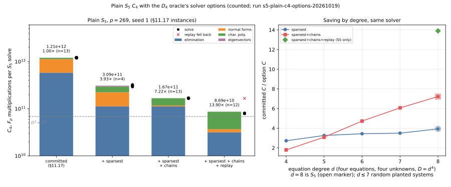

# Run report: plain `S₅` `C₄` with solver options, 2026-10-19

Descriptive record of the runs behind [`../../README.md`](../../README.md). Observations only.

- **Runner:** `examples/gaudry_quartic_c4_options.rs` (summaries: `examples/gaudry_quartic_c4_options_summary.rs`), built from `origin/main` `cb2ec6873` plus this PR's `PlainOptions` wrapper, `cargo build --release`, rustc 1.93.1.
- **Host:** Apple M4 Pro, 14 logical cores, 48 GiB, macOS 25.6 arm64; `RAYON_NUM_THREADS=4`; **no isolation tier** (no core pinning on macOS; load average about 26 from other sessions' jobs at launch). Counted `F_p` multiplications are contention-independent; wall times are contended and not evidence.
- **Instances:** `p = 269`, seed 1 (§11.17's curve, 149-point base, residual stream advanced by the committed arm's solve).

| run (UTC start) | arms | residuals | solves requested / completed | failures | record |
|:--|:--|:--|:--|:--|:--|
| 18:51Z | committed, sparsest, sparsest+chains, sparsest+chains+replay (Latin square) | 0–3 | 16 / 16 | none | `raw/s5_p269_seed1.json`, `.log` |
| 18:52Z | committed, sparsest, sparsest+chains (generic `d` = 4–7) | — | 12 / 12 | none | `raw/generic_d4-7.json`, `.log` |
| 19:21Z | sparsest+chains+replay, all residuals constructed | 0–3 | 4 / 4 | none | `raw/s5_p269_seed1_constructed4_replay.json`, `.log` |
| 19:22Z | committed, sparsest+chains, sparsest+chains+replay (rotated) | 0–12 | 39 / 39 | none | `raw/s5_p269_seed1_r13.json`, `.log` |

A pilot of the generic panel (`d` = 4–6, 18:48Z, `raw/generic_d4-6.json`) gave the same counts.

**Recorded values** (`F_p` multiplications per solve; `raw/summary_r13.json`, `raw/summary.json`):

| run | arm | n | mean `C₄` | range | committed / arm (ratio of means) | oracle-equal |
|:--|:--|--:|--:|:--|--:|:--|
| r13 | committed | 13 | 1.2093e12 | 1.1933e12–1.2270e12 | 1 | 13/13 |
| r13 | sparsest+chains | 13 | 1.6750e11 | 1.6525e11–1.6895e11 | 7.22 | 13/13 |
| r13 | sparsest+chains+replay (first solve excluded) | 12 | 8.690e10 | 7.893e10–1.6562e11 | 13.90 | 13/13 |
| 4-arm | sparsest | 4 | 3.0865e11 | 2.919e11–3.242e11 | 3.93 | 4/4 |
| constructed | sparsest+chains+replay (3 replays) | 3 | 7.959e10 | 7.942e10–7.974e10 | — | 4/4, planted found 4/4 |

Replay outcomes in r13: 1 recorded, 11 replayed, 1 fell back (residual 3). Residuals with a nonempty decomposition: 0 (constructed) and 6. Residuals 0–3 have identical counts in the 4-arm and r13 runs, and the committed arm equals `experiments/24_gaudry_quartic_c4.json` on all four.

*Figure: mean `C₄` by arm with phase stacks and per-residual solves (left); committed/option ratio against equation degree (right). Runs above.*
