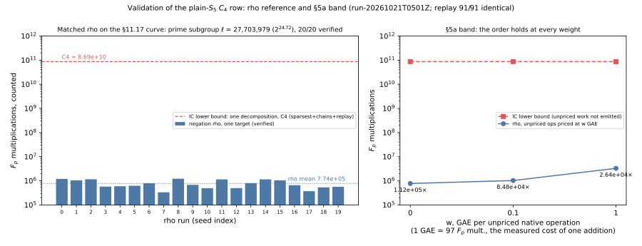

# Run report: rho reference and replay for the plain-`S₅` `C₄` row, 2026-10-21

Descriptive record of the validation runs behind
[`../../README.md`](../../README.md) ("Validation"). Observations only.

- **Binary:** `examples/gaudry_quartic_c4_options.rs`, a fresh release build of `ca88b3917` in a new target directory (rustc 1.93.1, Homebrew).
- **Host:** Apple M4 Pro, 14 logical cores, macOS arm64, `RAYON_NUM_THREADS=4`, **no isolation tier**. The host load average was about 240–300 from other sessions' jobs. Counted `F_p` multiplications don't depend on contention. Wall times are not evidence.
- **Instances:** `p = 269`, seed 1, the curve and residual stream of §11.17.

| run (UTC start) | what | requested / completed | failures | record |
|:--|:--|:--|:--|:--|
| 2026-10-21 05:01Z | `--rho 20`: `#E` from point orders in the Hasse interval, then 20 one-target negation-map rho solves in the prime subgroup | 20 / 20 | none | `validation/rho_reference.json` |
| 2026-10-21 05:01Z – 10:00Z | `validation/replay.sh`: replay of the four recorded `S₅`/generic runs | 71 / 71 solves | none | `validation/replay/*.json`, `.log` |
| 2026-10-26 01:15Z | `validation/replay.sh`: replay of the rho runs, then the certificate | 20 / 20 | none | `validation/replay/rho_reference.json`, `validation/replay-certificate.json` |

Also recorded: `validation/curve_info.json` from `examples/gaudry_quartic_curve_info.rs`, with `j(E)` and its subfield tests.

**Recorded values.**

- **Group.** `#E(F_{269⁴}) = 5,236,052,031 = 189 · 27,703,979`, with `ℓ = 27,703,979` prime (24.72 bits). Setup, outside the runs: 118,498 `F_p` multiplications.
- **Rho, per run.** `F_p` multiplications 331,962 – 1,216,863, mean 773,556.2 (n = 20). Steps 717 – 9,570. Look-aheads 13 – 174. Restarts 0 – 3. S (group operations / √ℓ, setup multipliers included) 0.60 – 2.34, mean 1.47. All 20 logarithms were recovered and verified.
- **Curve.** `j(E)` is in neither `F_p` nor `F_{p²}`, and `a, b ≠ 0`.
- **Replay.** 91 / 91 solves identical: every counted phase, every decomposition and oracle set, and every rho run's counts and verified logarithm. Certificate status `verified`.
- **Validator.** 17 / 17 headline values recomputed, status `pass`.
- **§5a band** (validator recompute, `F_p` multiplications): rho 7.736·10⁵, 1.025·10⁶ and 3.289·10⁶ at w = 0, 0.1 and 1. The IC lower bound is 8.690·10¹⁰ at every w.

*Figure: the 20 rho runs' counted `F_p` multiplications against the IC lower bound (left); the §5a band (right). Run run-20261021T0501Z.*

**Graphs checked and left unchanged:** `figures/c4_options.svg` (the `C₄` arms). It has no rho data and its y-axis starts at 10¹⁰, so the rho values (~10⁶) belong in the new figure instead.
