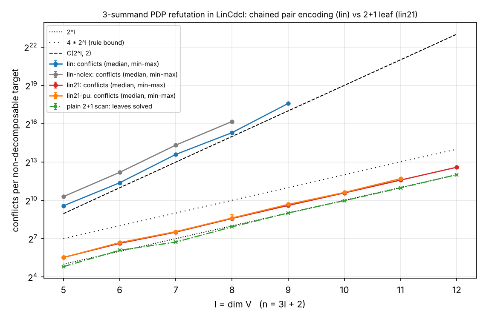

# Pilot: the 2+1 linear leaf inside the field-product-gate CDCL (2026-11-16)

Pilot at toy sizes in a shared 4-core container. Every number here is an unverified pilot
assertion, tagged `[pcc:unverified]`. No benchmark record, leaderboard row or pcc claim.
Protocol committed alone before the first measured row: [`PROTOCOL.md`](PROTOCOL.md), commit
`ec75e74b1a` (2026-11-16T01:14:14Z). All tables: [`tables.md`](tables.md). Raw rows:
`raw/rows.jsonl`, `raw/targets_l*.jsonl`, merged verbatim into `results.json`.

**Decision by the pre-registered rule: lead holds.** `lin21` median conflicts are 1.42 to 1.51
times 2^l at every l = 7..12 (bound: 4), and at L* = 9 the median `lin` conflicts are 254 times
the median `lin21` conflicts on the 8 common targets (threshold 2^(L*-3) = 64). [pcc:unverified]

What this is and is not: `lin21` makes `LinCdcl` perform the known linear 2+1 scan. Its conflict
count equals the scan's own count on every target (D >= 0, see below); no learnt clause pruned
an x1 value. In wall time `lin21` is 1 400 to 1 900 times slower than the plain native scan of
the same leaves. The measured ratios are against `lin` (the chained pair encoding), which
enumerates pairs; they are not a ratio against the scan.

## Setting

- F_{2^n}, polynomial basis, n = 3l + 2: (l, n) = (5, 17) .. (12, 38); modulus = first
  irreducible trinomial by increasing middle degree, else first pentanomial (mask in every
  row: 131081, 1048585, 8388641, 67108891, 536870917, 4294967437, 34359738373, 274877907043).
- Curve y^2 + xy = x^3 + x^2 + 1. V = span(1, .., z^(l-1)) = elements < 2^l.
- Problem (ALG0): x1, x2, x3 in V, t in F with S3(x1, t, xR) = 0 and S3(t, x2, x3) = 0.
  Zero is an allowed summand abscissa in every arm (`ChainInstance` allows it).
- Targets: xR outside V, R rational, sqrt(b)/xR outside V (excludes R = base point +
  2-torsion point, the case with non-liftable twist models). Seed 20261116. Per cell 16
  non-decomposable uniform targets, 4 planted, plus the decomposable uniform draws met on the
  way (0 to 4 per cell, kind `uniform-dec`, run but outside the medians).

## The encoding (`Lin21Instance::build` in `lin21.rs`)

15 blocks of n bits: x1, u, A2, B, k, E, w, C, t, s, p, ST, H, zz, Q.

- Static XOR rows: A2 = (x1 + xR)^2, B = xR x1, C = B^2 + b, w = u^2 + u,
  p^2 + ST^2 + H = b, zz^2 + Q + p = 0.
- Product gates: B = k A2, E = B k, C = E w, t = k u, ST = t s, H = t p, Q = s zz.
- Unit clauses: x1, s, zz in V; p in span(V.V) (bits >= 2l - 1 are zero).
- Branch priority: the l bits of x1 only (`lin21`); `lin21-pu` adds u_0.

The difficulty was that S3(x1, t, xR) = A2 t^2 + B t + C has two roots, so Gauss leaves one
free bit of t and its position depends on x1; a gate fires only on a fully assigned block.
With k = B/A2 and t = k u the equation becomes E (u^2 + u) = C, whose two roots differ in bit 0
of u for every x1. When x1 is assigned, Gauss assigns A2, B, C, then k, E, w and all of u
except u_0 (or reports a conflict when there is no root). One decision on u_0 (the
lowest-index non-priority variable) assigns t; the gates ST = t s and H = t p fire and the
leaf is n linear equations in the 3l - 1 unknown bits of (s, p). If it has a solution, s is
assigned, Q = s zz fires and zz^2 + s zz + p = 0 is linear in zz. Model: x2 = zz, x3 = zz + s.
x1 = 0 gives k = E = 0 and C = b != 0, a conflict; that loses nothing because the problem is
symmetric in the summands (checked exhaustively in the selftest). The solver file is included
unchanged (sha256 996770f4b4ecbc84c451203f6edce5cb17ac40b44892def19d06ca63bc0d2f47).

## Results: non-decomposable uniform targets, medians [pcc:unverified]

Conflicts as multiples of 2^l and of C(2^l, 2) (ranges in `tables.md`):

| l | n | lin / 2^l | lin / C | lin-nolex / C | lin21 / 2^l | lin21 / C | lin21-pu / 2^l | targets lin, lin21 |
|---|---|---|---|---|---|---|---|---|
| 5 | 17 | 23.7 | 1.528 | 2.522 | 1.438 | 0.0927 | 1.438 | 16, 16 |
| 6 | 20 | 41.3 | 1.313 | 2.310 | 1.547 | 0.0491 | 1.609 | 16, 16 |
| 7 | 23 | 96.4 | 1.519 | 2.518 | 1.422 | 0.0224 | 1.461 | 16, 16 |
| 8 | 26 | 156.9 | 1.231 | 2.256 (4 targets) | 1.492 | 0.0117 | 1.531 | 16, 16 |
| 9 | 29 | 383.5 | 1.501 | not run | 1.512 | 0.0059 | 1.603 | 8, 16 |
| 10 | 32 | not run | | | 1.491 | 0.0029 | 1.532 | -, 16 |
| 11 | 35 | not run | | | 1.497 | 0.0015 | 1.618 | -, 16 |
| 12 | 38 | not run | | | 1.501 | 0.0007 | not run | -, 16 |

Slope of log2(median conflicts) against l: lin 1.996 (l = 5..9), lin-nolex 1.977 (5..8),
lin21 1.005 (5..12), lin21-pu 1.018 (5..11); scan leaves 1.019.

Wall time per target, median ms (one process per target, 2 processes at a time, one other
heavy job on the machine):

| l | lin | lin-nolex | lin21 | plain scan | lin / lin21 (paired) | lin21 / scan (paired) |
|---|---|---|---|---|---|---|
| 5 | 171 | 295 | 20.8 | 0.0108 | 8.4 | 1927 |
| 6 | 672 | 1228 | 62.8 | 0.0338 | 10.3 | 1838 |
| 7 | 6088 | 11712 | 145 | 0.101 | 41.6 | 1435 |
| 8 | 27068 | 64004 | 428 | 0.300 | 61.9 | 1399 |
| 9 | 442746 | not run | 1068 | 0.763 | 418 | 1401 |
| 10 | not run | | 2663 | 1.77 | | 1462 |
| 11 | not run | | 6500 | 4.09 | | 1586 |
| 12 | not run | | 15596 | 9.38 | | 1682 |

The plain scan at l = 12 solves 4 108 leaves (median) with 36 881 field multiplications,
8 190 inversions, 193 076 shifts and 1 155 835 row XORs.

Planted targets: every arm returned SAT on every planted and `uniform-dec` target it ran, and
all 150 SAT models lift to curve points with a signed sum equal to the target. 0 verdict
disagreements with the pair oracle in 642 rows, 0 censored rows.

### Learnt clauses of `lin21` by number of x1 literals

Summed over the 16 non-decomposable targets (full table in `tables.md`). At l = 12: 33 588
clauses with no x1 literal (one per first leaf of an x1 with roots, about a third of the
99 108 clauses), then 192, 176, 320, 576, 1 024, 1 792, 3 072, 5 120, 8 192, 12 288, 16 384,
16 384 at widths 1..12. Clauses of width w < l do exist and each excludes 2^(l-w) values of
x1, but the counts follow the chronological-backtracking pattern (about 2^(w-1) per target):
they are resolvents produced after every x1 below them had been visited. The diagnostic
D = conflicts - (1 + x1 without roots + leaves) is >= 0 on all 128 targets (ranges per l:
[0,1], [0,3], [0,3], [0,12], [0,10], [0,34], [6,20], [0,136]), so no x1 value was excluded
without being visited. [pcc:unverified]

## Predictions against results

| # | Prediction | Result |
|---|---|---|
| 1 | lin21 median conflicts / 2^l in [1.3, 1.7] | 1.42 to 1.55: inside |
| 2 | D in [0, 16]; a third of clauses at width 0; backtracking pattern | D >= 0 everywhere, but the upper bound is exceeded at l = 10, 11, 12 on some targets (max 34, 20, 136): the bound was wrong. Histogram as predicted |
| 3 | lin R in [1.2, 1.7]; lin-nolex in [2.1, 2.7] | 1.23 to 1.53; 2.26 to 2.52: inside |
| 4 | conflict ratio lin / lin21 at L* between 2^(L*-1) and 2^(L*) | 254 at L* = 9, just under 2^8 = 256: missed by 1 % |
| 5 | wall lin / lin21 >= 2^(l-4) for l >= 7, growing | 41.6, 61.9, 418 against 8, 16, 32: inside |
| 6 | wall lin21 / scan in [300, 5000], no trend to parity | 1 399 to 1 927; wall slopes 1.360 (lin21) and 1.389 (scan) bits per unit of l: inside |
| 7 | lin21-pu within 15 % of lin21 in conflicts | median ratio 1.00 to 1.08; one l = 8 target at 1.22 |

Not explained: the excess D on a few targets; the dependence of "leaves with a consistent
(s, p)" on the cell (median 0 at l = 10 and 12, 236 at l = 11); `lin` giving the same conflict
count on all 16 targets in some cells.

## Checks

- Selftest (`raw/selftest.json`, rerun by `run.sh` into `raw/selftest.jsonl`): exhaustive over
  all rational targets outside V at (n, l) = (11, 3), (8, 3), (7, 3), sampled at (14, 4):
  1 313 targets, 592 SAT models. Pair oracle = brute-force sums of all triples of rational
  points with abscissa in V (on admissible targets) = scan = all four SAT arms: 0 mismatches.
  On admissible targets every model lifts. On the 10 non-admissible targets 6 models do not
  lift and the algebraic truth differs from the point truth once: the twist case exists and
  the admission rule removes it.
- Infinity: t = x(R -+ P1) is finite because xR is outside V. x = 0: allowed in every arm; the
  scan and `lin21` skip x1 = 0 by symmetry, verified against the oracle (which includes it).
- Measured rows: flags recomputed by `summary.rs` from the binary's fields.

## Deviations

1. Implementation language. The measured rows were launched by `run.py` (Python), written
   before I was told of AGENTS.md "Implementation language: no Python". `run.py` only built
   the binary, started one `lin21` process per (target, arm) with a 600 s timeout, and copied
   the binary's JSON line into `raw/rows.jsonl` with five pass-through or bookkeeping keys
   (`idx`, `kind`, `seed`, `oracle_sat` from the binary's target line; `process_s`; `agree`,
   `verified`). Every arm, the oracle, model verification and every per-target metric came
   from the Rust binary. It is kept because the rows depend on it. What I did afterwards:
   (a) `run.sh`, a thin shell script, replaces it for any rerun; (b) `summary.rs` (Rust,
   standard library) computes every table, slope, ratio, the decision, `results.json` and the
   SVG, ignores `agree`/`verified` and recomputes them; (c) the protocol's `analyze.py` was
   never run on measured rows and is deleted (its pinned version is in commit `0330c5d51f`);
   (d) `plot_png.py` is presentation only: it draws the PNG from `fig_data.tsv`, which
   `summary.rs` wrote, and computes no reported number. Cross-check: `run.sh` on the l = 5 cell
   reproduces the measured conflict, decision, GJE and gate columns exactly.
2. `raw/results_as_written_by_run_py.json` is the file `run.py` wrote; `results.json` is the
   Rust-written one.
3. No runtime deviation: about 70 minutes in total; the l = 9 `lin` rows took 440 to
   450 s each (estimate 150 s), under the 600 s cap.
4. Research-kb queries and a Conductor task were not made: neither tool is available in this
   subagent. The session-log entry is in `SESSION_LOG_ENTRY.md` for the parent to append,
   because this task may not touch files outside this directory.
5. A snapshot commit of this directory (`0330c5d51f`, 01:35Z, by the coordinating session)
   landed while rows were being produced; the protocol commit precedes all measured rows.

## Not covered

Other curves, fields, subspaces, n/l ratios; m > 3; `lin` beyond l = 9 and `lin-nolex` beyond
l = 8; external solvers; restarts; any solver change; A/A repeats (conflict counts are
deterministic, wall times are single runs under shared load); any size at which the scan
itself matters for an index-calculus cost; the gap to Pollard rho (the scan baseline is
unchanged by this pilot).

## Arms run

`oracle` (inside `targets`), `scan`, `lin`, `lin-nolex`, `lin21`, `lin21-pu`; cell plan in
PROTOCOL.md; 642 rows, none censored.

## Files and rerun

`lin21.rs` 2631df21..25e3f1 (unchanged since the protocol), `summary.rs`, `run.sh`, `run.py`
(kept, see Deviations), `plot_png.py` (presentation only), `raw/`, `results.json`,
`summary.json`, `tables.md`, `fig_conflicts_vs_l.svg` (written by `summary.rs`),
`fig_conflicts_vs_l.png`, `fig_data.tsv`.

Rebuild and rerun the smallest cell (about 40 s, selftest included):

    research/sat_native_lin21_20261116/run.sh /tmp/lin21-l5 5

Full rerun: `run.sh OUTDIR` (about 50 minutes on 2 cores).
