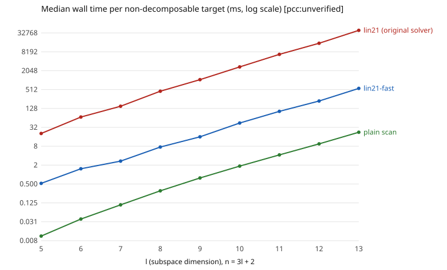

# Pilot: wall-time gap between the `lin21` SAT arm and the plain 2+1 scan (2026-11-16)

Pilot at toy sizes in a shared 4-core container with another CPU-heavy agent. Every number
here is an unverified pilot assertion, tagged `[pcc:unverified]`. No benchmark record,
leaderboard row or pcc claim. Protocol committed alone before the first measured row:
[`PROTOCOL.md`](PROTOCOL.md), commit `dfe87cd298` (2026-11-16T02:55:26Z; the measured run
started 02:56:01Z). All tables: [`tables.md`](tables.md). Raw rows: `raw/rows.jsonl`, merged
verbatim into `results.json`. Figure: `fig_wall_vs_l.svg`.

**Decision by the pre-registered rule: gap closes, inside the A/A band.** With the modified
solver copy (`lin21-fast`), the median wall time per non-decomposable target is 20.6, 23.7,
24.5 and 23.2 times the plain scan's at l = 9, 10, 11, 12 (threshold 30; the original `lin21`
rerun in the same binary: 1,364 to 1,613 times). Verdicts equal the pair oracle on all 822
rows, no censored row. The margin is not robust to the noise of this machine: the per-target
A/A ratio (second `lin21-fast` run / first) spans [0.58, 1.51] over l = 9..12, so 30 lies
inside ratio x A/A-range at every l, and single targets reach 28 to 34 times the scan.
[pcc:unverified]

What this is and is not: `lin21-fast` decides the same instances with the same search
skeleton and the same conflict counts as `lin21`, at 61 to 70 times less wall time than the
original solver at l = 9..12. It is still 21 to 25 times slower than the plain native scan of
the same leaves, with no trend toward parity (slope +0.057 bits per unit of l over l = 9..12).
The best arm in the file is the scan, as before; nothing here changes an index-calculus cost
or the distance to Pollard rho.

## Step 1: profile of the original solver (before any change)

Seed 777 (not a measured seed), one non-decomposable target per size, `lin21` in the profiling
copy `lincdcl_prof.rs` (the original plus timers and counters, generated by `prof.sed`).

| l | wall s | conflicts | GJE calls per conflict | row XORs per conflict | words per conflict | gje_eliminate | gje_scan_explain | gje_build | gate_inject | analyze | clause_prop | backtrack |
|---|---|---|---|---|---|---|---|---|---|---|---|---|
| 9 | 1.12 | 773 | 5.2 | 5 306 | 61 752 | 39.6 % | 41.4 % | 9.7 % | 2.9 % | 2.9 % | 0.5 % | 1.2 % |
| 10 | 2.76 | 1 527 | 5.1 | 7 511 | 94 271 | 43.3 % | 37.7 % | 8.9 % | 2.9 % | 2.8 % | 0.9 % | 1.7 % |
| 12 | 15.76 | 6 150 | 5.0 | 10 390 | 154 426 | 42.3 % | 40.3 % | 6.7 % | 2.6 % | 2.5 % | 2.3 % | 1.7 % |

Two phases carry the time: the full re-elimination (42 %, plus 7 to 10 % to rebuild the
matrix) and the conflict/unit scan with eager explanations (40 %: at l = 12, 815 739
explanations with 56.5 million literals, 69 each, sorted and deduplicated). Watch lists,
learning, analysis and branching are below 3 % each. The measured targets give the same
shares (`tables.md`, "Time shares by phase": 41 % and 41 to 44 % at l = 9..12).

Ceilings stated before the changes: removing re-elimination and rebuild alone at most 2.0x;
removing eager explanation alone at most 1.7x; both at most about 9x, because the remaining
11 % (gate injection, analysis, clause propagation, backtracking) stays. Reaching 30x of the
scan needed 47x, so the remaining phases had to shrink too.

## Step 2: the modified copy (`fastcdcl.rs`), every change against the original

Original: `examples/pdp_lin_cdcl.rs`, sha256
`996770f4b4ecbc84c451203f6edce5cb17ac40b44892def19d06ca63bc0d2f47`, included unchanged as the
baseline arm.

- C1 incremental Gauss-Jordan: one reduced row-echelon matrix over all variables per decision
  level; a decision copies the current level's matrix (checkpoint stack), a backtrack drops
  levels. The original re-eliminated every active row at every propagation fixpoint.
- C2 assignments enter as unit rows for literals the XOR engine did not imply itself; a
  variable is implied exactly when its pivot row has no other variable.
- C3 bit-packed rows (variable words + 1 mask word), XOR limited to the non-zero word range of
  the source row, and a column index (rows containing each variable) kept by column
  operations, so a new pivot is eliminated without scanning the matrix.
- C4 lazy explanations cut at unit literals: each decision or clause-propagated literal above
  level 0 gets a slot (bit) in the mask word; masks are OR-ed through row operations and gate
  rows (a superset of the supporting decisions, sound as a reason); literals are produced only
  inside conflict analysis. Bit 63 is a sound overflow fallback (never used in these runs).
  Learnt clauses therefore contain decisions and clause-propagated literals only.
- C5 the level-0 matrix (static rows, independent of x1) is eliminated once and inherited.
- C6 gate linearisation folds values: z = a * y by one field multiplication when y is fully
  assigned; y = z / a by one inversion and multiplication when a != 0 and z is fully assigned;
  otherwise the n gate rows with the assigned bits of y substituted.
- C7 pivot of a new row: its highest-index variable (the original eliminates in lowest-index
  order).
- C8 `add_clause` only runs clause propagation at build time; the XOR engine starts in
  `solve()`.
- C9 watch lists are compacted in place.
- A popcount-free single-variable test (the default x86-64 target has no POPCNT).

Not changed: first-UIP learning on every conflict, all learnt clauses kept, backjumping,
priority/activity/lowest-index branching, phase saving, no restarts, gate semantics. Not
implemented from the candidate list: Gray-code order over x1 and a learning-free leaf (both
change the search), multi-word fields.

Tuning (seed 777 only, before the protocol), wall of one l = 10 target against a scan of
1.76 to 1.86 ms: v1 (C1, C2, C5, exact combination masks, linear scan for pivot rows) 132 ms;
v2 (+ C6, OR masks) 94 ms; v3 (+ column index, unit-cut masks, in-place watches) 55 ms;
popcount-free test 39 to 41 ms. Pivot settings static/dynamic at l = 10 and 12:
high/high 41 and 245 ms, low/high 50 and 281, high/low 44 and 298, low/low 58 and 369.

## Step 3: measured rows [pcc:unverified]

Same targets and seed as the lin21 pilot (its `raw/targets_l*.jsonl`, 168 targets) plus the
extension cell l = 13 (6 non-decomposable + 2 planted, same generator and seed). One process
per target, one at a time: `scan` (median of 21 repeats), `lin21-fast`, `lin21` (original),
`lin21-fast` again (A/A). Medians over the non-decomposable uniform targets, ms:

| l | n | targets | scan | lin21 | lin21-fast | fast / scan | lin21 / scan | lin21 / fast | fast / scan paired [min, max] | A/A second/first [min, max] |
|---|---|---|---|---|---|---|---|---|---|---|
| 5 | 17 | 16 | 0.0109 | 20.4 | 0.523 | 47.9 | 1866 | 39.0 | 48.5 [39.7, 66.5] | 0.90 [0.62, 0.98] |
| 6 | 20 | 16 | 0.0381 | 68.3 | 1.53 | 40.1 | 1794 | 44.7 | 40.1 [36.6, 49.4] | 0.95 [0.63, 1.25] |
| 7 | 23 | 16 | 0.108 | 151 | 2.68 | 24.9 | 1394 | 56.1 | 26.0 [23.6, 32.7] | 0.93 [0.51, 1.67] |
| 8 | 26 | 16 | 0.304 | 453 | 7.54 | 24.8 | 1493 | 60.2 | 24.7 [23.4, 33.4] | 0.99 [0.55, 1.47] |
| 9 | 29 | 16 | 0.778 | 1061 | 16.0 | 20.6 | 1364 | 66.3 | 21.0 [20.0, 28.2] | 0.98 [0.61, 1.51] |
| 10 | 32 | 16 | 1.86 | 2704 | 44.0 | 23.7 | 1456 | 61.5 | 23.3 [21.6, 34.1] | 0.89 [0.59, 1.42] |
| 11 | 35 | 16 | 4.22 | 6785 | 104 | 24.5 | 1606 | 65.5 | 24.5 [21.5, 32.4] | 0.99 [0.58, 1.28] |
| 12 | 38 | 16 | 9.52 | 15358 | 221 | 23.2 | 1613 | 69.6 | 22.7 [20.6, 33.5] | 1.00 [0.70, 1.38] |
| 13 (extension) | 41 | 6 | 22.3 | 39631 | 558 | 25.0 | 1777 | 71.1 | 23.4 [21.7, 28.0] | 0.95 [0.82, 1.13] |

Conflicts: `lin21-fast` equals `lin21` on all 134 non-decomposable targets (medians 46, 99,
182, 382, 774, 1527, 3066, 6150, 12351) and on 155 of all 176 targets; on decomposable targets
the sums differ by at most 4 in a cell (table in `tables.md`).

Gauss work, median 64-bit words touched by row operations per target:

| l | scan | lin21-fast rows | lin21-fast column index | lin21-fast checkpoint copies | lin21 (original) | fast rows+index / scan | lin21 / fast rows+index |
|---|---|---|---|---|---|---|---|
| 9 | 155 784 | 1 153 806 | 496 282 | 4 170 812 | 48 433 988 | 10.6 | 29.4 |
| 10 | 381 767 | 3 610 328 | 1 228 905 | 10 287 907 | 142 214 931 | 12.7 | 29.4 |
| 11 | 936 815 | 8 547 140 | 3 205 405 | 25 302 830 | 358 422 944 | 12.5 | 30.5 |
| 12 | 2 311 670 | 20 483 452 | 9 106 856 | 55 095 641 | 906 697 941 | 12.8 | 30.6 |
| 13 | 5 461 514 | 41 978 766 | 20 883 130 | 132 177 925 | 2 166 330 451 | 11.5 | 34.5 |

(Original counted by the profiling copy: all 16 targets at l <= 9, 4, 3, 3, 4 targets at
l = 10..13.) Row XOR counts: about 7 `lin21-fast` row operations per scan row operation.

Where `lin21-fast` spends its time (share of its phase timers): gate rows 70 to 75 % at
l = 9..12 (the leaf elimination and the u-from-w solve), checkpoint copies about 6 %, unit rows
5 to 6 %, branching 3 to 4 %, analysis 2 %, clause propagation 5.7, 6.4, 8.8, 13.2 % at
l = 9, 10, 11, 12 and 23.2 % at l = 13. Learnt clauses are never deleted, so this share keeps
growing; the ratio to the scan should be expected to rise beyond l = 13 unless that is
addressed.

Slopes on medians, bits per unit of l: log2(lin21-fast / scan) +0.057 over l = 9..12 (+0.053
with l = 13); wall time over l = 9..13: scan 1.204, lin21-fast 1.258, lin21 1.295.

## Step 4: decision and predictions

Rule (PROTOCOL.md): "gap closes" if the `lin21-fast` median wall is <= 30 times the scan's at
every l in 9..12 with verdicts identical to the oracle and no censored row. Outcome: **gap
closes**; largest ratio 24.5 (l = 11). By the protocol's own clause it is reported as decided
by the rule but within the A/A band: ratio x per-target A/A [min, max] is [12.6, 31.1],
[13.9, 33.7], [14.2, 31.4], [16.2, 32.0] at l = 9..12. With the per-cell A/A medians (0.98,
0.89, 0.99, 1.00) the ratios are 20.1, 21.0, 24.3, 23.2. The extension cell l = 13 gives 25.0.

| # | Prediction | Result |
|---|---|---|
| 1 | fast / scan in [17, 27] at l = 9..12; 25 to 60 at l = 5..8; rule outcome "gap closes" with a thin margin | 20.6 to 24.5: inside. l = 5, 6: 47.9, 40.1 inside; l = 7, 8: 24.9, 24.8, just under the range |
| 2 | slope of log2(fast / scan) over l = 9..12 in [-0.10, +0.10] | +0.057: inside |
| 3 | lin21 / lin21-fast 55 to 90 at l = 9..12 | 61.5 to 69.6: inside |
| 4 | conflicts equal on >= 90 % of non-decomposable targets; decomposable sums within 5 % | 134 of 134; largest difference 4.3 % (l = 6, 92 against 88) |
| 5 | Gauss words fast / scan 9 to 15; lin21 / fast 25 to 35 | 10.6 to 12.8 and 29.4 to 34.5 at l = 9..13; at l = 5, 6 the second ratio is 23.2, 20.7 |
| 6 | A/A per-cell median in [0.9, 1.1]; single targets within 40 % | missed: median 0.885 at l = 10; single targets from 0.51 to 1.67 |
| 7 | l = 13: ratio in [17, 30] | 25.0: inside |

## Checks

- Selftest (`raw/selftest.jsonl`, rerun at every build): exhaustive over all rational targets
  outside V at (n, l) = (11, 3), (8, 3), (7, 3), sampled at (14, 4), (17, 5), (20, 6): 1 753
  targets; pair oracle = scan = original `lin21` = profiling copy = `lin21-fast`: 0 verdict
  mismatches; 112 `lin21-fast` models, all in V^3 and algebraically valid, all lifting to
  points that sum to the target on admissible targets.
- Measured rows: 822 rows on 176 targets, 0 verdicts different from the pair oracle, 0
  censored, 192 SAT models all lifting to curve points with a signed sum equal to the target
  (flags recomputed by `summary.rs` from the binary's fields).
- The profiling copy equals the unmodified solver in conflicts, decisions, propagations and
  GJE calls on all 118 targets where both ran.
- `run.sh` compares `base_lin21_verbatim.rs` with lines 16..862 of the pilot's `lin21.rs` and
  `lincdcl_prof.rs` with `prof.sed` applied to the original, byte for byte, at every build.

## Deviations

1. The first launch of the measured run (02:55:36Z) died in the shell before any binary ran
   (the output directory was created by a backgrounded command and did not exist yet). No row
   was produced. Relaunched at 02:56:01Z.
2. `summary.rs` was changed after the measured run: 6 lines that print the protocol's
   A/A-band statement per l (sha256 34d8e712... in the protocol, now 41942003...). No existing
   number or rule changed; nothing else was touched after the protocol.
3. The coordinating session's snapshot commits `e0fdc0a272` (02:31Z) and `7a808c71b6` (02:40Z)
   contain early development versions of files in this directory. They are not the frozen
   files (whose hashes are in the protocol) and were not made by this session; the protocol
   commit contains `PROTOCOL.md` only.
4. Stretch not run: no multi-word field blocks, no n = 131 run on the ECC2K-130 curve. Time
   went to steps 1 to 4 and the l = 13 cell.
5. A timer placement error in the first version of `prof.sed` (the clause-propagation timer
   was accumulated inside the loop) was found and fixed before the protocol; the protocol's
   and this file's profile come from the fixed version.
6. The orchestration script as a whole ran 11 minutes (l = 5..12) and 8 minutes (l = 13); each
   process stayed below the 600 s cap (the l = 13 processes with the profiling copy are the longest, under 2 minutes each).
7. Arm order inside a process is fixed (scan, lin21-fast, lin21, lin21-fast). The second
   `lin21-fast` run is a little faster in the median (0.89 to 1.00), so the first run, which
   the rule uses, is the less favourable one.
8. No research-kb query, lead-atlas read or Conductor task: this subagent has neither tool and
   may only write in this directory. The session-log entry is in `SESSION_LOG_ENTRY.md` for
   the parent to append. No PDF or PNG: the task asked for an SVG written by Rust.
9. Rust files written through the editor were reformatted by a formatter hook; the hashes in
   the protocol are those of the formatted files.

## Not covered

Other curves, fields, subspaces or n/l ratios; m > 3; the chained `lin` encoding; external
solvers; restarts and clause deletion (the growing clause-propagation share is unaddressed);
Gray-code enumeration and a learning-free leaf; a batch block assignment or a leaf-specific
elimination that would cut the remaining 12x in Gauss words; a native target CPU (the build
is plain `rustc -O`, SSE2 only, for all arms); repeated runs per target; any machine without
a second heavy job; multi-word fields and ECC2K-130; any size at which the scan itself
matters for an index-calculus cost; the gap to Pollard rho.

## Files and rerun

`fastcdcl.rs` (the modified solver), `l21fast.rs` (harness, selftest), `lincdcl_prof.rs` +
`prof.sed` (profiling copy), `base_lin21_verbatim.rs` (verbatim extract of the pilot's
`lin21.rs`), `summary.rs` (tables, decision, SVG), `run.sh` (thin orchestration),
`PROTOCOL.md`, `raw/` (rows, job lists, selftest, l = 13 targets, logs), `results.json`,
`tables.md`, `fig_wall_vs_l.svg`.

Rebuild and rerun the smallest cell (about 30 s, selftest included; reproduces the l = 5 counters):

    research/sat_native_lin21_fast_20261116/run.sh /tmp/l21fast-l5 5

Full rerun: `run.sh OUTDIR` (about 11 minutes, one process); extension cell: copy
`raw/targets_l13.jsonl` to `OUTDIR/raw/` and run `run.sh OUTDIR 13`.
