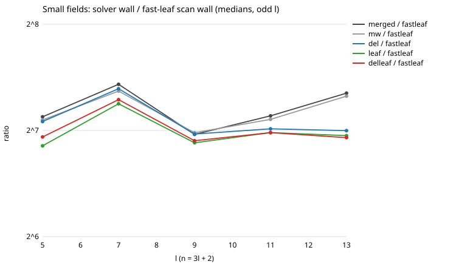
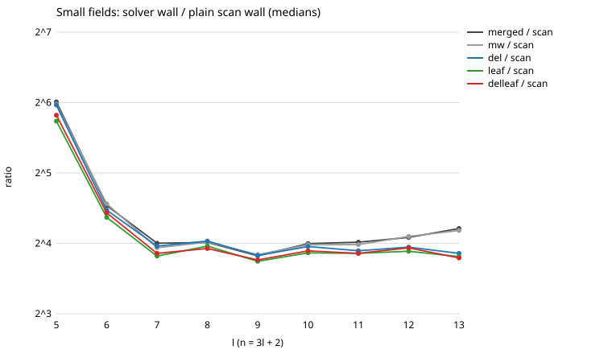
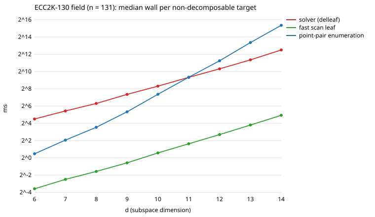

# Pilot: native `lin21` CDCL with clause deletion, a learning-free leaf, and n = 131 (2026-11-16)

Local pilot on a shared 4-core container with another CPU-heavy agent. Every number here is an
unverified pilot assertion, tagged `[pcc:unverified]`. No benchmark record, leaderboard row or
pcc claim; wall times are indicative and the A/A band is given with them. Protocol committed
alone before the first measured row: [`PROTOCOL.md`](PROTOCOL.md), commit `8fce46bd83`
(2026-11-16T05:38:50Z; first measured process 05:39:27Z, `raw/started_utc.txt`). All tables:
[`tables.md`](tables.md); raw rows: `raw/rows_small.jsonl`, `raw/rows_k130.jsonl`, merged
verbatim into `results.json`. All computation, checks, tables and figures are Rust.

**Small fields, decision by the pre-registered rule: inconclusive.** With deletion and/or the
learning-free leaf the slope of log2(solver wall / fast-leaf scan wall) over l = 9, 11, 13 is
+0.008 (`del`), +0.017 (`leaf`), +0.007 (`delleaf`) per unit of l, inside ±0.03, against +0.097
for the solver as merged; but the ratio at l = 13 is 128, 124 and 122, above the threshold 60
(merged: 163). The growth of the ratio stops; the level does not move below about 120 times
the fast scan leaf. [pcc:unverified]

**ECC2K-130 field (n = 131), d = 6..14:** the solver with three-word blocks decides every
target with the verdict of the fast scan leaf and of point-pair enumeration (90 targets, 0
differences, 18 of 18 planted targets SAT with models that lift and sum to the target). It uses
2.73 to 3.05 times A conflicts per non-decomposable target (0.045 times the pair count C(A, 2)
at d = 8, where the repository's CryptoMiniSat panel reports 36.7; 0.0030 times at d = 12). In
wall time it is 187 to 271 times slower than the fast scan leaf at every d, and its wall equals
that of point-pair enumeration at d = 11 (ratio 0.99), 0.52 at d = 12, 0.14 at d = 14.
[pcc:unverified]

Nothing here changes an index-calculus cost or the distance to Pollard rho: the fast scan leaf
is the best arm in every cell of both series.

## Changes (lead A and lead B), all in `fastcdcl_mw.rs`

Copy of `research/sat_native_lin21_fast_20261116/fastcdcl.rs`, sha256 of the original
`ef88dca6020ceaefe1b14341a864037cd4e82787062330676ebd140aefcb3c05` (included unchanged as arm
`merged`). Every change:

- M1 multi-word field blocks. Field values are `[u64; W]` (const generic) instead of `u64`:
  `irr`, `gf_mul`, `gf_inv`, `mul_matrix`, `sq_matrix`, `add_linear_map`, `block_value`,
  `model_block`; in `linearise` the known operand, the multiplication-row cache (a vector of n
  blocks instead of `[u64; 64]`), the assigned-bit masks and the packing of a block into a row.
  n <= 64 W - 1; n = 131 uses W = 3. The solver's own field arithmetic stays bit-serial (one
  product or inversion per gate linearisation).
- M2 learnt-clause deletion (`delete_keep = Some(k)`): after a learnt clause is added, the
  oldest learnt clauses beyond the k newest are deleted unless they are the reason of an
  assigned literal; watch entries are removed in order and clause slots reused. Arm `del` uses
  k = 64 (the skeptic's patch kept 1 or 64).
- M3 learning-free leaf (`leaf_nolearn`): when a conflict occurs while every decision on the
  trail except possibly the topmost is a priority (x1) variable, analysis and learning are
  skipped; the solver backtracks one level and asserts the negation of the topmost decision
  with reason `Flip`, the decision clause over the decisions below it (at level 0: a fact).
  Other conflicts are analysed and learnt from as before; a `Flip` reason is expanded in the
  analysis to the negated lower decisions. Arm `leaf`; arm `delleaf` = M2 + M3.
- M4 counters (`deleted_clauses`, `chrono_flips`, `max_live_learnts`).

With W = 1 and both switches off (arm `mw`) the search is the original's: conflict counts equal
on every one of 2,800 differential instances and 176 measured targets.

Also new: `mw.rs` (generic-width field with the pclmulqdq intrinsic when the build enables it
and a portable fallback, checked against each other at every build; curve; fast-leaf port;
point-pair enumeration), `n131.rs` (harness), `summary.rs`, `run.sh`.

## Differential tests (before any measured row; rerun at every build)

- n <= 63 (`dt`, seed 991): 2,800 fresh instances at (n, l) = (10,3), (12,3), (13,3), (14,4),
  (15,4), (17,5), (20,6), l = 3..6 (1,400 planted, 1,447 decomposable). Arms `mw`, `del`,
  `del1` (keep 1), `leaf`, `delleaf` against the unmodified fastcdcl and the pair oracle:
  **0 verdict mismatches**; 7,235 models checked, 0 bad, 0 non-liftable on admissible targets.
  Conflict count different from fastcdcl's: `mw` 0, two-word `mw` 0, `del` 0, `del1` 0,
  `leaf` 1, `delleaf` 1 instance. [pcc:unverified]
- multi-word (`dtmw`, seed 992): 11 cells from (W, n, d) = (1, 17, 5) to (3, 131, 6), including
  n = 67 and 71 with W = 2 and 3; 210 targets (105 decomposable); solver arms `mw`, `delleaf`,
  `del1`, `leaf` against point-pair enumeration and the fast-leaf port: **0 verdict
  mismatches**; 420 models, 0 bad; 0 unverified hits. [pcc:unverified]
- `selfcheck`: pclmulqdq = portable multiply; z^131 + z^8 + z^3 + z^2 + 1 passes the
  prime-degree irreducibility test; A = 10, 17, 34, 74, 131, 252, 519 at d = 4..10, the values
  behind the pair counts of `RESEARCH_ECC2K130_RR_SOLVER_PANEL.md` section 11.

## Small-field series [pcc:unverified]

Curve y^2 + xy = x^3 + x^2 + 1, n = 3l + 2, the lin21 pilots' target files (seed 20261116; 16
non-decomposable targets per cell, 6 at l = 13). Medians over non-decomposable targets, ms.
`scan` = the lin21 harness's plain scan (`scan21`, bit-serial field). `fastleaf` = the port in
`mw.rs` of the BASELINE arm of `research/scan_floor_leaf_20261116/scan_leaf.rs` (itself a port
of the repository's `lin21-ht` leaf): batched t stage, half-trace elimination, root split,
membership and group verification; here with the field polynomial `find_irr(n)` so that the
targets are the same. It needs n odd, so it exists at l = 5, 7, 9, 11, 13 only.

| l | scan | fastleaf (ns/leaf) | merged | del | leaf | delleaf | conflicts (every arm) |
|---|---|---|---|---|---|---|---|
| 9 | 1.090 | 0.124 (240) | 15.45 | 15.48 | 14.62 | 14.82 | 774 |
| 10 | 2.470 | n/a | 39.42 | 38.31 | 36.00 | 36.73 | 1527 |
| 11 | 5.760 | 0.662 (330) | 93.22 | 85.66 | 83.56 | 83.54 | 3066 |
| 12 | 12.84 | n/a | 217.8 | 197.9 | 190.0 | 196.5 | 6150 |
| 13 | 28.63 | 3.248 (396) | 530.3 | 415.2 | 401.9 | 396.8 | 12351 |

Ratios, solver wall / plain scan wall and (in brackets) solver wall / fast-leaf wall:

| l | merged | del | leaf | delleaf |
|---|---|---|---|---|
| 9 | 14.2 (125) | 14.2 (125) | 13.4 (118) | 13.6 (120) |
| 10 | 16.0 | 15.5 | 14.6 | 14.9 |
| 11 | 16.2 (141) | 14.9 (129) | 14.5 (126) | 14.5 (126) |
| 12 | 17.0 | 15.4 | 14.8 | 15.3 |
| 13 | 18.5 (163) | 14.5 (128) | 14.0 (124) | 13.9 (122) |
| slope vs fastleaf, l = 9, 11, 13 | +0.097 | +0.008 | +0.017 | +0.007 |
| slope vs scan, l = 9..13 | +0.086 | +0.005 | +0.015 | +0.010 |

- Conflicts equal to `merged` on all 134 non-decomposable targets for every arm; on all 176
  targets: `mw` 176, `del` 176, `leaf` 174, `delleaf` 174.
- Clause-propagation share of the solver's phase timers at l = 9 / 11 / 13: `merged` 5.6 / 8.4 /
  20.8 %, `del` 3.3 / 2.5 / 2.2 %, `leaf` 2.0 / 1.6 / 1.5 %.
- A/A (`merged-b` / `merged`, per target): cell medians 0.97 to 1.01; single targets from 0.36
  (one target at l = 8) to 1.57; at l = 9..13 from 0.79 to 1.21. The wall difference between
  `merged` and the three arms at l = 13 (530 against 397 to 415) is outside that cell's band
  [0.98, 1.11]; at l = 9 and 10 the arms are inside the band of `merged`.
- The plain scan measured 1.09 to 28.6 ms here against 0.78 to 22.3 ms in the lin21-fast pilot
  (machine load), so its ratios (14 to 18) are lower than that pilot's 21 to 25 for the same
  solver; the fast-leaf port is 8.7 to 8.8 times faster than the plain scan at l = 9, 11, 13.
- Exactness: 1,232 scan and solver rows, 0 verdicts different from the pair oracle; 252 SAT
  models, 0 fail (in V^3, chain equations, lift, signed sum = target); the fast-leaf port's
  verdict equals the pair oracle on 90 of 90 rows; no censored row.

**Rule:** "ratio flattens" needs |slope| <= 0.03 and ratio at l = 13 <= 60 for some arm; "does
not flatten" needs slope > +0.05 for all three. Outcome: **inconclusive**. The slope condition
is met by all three arms, the level condition by none (122 to 128).

| # | Prediction | Result |
|---|---|---|
| 1 | `mw` = `merged` in conflicts on every target; other arms on >= 95 % of non-decomposable targets | 176 of 176; 134 of 134 each |
| 2 | clause-propagation share at l = 13: merged 18 to 30 %, del <= 5 %, leaf/delleaf <= 4 % | 20.8 %, 2.2 %, 1.5 %: inside |
| 3 | ratio to fastleaf at l = 13: merged [120, 200], arms [90, 160]; arm slopes in [-0.10, +0.06]; merged slope in [0, +0.12]; rule outcome inconclusive | 163; 122 to 128; +0.007 to +0.017; +0.097; inconclusive: all inside |
| 4 | ratio to plain scan at l = 13: merged [15, 27], delleaf [11, 20] | 18.5, 13.9: inside |
| 5 | fastleaf 230 to 300 ns/leaf at n = 29, 380 to 520 at n = 41 | 240, 396: inside |
| 6 | A/A cell medians in [0.9, 1.1]; single targets in [0.6, 1.6] | medians inside; single targets missed (0.36 at l = 8) |

## ECC2K-130 series [pcc:unverified]

Curve y^2 + xy = x^3 + 1 over F_2[z]/(z^131 + z^8 + z^3 + z^2 + 1); curve from
`ecc2k130/codegen/curves.py` (`CurvePb`, used by `research/nagao_relations/solver_16/weil.py`),
polynomial from `ecc2k130/benchmarks/sparse-basis-compound/PROTOCOL.md` (f_1), both confirmed by
the panel's A values. V = degree < d. 8 uniform (non-decomposable) + 2 planted targets per d,
seed 20261116. `solver` = `fastcdcl_mw`, W = 3, `delleaf`. `fastleaf` = the same port at W = 3.
`pairs` = point-pair enumeration: all unordered pairs of base points (both signs), x-only
batched additions, test deg x(R - P_i - P_j) < d; it tests about 4 C(A, 2) point pairs.
Medians over the uniform targets, ms.

| d | A | C(A,2) | conflicts | / A | / C(A,2) | solver | fastleaf (ns/leaf) | pairs | solver / fastleaf | solver / pairs | A/A median [min, max] |
|---|---|---|---|---|---|---|---|---|---|---|---|
| 6 | 34 | 561 | 98 | 2.88 | 0.175 | 22.6 | 0.083 (1206) | 1.38 | 271 | 16.3 | 0.94 [0.90, 1.29] |
| 7 | 74 | 2,701 | 202 | 2.73 | 0.0748 | 43.0 | 0.177 (1191) | 4.15 | 242 | 10.4 | 0.98 [0.95, 1.06] |
| 8 | 131 | 8,515 | 387 | 2.95 | 0.0455 | 78.7 | 0.335 (1272) | 11.6 | 235 | 6.79 | 1.00 [0.95, 1.23] |
| 9 | 252 | 31,626 | 764 | 3.03 | 0.0242 | 163 | 0.667 (1322) | 40.3 | 244 | 4.05 | 0.93 [0.80, 1.00] |
| 10 | 519 | 134,421 | 1,543 | 2.97 | 0.0115 | 315 | 1.48 (1425) | 165 | 213 | 1.92 | 0.95 [0.89, 1.13] |
| 11 | 1,023 | 522,753 | 3,071 | 3.00 | 0.00587 | 641 | 3.10 (1513) | 646 | 207 | 0.99 | 1.01 [0.89, 1.21] |
| 12 | 2,002 | 2,003,001 | 6,098 | 3.05 | 0.00304 | 1,268 | 6.45 (1611) | 2,430 | 197 | 0.52 | 1.03 [0.88, 1.12] |
| 13 | 4,137 | 8,555,316 | 12,329 | 2.98 | 0.00144 | 2,605 | 13.9 (1685) | 10,463 | 187 | 0.25 | 1.00 [0.90, 1.05] |
| 14 (extension) | 8,175 | 33,411,225 | 24,559 | 3.00 | 0.00074 | 5,779 | 30.4 (1860) | 41,889 (1 target) | 190 | 0.14 | 0.99 [0.85, 1.08] |

- Slopes of log2(median wall) per unit of d: solver +1.00, fastleaf +1.06, pairs +1.88.
- 144 solver rows on uniform targets: 0 learnt clauses; clause propagation at most 1.3 % of
  the phase timers. Between 0.20 and 0.24 ms per conflict at every d.
- Checks: 90 targets, 0 with any arm off the expected verdict (uniform: UNSAT on all three
  arms; planted: SAT on all three, 18 of 18); 36 solver models, all in V^3, lifting, with a
  signed sum equal to the target; every scan and pair hit verified in the group; no censored row.
- The panel's 36.7 at d = 8 is CryptoMiniSat conflicts on the S'4 Weil-descent encoding per
  C(A, 2); the 0.0455 here is this solver on the lin21 encoding, which makes it walk the 2+1
  scan (2 leaves per liftable x1, 1 conflict per other x1: about 3 A). They are different
  encodings and solvers on the same decision; the comparison of conflict counts says nothing
  about wall time, which is in the table.

What the over-determination changes (n = 131 against 3d <= 42 unknowns per leaf): no leaf of a
non-decomposable target is consistent (0 consistent leaves in every uniform row, against about
1 leaf in 8 in the balanced n = 3l + 2 series), so there is no kernel enumeration and no root
split, and nothing for learning to do. The fast leaf's cost grows only through the field
(1.2 to 1.9 microseconds per leaf). The solver's cost per conflict is set by n and not by d:
it inserts the 131-row gates on rows of 31 words before the contradiction appears, which is
why its ratio to the fast leaf (187 to 271) is higher than in the balanced series (about 120).
Neither arm uses the margin (a leaf cut to about 3d + 20 equations would decide the same).

| # | Prediction | Result |
|---|---|---|
| 1 | conflicts / A: 2.8 to 3.2 at d = 8, 2.9 to 3.15 at d = 12; / C(A,2): 0.042 to 0.050 and 0.0028 to 0.0032; no learnt clause on uniform targets | 2.95, 3.05; 0.0455, 0.00304; 0 learnt: inside |
| 2 | solver / pairs: 4 to 11 at d = 8; 0.35 to 0.75 at d = 12; crossing 1 between d = 10 and 12 | 6.79; 0.52; 0.99 at d = 11: inside |
| 3 | solver / fastleaf: 170 to 330 at d = 8; 150 to 260 at d = 12 | 235; 197: inside |
| 4 | slopes: solver 0.95 to 1.05, fastleaf 1.0 to 1.1, pairs 1.8 to 2.0 | 1.00, 1.06, 1.88: inside |
| 5 | A/A cell medians in [0.9, 1.1] | 0.93 to 1.03: inside |

The predictions were written after development runs on seed 777 with the same shapes
(disclosed in the protocol), so they test reproducibility on fresh targets, not a blind guess.

## Deviations

1. `summary.rs` was changed after the measured run: one added block that prints two counts
   (conflict equality over all targets; learnt clauses on ECC2K-130 uniform rows). sha256
   `7fbfbdd3...` in the protocol, now `98cf19d5...`. `tables.md` gained those two lines and
   nothing else changed; `results.json` is byte-identical before and after (checked with `cmp`).
2. The rule's slope uses l = 9, 11, 13: the fast-leaf port needs the half-trace (n odd), so
   there is no fast-leaf denominator at l = 10, 12. Stated in the protocol before the run.
3. `pairs` is point-pair enumeration with batched additions (about 0.3 microseconds per point
   pair), not the abscissa-pair enumeration with two quadratic solves per pair that defines the
   panel's C(A, 2); it is the faster of the two forms. At d = 14 it ran on targets 0 and 8 only
   (one uniform), as pre-registered.
4. The measured rows were produced by three `run.sh` invocations (small series; d = 6..13;
   d = 14), each under 600 s, one measuring process at a time.
5. `research/scan_floor_leaf_20261116/scan_leaf.rs` does not compile here with rustc 1.97.0
   (type error at its line 1314), so the port's speed is compared with that file's README
   (273 to 428 ns per leaf at n = 29..41; port: 240 to 396), not with a rerun of it.
6. The whole binary, the unmodified `merged` arm included, is built with
   `-C target-cpu=native` (needed for the intrinsic); the earlier pilot built with plain `-O`.
7. No research-kb query, lead-atlas read, Conductor task, benchmark record or PDF: this
   subagent may only write in this directory and is a local pilot. The session-log entry is in
   `SESSION_LOG_ENTRY.md` for the parent to append.
8. The coordinating session's snapshot commit `e57a3d9f60` (05:48:41Z, not made by this
   subagent) contains this directory's sources as they were during the run: `fastcdcl_mw.rs`,
   `mw.rs`, `n131.rs` and the pre-change `summary.rs`, each with the sha256 stated in the
   protocol. This subagent made one commit only, the protocol.

## Not covered

Fast-leaf denominators at even l; l > 13; d > 14; a strictly learning-free solver (the leaf
rule still learns when two non-priority decisions are on the trail: 0 to 64 clauses per
target); deletion policies other than keep-64 (keep-1 only in the differential test);
truncating the over-determined leaf; a fast field multiply inside the solver; restarts and
Gray-code order; repeated runs per target; a machine without a second heavy job; the panel's
own S'4 encoding or CryptoMiniSat rerun here; m > 3; any size at which this bears on an
index-calculus cost; the gap to Pollard rho.

## Files and rerun

`fastcdcl_mw.rs`, `mw.rs`, `n131.rs`, `summary.rs`, `run.sh`, `PROTOCOL.md`, `raw/` (rows,
ECC2K-130 target files, differential-test and selfcheck output, run logs, start times),
`results.json`, `tables.md`, `fig_small_ratio_fastleaf.svg`, `fig_small_ratio_scan.svg`,
`fig_k130_wall.svg`.

Rebuild and rerun the smallest cell (about 30 s: build, selfcheck, both differential tests,
l = 5; reproduces the l = 5 statuses and conflict counts):

    research/sat_native_lin21_n131_20261116/run.sh /tmp/n131-l5 5 ""

Full rerun: `run.sh OUTDIR` (small series about 2 minutes, ECC2K-130 d = 6..14 about 8 minutes;
split as in deviation 4 to keep each invocation under 10 minutes).
