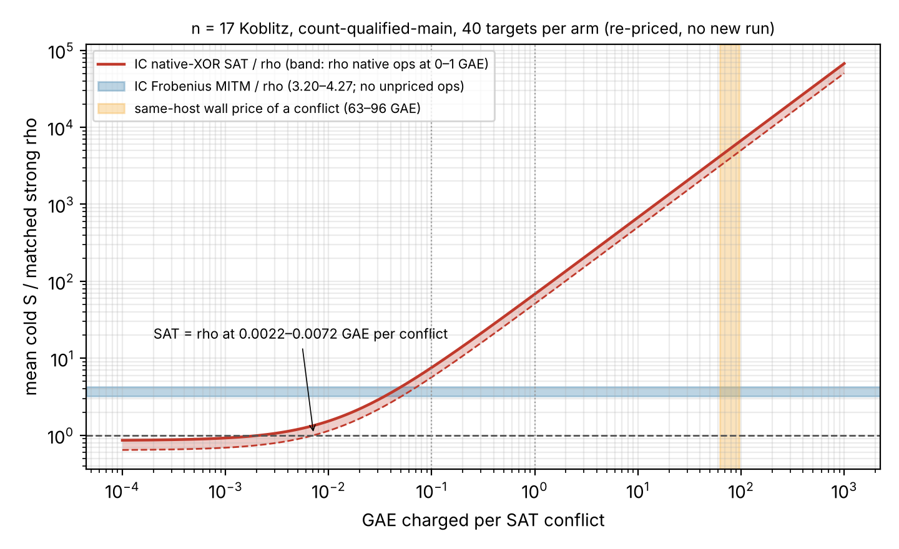

# Native-XOR SAT oracle: the sub-rho reading does not survive pricing its conflicts

Lead `LEAD-ICE-sat-xor-pdp-oracle` (crypto-autoresearcher atlas). Every number here is
an **unverified assertion** `[pcc:unverified]`: no pcc claim has been filed.

**Class:** a derived re-pricing of committed data. No new measurement, no `S` row, no
benchmark record, no leaderboard change.



*Figure:*
- The red curve is mean cold `S` of IC native-XOR SAT divided by matched strong rho, as a
  function of the GAE charged per CDCL conflict.
- Rho's own unpriced native operations are held at the AGENTS.md §5a band: the solid line
  prices them at 0 GAE, the dashed line at 1 GAE.
- The blue band is IC Frobenius MITM over rho, which has no unpriced work.
- The orange span is the price of a conflict implied by the session's own wall times.
- Data: `band.json`, made by `analyze.py` from the committed records.

## Input

`research/ecbench_sat_pdp_20261009/sessions/count-qualified-main/records.jsonl`, session
`ECBS1hb55a1bdabf18`:
- n = 17 Koblitz, r = 65,587;
- 40 measured, verified, non-warm-up runs per arm;
- full-replay receipt `a03b673e…`.

The committed table reports SAT at S = 3.413, a lower bound, which is 0.854 × rho. The SAT row
leaves its solver's conflicts unpriced. Rho leaves its canonicalisations, partition hashes,
table inserts and table queries unpriced.

## Result

**The §5a band (each arm's unpriced operations at w GAE each):**

| w (GAE per op) | SAT S | rho S | SAT / rho | Frobenius MITM / rho |
|---:|---:|---:|---:|---:|
| 0 | 3.41 | 4.00 | **0.854** | 4.27 |
| 0.1 | 30.3 | 4.13 | **7.34** | 4.13 |
| 1 | 272 | 5.34 | **51.0** | 3.20 |

- **The order of SAT and rho flips inside the band.** Under §5a the two arms are therefore
  not ranked. The "SAT below rho" reading holds only at w = 0.
- **Where SAT would equal rho.** The SAT arm records 2,755,966 conflicts in 749 solver calls,
  about 68,900 per target. Rho records 13,788 unpriced operations in all. SAT matches rho only
  if a conflict costs at most **0.0022 GAE**, with rho's operations priced the same, or
  **0.0072 GAE** with rho's operations at 1 GAE.
- **What the session's wall times imply.** These are same-host and descriptive (L0, macOS).
  - The SAT relations phase took 15.1 µs per conflict, aggregated (record median 14.9 µs).
    The solver runs in process (`crate::cryptanalysis::sat`), so this is solver time.
  - Pure group-arithmetic phases in the same session took 158–241 ns per GAE.
  - A conflict therefore costs about **63–96 GAE**. That is 9,000–44,000 × the break-even
    price.
  - At that price, SAT is about **3,100–4,800 ×** rho, with rho's native operations at 1 GAE.
  - The ratio of solve wall times is 41.6 s against 4.7 ms.
- **What the conflict count leaves out.** Conflicts do not count unit propagations or
  Gauss–Jordan XOR work. A per-conflict price is therefore a floor on solver work, not a
  full account of it.

## Reading

The sub-rho row was an accounting gap. A conflict would have to cost about 1/450 of a
group addition for it to stand, and the session itself measures about 60–100 group
additions. This is the same lesson as #1774, where pricing F4's word XORs reversed its
ranking.

The lead's registered discrimination says: "above 1 with conflicts priced closes the
lead at toy scale". It is above 1 at every nonzero price in the band. The fitted α(m)
of the conflict count at m = 3, 4, 5 (H-SATIC-5c526c) would only matter if a conflict cost
less than the break-even price, so it is not needed to close this lead.

**Not claimed:**
- No statement about other encodings, solvers or curve sizes.
- No statement about the m = 83 confidence pair.
- The wall price comes from one L0 host, and §5a ranks nothing from wall time. It only
  places the counted break-even in context.

## Reproduce

```sh
git show origin/main:research/ecbench_sat_pdp_20261009/sessions/count-qualified-main/records.jsonl > /tmp/records.jsonl
python3 analyze.py /tmp/records.jsonl > band.json    # then fix "source" to the repo path
python3 plot.py                                       # band.svg, band.png (matplotlib)
python3 -c "import typst; typst.compile('REPORT.typ', output='REPORT.pdf')"
```
