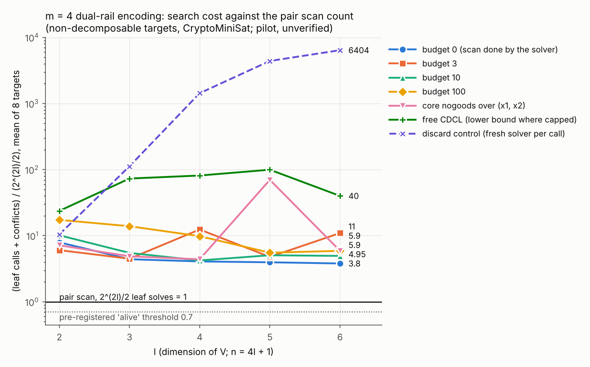

# Lead A: dual-rail encoding at m = 4 (2026-11-15)

Local pilot at toy sizes, one core of a shared 4-core container. Every number here is an
unverified pilot assertion, tagged `[pcc:unverified]`. No benchmark record, leaderboard row,
`benchmarks/` entry or pcc claim. Protocol written before the measured runs:
[`PROTOCOL.md`](PROTOCOL.md). Code: `dr4.py` (m = 4 cell, encoding, DFS, core arm), `sub.py`
(field, curve, CryptoMiniSat wrapper; copied unchanged from
`../../sat_smt_leads_20261114/followup-subcube/`), `validate.py`, `dr4_run.py`, `analyze.py`.
Raw rows: `results.json` (760 rows, merged from `raw/*.jsonl`). All tables: [`tables.md`](tables.md).
Figure: `ratio_vs_l.svg`, `ratio_vs_l.png`.

**Decision by the pre-registered rule: KILL.** At l = 6 every arm has
(leaf calls + conflicts) / (2^(2l)/2) >= 1.0 against the pair scan count; the lowest is 3.80
(budget 0, the scan done by the solver). No run on any non-decomposable target at any size is
below 1. [pcc:unverified]

## Setup

- R = P1 + P2 + P3 + P4 (signs free), x(Pi) in V \ {0}, V = span(1, .., t^(l-1)) in F_{2^n},
  n = 4l + 1, curve y^2 + xy = x^3 + x^2 + B. One curve per size, cell seed 2026111500 + l.
- Chain: d = x1 + x2, q = x1 x2; S3(x1, x2, u) written as q^2 + uq + (ud)^2 + B;
  S3(u, xR, v); S3(x3, x4, v) written as p^2 + vp + (vs)^2 + B; z^2 + sz + p = 0. Every AND gate
  t = a & b carries the m = 3 pilot's rail r = ~a & b with the XOR t + r + b = 0 ("dual").
  "dual2" adds the second rail a & ~b with t + r2 + a = 0.
- 8 non-decomposable and 4 planted targets per cell, the same for every arm.
- CryptoMiniSat 5.18.0 (pycryptosat), one thread, `autodisablegauss=0, sls=0`.

| l | n | factor base, points up to sign | pair scan, 2^(2l)/2 leaf solves | leaves the budget-0 DFS visits | meet in the middle, time and memory | 3-scan enumeration, 2^(3l)/24 |
|---|---|---|---|---|---|---|
| 2 | 9 | 3 | 8 | 6 | 16 and 16 | 3 |
| 3 | 13 | 5 | 32 | 28 | 64 and 64 | 21 |
| 4 | 17 | 10 | 128 | 120 | 256 and 256 | 171 |
| 5 | 21 | 15 | 512 | 496 | 1 024 and 1 024 | 1 365 |
| 6 | 25 | 32 | 2 048 | 2 016 | 4 096 and 4 096 | 10 923 |

The baseline named in every ratio below is the pair scan, 2^(2l)/2 linear leaf solves. The
other two rows are counts for the same targets, not measured arms.

## Soundness fix and validation

- Intermediate x = 0 (the m = 3 pilot's false SAT through twist points): B is drawn so that
  sqrt(B) is not a product of two non-zero elements of V. Then S3(a, b, 0) = (ab)^2 + B has no
  zero with a, b in V, so neither a true decomposition nor a twist-point model has u = 0 or
  v = 0. Clauses: x1, x2, p, u, v non-zero.
- Infinity: targets are not sums of at most 2 signed base points, so no partial sum of a true
  decomposition is the point at infinity; the encoding has no representation of infinity.
- `validate.py 2 3` on the cell seeds (`validation.json`), 24 targets per size, 20 decomposable:
  pair-table truth equals enumeration of all signed quadruples (24 of 24 at l = 2, 12 of 24 at
  l = 3); free solves (plain, dual) agree with truth; 300 SAT models lift to four curve points
  whose signed sum is R; 1 920 leaf answers (x1, x2) equal the enumeration of decompositions
  using that pair; 576 DFS runs (budgets 0, 3, 10, keep and discard, two orders) and 48 core
  runs agree with truth. `dr4_run.py` asserts sat == truth and the lift on every row.
- Not shown: an instance where the old defect would fire. The fix removes the case by the
  choice of B; no B with sqrt(B) in V*V was tested.

## Question 1: conflicts per leaf with (x1, x2) assigned [pcc:unverified]

Non-decomposable targets. Warm = leaf calls of the budget-0 DFS, one incremental solver, every
leaf. Cold = fresh solver per leaf, 16 sampled leaves per target (dual), cap 20 000.

| l | warm, dual: mean | leaves with 0 conflicts | largest leaf | warm, dual2: mean | cold, dual: mean | median | capped | cold, dual2: mean | median |
|---|---|---|---|---|---|---|---|---|---|
| 2 | 9.58 | 0 % | 38 | 7.25 | 13.7 | 11.5 | 0 of 48 | 8.27 | 10 |
| 3 | 4.04 | 22 % | 33 | 5.09 | 143 | 11.5 | 0 of 128 | 26.5 | 3 |
| 4 | 3.35 | 26 % | 117 | 3.92 | 1 942 | 21.5 | 0 of 128 | 134 | 7.5 |
| 5 | 3.09 | 26 % | 1 997 | 2.37 | >= 4 401 | 64.5 | 20 of 128 | 801 | 320 |
| 6 | 2.86 | 26 % | 2 000 | 2.86 | >= 6 403 | 3 | 35 of 128 | 2 373 | 6.5 |

- Warm: yes, O(1) in the mean. 2.9 to 4.0 conflicts per leaf for l = 3..6, falling slightly;
  about twice the m = 3 figure (1.6), which matches one more two-root branch (u, then v).
  Single leaves reach about 2 000 conflicts at l = 5 and 6.
- Cold: no. The mean grows with l and 27 % of sampled leaves hit the 20 000 cap at l = 6, while
  the median stays small. The m = 3 pilot's cold cost was flat near 20. The second rail lowers
  the cold mean (2 373 at l = 6, 36 leaves) and does not make it flat.
- Not diagnosed: why a cold solver fails on a minority of leaves. The warm figure depends on
  state carried between leaves.

## Question 2: search over the 2l coordinates of (x1, x2) [pcc:unverified]

ratio = (leaf calls + conflicts) / (2^(2l)/2), mean of 8 non-decomposable targets; 1 = the pair
scan count. Trend = slope of log2(ratio) over l = 4, 5, 6. ">=" = runs stopped at a conflict cap.

| arm | l=2 | l=3 | l=4 | l=5 | l=6 | trend, bits per l | ratio / budget-0 arm at l=6 |
|---|---|---|---|---|---|---|---|
| keep-B0 (scan done by the solver) | 7.94 | 4.41 | 4.08 | 3.96 | 3.80 | -0.05 | 1.00 |
| keep-B3 | 6.05 | 4.48 | 12.4 | 4.78 | 11.0 | -0.09 | 2.88 |
| keep-B10 | 10.1 | 5.49 | 4.22 | 5.06 | 4.95 | +0.11 | 1.30 |
| keep-B100 | 17.4 | 13.9 | 9.83 | 5.53 | 5.90 | -0.37 | 1.55 |
| core (nogoods over (x1, x2) from final conflicts) | 7.16 | 4.88 | 4.40 | >= 70.0 | 5.90 | not defined (capped at l=5) | 1.55 |
| free CDCL, dual | 23.7 | >= 73.3 | >= 81.4 | >= 99.6 | >= 40 | not defined (capped) | >= 10.5 |
| keep-B0, order x1 then x2 | 7.94 | 5.04 | 4.29 | 3.28 | 4.17 | -0.02 | 1.10 |
| keep-B10, order x1 then x2 | 9.20 | 5.75 | 4.32 | 4.54 | 5.74 | +0.20 | 1.51 |
| keep-B0, dual2 | 6.19 | 5.33 | 4.61 | 3.26 | 3.80 | -0.14 | 1.00 |
| keep-B10, dual2 | 9.42 | 6.61 | 5.00 | 7.36 | 6.38 | +0.18 | 1.68 |
| free CDCL, dual2 | 8.41 | 7.02 | 8.14 | 8.67 | 11.0 | +0.22 | 2.89 |
| free CDCL, plain AND gates | >= 86.4 | >= 100 | >= 100 | >= 100 | >= 20 | not defined (capped) | >= 5.26 |

Discard control (fresh solver per solver call):

| arm | l=2 | l=3 | l=4 | l=5 | l=6 |
|---|---|---|---|---|---|
| disc-B0, full DFS | 10.5 | 112 | 1 433 | not run (protocol) | not run (protocol) |
| disc-B3, full DFS | 15.1 | 117 | not run (protocol) | not run | not run |
| disc-B10, full DFS | 20.3 | 125 | 1 446 | not run | not run |
| disc-B100, full DFS | 30.2 | 171 | not run (protocol) | not run | not run |
| sampled estimate, 1 + cold conflicts per leaf | 14.7 | 144 | 1 943 | >= 4 402 | >= 6 404 |

Readings:

- No arm is below 1 at any size, and no single run on a non-decomposable target is
  (0 of 8 in every cell of the six main arms). The lowest arm at l = 3..6 is budget 0 in one of
  its three variants, at 3.3 to 4.4: one unit per leaf plus 2.9 to 4.0 conflicts per leaf.
- The budget-0 ratio is flat: 4.08, 3.96, 3.80 for l = 4, 5, 6. Its floor is 1 by construction.
- Every arm that lets the solver work above the leaves costs more than the solver's own scan
  at l = 6: 1.30x (B = 10), 1.55x (B = 100, core), 2.88x (B = 3), 2.89x (free, dual2).
- Budget 100 has the only clearly negative trend (17.4 to 5.90, slope -0.37 over l = 4..6). It
  refutes almost everything above the leaves (1.8 leaves visited at l = 6, refutations
  concentrated at depths 5 to 7 of 12), but spends 12 090 conflicts for 2 048 pairs. From
  l = 5 to l = 6 its ratio rose (5.53 to 5.90), and it stayed 1.4x to 3.2x above budget 0.
  Part of the fall is the fixed budget shrinking relative to 2^(2l).
- Subcubes are refuted, as at m = 3, and it does not pay: at l = 6 and B = 10, 323 subcubes of
  dimension 1 to 5 are refuted and 14 leaves visited, for 10 118 conflicts, against 5 770 for
  the full leaf scan.
- Core arm: at l = 6 the final conflict has 9.44 of 12 literals on average, 512 of 2 016 leaves
  are covered by a nogood without a solve, and the conflicts are 1.8x the scan's (10 584 against
  5 770). In some runs a leaf call ends by refuting the whole instance (empty core). At l = 5
  one run hit the 200 000 cap in a single leaf call and another cost 147x; the l = 5 mean is a
  lower bound.
- Free CDCL: with one rail it hits the cap on 5, 6, 7 and 8 of 8 targets at l = 3, 4, 5, 6. With two rails it
  finishes everywhere: 7.02, 8.14, 8.67, 11.0 for l = 3..6, rising, 2.9x the solver's scan at
  l = 6. This is the first unrestricted solve in these pilots within about 10x of a scan count;
  it is still above the count and moving away from it.
- Keep against discard: 3.80 against >= 6 404 at l = 6 (sampled estimate), 4.08 against 1 433 at
  l = 4 (full DFS). The discard arm pays the cold-leaf cost of question 1, so this measures the
  warm solver state, not reuse of subcube refutations.
- Order and second-rail controls for budgets 0 and 10 give the same picture (3.80 to 6.38 at
  l = 6).
- Wall time, secondary, shared machine: keep arms 8.7 to 10.3 s per target at l = 6, core
  13.4 s, free dual2 40 s.

Planted (decomposable) targets, 4 per cell, search stops at the first model; the matching
reference is a scan with early stop, not 2^(2l)/2:

| arm | l=2 | l=3 | l=4 | l=5 | l=6 |
|---|---|---|---|---|---|
| keep-B0 | 1.59 | 2.16 | 0.816 | 1.13 | 1.17 |
| keep-B3 | 1.00 | 2.45 | 0.658 | 1.21 | 14.6 |
| keep-B10 | 2.28 | 7.16 | 0.906 | 2.23 | 1.11 |
| keep-B100 | 6.66 | 9.72 | 5.22 | 9.65 | 1.51 |
| core | 2.62 | 2.17 | 0.939 | 1.29 | 1.99 |
| free, dual | 7.88 | >= 54.9 | >= 87.7 | >= 100 | >= 20 |

## Decision

Rule (PROTOCOL.md): alive if a learning arm is below 0.7 at l = 6 with a negative trend and below
its discard control; kill if every arm is >= 1.0 at l = 6; otherwise inconclusive.

All twelve keep, core and free arms were run on all 8 targets at l = 6 and all are >= 3.80.
**KILL** for this encoding, solver and size range. [pcc:unverified] The distance to the pair
scan count is a factor 3.8 at best, and that best arm is the scan itself performed by the
solver. Against the other counts at l = 6: the budget-0 arm's 7 786 leaves + conflicts are
1.9x the meet-in-the-middle time count (4 096, which also needs 4 096 stored entries; the SAT
arm stores learnt clauses, not counted) and 0.71x the 3-scan enumeration count (10 923); these
are counts in different units, not measured comparisons.

## Deviations and limits

- Development on seed 777000 + l (l = 2..5) before PROTOCOL.md: validation, timing, the cold-leaf
  observation, and the addition of the dual2 encoding. Not kept as rows.
- PROTOCOL.md was amended once before any measured run: the first B draw at l = 2 gave an empty
  factor base and `validate.py` stopped before a solver call; cells now also require at least
  2^(l-2) + 1 base points. Protocol-before-data rests on file times only; there is no git history.
- Two processes were killed from outside (exit 144; other agents on the machine run scripts
  named `run.py`). The l = 5 run was restarted from an empty file under the name `dr4_run.py`.
  The first l = 6 process died after 13 rows; resume support was added and those rows were kept.
- After that kill, to stay inside the time budget, two l = 6 settings were changed without
  looking at l = 6 arm results other than the 13 finished rows: the free-CDCL cap is 20x the
  baseline instead of 100x for targets 2..7 and the planted targets (targets 0, 1 of the dual
  arm ran at 100x; all 8 dual and all 8 plain runs are capped, so the l = 6 means >= 40 and
  >= 20 are lower bounds at mixed caps; free dual2 finished below either cap on all 8), and the
  cold dual2 sample is 4 leaves per target instead of 8 (target 0 has 8).
- l = 6 ran as five processes (targets 0-1, 2-3, 4-5, 6-7, planted) instead of the three in the
  protocol. No row is NOT_RUN.
- The discard control at l = 5, 6 is the sampled estimate, as the protocol states; the full
  discard DFS exists for l = 2, 3 (all budgets) and l = 4 (budgets 0, 10).
- Trends for arms with capped runs are not meaningful and are not quoted (`tables.md` prints
  them mechanically).
- Decision restriction or decision priorities inside CryptoMiniSat: not run, pycryptosat exposes
  neither. The core arm and the budgeted DFS are the substitutes. An external-propagator CaDiCaL
  arm was not run (no native XOR reasoning there).
- Baseline level: 2^(2l)/2 counts every pair; a real pair scan skips x-coordinates that do not
  lift (about half of each), so the baseline is generous to the SAT arms by up to about 4x and
  the KILL is conservative. The driver's own leaf count is 2^l (2^l - 1)/2, 1.6 % under the
  baseline at l = 6.
- One conflict counted as one leaf solve is a convention. Conflict counts are parsed from the
  solver's verbose line by the m = 3 pilot's wrapper and were not cross-checked. Propagation and
  Gauss work are not counted.
- One curve and one seed per size, l <= 6, one solver, one chain (pairing (1,2)(3,4)), one V and
  basis, conflict-limit budgets only. l = 2 is degenerate (3 base points). Not covered: l >= 7,
  proportional budgets, per-node warm refutation cost, a diagnosis of the cold-leaf cost, any
  proof-system statement.
- Not done because this pilot was confined to its directory: `docs/session-logs/` entry,
  Conductor task, research-kb receipt, PDF report, benchmark record.

## Rerun

Smallest cell (l = 2, about 2 s; reproduces `raw/l2.jsonl` exactly apart from wall time):

`python3 dr4_run.py /tmp/dr4_l2.jsonl 300 2 && python3 analyze.py /tmp/dr4_l2.jsonl`

Validation (about 45 s): `python3 validate.py 2 3`. Everything: `dr4_run.py raw/lN.jsonl 540 N`
for N = 2..5, `dr4_run.py raw/l6_a-b.jsonl 540 6 a:b` for the five slices, then
`python3 analyze.py` (rewrites `results.json`, `tables.md` and the figure). `DR4_FULLCAP=1`
restores the protocol's l = 6 caps.
