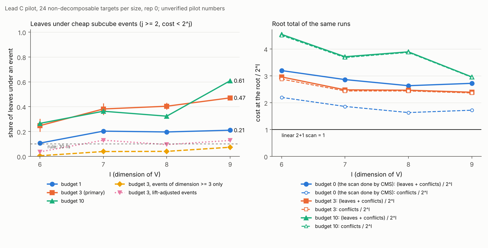
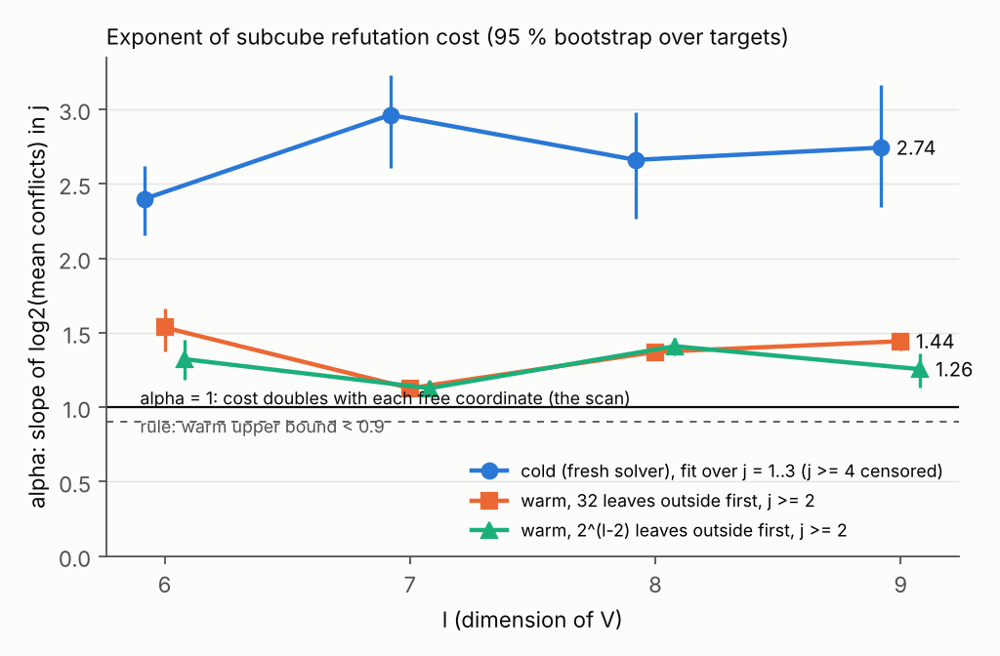

# Lead C: cheap block refutations in the x1-subcube DFS (2026-11-15)

Local pilot at toy sizes in a shared 4-core container. Every number here is an unverified pilot
assertion, tagged `[pcc:unverified]`. No benchmark record, leaderboard row, `benchmarks/` entry or pcc
claim follows from it. Rules were written before the measured runs: [`PROTOCOL.md`](PROTOCOL.md)
(two addenda for the exploratory arm, each written before that arm ran). All tables:
[`tables.md`](tables.md). Aggregates: `results.json`. Raw rows with every DFS node: `raw/*.jsonl.gz`.

Follow-up to [`../../sat_smt_leads_20261114/followup-subcube/`](../../sat_smt_leads_20261114/followup-subcube/README.md)
and its [review](../../sat_smt_leads_20261114/followup-subcube/SKEPTIC.md). Baseline named throughout:
the linear 2+1 scan, counted as 2^l leaf solves. rho = (leaves visited + conflicts) / 2^l.

## The three decisions, by the pre-registered rules

| Item | Rule | Result | Numbers |
|---|---|---|---|
| (2) cheap refutations | "signal" if the share of leaves under events is >= 10 % at l = 9 and not decreasing over >= 3 sizes | **signal, by the letter of the rule** | budget 3: 0.247, 0.382, 0.404, 0.471 at l = 6, 7, 8, 9 (l = 9 interval 0.454..0.490) [pcc:unverified] |
| (3) alpha | "sub-scan exponent" only if the warm alpha upper bound is < 0.9 at l = 9 | **no sub-scan exponent** | warm alpha at l = 9: 1.44 (1.38..1.50) and 1.26 (1.13..1.36) for the two warm-ups [pcc:unverified] |
| (4) budget 3 against budget 0 | real only if outside the A/A 95 % interval at two of l = 6, 7, 8 | **not shown above the A/A floor** | outside at l = 7 only [pcc:unverified] |

What the "signal" in (2) is, in one paragraph. The events are real and reproducible, but they are
dimension-2 subcubes refuted inside a budgeted call after failed attempts at every ancestor, and
they do not reach the total: no arm at any size has a mean rho below 1.68, and no arm spends fewer
than 1.49 conflicts per x1 value on average. At budget 3 the share of leaves under events of dimension >= 3 is 0.5 %,
3.9 %, 4.0 %, 7.4 %, and under events of dimension >= 4 it is 0 at every size. The rule as written
counts marginal events and cannot tell this from a sub-scan mechanism; the reading below does.
[pcc:unverified]

## Setup

- F_{2^n}, (l, n) = (6, 19), (7, 23), (8, 29), (9, 29); curve y^2 + xy = x^3 + x^2 + B from the cell
  seed 2026111500 + l; V = span(1, .., t^(l-1)); factor base = rational points with x in V \ {0}.
  n - (3l - 1) = 2, 3, 6, 3 is not constant: a confound for every trend in l.
- 24 non-decomposable targets per cell and 4 planted ones, the same in every arm. Planted targets are
  reported separately at the end.
- Dual-rail encoding of the earlier pilot with the u = 0 fix; CryptoMiniSat 5.18.0 (pycryptosat), one
  thread, `autodisablegauss=0, sls=0`.
- DFS over x1's coordinates, value 0 first, one warm incremental solver per DFS, conflict limit
  "budget" at every internal node, no limit at leaves. Every node is recorded with the conflicts of
  its own call, the leaves and conflicts beneath it, and CMS's final assumption conflict.
- rep 0 = canonical variable numbering. rep 1, 2, 3 = the same instance with variables renumbered
  and clauses reordered at random. The CMS `seed` option does not change a single conflict count
  here, so renumbering is the A/A device.
- Units: leaves and conflicts. rho' = (solver calls + conflicts) / 2^l is given next to rho because
  under rho a budgeted internal call pays no leaf unit, while a leaf call pays one.

## (1) The u = 0 defect

S3(x2, x3, 0) = 0 reduces to x2 x3 = sqrt(B), which x-coordinates of twist points satisfy as well.
For u != 0 a model forces all three points rational (if x(P2) is rational and P2 is not, Frobenius
maps P2 to -P2, and x(P3) rational then forces 2(P2 + P3) = 0, i.e. u = 0). Fix: the clause "u != 0"
in the SAT instance, and the u = 0 case (R = +-P1 + T, T the 2-torsion point, T a sum of two base
points) decided outside it by `Cell.u0_decomposable`. Decision = SAT or that check.

Validation (`validate.py 3 4`, `validation.json`), against an independent brute force with its own
field arithmetic and y search [pcc:unverified]:

- l = 3 (n = 11) and l = 4 (n = 13), 32 targets each, 9 decomposable in each cell: brute force = pair
  table = triple enumeration = fixed encoding (plain and dual), 128 free solves; 36 SAT models lift
  to points summing to R; 768 per-x1 leaf answers equal the enumeration of decompositions using that
  x1 with x(P2 + P3) != 0; the recording DFS (budgets 0 and 3, canonical and renumbered) agrees, 256
  runs.
- u = 0: 16 constructed instances (l = 3 and 4, including the reviewer's B = 1281) where brute force
  says non-decomposable and the old encoding returns SAT with a model that does not lift; the fixed
  encoding returns UNSAT on all 16. 33 instances that do decompose through u = 0 are decided
  correctly.
- Conflict counter: the count is still parsed from CMS's verbose line. Checked against the conflict
  limit on 16 cold leaves: the smallest limit that returns UNSAT equals the reported count on 7 and
  differs by at most 4 on the rest. Counts are good to a few conflicts per call, not exact.

No measured cell is affected by the fix: `u0_decomposable` is false for every measured target.

## (2) Census of cheap refutations

Event = a DFS node of dimension j >= 2 disposed of for (leaves + conflicts) < 2^j, counting its own
call and everything beneath it. Share of leaves under at least one event, mean of 24 targets
[pcc:unverified]:

| budget | l = 6 | l = 7 | l = 8 | l = 9 |
|---|---|---|---|---|
| 0 | 0 | 0 | 0 | 0 |
| 1 | 0.107 | 0.203 | 0.197 | 0.211 |
| 2 | 0.164 | 0.283 | 0.309 | 0.349 |
| 3 (primary, 95 % interval) | 0.247 (0.198..0.302) | 0.382 (0.335..0.428) | 0.404 (0.377..0.432) | 0.471 (0.454..0.490) |
| 5 | 0.339 | 0.480 | 0.518 | 0.653 |
| 10 | 0.266 | 0.363 | 0.324 | 0.609 |

Renumbered instance (rep 1), budget 3: 0.240, 0.397, 0.393, 0.478. Random coordinate order, budget 3:
0.234, 0.355, 0.412, 0.466. The share grows with l in every arm that attempts subcubes.



The same runs at the root, and how large the events are (rep 0) [pcc:unverified]:

| l | budget | rho | conflicts / 2^l | rho' | share under events | under events of dimension >= 3 | >= 4 | largest event dimension | lift-adjusted share |
|---|---|---|---|---|---|---|---|---|---|
| 6 | 0 | 3.195 | 2.195 | 4.179 | 0 | 0 | 0 | - | 0 |
| 6 | 3 | 2.957 | 2.876 | 3.668 | 0.247 | 0.005 | 0 | 3 | 0.036 |
| 6 | 10 | 4.541 | 4.505 | 5.058 | 0.266 | 0.109 | 0 | 3 | 0.109 |
| 7 | 0 | 2.859 | 1.859 | 3.851 | 0 | 0 | 0 | - | 0 |
| 7 | 3 | 2.477 | 2.435 | 3.119 | 0.382 | 0.039 | 0 | 3 | 0.130 |
| 7 | 10 | 3.710 | 3.679 | 4.113 | 0.363 | 0.250 | 0.016 | 4 | 0.164 |
| 8 | 0 | 2.631 | 1.631 | 3.627 | 0 | 0 | 0 | - | 0 |
| 8 | 3 | 2.464 | 2.436 | 3.098 | 0.404 | 0.040 | 0 | 3 | 0.095 |
| 8 | 10 | 3.891 | 3.870 | 4.320 | 0.324 | 0.176 | 0.003 | 4 | 0.117 |
| 9 | 0 | 2.719 | 1.719 | 3.717 | 0 | 0 | 0 | - | 0 |
| 9 | 3 | 2.388 | 2.361 | 2.992 | 0.471 | 0.074 | 0 | 3 | 0.128 |
| 9 | 10 | 2.958 | 2.942 | 3.291 | 0.609 | 0.514 | 0.098 | 5 | 0.254 |

"Lift-adjusted" counts an event only if its cost is below the number of leaves in the subcube whose
x1 lifts to a rational point; the scan pays next to nothing for the others. No event of dimension
l - 2 or more occurs in any run.

### What the cheap refutations are

1. **They are dimension-2 nodes refuted by their own budgeted call.** At budget 3, l = 9: 1 375 of
   1 488 events are dimension 2, all refuted by their own call; 113 are dimension 3. A budget b can
   only produce an event at a dimension with 2^j > b that the solver happens to finish within b, so
   the event dimension follows the budget (rep 0: largest 3 at budgets <= 3, 5 at budget 10), not l.
2. **They are cheap in conflicts on their own subcube.** On the leaves under maximal events the
   budget-3 DFS spends 0.61, 0.50, 0.56, 0.54 conflicts per leaf (l = 6..9), which is 0.42, 0.35,
   0.39, 0.38 of what the budget-0 DFS of the same target spends on the same subcubes. A dimension-2
   event with two liftable x1 values costs about 2 conflicts in total, where the budget-0 scan pays
   2.5 to 3.8 per liftable leaf.
3. **The work that makes them cheap is paid by failed attempts above them.** The budget-3 DFS
   spends 1.10 to 1.21 conflicts per leaf on calls at dimension >= 3, almost none of which refute
   anything. Dimension-2 attempts succeed in 55 %, 69 %, 72 %, 77 % of cases (l = 6..9) when every
   ancestor was attempted first, and in 31 %, 36 %, 43 %, 42 % when no call is made above dimension
   2 (exploratory arm `j2only`, same targets). The second child of a node succeeds more often than
   the first (0.85 against 0.70 at l = 9).
4. **The x1-only clauses that fire are merges of cubes the DFS has finished.** The final assumption
   conflict of an own-call event contains on average 1.6, 2.3, 2.8, 3.1 of its k = 4, 5, 6, 7 assumed
   coordinates (l = 6..9).
   In 82 to 87 % of budget-3 refutations it is exactly the set of coordinates where the node has
   value 0: the coordinates with value 1 drop out because the 0-branch is already refuted. This
   merge costs no conflict. No 0-conflict event has a conflict on all k coordinates.
5. **0-conflict refutations have a trivial cause.** In the budget-0 scan 25 to 28 % of leaves are
   refuted for 0 conflicts. Every one of them is a class-0 leaf (x1 does not lift, so
   S3(x1, xR, u) = 0 has no root u in the field), and 94 to 99 % lie inside the final-conflict cube
   of an earlier leaf: when the leaves before it in a finished cube are refuted, the clauses force
   the last x1, and Gauss propagation on the stage-1 system finds it inconsistent without a
   decision. Class-0 leaves cost 0.66 to 0.79 conflicts on average, class-1 and class-2 leaves 2.5
   to 3.8. Of budget-3 events refuted for 0 conflicts (338 at l = 9), 72 to 86 % lie inside an
   earlier final-conflict cube. The reviewer's isolated 64-leaf, 0-conflict case is consistent with
   this; it was not re-run.
6. **The events with non-zero cost are not explained by the trivial cause.** Exact classification of
   every leaf (class 0: x1 does not lift; class 1: P1 rational but the affine linear system
   p^2 + up + u^2 s^2 + B = 0 in (s, p) is inconsistent for both u = x(R +- P1); class 2: consistent
   for some u, no split). At budget 3 the share of events whose leaves are all class 0 is 0 %, 9.1 %,
   6.1 %, 8.5 % against a base rate of 0 %, 5.9 %, 4.5 %, 6.5 % over all aligned subcubes of the
   same dimension; all class 0 or 1: 40 %, 66 %, 94 %, 68 % against 39 %, 64 %, 94 %, 61 %. The share
   of class-0 leaves under events is 0.55 to 0.60 against 0.50 to 0.535 overall. Events are slightly
   enriched in non-liftable x1, far from enough to account for them. "Linear stage inconsistent for
   every completion" is the normal state of a 4-leaf block here (base rate 39 to 94 %, because n
   exceeds the 3l - 1 unknowns of (s, p)) and events are not enriched in it, so it does not single
   them out. Each completion has its own u, so this is not one inconsistency shared by the block.
7. **Not determined:** whether the firing clauses are XOR-derived. pycryptosat exposes neither the
   learnt clause database nor clause provenance; clause length here is the size of the final
   assumption conflict.

So: a warm solver does refute 4-leaf blocks for about 2 conflicts, repeatedly, on roughly half the
leaves at l = 9, and this is not a trace-condition artefact. It is bought with conflicts spent in
failed calls on the enclosing cubes, and it stops at dimension 3 to 5.

## (3) Alpha: cost of refuting one subcube against its dimension j

12 targets, 2 random subcubes per (target, j), the same subcube in every arm, cap 50 000 conflicts.
Mean conflicts (multiple of 2^j) [pcc:unverified]:

| arm | l | j = 0 | j = 1 | j = 2 | j = 3 | j = 4 | j = 5 | j = 6 | alpha, j >= 2 (95 % bootstrap over targets) |
|---|---|---|---|---|---|---|---|---|---|
| cold | 6 | 18 | 75 | 386 (96x) | 2 096 (262x) | >= 10 114, 2 of 24 at the cap | 8 of 24 at the cap | - | undefined; j = 1..3: 2.40 (2.15..2.62) |
| cold | 7 | 38 | 85 | 756 (189x) | 5 187 (648x) | >= 19 164, 5 capped | 14 capped | - | undefined; j = 1..3: 2.96 (2.61..3.23) |
| cold | 8 | 46 | 148 | 1 037 (259x) | 5 920 (740x) | >= 21 821, 5 capped | 20 capped | - | undefined; j = 1..3: 2.66 (2.27..2.98) |
| cold | 9 | 10 | 80 | 885 (221x) | 3 568 (446x) | >= 15 735, 1 capped | 10 capped | - | undefined; j = 1..3: 2.74 (2.35..3.17) |
| warm, 32 leaves first | 6 | 1.5 | 3.4 | 7.2 (1.8x) | 14.7 (1.8x) | 46.4 (2.9x) | 172 (5.4x) | - | 1.54 (1.37..1.66) |
| warm, 32 leaves first | 7 | 2.0 | 3.0 | 6.6 (1.7x) | 14.0 (1.7x) | 27.4 (1.7x) | 70.5 (2.2x) | 146 (2.3x) | 1.13 (1.07..1.19) |
| warm, 32 leaves first | 8 | 2.2 | 2.6 | 5.6 (1.4x) | 11.9 (1.5x) | 39.4 (2.5x) | 84.2 (2.6x) | 243 (3.8x) | 1.37 (1.32..1.42) |
| warm, 32 leaves first | 9 | 1.6 | 3.1 | 6.0 (1.5x) | 12.0 (1.5x) | 33.3 (2.1x) | 110 (3.4x) | 293 (4.6x) | 1.44 (1.38..1.50) |
| warm, 2^(l-2) leaves first | 6 | 1.9 | 3.2 | 6.7 (1.7x) | 17.3 (2.2x) | 37.0 (2.3x) | 110 (3.4x) | - | 1.32 (1.18..1.45) |
| warm, 2^(l-2) leaves first | 7 | identical to the 32-leaf arm (2^(l-2) = 32) | | | | | | | 1.13 (1.07..1.18) |
| warm, 2^(l-2) leaves first | 8 | 2.1 | 2.6 | 5.6 (1.4x) | 11.9 (1.5x) | 37.7 (2.4x) | 112 (3.5x) | 242 (3.8x) | 1.41 (1.35..1.46) |
| warm, 2^(l-2) leaves first | 9 | 1.4 | 3.1 | 7.5 (1.9x) | 13.6 (1.7x) | 51.2 (3.2x) | 77.3 (2.4x) | 246 (3.8x) | 1.26 (1.13..1.36) |



- Warm alpha is above 1 at every size, with every lower bound above 1. Warm cost is 1.4 to 5.4 times
  2^j and that multiple rises with j: the solver's advantage is largest on the smallest blocks, which
  is the same picture as the census. The warm-up conflicts (about 2 per warm-up leaf) are not
  charged.
- Cold: the protocol's fit over j >= 2 needs three uncensored dimensions and has two at every l,
  because 1 to 5 of 24 samples hit the 50 000 cap at j = 4. The cap was too low for the cold arm.
  The pre-registered secondary fit over j = 1..3 gives 2.4 to 3.0 at all four sizes, and the cold
  level is 96 to 740 times 2^j at j = 2, 3. This replaces the earlier pilot's single value (1.81 at
  l = 4) with four sizes, and agrees with it in direction.
- The warm DFS itself gives the same reading without the random-subcube design (selected by the
  budget, so reported only): at l = 9, budget 10, own-call refutations cost 4.1, 5.9, 10.8 conflicts
  on average at j = 2, 3, 4.

## (4) Budget sweep and the A/A floor

rho, mean of 24 non-decomposable targets (conflicts / 2^l in brackets) [pcc:unverified]:

| budget | l = 6 rep 0 | l = 6 rep 1 | l = 7 rep 0 | l = 7 rep 1 | l = 8 rep 0 | l = 8 rep 1 | l = 9 rep 0 | l = 9 rep 1 |
|---|---|---|---|---|---|---|---|---|
| 0 | 3.195 [2.195] | 2.677 [1.677] | 2.859 [1.859] | 2.556 [1.556] | 2.631 [1.631] | 2.495 [1.495] | 2.719 [1.719] | 2.536 [1.536] |
| 1 | 2.510 [2.330] | 2.370 [2.232] | 2.149 [2.047] | 2.109 [2.022] | 2.130 [2.049] | 2.181 [2.090] | 2.253 [2.160] | 2.111 [2.025] |
| 2 | 2.757 [2.665] | 2.654 [2.577] | 2.300 [2.261] | 2.243 [2.212] | 2.332 [2.301] | 2.236 [2.210] | 2.311 [2.276] | 2.181 [2.158] |
| 3 | 2.957 [2.876] | 2.825 [2.768] | 2.477 [2.435] | 2.307 [2.288] | 2.464 [2.436] | 2.444 [2.412] | 2.388 [2.361] | 2.270 [2.247] |
| 4 | 3.162 | 3.006 | 2.542 | 2.650 | 2.927 | 2.639 | not in protocol | |
| 5 | 3.371 | 3.347 | 2.844 | 2.779 | 2.935 | 2.723 | 2.554 | 2.458 |
| 6 | 3.577 | 3.378 | 2.889 | 2.954 | 3.116 | 3.124 | not in protocol | |
| 7 | 3.775 | 3.557 | 3.042 | 3.093 | 3.428 | 3.240 | not in protocol | |
| 8 | 4.065 | 3.729 | 3.613 | 3.271 | 3.473 | 3.333 | not in protocol | |
| 9 | 4.258 | 3.908 | 3.633 | 3.239 | 3.620 | 3.586 | not in protocol | |
| 10 | 4.541 [4.505] | 4.137 [4.118] | 3.710 [3.679] | 3.480 [3.471] | 3.891 [3.870] | 3.621 [3.610] | 2.958 [2.942] | 2.827 [2.820] |

Budget 3 minus budget 0 in rho, same rep (95 % bootstrap over targets), and the A/A interval
(difference between two renumberings of the same arm) [pcc:unverified]:

| l | E_0 (canonical) | E_1 | E_2 | E_3 | A/A 95 % interval | all of E_1..E_3 below it |
|---|---|---|---|---|---|---|
| 6 | -0.238 (-0.433..-0.064) | +0.148 (+0.020..+0.294) | +0.030 (-0.143..+0.166) | +0.197 (+0.062..+0.327) | -0.214..+0.209 | no |
| 7 | -0.382 (-0.573..-0.187) | -0.249 (-0.327..-0.168) | -0.253 (-0.318..-0.188) | -0.246 (-0.346..-0.147) | -0.103..+0.097 | yes |
| 8 | -0.168 (-0.238..-0.097) | -0.051 (-0.116..+0.016) | -0.166 (-0.220..-0.115) | -0.048 (-0.116..+0.021) | -0.149..+0.147 | no |
| 9 (not in the rule) | -0.331 (-0.477..-0.203) | -0.267 (-0.307..-0.232) | -0.231 (-0.268..-0.193) | -0.239 (-0.275..-0.203) | -0.054..+0.053 | yes |

- By the rule the budget-3 edge is not shown: outside the A/A interval at l = 7 only. At l = 6 it
  has the opposite sign on all three renumbered instances.
- The canonical numbering is an unfavourable instance for the budget-0 arm: its budget-0 rho is 0.14
  to 0.52 above the renumbered ones at every size, far outside the spread between renumberings
  (0.007 to 0.042). The reviewer's 2.67 against 3.40 at l = 6 was measured on the canonical
  numbering only, and most of it is this.
- In conflicts budget 3 is above budget 0 in every cell: +0.58 to +1.12 conflicts per x1 value, all
  twelve renumbered estimates above the A/A interval. In rho' it is below at l = 7, 8, 9.
- What rho credits to a budget is the leaf unit: budget 3 visits 5 to 14 leaves instead of 2^l.
  Budgets 1 and 2 show this more strongly than budget 3 (budget 1 minus budget 0 on the renumbered
  instance: -0.31, -0.45, -0.31, -0.43, intervals excluding 0 at all four sizes) with 2.0 to 2.2
  conflicts per x1 value against 1.5 to 1.7 for budget 0. No rule was registered for budgets other than 3.

## (5) Exploratory arm, no rule, chosen after the l = 6..8 census

Question: are the dimension-2 refutations still cheap when the failed attempts above them are not
made, and can the 0-conflict refutations be collected deliberately? Variants (`explore.py`), same 24
targets, budget 3 where a budget applies: `j2only` (calls at dimension 2 and at leaves only), `jle2`
(dimensions 1 and 2), `jle3` (dimensions 1 to 3), `coreskip` (the budget-0 scan, except that a leaf
inside the final-conflict cube of an earlier leaf is not sent to the solver).

rho [conflicts / 2^l] {rho'}, rep 0 / rep 1 [pcc:unverified]:

| arm | l = 6 | l = 7 | l = 8 | l = 9 |
|---|---|---|---|---|
| budget 0 (reference) | 3.195 [2.195] {4.179} / 2.677 [1.677] {3.661} | 2.859 [1.859] {3.851} / 2.556 [1.556] {3.549} | 2.631 [1.631] {3.627} / 2.495 [1.495] {3.491} | 2.719 [1.719] {3.717} / 2.536 [1.536] {3.535} |
| budget 3 (reference) | 2.957 [2.876] {3.668} / 2.825 [2.768] {3.532} | 2.477 [2.435] {3.119} / 2.307 [2.288] {2.922} | 2.464 [2.436] {3.098} / 2.444 [2.412] {3.083} | 2.388 [2.361] {2.992} / 2.270 [2.247] {2.880} |
| `coreskip` | 3.061 [2.296] {3.061} / 2.432 [1.666] {2.432} | 2.548 [1.821] {2.548} / 2.288 [1.561] {2.288} | 2.366 [1.636] {2.366} / 2.224 [1.494] {2.224} | 2.439 [1.685] {2.439} / 2.284 [1.530] {2.284} |
| `j2only` | 2.658 [1.965] {2.908} / 2.493 [1.831] {2.743} | 2.331 [1.689] {2.581} / 2.322 [1.686] {2.572} | 2.210 [1.638] {2.460} / 2.181 [1.607] {2.431} | 2.212 [1.631] {2.462} / 2.167 [1.597] {2.417} |
| `jle2` | 2.101 [2.015] {2.671} / 2.083 [2.010] {2.669} | 1.789 [1.751] {2.371} / 1.814 [1.778] {2.404} | 1.729 [1.696] {2.255} / 1.717 [1.688] {2.242} | 1.715 [1.687] {2.261} / 1.684 [1.662] {2.230} |
| `jle3` | 2.386 [2.314] {2.977} / 2.298 [2.240] {2.907} | 1.931 [1.899] {2.468} / 1.992 [1.964] {2.544} | 1.888 [1.862] {2.412} / 1.923 [1.898] {2.450} | 1.938 [1.911] {2.473} / 1.901 [1.876] {2.427} |

- The lowest ratio measured in this pilot is `jle2`: (leaves + conflicts) / 2^l = 1.72 / 1.68 at
  l = 9 and 1.73 / 1.72 at l = 8, against 1 for the linear 2+1 scan. It is above 1 at every size and
  flat from l = 8 to 9.
- Its conflicts per x1 value at l = 9 are 1.69 (rep 0) and 1.66 (rep 1), against 1.72 and 1.54 for
  the budget-0 scan: the same level, above it on the renumbered instance. The difference in rho
  between `jle2` and budget 0 is the leaf unit: `jle2` visits 11 to 14 of 512 leaves. On the
  renumbered instance every budgeted variant spends more conflicts than the budget-0 scan at every
  size; the lowest conflict count of any arm is 1.494 per x1 value (`coreskip`, l = 8, rep 1)
  against 1.495 for budget 0.
- `coreskip` removes about a quarter of the leaf calls (126 of 512 at l = 9, the same number for
  every target, since class 0 depends on the curve only) and leaves the conflicts where they were
  (within 0.1 per x1 value of budget 0, either sign).
- Without ancestor attempts the dimension-2 success rate drops to 31 to 43 % (`j2only`), as stated
  in the characterisation.

## Planted (decomposable) targets, 4 per cell, separate

rho with early stop at the first model, rep 0: budget 0 / 3 / 10 = 0.80 / 0.60 / 1.26 (l = 6),
1.21 / 0.63 / 1.29 (l = 7), 0.81 / 0.99 / 1.37 (l = 8), 0.96 / 0.84 / 1.27 (l = 9). Every model lifts
to points summing to R. Four targets per cell; the scan with early stop is the matching reference,
not 2^l. [pcc:unverified]

## Every arm that was run

| File | Arms | Rows |
|---|---|---|
| `raw/sweep_l{6,7,8}.jsonl.gz` | budgets 0..10 at rep 0, 1; budgets 0, 3 at rep 2, 3; random-order control (budgets 0, 3); planted (budgets 0, 3, 10); leaf classes | 624 + 48 + 12 + 24 per size, all OK |
| `raw/sweep_l9.jsonl.gz`, `sweep_l9_cont.jsonl.gz`, `sweep_l9_cont2.jsonl.gz` | budgets 0, 1, 2, 3, 5, 10 at rep 0, 1; budgets 0, 3 at rep 2, 3; control; planted | 384 distinct sweep rows OK (10 rows of target 22 run twice, first kept), 48 + 12 OK; 82 NOT_RUN rows from the first process, all completed by the continuation |
| `raw/alpha_l{6..9}.jsonl.gz` | cold, warm32, warmq, j = 0..6 | 1 866 OK, 6 skipped after censoring (protocol), 72 cold j = 6 not in protocol |
| `raw/explore_l{6..9}.jsonl.gz` | `j2only`, `jle2`, `jle3`, `coreskip` at rep 0, 1 | 192 per size, all OK |

Wall time is in the raw rows and in `results.json` (`time_s`); the machine load was between 4 and 7
on 4 cores, so it is not comparable between arms and is not reported here.

## Deviations

- First launch aborted and discarded: I stopped it after about 30 s to record the final assumption
  conflict as a coordinate set, not only its size (PROTOCOL.md was edited to say so before the
  relaunch; the partial l = 6 file was never analysed).
- Second launch: the l = 8 and l = 9 sweep processes were terminated from outside after l = 6 and
  l = 7 had finished (another job's process-name kill is the likely cause). I discarded the partial
  l = 8 file unanalysed, renamed `run.py` to `cmeasure.py`, and reran l = 8, l = 9, alpha and the
  exploratory arm. l = 6 and l = 7 sweep files are from the second launch. To stop my first launch I
  used `pkill -f "run.py raw/"`, a pattern that could also match other jobs on the machine.
- l = 9 sweep hit the 540 s deadline at target 22 (machine load); a continuation process ran
  targets 22 and 23 and the control and planted arms. The first process's NOT_RUN rows remain in the
  raw file.
- The exploratory arm was chosen after seeing sweep data (l = 6, 7 for the j-variants, l = 6..8 for
  `coreskip`), as the two protocol addenda say. It is not confirmatory.
- Cold alpha over j >= 2 is undefined (cap too low); the cap was not raised after the fact.
- The rule for (2) was applied as written. Its reading as a marginal, non-amortising effect comes
  from quantities the protocol listed in advance (event dimension, lift-adjusted share, conflict
  comparison, root totals) and from the exploratory arm.
- An `rm` of an empty `raw/` glob was refused by the harness safety check; nothing was removed.
- Not done because this pilot was confined to its directory: `docs/session-logs/` entry, Conductor
  task, research-kb receipt, benchmark record, PDF report. This README is the handoff.

## Not covered

- Whether the firing clauses are XOR-derived; the learnt clause database itself.
- A function-field proof that no subcube of dimension >= 1 has a linear-stage inconsistency; the
  check here is enumeration of all completions on 96 targets.
- m = 4, l > 9, fixed n, a second subspace V, other solvers, CMS option sweeps, restart or
  decision-variable control.
- Budgets 4, 6, 7, 8, 9 at l = 9; rep 2, 3 for budgets other than 0 and 3.
- Proportional budgets (c * 2^j) and budgets above 10: the census says nothing about them.
- A cost model in which one conflict equals one leaf solve is a convention, not a measurement; rho,
  rho' and conflicts give three different orderings of the same arms.
- One curve and one seed per size; 12 targets for alpha.

## Rerun

Smallest cell (l = 6, all arms, about 80 s on one core); its tables are byte-identical to the l = 6
part of this directory's data when rerun on this machine:

```
python3 cmeasure.py /tmp/c_l6.jsonl.gz 540 6 sweep,rand,planted,alpha,explore && python3 analyze.py /tmp/c_l6.jsonl.gz
```

Validation (about 12 s): `python3 validate.py 3 4`. Everything: `sh runall.sh` from an empty `raw/`
(about 40 minutes; l = 9 may need the continuation `cmeasure.py OUT 540 9 sweep a:24` if the deadline
cuts it), then `python3 analyze.py` (rewrites `results.json`, `tables.md` and the figures).
