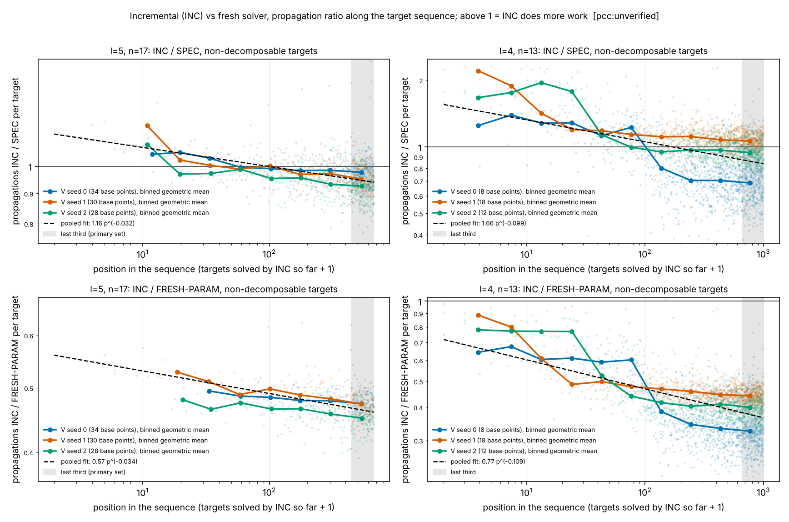

# Lead D: settling run for target-parametric incremental SAT (idea 8)

2026-11-15, local pilot, one core. Every number below is an unverified producer assertion
[pcc:unverified]: no pcc claim, no benchmark record, no replay certificate, no matched rho arm.
Protocol: [PROTOCOL.md](PROTOCOL.md) (hashes in `PREREG.sha256`, written before the measured runs).
Raw per-target rows: `results.json` (`raw_rows`, 12 `raw_*.jsonl` files). Full tables: `analysis.md`.

## Decision per the pre-registered rule: INCONCLUSIVE

Primary statistic: geometric mean of propagations INC/SPEC on never-seen non-decomposable targets
in the last third of each l=5 (n=17) sequence, three V seeds pooled, two-stage seed-level bootstrap.

- **0.951 (95%: 0.925..0.976)**; per seed 0.976, 0.952, 0.924; 216/213/211 targets. [pcc:unverified]
- Rule: alive if upper bound < 0.9 (it is 0.976: not met); kill if lower bound > 1.0 (it is 0.925:
  not met). Hence inconclusive.
- The written prediction (ratio above 1) was wrong: INC does about 5% fewer propagations than SPEC
  after 445 to 667 targets. The A/A arm (SPEC, shuffled clauses) is 0.998 (0.992..1.005), so the
  5% is outside the A/A floor; it is far from the 10% the rule asked for.
- With three seeds the seed-level bootstrap is coarse; the interval should be read with the
  per-seed values.

**Length actually run.** 1,000 targets per l=5 sequence did not fit: an INC sequence cannot be
checkpointed across processes and each process is capped at 10 minutes. INC completed 667, 734 and
1,000 targets (seeds 0, 1, 2) before the 565 s guard; per the protocol all three seeds are analysed
on the first **N* = 667** positions (last third = positions 445..667, 1-indexed), no seed dropped.
l=4 ran the full 1,000 per seed.

## l = 5 (n = 17), 2+1 scan reference: 32 leaf solves per target

| seed | signed base points | INC targets run / analysed | decomposable targets / decomposable abscissae | non-dec targets / non-dec abscissae | solves INC, SPEC, FP, AA | verdict or lift errors |
|---|---|---|---|---|---|---|
| 0 | 34 | 667 / 667 | 34 / 3,205 (1.1%) | 633 / 62,263 (1.0%) | 667, 425, 213, 108 | 0 |
| 1 | 30 | 734 / 667 | 31 / 2,197 (1.4%) | 636 / 63,273 (1.0%) | 667, 425, 213, 107 | 0 |
| 2 | 28 | 1,000 / 667 | 35 / 1,827 (1.9%) | 632 / 63,644 (1.0%) | 667, 422, 212, 106 | 0 |

Table-exhaustion control: met (about 1% of either table; no target repeats).

Last third, non-decomposable targets, geometric mean (95%), all [pcc:unverified]:

| ratio | propagations | per seed | conflicts | solver seconds (indicative) | first third, propagations |
|---|---|---|---|---|---|
| INC / SPEC | **0.951 (0.925..0.976)** | 0.976, 0.952, 0.924 | 0.601 (0.569..0.637) | 2.29 (1.65..2.95) | 0.996 (0.976..1.013) |
| INC / FP (FRESH-PARAM) | 0.465 (0.451..0.474) | 0.473, 0.472, 0.450 | 0.503 (0.475..0.527) | 0.86 (0.62..1.10) | 0.488 (0.472..0.505) |
| FP / SPEC | 2.036 (2.011..2.058) | 2.057, 2.011, 2.040 | 1.190 (1.174..1.205) | 2.65 (2.56..2.74) | 2.040 (2.000..2.075) |
| AA / SPEC (A/A) | 0.998 (0.992..1.005), sd ln 0.041 | 0.998, 1.003, 0.994 | 0.998 (0.988..1.008) | 1.03 (1.00..1.06) | n/a |

Medians per target, last third: propagations INC 2,118,060, SPEC 2,223,485, FP 4,468,153;
conflicts INC 756, SPEC 1,262, FP 1,484. Next to these: the linear 2+1 scan needs 32 leaf solves
per target. Units differ; no ratio is formed. No SAT arm is near the scan count.

Wall time: INC took 2.3 times SPEC's solver seconds (summed: INC 215 / 178 / 75 s against SPEC
87 / 61 / 46 s per seed) while doing 5% fewer propagations. INC and SPEC ran in different
processes on a loaded shared machine, so this is indicative only; the like-for-like pair in one
process is FP/SPEC = 2.65 in time for 2.04 in propagations, and at l=4 (one process) INC/SPEC is
1.84 in time for 0.88 in propagations. A propagation in the parametric formula costs more time
than one in the specialised formula.

### Fitted law (propagations, pooled, ln ratio = a − beta ln p, p = position)

| ratio | fit | beta (95%) | per-seed beta | p where fit = 1.0 | p where fit = 0.5 |
|---|---|---|---|---|---|
| INC / SPEC propagations | 1.160 p^−0.032 | **0.0323 (0.0219..0.0427)** | 0.026, 0.038, 0.033 | 99 (41..184) | 2.0e11 (1.4e9..4.1e15) |
| INC / SPEC conflicts | 0.974 p^−0.077 | 0.0773 (0.0670..0.0868) | 0.068, 0.081, 0.083 | below 1 from the start | 5,570 (2,510..17,600) |
| INC / FP propagations | 0.574 p^−0.034 | 0.0340 (0.0199..0.0507) | 0.034, 0.042, 0.025 | below 1 from the start | 57 (7..140) |

Reading [pcc:unverified]: the fitted propagation ratio crosses 1.0 near 100 targets (the binned
data agree: about 1.0 at positions 60 to 300, 0.95 in the last third). It reaches 0.5 only at
about 2e11 targets, and at least 1.4e9 at the lower bound, against 62,000 to 64,000
non-decomposable abscissae that exist in the cell: within the cell it never reaches 0.5. The fitted
ratio at the last available target (p = 63,000) is 0.81. This is an extrapolation of a
two-parameter law from 667 positions; the binned curves in the figure are flatter between
positions 20 and 300 than a single power law.

### Mechanism: INC against INC-DROP

python-sat has no call that deletes CaDiCaL's learnt clauses, so INC-DROP is emulated by
FRESH-PARAM (FP): a new solver per target on the same parametric formula with the same
assumptions. INC/FP = 0.465 (0.451..0.474) in propagations and already 0.488 in the first third:
what the incremental solver carries between targets halves the work on the parametric formula,
and most of that is in place within the first tens of targets. FP/SPEC = 2.04: the parametric
formula with nothing carried costs twice the specialised one. INC/SPEC = 0.95 is the product: the
carried state pays back the cost of the parametric formula and about 5% more. FP also discards the
inprocessed formula and the scheduler state, so learnt-clause reuse is NOT separated from
amortised inprocessing; that question stays open.

## l = 4 (n = 13), 2+1 scan reference: 16 leaf solves per target

| seed | signed base points | targets | decomposable targets / abscissae | non-dec targets / abscissae | errors |
|---|---|---|---|---|---|
| 0 | 8 | 1,000 | 15 / 44 (34%) | 985 / 3,957 (25%) | 0 |
| 1 | 18 | 1,000 | 15 / 457 (3.3%) | 985 / 3,539 (28%) | 0 |
| 2 | 12 | 1,000 | 15 / 146 (10%) | 985 / 3,853 (26%) | 0 |

Table control is weaker here: a quarter of the non-decomposable abscissae are used, and seed 0 has
8 base points and 44 decomposable abscissae (a near-degenerate V).

| ratio, last third (positions 667..1,000) | propagations | per seed | conflicts | solver seconds |
|---|---|---|---|---|
| INC / SPEC | 0.879 (0.685..1.057) | 0.684, 1.058, 0.937 | 0.262 (0.151..0.441) | 1.84 (1.41..2.29) |
| INC / FP | 0.384 (0.324..0.440) | 0.323, 0.440, 0.397 | 0.226 (0.137..0.369) | 0.66 (0.57..0.77) |
| FP / SPEC | 2.289 (2.119..2.403) | 2.115, 2.402, 2.360 | 1.155 (1.103..1.197) | 2.77 |
| AA / SPEC | 0.999 (0.985..1.017), sd ln 0.162 | 1.013, 0.997, 0.987 | 0.983 | 1.03 |

Fit, INC/SPEC propagations: 1.664 p^−0.099, beta 0.0992 (0.0569..0.1521), per seed 0.154, 0.056,
0.086; crosses 1.0 at p = 169 (55..1,680) and 0.5 at 1.8e5 (5.0e3..3.0e8), beyond the 3,500 to
4,000 non-decomposable abscissae of the cell. Medians, last third: propagations INC 147,486, SPEC
156,330, FP 375,150; conflicts 64, 253, 288. The same rule applied to l=4 would also be
inconclusive, and the three V disagree on the side of 1.0 (0.68, 1.06, 0.94).

## l = 4 against l = 5 (matched positions 445..667) [pcc:unverified]

| | l = 4 | l = 5 | l=5 minus l=4 |
|---|---|---|---|
| INC / SPEC propagations, GM | 0.886 (0.691..1.061) | 0.951 (0.925..0.975) | ln ratio +0.070 (−0.106..+0.313): not resolved |
| INC / FP propagations, GM | 0.389 (0.328..0.443) | 0.465 (0.451..0.474) | ln ratio +0.178 (+0.050..+0.348): higher at l=5 |
| beta, INC / SPEC (p ≤ 667) | 0.119 (0.068..0.179) | 0.032 (0.022..0.043) | −0.087 (−0.147..−0.034): smaller at l=5 |
| beta, INC / FP (p ≤ 667) | 0.130 (0.070..0.194) | 0.034 | −0.096 (−0.160..−0.036): smaller at l=5 |

The exponent shrinks by a factor of about 3 from l=4 to l=5, and the carried-state ratio INC/FP is
closer to 1 at l=5. The powered run's skeptic set "alive only if the fitted exponent does not
shrink with l and the propagation ratio falls below 1": the second holds (by 5%), the first does
not. l and n move together and the base size differs between V, so the trend has three points per
l and is confounded with n.

## Figure

`ratio_vs_position.svg` / `.png`: propagation ratio against sequence position per V seed (binned
geometric means over per-target points), pooled power-law fit, last third shaded; top row
INC/SPEC, bottom row INC/FRESH-PARAM; left l=5, right l=4.



## Arms run

INC (every target), SPEC, FP = FRESH-PARAM (emulated INC-DROP), AA (SPEC with shuffled clauses);
CaDiCaL 1.5.3 through python-sat, default options. At l=5 the fresh arms ran on a position
subsample fixed in advance (SPEC: all last-third and every 2nd earlier non-decomposable target; FP:
every 2nd and every 4th; AA: every 2nd of the last third); at l=4 on every non-decomposable target
(AA: last third). Total solves analysed: l=5 2,001 INC, 1,272 SPEC, 638 FP, 321 AA; l=4 3,000 INC,
2,955 SPEC, 2,955 FP, 989 AA. 0 verdict errors and 0 lift errors in all rows (including the 400
unanalysed INC rows beyond N*).

## Generator and validation

`pdp.py` is the followup-08-powered generator plus the rationality constraint (one clause per
summand for each non-liftable x in V). `validate.py` at (l,n) = (3,11), three V, exhaustive over
all 1,050 to 1,054 rational abscissae outside V (`validation_l3.json`): independent triple
enumeration = 2+1 ground truth; parametric CNF = ground truth (0 mismatches); constant-target CNF
= ground truth on every decomposable and every third other abscissa (0 of 1,258); 0 lift failures.
The CNF without the rationality clauses gave the same verdict on every abscissa (0 labels changed),
and none of the nine V used here (l = 3, 4, 5) contains a non-liftable pair x, 1/x, so the
constraint changed no label anywhere in this run and had no positive control. It does change the
cost: instances are several times cheaper than in the powered run (INC about 0.7 s per l=5 target
against 4.5 s), so no number here is comparable with followup-08-powered. In particular the sign
of INC/SPEC in propagations (1.36 there at positions 30..59, 0.95 here at 445..667) differs in
both the encoding and the position window.

## Deviations and limits

1. 667 targets per l=5 sequence analysed instead of 1,000 (budget and the 10-minute process cap);
   equal count per seed, three seeds kept.
2. INC-DROP is the FRESH-PARAM emulation; it does not isolate learnt clauses from inprocessing and
   scheduler state.
3. `analyze.py` was written and hashed (second timestamp in `PREREG.sha256`) after the first INC
   process had started and before any row was analysed; after the data it received one fix (a
   JSON key type error), no change to any statistic. The l-trend resampling uses seeds 1510 and
   1511 for the two cells (the protocol names 1510). Protocol-before-data rests on file times and
   hashes only; there is no version control here.
4. Wall time at l=5 compares different processes on a machine shared with five other agents.
5. Three V per l is the minimum for a seed-level bootstrap; intervals at l=4 are dominated by the
   between-V spread, and base size varies between V (28 to 34 points at l=5, 8 to 18 at l=4).
6. Repository obligations not met, by instruction for this pilot: no Conductor task, no session
   log entry, no knowledge-base receipt, no resume checkpoint, no benchmark record, no validation
   gate, no PDF. Nothing here may reach a leaderboard or `benchmarks/`.
7. No hook refused a command.

Not covered: l ≥ 6; m = 4; other curves, solvers or native XOR; a true in-solver INC-DROP; 1,000+
targets at l=5; wall time on an isolated core; any common-unit comparison with the 2+1 scan.

## Rerun of a small cell

```
sh research/sat_smt_leads_20261115/D-idea8-settling/rerun_small.sh
```

l=4, seed 0, all four arms, 1,000 targets, about 1 to 2 minutes; writes to the scratch directory
and compares every counter with the committed `raw_l4_s0_ALL.jsonl`. Full chain: `run_all.sh`
(about 50 minutes), then `python3 analyze.py`.
