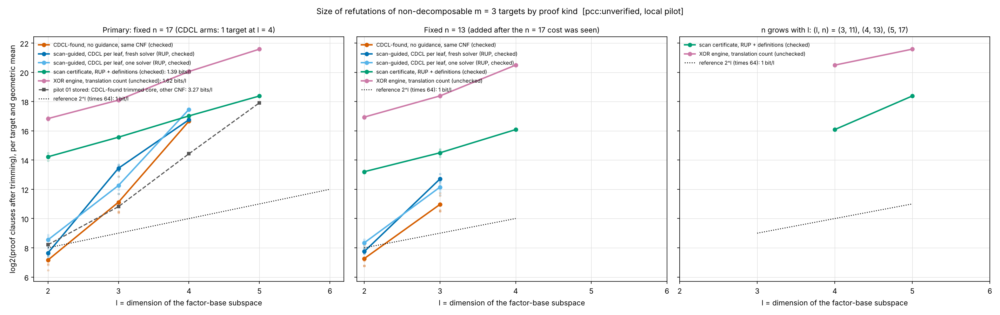

# Lead E: how large is a refutation that follows the linear 2+1 scan?

Local pilot, 2026-11-15, toy sizes, one core of a shared 4-core container. **Every number here is
an unverified pilot assertion, `[pcc:unverified]`.** No benchmark record, leaderboard row, pcc
claim, isolab run, replay certificate or matched rho arm. The directory is not under version
control; `PROTOCOL.md` (with two dated amendments) was written before the runs it governs, and
file times are the only evidence of that.

## Result in short

- The scan certificate was written out as a clausal proof and machine-checked (`xproof`: RUP
  lemmas plus definitions of fresh XOR variables). At fixed n = 17 its trimmed size grows at
  **1.39 bits per l (95 % interval 1.35..1.43; l = 2..5, 24 proofs, all verified)**.
  `[pcc:unverified]`
- Scan-guided proofs made by a CDCL solver per leaf, with no new variables, do not get there:
  about 2.9 to 3.2 bits per l at n = 13, the same range as refutations CDCL finds with no
  guidance on the same CNF (3.55) and as pilot 01 (3.27). `[pcc:unverified]`
- So the pilot-01 kill is a statement about resolution-style reasoning on this kind of CNF, not
  about the existence of short refutations: a short one exists once XOR definitions are allowed.
  In absolute size the checked certificate is larger than the CDCL proofs at every size where
  both were measured at n = 13, and about equal at (n, l) = (17, 4).
- With n growing with l the checked certificate grows at 2.30 bits per l over three cells; a
  two-variable fit gives 1.40 bits per l times n^2.8.

(`fig_proof_size_vs_l.svg` is the vector version.)

## Setup

Point decomposition R = P1 + P2 + P3 on y^2 + xy = x^3 + x^2 + B over F_2^n, x(Pi) in
V = span(1, t, .., t^(l-1)), V without 0. System (from `sub.py`, a verbatim copy of the
follow-up pilot's library): S3(x1, xR, u) = 0, S3(x2, x3, u) = 0 in (s, p), z^2 + sz + p = 0.
Added here: the clause u != 0 and the rejection of targets with R -+ P1 equal to the 2-torsion
point, which closes the false SAT the follow-up's skeptic found. Only non-decomposable targets
are measured (pair-table ground truth), 6 per cell, cell seed 20261115 * 1000003 + 1000 n + 10 l.

Arms (same targets for every arm):

| arm | what it is | checked |
|---|---|---|
| `cold` | CaDiCaL 1.5.3, fresh solver per x1 leaf under assumptions; lemma lists concatenated, leaf clauses, resolution tree over x1 | yes: `rup_dep` backward RUP, trimmed proof re-checked, MiniSat forward check |
| `warm` | same with one incremental solver | yes, same |
| `free` | Glucose 4 on the same CNF, no guidance (reference) | yes, same |
| `xproof` | the scan itself replayed as clauses: gate substitution and forward Gaussian elimination per leaf, rows as prefix-parity chains, fresh variables by definition d = a XOR b | yes: `rup_dep` on CNF + definitions; definitions verified syntactically (`xproof.check_defs`); trimmed proof re-checked |
| `xor` | step count of the follow-up's DPLL + Gauss engine and a formula for its clausal translation | **no: a count, not a proof** |

CNF: dual-rail gates, XOR rows cut to 3-variable XORs with auxiliaries, pure CNF. The `xproof`
CNF has the same constraints with rows written as full prefix chains in a different variable
order. Proof size = clauses of the trimmed, re-checked proof (for `xproof`: lemmas + definition
clauses used).

## Validation (before the measured runs; `validate.py`, `validation.json`, cell (3, 11))

- CNF satisfiability equals plain enumeration of signed triples on 24 targets (11 SAT, 13 UNSAT);
  every model lifts to rational points with x in V \ {0} summing to R.
- 192 per-leaf answers equal enumeration of decompositions using that x1.
- 6 crafted targets R = P1 + T (u = 0): with the u != 0 clause the CNF agrees with enumeration
  that excludes a partial sum at T, 6 of 6. None of the 6 gave a false SAT without the clause, so
  the defect itself was not reproduced here; the clause is kept as a guard.
- Engine verdict equals ground truth on all 24.
- Checker: 4 scan proofs verify; forward check agrees; core originals UNSAT under Glucose 3; a
  proof stripped of its solver lemmas and a forged proof for a decomposable target are rejected.

## Slopes, bits per l (least squares on per-target log2, bootstrap 95 % interval) [pcc:unverified]

| proof kind | series | sizes | proofs | slope | interval | geometric mean size per l |
|---|---|---|---|---|---|---|
| `xproof`, checked | n = 17 (primary) | 2..5 | 24 | **1.39** | 1.35..1.43 | 19 133; 48 380; 132 722; 341 254 |
| `xproof`, checked | n = 13 (post hoc) | 2..4 | 18 | 1.43 | 1.40..1.47 | 9 440; 23 124; 68 408 |
| `xproof`, checked | n grows: (3,11), (4,13), (5,17) | 3..5 | 18 | 2.30 | 2.26..2.35 | 14 006; 68 408; 341 254 |
| `cold`, checked | n = 13 (post hoc) | 2..4 | 18 | 3.18 | 2.99..3.36 | 215; 6 690; 17 687 |
| `warm`, checked | n = 13 (post hoc) | 2..4 | 18 | 2.90 | 2.72..3.06 | 325; 4 537; 18 009 |
| `free` (CDCL-found, same CNF), checked | n = 13 (post hoc) | 2..4 | 18 | 3.55 | 3.26..3.79 | 154; 2 001; 21 092 |
| `cold`, `warm`, `free` | n = 17 (primary) | 2, 3 complete | 12 each | not fitted | | cold 201; 11 120. warm 373; 4 907. free 143; 2 224 |
| `xor` steps, unchecked | n = 17 | 2..5 | 24 | 1.54 | 1.52..1.56 | 2 118; 4 674; 18 477; 46 930 |
| `xor` translation count, unchecked | n = 17 | 2..5 | 24 | 1.62 | 1.60..1.64 | 116 897; 280 748; 1 088 439; 3 138 774 |
| `xor` translation count, unchecked | n grows | 3..5 | 18 | 1.79 | 1.74..1.83 | |
| pilot 01, CDCL-found trimmed core (stored, other CNF) | n = 17 | 2..5 | 29 | 3.27 | 3.14..3.38 | 296; 1 802; 22 063; 246 904 |
| pilot 01, conflicts (stored) | n = 17 | 2..5 | 29 | 3.34 | 3.24..3.42 | |
| reference 2^l | | | | 1 | | |

Partial cells (time-censored, not in any fit):

- (17, 4), target 0 only: `cold` 110 714 clauses (343 985 conflicts), `warm` 180 740
  (188 303), `free` 103 353 (110 233). Steps from the l = 3 geometric means: 3.3, 5.2 and 5.5
  bits. `xproof` on the same target: 128 841.
- (17, 6), target 0 only: `xproof` 882 287 clauses, verified, 1.37 bits above the l = 5 mean.
- Post hoc two-variable fit of `xproof` over its 48 complete-cell proofs:
  log2(size) = a + 1.40 l + 2.78 log2(n) (intervals 1.37..1.44 and 2.60..2.94, largest residual
  0.32 bits).

Checking status: 49 of 49 `xproof` proofs, 37 of 37 `cold`, 37 of 37 `warm` and 37 of 37 `free`
proofs VERIFIED by `rup_dep`, and their trimmed forms VERIFIED again. The independent forward
check passed on 36 of 37 for each CDCL arm; the three (17, 4) proofs exceed its 60 000-clause
limit and have the `rup_dep` checks only. `xproof` has no independent forward check. All 50 `xor`
rows are unchecked counts. In step 3, 32 "seeded" candidates were rejected by the checker (my
construction dropped closing-type lemmas that the seeds depended on); they were not used.

## Decisions per the pre-written rules

**Step 2.**

- RUP proofs over the CNF without new variables (`cold`/`warm`), primary series n = 17:
  **not shown.** Only two sizes are complete (amendment 2), so the rule cannot be met. The data
  do not point the other way: the post hoc n = 13 series gives 3.18 and 2.90 bits per l, and the
  one (17, 4) target is 3.3 and 5.2 bits above l = 3.
- RUP plus definitions (`xproof`), primary series n = 17, l = 2..5, four complete sizes, all 24
  proofs verified: slope 1.39, upper end 1.43, below 1.5. **Short proofs exist, in the proof
  system "RUP + XOR definitions" (extended resolution; DRAT with RAT definition lines).**
  As the protocol requires in the same paragraph: on the series where n grows with l the slope is
  2.30, above 1.5. That series mixes the 2^l leaves with the per-leaf factor, which grows like
  n^2.8 here.
- Fixed n makes a slope near 1 partly a matter of construction (2^l leaves times a per-leaf
  cost). What the measurement adds is that the composition is checkable, that the per-leaf cost
  in l is small (0.4 bits per l above the count), and that the same construction without XOR
  definitions costs about 3 bits per l.

**Step 3 (lower-bound probe).** Smallest verified proof per target among `cold`, `warm` and the
minimised candidates (iterated trimming, re-solving on core clauses, subsumption; CaDiCaL and
Glucose).

- Rule cell, (17, 3), 8 leaves: per-target median leaves served 4, 2, 4, 2, 2, 2; median of
  medians 2. **No cross-leaf sharing shown** (threshold 4).
- Post hoc cell (13, 4), 16 leaves: 2, 9, 2, 9, 9, 2; median of medians 5.5, which is at or
  above the threshold. It is not the rule cell.
- The two indicators disagree in both cells. At (17, 3) the minimised proofs are 0.15 to 0.21 of
  the no-sharing reference (1.2 to 1.7 leaf-equivalents of 8) and 28 % to 41 % of their lemmas
  serve all 8 leaves, yet the median lemma serves 2. At (13, 4) the median lemma serves up to 9
  leaves, yet the proofs are 0.82 to 0.99 of the reference (13 to 16 leaf-equivalents of 16)
  and under 2.2 % of lemmas serve all 16.
- The reference is the sum of one solver's (CaDiCaL, fresh) trimmed leaf proofs, not a minimum,
  so a ratio below 1 is not evidence of a sub-scan refutation. The minimised scan-guided proofs
  at (17, 3) (geometric mean 3 044) are still larger than the unguided CDCL proofs (2 224).
  Lemmas over (u, s, p, z) only do not depend on x1, which is enough to explain lemmas serving
  many leaves.
- `xproof` has no sharing by construction: every lemma carries the leaf's x1 literals or
  concerns leaf-specific definitions.

## What was not covered

- A checked XOR-aware proof in a native format (BDD, FRAT/XOR, polynomial calculus). `xor` is a
  count; its translation formula overestimates what `xproof` actually needed by about 9x at (17, 5).
- No size lower bound. Nothing here shows that RUP-only proofs must be long, only that the ones
  these solvers produced are.
- `xproof` is not minimised: one trimming pass, no sharing of stage-2/3 work between leaves, no
  back-substitution. Its constant (about 10 000 clauses per leaf at n = 17, l = 5) is large.
- RUP-only arms at n = 17 beyond l = 3 (one target at l = 4); any arm at l >= 7; `xproof` at
  l = 6 beyond one target; cells (6, 19) and (7, 23).
- m = 4, other curves or bases, other solvers (Kissat, CryptoMiniSat with FRAT), drat-trim.
- The u = 0 false SAT was guarded against but not reproduced.
- Definitions are trusted through a syntactic check written by the same author as the proof
  generator; no independent DRAT checker with RAT support was available.

## Deviations (all)

1. Amendment 1, before any measured run, after the seed-999 cost probe: CDCL arms cut to
   l = 2..4; arm `xproof` added; Step 2 rule restated per proof system.
2. Amendment 2, after the n = 17, l = 2, 3 rows and target 0 of l = 4 were seen: CDCL arms at
   (17, 4) limited to that target (about 4 minutes per arm per target); a fixed n = 13 series
   added post hoc; secondary series cut to three cells; step 3 moved from (17, 4) to (13, 4).
   The n = 13 series and the (13, 4) sharing value are post hoc and labelled so.
3. (17, 6): stopped after target 0 (223 s per target, dominated by the checker) to leave time
   for step 3. Time censoring, not result-based.
4. Process handling: when the first driver loop was stopped, its shell went on to start later
   cells, and for under a minute two of my processes ran at once. All rows written by those
   stray processes were deleted and the cells re-run from scratch by `run_all.sh`; the kept
   (17, 4) target-0 rows come from the first, single process. Counts are deterministic, wall
   times are not comparable.
5. The sharing statistic was redefined through cubes of closing clauses after the seed-999 probe
   and before the measured runs (in `PROTOCOL.md`).
6. `validate.py` used the stream seed + 7 of cell (3, 11), not the measured stream.
7. Not done, because writes were limited to this directory or the tool is not available here:
   `docs/session-logs/` entry (kept below instead), Conductor task, research-kb and lead-atlas
   queries, lessons ledger, PDF report, resume checkpoint, EKS route (the task asked for a local
   pilot).

## Arms run and time

Every arm that was run is in the tables above; none was dropped. Solver options are defaults; no
arm was re-run with other settings. Measured compute: about 19 minutes for `run.py` rows and 10.5
minutes for `min3.py`, plus validation and probes.

## Files

`PROTOCOL.md`, `sub.py` (copied library), `scanproof.py` (instances, CNF, scan-guided proofs,
checking, sharing, XOR step counter), `xproof.py` (checked scan certificate), `rup_dep.c`
(checker: pilot 01's `rup_trim.c` plus core indices and dependency output), `validate.py`,
`validation.json`, `run.py`, `min3.py`, `run_all.sh`, `probe.py` (seed-999 probe), `analyze.py`,
`raw/*.jsonl`, `results.json`, `tables.md`, `fig_proof_size_vs_l.{svg,png}`.

Rerun of the smallest measured cell (about 5 s; the checker is compiled on first use into
`$E_SCRATCH`):

`E_SCRATCH=$(mktemp -d) python3 run.py /tmp/e_f13_2.jsonl 13 2 0 6 xor,xproof,cold,warm,free`

Everything after amendment 2: `./run_all.sh` then `python3 analyze.py`. Validation:
`python3 validate.py 3 11`.

## Session log entry (2026-11-15, kept here because writes were restricted to this directory)

### What was done (commands, files, features)
Protocol, validation, the five arms, step-3 minimisation and analysis listed above.
`validate.py 3 11` passed; 160 clausal proofs VERIFIED by `rup_dep`; `results.json`, `tables.md`
and the figure regenerated by `analyze.py`.

### Decisions made (and why)
Added the checked `xproof` arm because the probe showed CDCL leaf proofs grow with l at fixed n,
so they could not test the claim. Cut CDCL arms at n = 17 and added n = 13 for cost. Definitions
checked syntactically and appended to the CNF because the available checker is RUP-only.

### Open threads (unfinished, pick up next time)
Independent check of the definitions with a RAT-capable checker; share stage-2/3 derivations
across leaves with equal u and see whether `xproof` drops below 2^l leaves' worth; a size lower
bound or a smaller RUP-only proof; l = 6, 7 with a faster checker; an independent skeptic pass.

### Errors (what went wrong, how it was handled)
First `xproof` version used constants that unit propagation cannot reproduce (checker FAILED on
seed 999); fixed by taking constants from a snapshot only when all derived rows are determined.
Stopping a shell loop started later cells (deviation 4). Seeded re-solve candidates in step 3
were built without their closing lemmas and were rejected by the checker.
