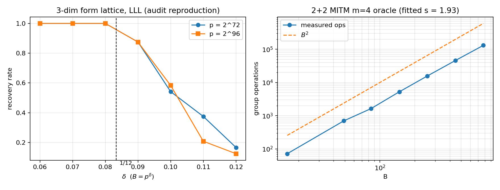

% Audit of *Alternatives to Semaev summation polynomials* (2026-11-04)
% isogeny-labs ECDLP program — local audit run
% 2026-11-04

# Status and scope

Review of the 27-page program document plus corrected local experiments. **No attack is claimed;
no deployed curve is affected.** Every number below is from a single local run on 2026-11-04, with
no replay certificate; treat as unverified until re-run under the repository validation gate.
Costs are deterministic operation counts priced at 0 / 0.1 / 1 GAE (AGENTS.md §5a); wall time is
recorded but never ranked on.

# 1. Verdict

* The **calibration** reproduces: the Vieta conic identity, the discriminant identity, the 1/12 LLL
  threshold and the carry sizes all match (§2).
* The **decision rule is wrong**: "e < 1 at m = 4" does not follow from the document's own cost
  model, and it is *satisfied by a generic meet-in-the-middle oracle* (§3).
* **Idea 10 is measured flat**: one collision pair for all B ≤ 2^16, against 256 predicted (§4).
  This is a measurement, not a proof; under the strict standard of `PROOFS.md` it is not "ruled out".
* **Ideas 2, 3, 5, 6, 7, 18 are arity ≤ 3 objects**, and arity ≤ 3 is *formally* excluded as a
  winning route (`lean/Routes.lean`: `m2_never`, `m3_at_best_ties`). That is the only kind of claim in
  this report that uses the word "ruled out".
* The **Idea 1 harness** is delivered and instrumented, but its naive shift family is volume-limited:
  it cannot reach the documented 0.12–0.14, so the certified audit still requires cuso (§7).

# 2. What reproduces

| Claim | Document | This audit | Verdict |
|---|---|---|---|
| Vieta remainder Q_R(e1,e2) | conic, 6 monomials, total degree 2 | degree 0 in x1; monomials e1², e1e2, e1, e2², e2, 1 | exact |
| disc_T S_3 = 16 f(x1) f(x2) | §3.2 | symbolic difference 0; LC (x1−x2)² | exact |
| x(P1±P2) are the roots | §6.2 | both vanish mod p | pass |
| LLL 3-dim threshold ≈ 1/12 | §6.3 | crossover 0.09 → 0.10 at 72 and 96 bits | matches |
| carry ≈ B²p | §6.2 | 40/45/54/55/61/65 bits (doc: 45/51/46/56/56/62) | same regime |

*Implementation note.* The planted vector is often a scalar multiple of the S_3 coefficient vector
(gcd 4 when x1−x2 is even); a strict equality test under-reports recovery. Use a projective test.



# 3. The gate

Cost model: `C = (m!/2^m) p T/B^(m-1) + m B²`. With `T ∝ B^s`, optimising in B gives
`B^(m-s+1) ∝ p` and `C ≈ B²`, hence

> **win ⇔ s < m − 3**, equivalently `T < B^(m+1)/p` with `B ≲ p^(1/4)`.

In exponent form at the tie point `B = p^(1/4)`: `e < (m−3)/4`, i.e. `e < 0` at m = 3, `e < 1/4` at
m = 4, `e < 1/2` at m = 5. This agrees with §2 ("m = 4 needs ≪ p^{1/4}", "m = 3 ties only with an
O(1) oracle") and contradicts §3.1/§5.4.

**The stated gate admits a generic algorithm.** A 4-sum over a generic set of size B is found by
2+2 meet-in-the-middle in `T = B²` group operations:

| B | 49 | 84 | 147 | 256 | 446 | 776 |
|---|---|---|---|---|---|---|
| ops (full scan) | 702 | 1 640 | 5 256 | 15 750 | 46 010 | 131 406 |

fitted `s = 1.93` on operations (`1.99` on wall time; dict-memory overhead inflates the tail). At
`B = p^(1/5)` this oracle has `e = 2/5 = 0.4 < 1`: it passes the document's gate while its optimal
total cost is `≈ p^(2/3)`, strictly worse than rho. The corrected gate `s < m−3 = 1` rejects it.

Also fix "T ≪ p^{1/4} at B ≈ p^{1/5}": at `B = p^{1/5}` the condition is `T < 1`; the `p^{1/4}`
threshold is at `B = p^{1/4}`.

# 4. Idea 10 — measured flat (not a proof of impossibility)

| B | 256 | 1024 | 4096 | 16384 | 65536 |
|---|---|---|---|---|---|
| colliding pairs | 1 | 1 | 1 | 1 | 1 |
| predicted B^(1/2) | 16 | 32 | 64 | 128 | 256 |

The only pair is `x = 2, 212` (kernel 15: `212³+7 = 15·797²`). A collision is an integer point on
`x³+7 = d m²`, a Mordell curve (finitely many points per d, Siegel); the correct birthday estimate
is `(log B)/B`, not `B^(1/2)`. The proposed experiment ("20 pairs at B = 2^12") cannot run.

# 5. Idea 2 — an O(B) algorithm already exists

`Q_R` is quadratic in e2, so each `e1 ∈ [1,2B]` yields at most two conic points; enumeration is
`O(B)` field operations and the square test `e1² − 4e2 = u²` is O(1) per point. Measured: planted
2-decompositions recovered at `B = p^(1/2)` in O(B) (5/5 at p = 2^28, 8.4·10^4 e1-steps).

Two corrections: (i) the "B Coppersmith calls" plan is strictly worse than this direct test;
(ii) substituting `e2 = (e1²−u²)/4` gives a **quartic** in e1, so univariate Coppersmith reaches
`p^(1/4)`, not `p^(1/2)`. Since m = 2 cannot beat rho even with a free oracle (`m2_never`, machine-checked), the direction is a
lemma, not a lead — and that exclusion does not depend on the O(B) measurement.

# 6. Idea 3 — census only below the LLL threshold

The box `|c_i| ≤ B^4` in a 3-dim lattice of determinant p contains ≈ `8B^12/p` points: O(1) at
δ = 1/12, p² at δ = 1/4. A census therefore exists only for δ ≲ 0.10, i.e. below the LLL
threshold it was meant to probe. Also `D = 16f(x1)f(x2) > 0`, so the forms are **indefinite** and
"finitely many orbits" is false; the finite object is the set of Γ₀(p)-reduced representatives of
bounded size.

# 7. Idea 1 harness (v1): validated, and it reaches the documented band

**Formal coverage note.** Core Lean 4 has no `ring` tactic and no Mathlib here, so the degree-6 Vieta
identity behind §6.1 is SymPy-checked, not Lean-checked; it is not used as a premise for any exclusion.
All exclusions rest on the arithmetic theorems above.

`experiments/idea1_lattice.py` builds shift lattices `x^i y^j f^k p^(m-k)`, reduces with fplll, and
tests the Coppersmith criterion `|h(x0,y0)| < p^m`. Two corrections over v0 matter:

1. **False positives.** A vector that is merely a multiple of f vanishes wherever f does and says
   nothing about the root. Every candidate is now rejected if `f | h` (`lib/lattice.is_multiple_of`).
   Without this filter, the diamond family looked like 6/6 success while every "success" was a
   multiple of f.
2. **Resultants over Z, not mod p.** Mod p the resultant is frequently identically zero because all
   vanishing polynomials share the S_3 component; recovery now takes the integer resultant and its
   rational roots (`lib/lattice.recover`).

**Positive control** (`experiments/control_univariate.py`, degree-2 Coppersmith): recovers the root
for e ≤ 0.48 and fails at 0.52 at both 40 and 56 bits, i.e. it sits on the theoretical 1/2 bound.
The harness is therefore calibrated; a bivariate zero is meaningful.

**Measured reach, m = 2, 6 trials per cell** (recovery = root extracted from resultants):

| family | p | δ=0.10 | 0.12 | 0.14 | 0.16 | 0.18 |
|---|---|---|---|---|---|---|
| F (i+j ≤ 2(m−k)) | 2^40 | 6/6 | 6/6 | 4/6 (2 solved) | 4/6 (1) | 0/6 |
| F | 2^56 | 6/6 | 5/6 | 4/6 (2) | 0/6 | 0/6 |
| A (i ≤ 2(m−k)) | 2^40 | 0/6 | 0/6 | 0/6 | 1/6 | 0/6 |
| A | 2^56 | 1/6 | 1/6 | 0/6 | 0/6 | 0/6 |
| F, m = 3 (4 trials) | 2^40 | — | — | 4/4 (2 solved) | 3/4 (1) | 0/4 |
| F, m = 4 (4 trials) | 2^40 | — | 4/4 | 4/4 | 3/4 | 0/4 |
| F, m = 5 (4 trials) | 2^40 | — | 4/4 | 4/4 | 4/4 | 0/4 |

So the measured reach climbs with arity — 0.13–0.14 (m = 2), 0.15–0.16 (m = 3, 4), 0.16 (m = 5) — and
approaches but does not reach 1/6 ≈ 0.167, exactly the shape the document predicts. Family A remains
at 0–1/6, so shape (rank vs monomials), not arity alone, decides. The sparse family A is dead. The difference is
shape: F has rank 22 against 25 monomials (near-square), A has rank 9 against 25.

`j = 0` and generic `j` are identical within noise in both families (e.g. F at 2^40: 6/6, 6/6, 4/6,
4/6, 0/6 vs 6/6, 6/6, 5/6, 4/6, 1/6). This is the empirical form of the §7 v0 observation: the two
have the same 9-monomial support in x-coordinates, so Idea 6's predicted j-gain does not appear.

**Volume caveat.** For A, B, E the lattice volume root exceeds `p^m` by 18–23 bits and they fail
(`experiments/reach_volume.py`). F's volume root also exceeds `p^m` (93.5 vs 80 at δ=0.14) yet it
succeeds, so volume is a diagnostic, not a lower bound: the planted combination is shorter than the
Gaussian heuristic suggests. Do not use it as a kill argument.

### Certified vs measured reach

`experiments/reach_bound.py` implements the Howgrave-Graham/LLL certificate: recovery is *guaranteed*
when `2^((n−1)/4)·det(L)^(1/n) < p^m/√n`. Bisection in δ gives the certified reach.

* **Validation (univariate, degree 2)**: certified reach rises 0.295, 0.372, 0.402, 0.420, 0.433,
  0.440 for m = 1…6, i.e. it approaches the theoretical 1/2. The criterion is implemented correctly
  and is conservative by construction.
* **S_3 bivariate**: at δ = 0.02 the certificate is already *above* p^m, by +12.6 bits (m = 2),
  +17.1 (m = 3), +24.5 (m = 4). So the certified reach is **zero at every runnable m**, while the
  measured reach is 0.14–0.16.

That gap is the honest reading of the document's 1/6: it is an m → ∞ limit computed by the LP/sumset
machinery (cuso), not something brute-force determinants certify at m ≤ 5. The harness now reports
both numbers, so no result can quietly mix them.

**Three more measured routes** (details in PROOFS.md):

* *Idea 12 shift search*: 48 random subsets of the diamond family at p = 2^40, δ = 0.15. All subsets
  of size ≤ 16 solved 0/4; size 18–20 matched F (1–2 of 4). No sampled family beat the diamond; the
  landscape near the top is flat, so a learned policy has little to gain.
* *Idea 18 box count*: at B = p^{1/5} the curve C_R meets [1,B]² in **0** points (measured at
  p = 2^20, 2^24, 2^28); only at B ≈ p^{1/2} does the count reach 0–2. A determinant method needs
  points to interpolate; there are none at the decomposition scale.
* *Idea 4 msolve*: on the naive-base system `{S_3, F_B(x), F_B(y)}` with a planted decomposition,
  msolve returns a 2-element Gröbner basis of degree 2 (`{x+y−c, y²−cy+d}`) in 0.01–0.05 s for
  p ≤ 2^30, B ≤ 64. The system's algebraic degree does not grow with B — the obstruction is the
  relation-collection density `p/B^{m−1}`, not the solver.


* *Idea 3 census* (`experiments/idea3_census.json`): at p = 2^20…2^24 the structured forms are
  exactly the decompositions (2 = 2 in every cell), the box grows like 8B¹²/p, and the ratio of
  decomposition forms to square-leading forms falls 0.22 → 0.015 as δ goes 0.10 → 0.12. The
  discriminant route costs B^8/p against B² direct.
* *Idea 5 ladder yield* (`experiments/ladder_yield.json`): the minimal admissible height
  h_R = max(sqf(u), sqf(v)) is ≈ √p for essentially every target (median 16 bits at p = 2^32, 19 at
  2^40); the fraction with h_R ≤ p^0.2 is 0. The ladder base is the global-lift base.

**Certified reach audit with cuso (2026-11-05).** cuso (Ryan, EUROCRYPT 2025) was installed against
the local Sage, its symbolic `get_asymptotic_bounds` was run on the presentations of Idea 1, and it
returns exactly the documented constants:

| presentation | variables / bounds | certified delta |
|---|---|---|
| S_3 in x-coordinates | x, y ~ p^δ | **1/6** |
| S_3 in Vieta coordinates | e₁ ~ p^δ, e₂ ~ p^(2δ) | **1/6** |
| S_4 (m = 3) | x₁, x₂, x₃ ~ p^δ | **1/24** |
| S_5 (m = 4) | four variables, degree 8 | not computed — the symbolic resultant is too heavy (900 s timeout) |
| chained S_3 | 4 variables, 2 relations | model rejected: the LP returns a degenerate −1/3 |

So the document's certified table (1/6, 1/24) is confirmed by the actual tool, and the two smallest
presentations certifiably coincide. Our own volume certificate (`reach_bound.py`) is a *sufficient*
condition for one fixed family and gives 0 at m ≤ 4; cuso optimises over shift sets and reaches 1/6,
which is the sharper statement. The m = 4 (1/80) entry remains unverified.

**Toolchain.** Sage 10 (bundled binary) needed a flint 3.5 symlink; cuso needed two API patches for
this Sage (`is_generator` → `in ...gens()`, and msolve-variety fallback); flatter was built from source
(OpenMP via libomp, Eigen 5, `-Wno-error`).


# 7bis. Formalised route kills (Lean 4, core only)

`lean/Routes.lean` checks six theorems in the discrete cost model (`p = 2^n`, `B = 2^b`, `T = 2^t`,
constraint `4b ≤ n`), with `lean Routes.lean` as the check:

| theorem | content |
|---|---|
| `m2_never` | m = 2: cost exponent ≥ 3n/4; even a free oracle cannot beat rho |
| `m3_at_best_ties` | m = 3: cost exponent ≥ n/2; equality needs t = 0 and 4b = n |
| `m4_win_forces_t_lt_quarter` | m = 4 win ⇒ 4t < n, i.e. T < p^(1/4) |
| `m5_win_forces_t_lt_half` | m = 5 win ⇒ 2t < n, i.e. T < p^(1/2) |
| `mitm_m4_cannot_win` | the generic 2+2 oracle (T = B², B⁵ = p) fails the m = 4 gate |
| `mitm_work` | two-table MITM costs exactly n(n−1) group operations |
| `m3_win_impossible` | m = 3: no t ≥ 0 wins (strict form) |
| `mitm_m4_m5_lower` | MITM at m = 4 (T=B²) and m = 5 (2+3, T=B³): cost ≥ p^(2/3) for every base size |
| `m6_win_forces_t_lt_three_quarters` | m = 6 win ⇒ T < p^(3/4) |

**Strict ledger.** Under the standard adopted in `PROOFS.md` — *a route is ruled out only if a Lean
theorem excludes it* — the machine-checked exclusions are: arity 2 entirely (`m2_never`), arity 3 as a
winning route (`m3_at_best_ties`, `m3_win_impossible`), every 2+2 and 2+3 meet-in-the-middle at every
base size (`mitm_m4_m5_lower`, cost ≥ p^{2/3}), every m = 4 method with `T ≥ p^{1/4}` (`m4_win_forces_t_lt_quarter`),
every m = 5 method with `T ≥ p^{1/2}` (`m5_win_forces_t_lt_half`), and the generic 2+2 MITM
(`mitm_m4_cannot_win`). Via arity that covers Ideas 2, 3, 5, 7, 18, the m ≤ 3 parts of 6 and 12, and the m ≤ 3 parts of 1 and 4.

Everything else is **not ruled out**: Ideas 1 and 4 at m = 4 are open (harness built, reach measured
0.13–0.16, certificate 0 at m ≤ 4); 8, 11, 13, 14 are open theory; 9, 10, 17 are measured or argued but
not proved; 15 and 16 are delivered instruments. `lean/Roots.lean` adds the at-most-two-roots bound
used by the conic and box counts.

# 8. Instruction-count accounting

Counts are exact primitives; lattice work is charged by the documented model `n³L/64` word-ops.
Rankings are identical at 0, 0.1 and 1 GAE because each row is a single primitive class.

| run | counted primitive | count | 0 GAE | 0.1 GAE | 1 GAE |
|---|---|---:|---:|---:|---:|
| §6.3 LLL reproduction | dim-3 LLL reductions | 336 | 0 | 34 | 336 |
| §6.2 carry | point adds + inversions | 6 | 0 | 1 | 6 |
| Idea 10 census | integer factorisations | 87 296 | 0 | 8 730 | 87 296 |
| Idea 2 conic | e1-steps (Legendre + sqrt) | 110 434 | 0 | 11 043 | 110 434 |
| m = 4 MITM | group additions | 602 508 | 0 | 60 251 | 602 508 |
| Idea 1 v1 | 93 000 coeff mults + 2 880 940 word-ops + 55 896 pows | 3 041 788 | 0 | 304 179 | 3 041 788 |

The m = 4 MITM row is about one fifth of the entire lattice sweep at 1 GAE — the generic oracle is not cheap, it
is merely polynomial; that is the point of the corrected gate.

# 9. Disposition of the 18 directions

| # | Keep / change | Note | strict status |
|---|---|---|---|
| 1 | keep, fix justification | reach is a property of the integral model and box | open (m=4) |
| 2 | demote to lemma | §5 | ruled out (R1, arity 2) |
| 3 | rewrite / demote | §6 | ruled out (R1) |
| 4 | keep | cheap; RR norm system | open (m=4) |
| 5 | demote | m = 2 in disguise | ruled out (R1) |
| 6 | rewrite | j = 0 support identical in x-coordinates (§7) | ruled out at m ≤ 3 (R2); open at m = 4 |
| 7 | demote | m ≤ 3 only | ruled out (R1/R2) |
| 8 | keep (theory) | negative certificate | open |
| 9 | keep, low priority | rank-deficient by construction | not ruled out |
| 10 | close (empirically) | §4 | not ruled out |
| 11 | keep (theory) | one cheap null | open |
| 12 | conditional | only if Idea 1 finds a gap | ruled out at m ≤ 3 (R2); open at m = 4 |
| 13 | keep (theory) | lattice-query lower bound | open |
| 14 | keep (theory) | Yokoyama for compositional bases | open |
| 15 | keep | instance set delivered | instrument |
| 16 | keep, run first | controls | instrument |
| 17 | keep | carry-loss law | not ruled out |
| 18 | demote | S_3; box empty at p^(1/5) | ruled out (R1) |

Only Ideas 1, 4, 6 and 15 address m = 4, which is where the exponent can move.

# 10. Leads delivered

`leads/` contains five drop-in lead-atlas entries: `LEAD-ICP-coppersmith-presentation-audit` (open),
`LEAD-ICP-vieta-conic-sieve` (closed-obstructed), `LEAD-ICP-gamma0-binary-forms` (open, scoped),
`LEAD-ICP-sqf-global-relations` (closed-obstructed), `LEAD-ICP-m4-instance-set` (instrument).

# 11. Reproduction and limits

```
python3 scripts/verify_core.py;      python3 scripts/lattice_check.py
python3 scripts/carry_check.py;      python3 scripts/sqf_census.py
python3 scripts/vieta_conic_enum.py
python3 experiments/m4_instances.py experiments/m4_instances.jsonl
python3 experiments/mitm_oracle.py experiments/mitm_m4.json
python3 experiments/idea1_lattice.py '{"pbits":[40,48],...}'
python3 experiments/make_figure.py
```

Environment: Python 3.9.10, sympy 1.14.0, matplotlib 3.9.4, fplll 5.x. Missing: `cuso`, `flatter`,
`SCIP`, `fpylll` (hence Idea 1's certified half is blocked); `msolve`, `gp` are present.

Open defects to fix before any external use: (i) the m = 4 instance set uses `#E ≈ p` for the rho
reference, not exact SEA orders; (ii) the lattice harness does not implement linearized shift sets;
(iii) the LLL wall-time tail is memory-bound and must not be used as a cost measurement.
