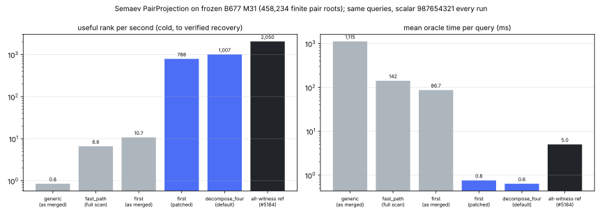

# Semaev 1D-1 fast path, qualified in the real library by useful rank per second

2026-11-25, Claude Code. Development measurements on one shared 4-vCPU cloud VM
(Intel Xeon @ 2.10 GHz). Unsigned. [pcc:unverified]

## Question

PR #4846 added a batched-inversion fast path to `src/cryptanalysis/semaev_projection.rs`.
PR #5157 timed it per query, through a shim, at B = 64. Does it raise **useful rank per
second** when it runs inside the actual library, on the frozen B677 M31 workload, charged
from cold to a verified target logarithm?

## Instrument

[`examples/semaev_fast_path_rank_rate.rs`](../../examples/semaev_fast_path_rank_rate.rs)
links the real `crypto_lib` (full release library build, 16 min, no shim) and calls
`PairProjection` through its public API.

- **Base and queries:** the B677 support (509 Dickson + 168 Y7 abscissae) is
  [`b677_points.csv`](b677_points.csv), exported from the unchanged `b677_fixture`
  constructor (SHA-256 `1d305443…`). The public target Q and the query seed are those of
  crypto #5097/#5184.
- **Per query:** the run draws a fresh R = aG + bQ, calls the arm's `decompose_four*` on
  x(R), and lifts the x-only witness to every sign pattern whose group-law sum is exactly R.
- **Per relation:** each lifted relation is replayed, deduplicated and admitted by the same
  rule as the graph control (at least two factor-base terms). It then enters the same
  large-prime-then-factor-base elimination.
- **Stop:** when the target column gets a pivot. The recovered d is checked by d·G = Q.
- **Useful rank per second** = final rank / cold wall time. The cold time covers the
  projection build, the query points, the oracle, the lift, replay and elimination.

Reference: the all-witness pair-table source from crypto #5184 (`cost-v2 sample:13`),
interleaved on the same host.

## Results

All 46 runs recovered and verified 987654321. Medians are below; the intervals are 95%
bootstrap intervals on geometric-mean ratios.

**Panel 01: library as merged** (5 reps for default and reference, 2 for first and fast,
1 for generic)

| Arm | build | oracle per query | queries | useful rank | cold to recovery | useful rank/s |
| --- | ---: | ---: | ---: | ---: | ---: | ---: |
| `build_generic` + `decompose_four_generic` | 659 ms | 1,115 ms | 682 | 647 | 761 s | **0.85** |
| `build_fast` + `decompose_four_fast_path` | 226 ms | 142 ms | 674 | 631 | 95.9 s | **6.6** |
| `build_fast` + `decompose_four_first` | 242 ms | 86.7 ms | 674 | 631 | 58.8 s | **10.7** |
| `build` + `decompose_four` (public default) | 154 ms | 0.60 ms | 674 | 631 | 0.58 s | **1,087** |
| all-witness reference (#5184) | 67 ms | 4.0 ms | 41 | 664 | 0.27 s | **2,472** |

**Panel 02: after the one-function patch below** (10 interleaved reps of default, first and
reference; 1 rep of fast)

| Arm | oracle per query | entries scanned | cold to recovery | useful rank/s | against reference |
| --- | ---: | ---: | ---: | ---: | --- |
| `decompose_four_first` (patched) | 0.76 ms | 2.03M | 0.80 s | **788** | 2.50× [2.33, 2.69] slower |
| `decompose_four` (default) | 0.64 ms | 2.03M | 0.63 s | **1,007** | 1.93× [1.81, 2.07] slower |
| `decompose_four_fast_path` | 141.6 ms | 308.8M | 95.7 s | 6.6 | 297× slower |
| all-witness reference | 5.0 ms | 1.91M probes | 0.32 s | **2,050** | – |



## Findings

1. **The fast path is correct at B677 scale.** Fast, first and default produce the same
   relation stream: digest `1dec4871edda55c5` over all 674 queries, with zero unliftable
   witnesses, zero duplicates and identical rank. Generic picks different witnesses
   (`HashMap` order) and reaches the same verified scalar at rank 647.
2. **Against generic, the fast path gains about 7.8× per query** (1,115 → 142 ms)
   **and about 7.7× in useful rank per second.** The batching gain carries through to
   rank only because each query still yields at most one relation.
3. **As merged, the fast path's early exit saves almost nothing.**
   `decompose_four_first` called `roots_batch` over all 458,234 pair roots before scanning.
   It therefore paid about 87 ms per query to keep the first witness, which it typically
   reaches after about 3,000 entries. The full-scan `decompose_four_fast_path` finds
   263,980 compatible keys over 674 queries (about 392 per query) and keeps one each time,
   so 99.7% of its root work buys no rank.
4. **A one-function patch fixes it.** `decompose_four_fast` now computes roots in
   `QUERY_BATCH` (64) blocks when early exit is requested; the full scan keeps one batch.
   The patched `first` goes from 58.8 s to **0.80 s** to recovery (**73×**), with the same
   relation stream. It is still 1.28× slower than the public default `decompose_four`,
   which already used block-batched, early-exit roots through `finite_list`.
5. **Query speed is the wrong metric.** The reference's oracle is 8× *slower* per query
   (5.0 ms against 0.64 ms), yet it delivers **2.0× more useful rank per second**: it
   keeps every relation a probe finds (16 rank per query) and needs 41 queries instead of
   674. Search efficiency is close: about 2,870 probes per useful rank for the reference
   and about 3,225 scanned entries for the library default. The remaining factor is the
   per-entry constant (211 ns against 108 ns), the build (149 against 77 ms) and the
   per-query point generation.

## What this qualifies, and what it does not

- **Qualified on this workload:** the fast path, inside the real library, at B677 scale,
  with identical relations. The best library path is the public default `decompose_four`
  at about 1,000 useful rank/s, 1.9× short of the all-witness reference and therefore
  further still from rho (see #5184: the reference itself is about 63× from an
  equal-engineering rho in wall time).
- **Not shown:** an exponent change, other curves, or isolated-host timing. The
  `decompose_four_generic` row is a single 13-minute run.
- **Library change:** only the internal `decompose_four_fast` (block-wise roots under early
  exit) and a new private helper. The public API and the full-scan results are unchanged.
  The module's unit tests were rerun on the patch (see `evidence/libtest.txt`).

## Next

The obvious library lever is a callback or multi-witness `decompose_four` that hands every
compatible key of a block to the caller. That would turn early exit into the #5184
sampling rule: stop after a fixed fraction rather than at the first witness. Measure it
with this harness; the target is at least 2,050 useful rank/s. Below the generic
pair-table floor, only non-enumerative sources remain (owner items 3–4).

## Replay

```
cargo build --release --example semaev_fast_path_rank_rate     # full library build
X=target/release/examples/semaev_fast_path_rank_rate
$X default 600 | jq '{recovered_scalar,total_rank,cold_ms,useful_rank_per_second,relation_stream_digest}'
REF=<b677_relation_cost_20261125 cost-v2 binary> research/semaev_fast_path_rank_20261125/tools/panel2.sh
python3 research/semaev_fast_path_rank_20261125/tools/summarize.py research/semaev_fast_path_rank_20261125/evidence/panel-02
```

Panel 01 used the library as merged (example binary SHA-256 `c7215853…`). Panel 02 used the
patched library. Each run's `.meta.json` records argv, exit status, wall time and the binary
SHA-256.
