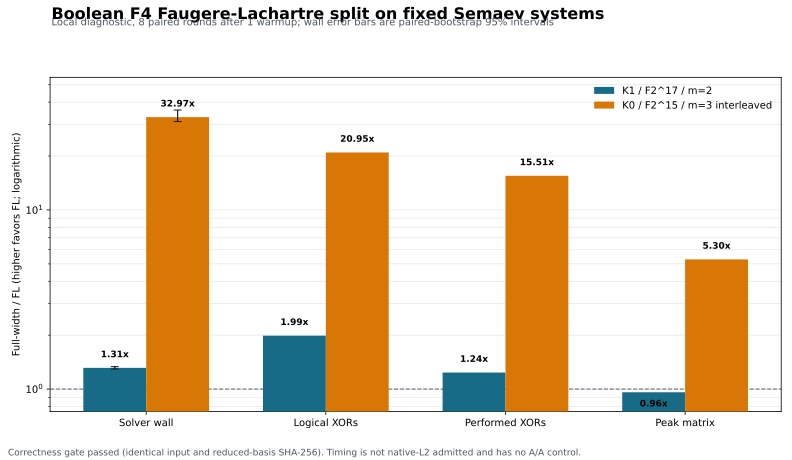

# Boolean F4 Faugere-Lachartre benchmark

The correctness gate passed on both fixed Semaev cells. Across eight paired
single-thread measurements after one warmup, the FL split used less exact
elimination work and lower local wall time than the same binary's full-width
cascade. These timings are local diagnostics, not native-L2 admitted results.

| Fixed cell | FL matrices | Solver wall, FL/full | Local wall effect | Logical XORs, FL/full | Performed XORs, FL/full | Peak matrix, FL/full |
|---|---:|---:|---:|---:|---:|---:|
| K1 / F2^17 / m=2, 16 variables | 18 | 0.7614 (95% paired bootstrap 0.7493–0.7729) | 1.31x; 23.9% lower | 0.5032 (49.7% lower) | 0.8084 (19.2% lower) | 1.0416 (4.2% higher) |
| K0 / F2^15 / m=3 interleaved, 27 variables | 20 | 0.03033 (0.02768–0.03209) | 32.97x; 97.0% lower | 0.04774 (95.2% lower) | 0.06449 (93.6% lower) | 0.1888 (81.1% lower) |

## Correctness and activation

Every matched arm used the same input SHA-256 and produced the same reduced
basis SHA-256. There were no timeouts or oversize exits. The optimized arm
activated 18 FL matrices per m=2 run and 20 per m=3 run; the control activated
zero.

| Cell | Input SHA-256 | Reduced-basis SHA-256 |
|---|---|---|
| K1 / F2^17 / m=2 | `12b410ec6a7fa96a99d94662679b6847b05a4e97104d3571b8888f3751e59414` | `3e469185697e17eead760bc5dc454a813ef5561e941b9c0e2594fd985d912e29` |
| K0 / F2^15 / m=3 | `c07cf4c9983cbe0851a0ca3f8319d77635a652b8c06238c88321289d85a1e67a` | `4ec81088032325a32e03cc75fa64818d9295f9e378fd70de7533d78131b8b84d` |

## Evidence boundary

The exact counters are deterministic observations for these fixed systems.
The wall intervals are descriptive local paired bootstraps. The frozen EKS
spec adds duplicate A/A arms and native-L2 admission, but the trusted
main-branch workflow is presently blocked before build by unrelated artifact
hydration failures. The source-checkpoint run for the published frozen commit
also reached AWS OIDC but was refused by the configured role
([run 44262076729](https://github.com/isogeny-labs/crypto/actions/runs/44262076729)).
Therefore the protocol's isolated-timing gate is not met.

No msolve, M4GB, or `m4gb` executable was available on the frozen host, so the
external Groebner reference is explicitly unavailable rather than replaced.
The earlier repository solver shootout remains context only; it is not pooled
with these cells.

This study does not establish an end-to-end ECDLP speedup, scaling in the field
degree, an asymptotic improvement, or a sub-rho attack. The ecbench K1 cell is
frozen for later admitted execution once the infrastructure gate is restored.
