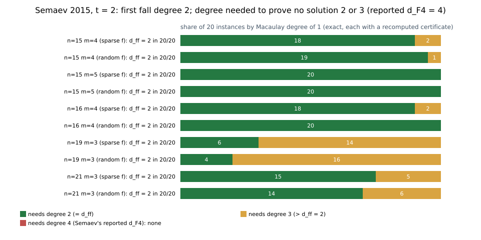

# Semaev 2015, t = 2: first fall degree 2, not 4; the solver needs 2 or 3 (2026-11-02)

**Verdict.**
- **REFUTED:** "the first fall degree … is always 4" for `S_3(x_1, x_2, z)` (Semaev 2015,
  §4.5). On every one of 200 instances of Semaev's own t = 2 cells, the first fall degree is
  2, with an explicit trace certificate.
- **SPLIT:** the earlier corpus inference that these rows refute `d_F4 ≤ d_ff`. The degree a
  Macaulay/XL computation needs to prove the system has no solution is 2 on 154 instances
  and 3 on 46, never 4. So the sharp first-fall assumption fails on 46/200 (3 > 2), not
  everywhere. Semaev's reported `d_F4 = 4` exceeds what the systems require.

All results are exact. No cost claim.

Protocol: [`PROTOCOL.md`](PROTOCOL.md), frozen before computing. Script:
`semaev_t2_trace.py` (standard-library Python, exact `F_{2^n}` and Boolean-ring
arithmetic). Source: arXiv:1504.01175v1 (sha256 `4db8433b…`), §4.4, §4.5, Table 2.



## Setup (Semaev §4.5)

- Curve `Y² + XY = X³ + AX² + B`, so
  `S_3(x_1, x_2, x_3) = (x_1x_2 + x_1x_3 + x_2x_3)² + x_1x_2x_3 + B`.
- `F_{2^n} = F_2[α]/(f)`, and `V` = the polynomials in `α` of degree `< k = ⌈n/m⌉`.
- For `t = 2` the system is the Weil descent of `S_3(x_1, x_2, z) = 0` with `x_1, x_2 ∈ V`:
  `n` Boolean equations of degree 2 in `2k` variables, with `z` random (standing in for
  `R_X`) and `B` random.
- Semaev's first fall degree (§4.4) is the least `d` with `g_i`,
  `max(deg g_i + deg f_i) = d`, `deg Σ g_i f_i < d` and `Σ g_i f_i ≠ 0`. His first fall
  degree assumption is `d_F4 ≤ d_ff`.

## The trace certificate

For `λ ∈ F_{2^n}`, `Tr(λu²) = Tr(√λ u)`, so

    Tr(λ S_3) = Tr(√λ (x_1x_2 + z(x_1 + x_2))) + Tr(λz x_1x_2) + Tr(λB).

With `λ = z^{-2}`, `√λ = λz` and the two quadratic terms cancel:

    Tr(z^{-2} S_3(x_1, x_2, z)) = Tr(x_1) + Tr(x_2) + Tr(B z^{-2}).

`Tr(λ S_3) = Σ_j Tr(λα^j) [S_3]_j` is a combination of the coordinate equations with
constant multipliers, and its sum has degree ≤ 1: a fall at 2.
- For odd `n`, `1 ∈ V` and `Tr(1) = 1`, so the sum is never zero.
- For even `n` it can vanish, but other constant combinations still fall at 2 on every
  instance computed (for the pentanomial field at n = 16, `Tr` is zero on all of `V`).

This is the Kosters–Yeo trace identity (Cor. 4.11), here in Semaev's coordinates.

## Results (`results/t2_trace.txt`, seed 20261102, 20 instances per cell and field polynomial)

| cell `(n, m)`, `k` | field polynomial | `d_ff = 2` | trace certificate exact | Macaulay degree of 1: 2 / 3 / 4 | Semaev Table 2 `d_F4` |
|---|---|---:|---:|---|---:|
| (15, 4), 4 | `x^15+x+1` | 20/20 | 20/20 | 18 / 2 / 0 | 4 |
| (15, 4), 4 | random | 20/20 | 20/20 | 19 / 1 / 0 | 4 |
| (15, 5), 3 | `x^15+x+1` | 20/20 | 20/20 | 20 / 0 / 0 | 4 |
| (15, 5), 3 | random | 20/20 | 20/20 | 20 / 0 / 0 | 4 |
| (16, 4), 4 | pentanomial | 20/20 | 20/20 | 18 / 2 / 0 | 4 |
| (16, 4), 4 | random | 20/20 | 20/20 | 20 / 0 / 0 | 4 |
| (19, 3), 7 | pentanomial | 20/20 | 20/20 | 6 / 14 / 0 | 4 |
| (19, 3), 7 | random | 20/20 | 20/20 | 4 / 16 / 0 | 4 |
| (21, 3), 7 | `x^21+x^2+1` | 20/20 | 20/20 | 15 / 5 / 0 | 4 |
| (21, 3), 7 | random | 20/20 | 20/20 | 14 / 6 / 0 | 4 |

- **Systems:** none of the 200 has a solution in `V × V` (brute force over all `2^{2k}`
  points). That matches Semaev's success probabilities of 0.0006–0.0155 for these rows.
- **"Macaulay degree of 1"** is the least `D` such that the Boolean Macaulay span
  `{red(μ [S_3]_j) : μ multilinear, deg μ ≤ D − 2}` contains 1: the degree at which a
  Macaulay/XL computation (Semaev's `M_d`, §4.4) proves the system has no solution. Each
  value comes with the tracked combination of rows, recomputed from scratch and checked to
  sum to exactly 1.
- **No fall at degree 1:** no instance has one. Most coordinate equations have degree
  exactly 2, and no combination of the lower-degree ones falls at 1.
- **Self-test.** It passes:
  - field arithmetic;
  - the identity `Tr(λu²) = Tr(√λ u)` on 200 random pairs;
  - a negative control: `λ ≠ z^{-2}` keeps a quadratic part.

## What it means

- **Semaev's statement about `S_3(x_1, x_2, z)` is false:** "the first fall degree … was
  bounded by 5 in [11]. The experiments show it is always 4 again." The first fall degree
  of these systems is 2, by a two-line identity.
- **The t = 2 systems are overdetermined.** Their quadratic parts depend only on
  `x_1x_2 ∈ V·V`, a space of dimension `2k − 1 < n`, so most systems are proved
  inconsistent already at degree 2 or 3.
- **Semaev's `d_F4 = 4` is not forced by the systems.** It is Magma's step degree for
  them; a degree-3 Macaulay computation already settles all 200 here.
- **Sharp first-fall assumption (degree needed ≤ `d_ff`):** fails on 46/200 instances
  (3 > 2), and holds on the rest.
- **Not affected:** Assumption 1 (`d_F4 ≤ 4`). The degrees measured here (≤ 3) are
  consistent with it, so this result neither supports nor refutes it.
- **Correction to the corpus.** `CEX-SP-SEMAEV15-T2-TRACE` inferred "`d_F4 = 4 > 2 = d_ff`
  on these rows". The first half used Magma's reported 4; the systems themselves need 3 at
  most. The node is corrected accordingly.

## Limits

- 20 instances per cell and field polynomial, for two field polynomials per n. Magma's
  exact default polynomial is not known, but the trace argument does not depend on the
  basis.
- The Macaulay degree is the Boolean XL/Macaulay quantity, not a reproduction of F4's step
  trace.
- Not kernel-checked in Lean: the identity is a statement over `F_{2^n}` that needs finite
  field theory beyond the core-Lean encodings used so far.

## Reproduce

```sh
python3 -I research/semaev_t2_trace_20261102/semaev_t2_trace.py 20   # ~12 s
python3 -I research/semaev_t2_trace_20261102/plot_t2.py
```
