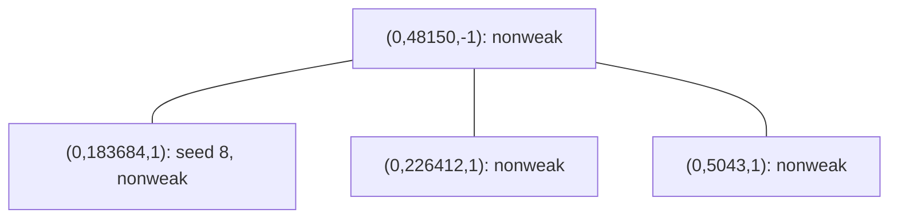

# Smith controls resumed in Codex — 2026-10-19

Original source: `ff27eeafe1a5bc477622eb6722dea47d72118405` on `claude/smith-elliptic-walk-20261018`. Recovery preserved the original host data and reproduced its failing controls before editing an isolated checkout.

## Corrections and validation

| Finding | Change | Evidence |
|---|---|---|
| Quartic-Jacobian conversion negated the unreduced integer 27 modulo small p. In release mode p−27 underflowed. | Reduce 27 modulo p before negation. | Original p=7 regression compared 367 and 336 points and failed. The same test now passes. |
| Degree-eight curves with nonsquare leading coefficient counted infinity over Fp² using the base-field square test. | Count two infinity points over Fp². Every nonzero element of Fp is square in Fp². | Exhaustive p=7 L-polynomial, Vélu, dual-edge, JV-model and signature controls all pass. |
| The fixed 24-model random sample at p=11 sampled model kinds [0,11,13], but asserted coverage of every kind. | Sample eight models from each of the three kinds, preserving 24 checks. | Both p=7 and p=11 descent tests pass with explicit kind coverage. |
| The old positive walk fixture used p=61, seed 8, in a component with no JV-weak node. | Keep seed 8 and its 200,000-node budget as an explicit censoring control; use seed 2 as a reachable positive control. | Native component traversal closes on four classes, all nonweak. Seed 2 reaches a weak node after four tested nodes. Both unit tests pass. |

All **29 tests pass** in the isolated crate containing the exact three original modules, with only `smith_elliptic_walk.rs` changed. The original exhaustive p=7 control failures and intermediate failed attempts remain preserved. This is a correctness repair; no larger-prime campaign or performance measurement was launched.

## The retained negative walk fixture

Canonical class keys are shown below. Each leaf has one admissible full-rational-2-torsion neighbor, and the center has three. The native diagnostic enumerated every admissible kernel at every discovered class; its queue closed after these four classes. None satisfies the implemented JV-weak predicate.



The original seed-8 run is retained as a capped result, not reclassified as a successful walk. Other diagnostic starts (seeds 0 and 7) can reflect between nodes while their tested-node counter stays at two. The diagnostic therefore uses a finite 100 ms wall budget; one initial unlimited diagnostic was terminated and rerun with that bound. Campaign callers must keep a finite wall budget. This recovery does not change the experiment's walk policy or claim every component contains a weak node.

## Reproduction

Extract `validation-crate.tar.gz` into an empty directory. It contains the three Rust modules, Cargo manifest and lockfile, and the bounded diagnostic source. Then run:

```sh
cargo test --release --locked --offline --lib
cargo run --release --locked --offline --example walk_diagnostic
```

The offline commands require the lockfile's dependencies to be cached. `original-source-manifest.json` identifies the source before correction. `SHA256SUMS` covers the saved evidence. The final module's hash and toolchain are in `validation.json`.

The full original repository library suite is a separate integration gate. It was started locally after restoring the original branch and required source fixtures; its final result is recorded separately in the top-level recovery directory. The 29-test result is not a substitute for that full suite. No branch is merged by this recovery.
