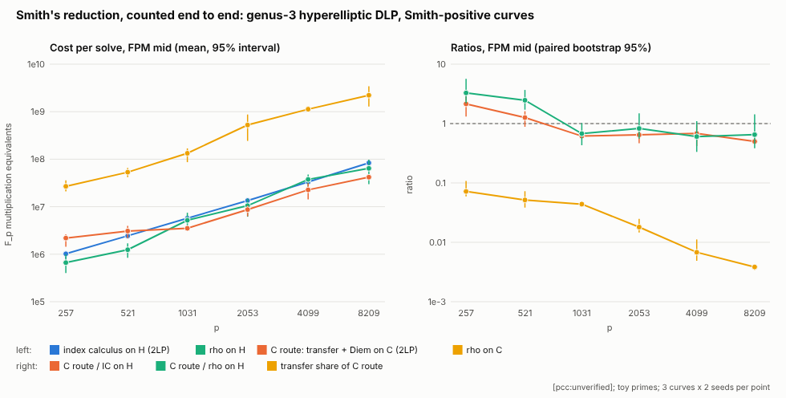

# Results: counted cost of Smith's reduction, end to end (2026-11-15)

Study `smith_transfer_cost_20261115`. Protocol `PROTOCOL.md`, sha256
`89a6fe5ce1b18be3a5a9a696bc89beaaedccc86df3fc894e9e7262c27a9a98e2`, frozen
2026-11-15T04:22:13Z, immediately before the run (`run.log`: 04:22:13Z to
04:41:18Z, exit 0). Data `runs.jsonl`, analysis `analysis.json`
(`genus_ladder_analyze`), tables `tables.md`, figure `fig_cost.svg`
(`fig_cost.png` is a render of it), hashes `data.sha256`, binary and source
hashes `binary.sha256`.

Every number here is `[pcc:unverified]`: one producer, one shared 4-vCPU
host, no independent replay, no pcc claim. Synthetic toy curves. Pre-gate:
no leaderboard row, no `benchmarks/README.md` row, no bench record.

## What ran

For `p = 257, 521, 1031, 2053, 4099, 8209`: the first three curve seeds whose
genus-3 curve `y^2 = f(x)` has `#J = h r` (`h <= 8`, `r` prime), is
Smith-positive with a normal-form trigonal map, and whose canonical quartic
`C` is smooth with `#C(F_p) = #H(F_p)`. 18 instances, 2 seeds each, four
arms: 144 runs. Arms and counted unit as in the protocol; the transfer's
`F_p` work is inside `C_transfer_diem_2lp` and also reported apart.

## Headline table (FPM mid, mean of 6 runs; ratios with paired bootstrap 95%)

"C route" = transfer by `Psi`, then Diem's double-large-prime index calculus
on `C`. "IC on H" = double-large-prime index calculus on `H` with prefilter.

| p | IC on H | rho on H | C route | rho on C | C route / IC on H | C route / rho on H | IC on H / rho on H | transfer share of C route |
|--:|--:|--:|--:|--:|---|---|---|---|
| 257 | 1.02e6 | 6.66e5 | 2.18e6 | 2.69e7 | 2.14 [1.32, 3.13] | 3.28 [2.19, 5.68] | 1.53 [0.99, 2.48] | 7.2% [5.9, 10.8] |
| 521 | 2.44e6 | 1.24e6 | 3.08e6 | 5.32e7 | 1.26 [0.88, 1.62] | 2.47 [1.71, 3.68] | 1.96 [1.40, 3.01] | 5.2% [3.9, 7.3] |
| 1031 | 5.70e6 | 5.19e6 | 3.51e6 | 1.33e8 | 0.616 [0.557, 0.654] | 0.677 [0.431, 1.02] | 1.10 [0.76, 1.55] | 4.4% [4.1, 4.8] |
| 2053 | 1.35e7 | 1.05e7 | 8.69e6 | 5.24e8 | 0.646 [0.466, 0.809] | 0.827 [0.556, 1.48] | 1.28 [0.93, 2.24] | 1.8% [1.5, 2.5] |
| 4099 | 3.32e7 | 3.75e7 | 2.26e7 | 1.13e9 | 0.681 [0.418, 0.957] | 0.604 [0.333, 1.10] | 0.89 [0.68, 1.32] | 0.68% [0.49, 1.12] |
| 8209 | 8.37e7 | 6.42e7 | 4.18e7 | 2.22e9 | 0.500 [0.447, 0.572] | 0.652 [0.385, 1.43] | 1.30 [0.86, 2.79] | 0.38% [0.34, 0.42] |

The same ratio `C route / IC on H` on the other two readings (`tables.md`
S4):

| p | FPM low (inversion 1, la 1) | FPM mid (10, 9) | FPM high (30, 9) | across the band |
|--:|---|---|---|---|
| 257 | 3.09 [2.17, 3.80] | 2.14 [1.32, 3.13] | 2.12 [1.32, 3.01] | above |
| 521 | 2.20 [1.63, 2.70] | 1.26 [0.88, 1.62] | 1.28 [0.90, 1.63] | unresolved |
| 1031 | 1.24 [1.11, 1.33] | 0.616 [0.557, 0.654] | 0.622 [0.561, 0.662] | unresolved |
| 2053 | 1.28 [0.97, 1.57] | 0.646 [0.466, 0.809] | 0.643 [0.464, 0.805] | unresolved |
| 4099 | 1.38 [0.96, 1.77] | 0.681 [0.418, 0.957] | 0.669 [0.412, 0.938] | unresolved |
| 8209 | 1.07 [0.98, 1.18] | 0.500 [0.447, 0.572] | 0.485 [0.435, 0.555] | unresolved |

Growth exponents in `p` (analyzer OLS on ln mean, six primes, bootstrap 95%):

| arm | FPM low | FPM mid | FPM high | group operations |
|---|---|---|---|---|
| IC on H (`H_C_double_lp+pre`) | 1.148 [1.136, 1.167] | 1.270 [1.243, 1.320] | 1.250 [1.225, 1.294] | 1.010 [1.000, 1.022] |
| rho on H (`H_rho_neg`) | 1.394 [1.222, 1.548] | 1.395 [1.223, 1.549] | 1.396 [1.223, 1.550] | 1.396 [1.223, 1.550] |
| C route (`C_transfer_diem_2lp`) | 0.872 [0.803, 0.945] | 0.895 [0.810, 0.985] | 0.866 [0.782, 0.956] | 0.446 [0.366, 0.535] |
| rho on C (`C_rho_neg`) | 1.347 [1.210, 1.467] | 1.347 [1.210, 1.466] | 1.346 [1.210, 1.466] | 1.332 [1.195, 1.450] |

## What the numbers say

* The transfer works as an attack step: on all 18 instances the logarithm
  found on `C` by Diem's algorithm, and by rho on `C`, is the planted
  logarithm on `H`.
* On FPM mid and FPM high the C route costs less than index calculus on `H`
  from `p = 1031` on (ratio 0.62, 0.65, 0.68, 0.50; every interval below 1).
  On FPM low it does not: there the ratio is above 1 at every prime (1.24,
  1.28, 1.38, 1.07). The difference between the readings is the price of the
  linear algebra modulo `r`: `la_mul` is weighted 9 on mid and high and 1 on
  low, and the `H` arm does 4 times the linear-algebra multiplications of
  the `C` arm at `p = 8209` (6.90e6 against 1.64e6), while the `C` arm does
  more relation-phase and `Pic` work. So the advantage at these sizes rests
  on pricing a multiplication modulo `r ~ p^3` at 9 field multiplications.
* The fitted exponents differ (1.27 against 0.90 on FPM mid; 1.15 against
  0.87 on FPM low, intervals disjoint on every reading), so the ratio should
  keep falling with `p` on every reading; within the grid it is not
  monotonic (0.62, 0.65, 0.68, 0.50 on mid) and at 3 curves x 2 seeds the
  intervals at 2053 and 4099 are wide. On FPM low the fitted lines would
  cross near `p ~ 1e4` (extrapolation, not measured).
* Distance to the matched rho on `H` (the reference of the success
  criterion): index calculus on `H` is at 0.9 to 2.0 times rho on FPM mid,
  never resolved on either side from 1031 on; the C route is at 0.60 to 0.83
  times rho from 1031 on, with intervals that reach or cross 1 at every
  prime (0.431 to 1.02 at 1031 is the closest to resolved). Neither index
  calculus arm is shown to beat rho on `H` at these sizes. Under the
  section 5a band the order C route < rho on H holds as a point estimate on
  all three FPM readings from 1031 on and is not resolved on any.
* Rho on `C` is 25 to 50 times rho on `H` (a `Pic^0` addition on the plane
  quartic costs about 9,000 field multiplications against about 220 for a
  genus-3 Cantor step). The transfer is useless for rho; it pays only
  through Diem's algorithm.
* The transfer itself costs about 1.4e5 multiplications and 1.4e3
  inversions, flat in `p` (1.40e5 to 1.46e5 across the grid). 80% of it is
  the 19 `Pic^0` operations and about 17 class constructions on `C`;
  building `T(t)` is 680 multiplications, the quartic fit 8,100 to 8,800,
  image points and conic conditions 11,000 to 15,000, Cantor steps and root
  finding 6,000 to 8,200 for 15 to 19 candidate representatives.

## Scorecard

| | prediction | measured | verdict |
|---|---|---|---|
| T1 | every run certifies, transferred log = planted log, `ord_ratio` 1 | 144/144 certified and correct; 36/36 transfers succeeded; `ord_ratio` 1 on all; 0 zeta mismatches | holds |
| T2 | C route below IC on H on all three FPM readings at `p >= 1031`; mid ratio falls from 1031 to the largest prime | below on FPM mid and high at 1031, 2053, 4099, 8209; ABOVE 1 on FPM low at all four (point estimates 1.07 to 1.38); mid ratio 0.616 at 1031, 0.500 at 8209 | fails as stated (the band condition); holds on two of three readings; the "falls" part holds end to end, not monotonically |
| T3 | transfer below 5% of the arm (FPM mid) at `p >= 1031` | 4.4%, 1.8%, 0.68%, 0.38% | holds (4.4% [4.1, 4.8] at 1031 is close to the bound; on FPM low the share at 1031 is 5.5%) |
| T4 | exponents (FPM mid): IC on H in [1.0, 1.4]; C route in [0.6, 1.0]; rho on H in [1.3, 1.6] | 1.270 [1.243, 1.320]; 0.895 [0.810, 0.985]; 1.395 [1.223, 1.549] | holds (point estimates; the rho interval extends below 1.3) |
| T5 | Smith-positive / admitted in [0.05, 0.20] | 18/105 = 0.171 (Wilson 95% [0.111, 0.255]) | holds on the stated statistic; see the bias note |

T5 bias: each prime's search stops at its third accepted curve, so the last
admitted curve of every prime is a success. The pooled fraction 18/105
overstates the rate. Dropping the last curve of each of the six searches
gives 12/99 = 0.121. Both are inside the predicted range. All 18
Smith-positive admitted curves had a usable normal-form map, a smooth `C`
and a matching point count: no curve was lost between "Smith-positive" and
"accepted".

## Instance search

| p | seeds tried | admitted | Smith-positive | accepted | search wall s |
|--:|--:|--:|--:|--:|--:|
| 257 | 116 | 12 | 3 | 3 | 2.8 |
| 521 | 278 | 17 | 3 | 3 | 19.9 |
| 1031 | 257 | 21 | 3 | 3 | 57.2 |
| 2053 | 205 | 16 | 3 | 3 | 133.7 |
| 4099 | 466 | 27 | 3 | 3 | 785.0 |
| 8209 | 168 | 12 | 3 | 3 | 994.3 |

Cofactors of the accepted instances are 2, 4, 6 or 8 (never 1: a
Smith-positive curve has even order). Instances with `f`, `N`, `D`, the 15
coefficients of `C`, `P0`, order, `h`, `r` are the `instance` records of
`runs.jsonl` (`tables.md` S2).

## Deviations from the protocol

* None in grid, seeds, arms, parameters or analysis. The grid ran in one
  session from one binary (`binary.sha256`).
* The binary was built from a working tree in which `genus_ladder.rs`
  carried another session's uncommitted work (structured Gaussian
  elimination behind `IcParams.sge`). This driver passes `sge: None`, which
  that module documents as the unchanged instrument; the file's hash at
  build time is in `binary.sha256`. Not independently checked here.
* `quartic_ladder::make_instance_from_classes` takes one argument more than
  the brief's sketch (`n_points`, which `QInstance` stores).
* The figure legend was re-laid twice after the data existed (layout only).
* The pilot at `p = 131` (`pilot/pilot_131.jsonl`, 2 curves, 1 seed) ran
  before the freeze, as the protocol says.

## What is and is not counted

Counted in `transfer_mul` / `transfer_inv`: building `T(t)`; square roots
in `F_p` and `F_p^2`, image points and `T(t) b` for every point used; the
15-column fit through 20 image points; `PlaneQuartic::setup_cost`; conic
conditions, `class_from_conics`, `Pic^0` additions and negations; Cantor
additions, split tests and root finding of the representative search.
Multiplications by the fixed non-residue and squarings count as
multiplications; additions are not priced.

Not counted, in any arm:

* finding Smith's trigonal map (`smith_prop24::analyze_curve`: factoring
  `f`, the tractable subgroups, linear algebra over extensions of degree at
  most 8);
* the fixed-degree polynomial set-up in `Trigonal::new` (`F mod G`, `s(t)`,
  its square root, the deltas);
* the smoothness certificate and the coordinate-ring tables built by
  `PlaneQuartic::new` (`setup_cost` reports 15 multiplications: it covers
  the base-point data only). The ladder's quartic arms do not count these
  either;
* instance search, group orders, `#C(F_p) = #H(F_p)`, and the checks
  `[r] Psi(G) = 0`, `Psi(T) = [t] Psi(G)` made when the instance is formed.

The first two are part of the attacker's work and are missing from the C
route. They do not grow with `p` beyond `log p` factors; their size was not
measured, so the transfer share (0.4% to 7%) is a lower bound on the true
overhead of the route, by an amount this study cannot state.

## Limits

* 3 curves x 2 seeds per cell. The curve is the unit of replication; most
  between-arm ratios against rho are unresolved for that reason.
* Only Smith-positive curves with a normal-form map and near-prime order:
  about 1 curve in 8 among the admitted, 18 of 1,490 seeds tried overall.
  Nothing here applies to the other genus-3 hyperelliptic curves.
* The comparison is between specific implementations at fixed parameters
  (`nb = 2 p^(2/3)` on `H`, `3 sqrt p` on `C`, no tuning of either, no
  structured Gaussian elimination on either). A better-tuned `H` arm or `C`
  arm would move the ratio.
* Exponents are fitted over a factor 32 in `p`; the predicted asymptotics
  (`p^(4/3)` on `H`, `p` on `C` up to logs) are not tested beyond that.
* The grid stops at 8209 because the instance search (orders by counting
  points over `F_p^2`) costs about 6 s per seed there and grows like `p^2`;
  the arms themselves took under 40 s per run. A larger prime needs a
  faster order computation, not more solver time.
* FPM readings price a `Pic^0` operation by its field multiplications in
  this implementation of `plane_quartic_pic`; that implementation was not
  optimised and its constant (about 9,000 multiplications per addition)
  enters the C route through the 1,052 group operations at 8209 (4.2e6 of
  4.2e7).
* Wall time is not a result (`tables.md` S8, shared host).
