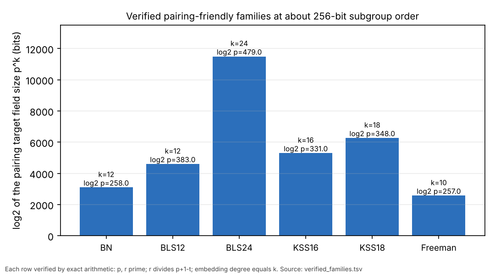

# Non-Solinas primes that give an SNFS-type route to `E(F_p)`: verified pairing-friendly families

Instrument: [`examples/snfs_pairing_prime_families.rs`](../../examples/snfs_pairing_prime_families.rs)
(run time under 2 s). Rows: [`verified_families.tsv`](verified_families.tsv).
Figure: [`figures/families.svg`](figures/families.svg). Conductor task T-5.
Context: [`research/elliptic_snfs_survey_20261016`](../elliptic_snfs_survey_20261016/README.md) §0 row A and §4A;
[`research/solinas_distribution_20261023`](../solinas_distribution_20261023/README.md).

## Answer

The only primes that open a special-number-field-sieve route to an elliptic
curve are the primes of **pairing-friendly polynomial families**. They are not
Solinas primes. The route is not on `E(F_p)` itself: it is the MOV / Frey–Rück
map into `F_{p^k}*` with small embedding degree `k`, where the special
polynomial `p = P(u)` with small coefficients makes `F_{p^k}` a target for
SNFS-type algorithms (SexTNFS). A prime of any other shape, special or not, has
`k` about as large as `r` for a curve of prime order, and the target field
`F_{p^k}` is out of reach.

Claim classes: the rows below are **exact computations**. The statement that no
other prime shape opens a route is the survey's literature-based argument
(`[lit]`), not something this run establishes.

## Verified parameters (about 256-bit subgroup order)

Each row was checked with exact big-integer arithmetic: `p` and `r` prime,
`r ∣ p + 1 − t` for the family's trace polynomial `t`, and the embedding degree
`min{k : r ∣ p^k − 1}` computed by the repository's `embedding_degree` equals
the family's `k`. The program reports a failed check as a failure. All 12 rows
passed. The first row of each family:

| family | `deg P` | `log₂ p` | `log₂ r` | `ρ = log p / log r` | verified `k` | `log₂ p^k` | `u` (hex) |
|:--|--:|--:|--:|--:|--:|--:|:--|
| Barreto–Naehrig | 4 | 258 | 258 | 1.00 | 12 | 3096 | `0x8000000000000359` |
| BLS12 | 6 | 383 | 257 | 1.49 | 12 | 4596 | `0x10000000000001cb6` |
| BLS24 | 10 | 479 | 385 | 1.24 | 24 | 11496 | `0x100000000016e` |
| KSS16 | 10 | 331 | 257 | 1.29 | 16 | 5296 | `0x40000ef75` |
| KSS18 | 8 | 348 | 256 | 1.36 | 18 | 6264 | `0x1000000018fa` |
| Freeman | 4 | 257 | 257 | 1.00 | 10 | 2570 | `0x80000000000021fe` |

Polynomials used, with the family trace `t`: BN `p = 36u⁴+36u³+24u²+6u+1`,
`r = 36u⁴+36u³+18u²+6u+1`, `t = 6u²+1`; BLS `r = Φ_k(u)`,
`p = (u−1)²r/3 + u`, `t = u+1` (`k = 12, 24`); KSS16, KSS18 and Freeman as written in
the example source. A second parameter set per family is in the table file.

## What this does not show

- **No security level is claimed.** SexTNFS cost at these field sizes needs a
  verified cost formula. The BN-254 and BLS12-381 figures quoted in the survey
  come from secondary sources and stay marked unverified.
- A smaller `ρ` or a shorter `p` does not mean the prime is more exposed: the
  exposure is the size and special structure of `p^k`.
- These curves are pairing curves, not general ECDLP curves, and this is not
  an improvement over the index-calculus baseline or over matched rho.
- Primes of other special shapes (Proth/FFT primes `c·2^m + 1`, `Φ_d(m)` primes,
  smooth `p ± 1`) are special for `F_p*` or for the PKM factor base, which the
  repository measured as giving no end-to-end gain. They give no small `k`.
- Not covered: Cocks–Pinch and Brezing–Weng constructions, MNT curves
  (`k = 3, 4, 6`), and composite-degree towers.
