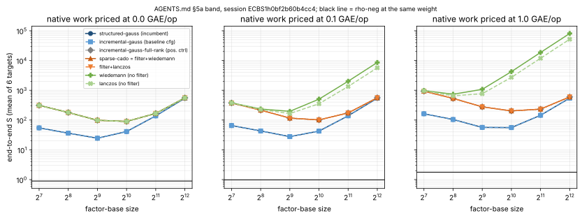
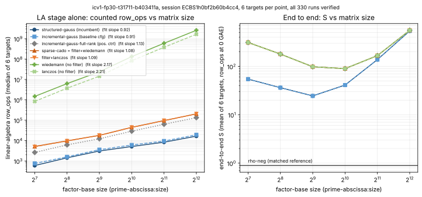

# Sparse relation matrices in `ic.pipeline`: first paired measurement (2026-10-18)

IC leads follow-up, lead 2 (`research/ic_leads_review_20261018/README.md`
§3.3–3.4). This is the first timing of the four relation matrices PR #2162
made reachable from `ic.pipeline`:

- `sparse-cado` = `filter+wiedemann`
- `filter+lanczos`
- `wiedemann`
- `lanczos`

They are measured against the incumbent `structured-gauss` and against the
baseline row's `incremental-gauss`.

- **Protocol:** [`PROTOCOL.md`](PROTOCOL.md), frozen in commit `6414d1575`
  before any measured run, and pinned by [`SHA256SUMS`](SHA256SUMS).
- **Specs:** [`specs/`](specs/).
- **Sessions, audits and saved comparisons:** [`sessions/`](sessions/).
- **Task cards and receipts:** [`cards/`](cards/), [`receipts/`](receipts/).
- **Analysis tables:** [`analysis/`](analysis/).
- **Graphs:** [`figures/`](figures/).
- **Report:** [`REPORT.pdf`](REPORT.pdf).

## Verdict

**Null or negative result. No arm lowers end-to-end `S` against the
baseline, and none is an improvement under AGENTS.md "Success criterion".**

All four deferred sparse matrices cost more end to end than the baseline
and the incumbent, on every workload where they differ at all:

- **E(F_{29⁴}) `k = 4` ladder (S1):** they cost the same as the baseline
  on one workload and 1.398× on the other, 1.206× in total.
- **LA-scaling curve (S2):** they cost 5.72× more at 128 columns, falling
  to 1.030× at 4,096 columns.

The cause is the completion rule, not the linear algebra:

- The deferred solvers answer only at full column rank.
- `structured-gauss` and `incremental-gauss` stop as soon as the target's
  column is pinned.
- The full-rank arms therefore draw 1.75× more relations on S1 workload 2,
  and 5.5–10.5× more on S2.
- The positive control `incremental-gauss-full-rank` uses the same rule
  with dense elimination. It reproduces the sparse arms' end-to-end `S` on
  every workload, to within the linear-algebra charge.

**Stage only.** On the like-for-like full-rank matrix:

- `sparse-cado` and `filter+lanczos` count 1.47–1.97× the `row_ops` of
  `incremental-gauss-full-rank`. That count is a lower bound: the
  block × block recurrence arithmetic is not counted.
- Their L0 wall time per linear-algebra stage falls from 2.0× at 128
  columns to 0.52× at 4,096 columns.
- The unfiltered `wiedemann` and `lanczos` count 10³–10⁴× more `row_ops`
  than `structured-gauss`, growing as about columns^2.2.

The wall-time crossover is descriptive only (isolation L0 on a shared VM).
It is not ranked and is not a stage improvement: in counted units the
filtered solvers lose at every size.

## 1. Baseline (named before measuring)

| workload | baseline | end-to-end `S` (cold, every phase) | protocol and receipts |
|:--|:--|--:|:--|
| E(F_{29⁴}) `k = 4` ladder: `fp4_torsion p = 29 seed 1 max_cofactor 16`, r = 44,263 | `ic-d4-chains`: `fghr-y-line:zero=1` + `gaudry-d4:macaulay=26,weighted=1,chains=1,sparsest=1,replay=1,charge_unsolved=1`, `linalg = incremental-gauss` | 1,653,062.3649 (`Wc87e324798ff`), 1,779,983.1215 (`W1016932647b2`) | `research/gaudry_quartic_d4_cost_20261014/` (`PROTOCOL.md`, session `k4-p29-d4cost`) |
| Genus 3 after cubic GHS | round 4's `r2:lpsgebw2` family (`examples/ic_improve4_01_genus3_rel.rs`) | relative only | `research/ic_improve4_20261015/` |

- **No leaderboard row.** `docs/ic/leaderboard.json` (tables A–C) has no
  F(p⁴) or genus-3 row; the rows above are the best verified pipelines in
  the files it cites.
- **Genus 3 is not measured.** It is not reachable from `ic.pipeline`
  (PROTOCOL §2). It needs a genus-3 curve kind in ecbench, or the
  relation-matrix registry wired into its example.
- **The F(p⁴) curve has no ICV1 slug in the registry.** ecbench records it
  as `fpk-29-4`, and the registry builder has no `fp4_torsion` producer.
- **The S2 curve is also unregistered.** `prime_search bits 30 seed 59297`
  is named by its construction here. Main's registry is stale against its
  builder (2,572 curves committed against 8,032 on rebuild), and the
  cover-transfer checks pin the committed catalog. A rebuild in this PR
  therefore cascaded into unrelated checks and was reverted (`8de6d2ed1`).

## 2. Design

Both specs use the same arms; only `linalg` varies among the IC arms.

| arm | `linalg` | role | stop rule |
|:--|:--|:--|:--|
| `rho-neg` | `rho.negation` | matched reference | — |
| `sg`, `sg-aa` | `structured-gauss` | incumbent, A/A | target pinned |
| `ig` | `incremental-gauss` | baseline row's configuration (gate G0) | target pinned |
| `igfr` | `incremental-gauss-full-rank` | positive control | full rank |
| `sparse-cado`, `filter-wiedemann`, `filter-lanczos`, `wiedemann`, `lanczos` | the four names (`filter-wiedemann` is the alias of `sparse-cado`) | candidates | full rank (deferred) |

ecbench derives one algorithm seed per workload, shared by every arm. All
IC arms therefore see the same relation stream, and pairs differ only in
when they stop and in their linear-algebra work.

**S1 (F(p⁴) ladder).** The baseline's curve, its 2 targets and its seeds:
20 runs.

**S2 (LA scaling).** One 30-bit prime curve (r = 968,795,183) and 6
targets. The factor base is `prime-abscissa:size` = 128, 256, …, 4,096 with
`mitm:negation_folded=1`. Factor-base size is the only other variable:
330 runs.

**Host and units.** Intel Xeon @ 2.10 GHz with 4 vCPU, shared, no PMU.
Runs earned L1–L2 on the run CPU, and the protocol requires only L0.
Counted operations are the unit; wall time is secondary.

## 3. Gates and controls

| gate | result |
|:--|:--|
| G0: `ig` reproduces the baseline row | **pass.** Both workloads are bit-identical to `k4-p29-d4cost`'s `ic-d4-chains` records: `S`, `total_gae`, every counter, the recovered log and the algorithm seed |
| Every answer verified | **pass.** S1 20/20, S2 330/330 (`[d]G = Q`, equal to the planted `d`) |
| Replay audit | S2: `ecbench verify --replay-all` OK, 330/330 replays (`sessions/prime-scaling.audit.json`). S1: AUDIT_S1 |
| A/A | **pass.** `sg-aa` equals `sg` in every count on all 38 workloads, and `filter-wiedemann` equals `sparse-cado` likewise. On wall time `ecbench compare` admits the A/A as 0.978 (L0, descriptive) |
| Positive control | **pass.** `igfr` collects strictly more relations than `ig` on every S2 workload (median 341.5 against 62 at 128 columns, 18,885.5 against 1,794.5 at 4,096). On S1 it collects the same on `Wc87e324798ff` (9) and more on `W1016932647b2` (14 against 8) |

## 4. End to end (every phase, cold)

### S1: E(F_{29⁴}) ladder (session `fp4-p29-r2`)

| arm | `S` `Wc87e324798ff` | `S` `W1016932647b2` | relations | trials | LA `row_ops` | gap to `rho-neg` (mean `S`) |
|:--|--:|--:|:--|:--|:--|--:|
| `rho-neg` | 1.0647 | 1.4117 | — | — | — | 1 |
| `ig` (baseline) | 1,653,062.365 | 1,779,983.122 | 9 / 8 | 574 / 635 | 189 / 158 | 1.386·10⁶ × |
| `sg`, `sg-aa` | 1,653,062.364 | 1,779,983.120 | 9 / 8 | 574 / 635 | 170 / 122 | 1.386·10⁶ × |
| `igfr` (pos. ctrl) | 1,653,062.365 | 2,487,930.024 | 9 / 14 | 574 / 885 | 189 / 208 | 1.672·10⁶ × |
| `sparse-cado`, `filter-wiedemann`, `filter-lanczos` | 1,653,062.369 | 2,487,930.064 | 9 / 14 | 574 / 885 | 277 / 1,032 | 1.672·10⁶ × |
| `wiedemann` | 1,653,062.671 | 2,487,932.264 | 9 / 14 | 574 / 885 | 6,441 / 45,940 | 1.672·10⁶ × |
| `lanczos` | 1,653,062.441 | 2,487,930.165 | 9 / 14 | 574 / 885 | 1,739 / 3,103 | 1.672·10⁶ × |

- **Totals.** Over the two pairs, every full-rank arm costs 1.2062× `ig`
  and `sg`. The arms are equal on `Wc87e324798ff` and 1.3977× on
  `W1016932647b2`. With two workloads, the paired interval is the two
  ratios themselves, [1.000, 1.398] (FP4_COMPARE).
- **Where the cost is.** Linear algebra is at most 2·10⁻⁵ of `S`. The
  relation phase, which is the D₄ oracle, is all of it.
- **Band (§5a).** `ecbench band` refuses this session: the records are
  priced through pinned timing units, and the registry has no calibration
  row for this curve. Bounded from the recorded counts instead:
  - Pricing every `row_op` at 1 GAE adds at most 45,940 / √r = 218 S
    units (`wiedemann`, `W1016932647b2`), against arm differences of
    7.08·10⁵.
  - Pricing `rho-neg`'s 75 / 140 `canonicalisations_uncharged` at 1 GAE
    adds 0.36 / 0.67 S.
  - So the order holds at 0, 0.1 and 1 GAE: target-pin arms below the
    full-rank arms on `W1016932647b2`, and unresolved (tied) on
    `Wc87e324798ff`.
  - The missing calibration row is recorded as an implementation gap.

### S2: LA scaling (session `prime-scaling`)

The ratio is `ecbench compare`'s paired totals ratio over 6 workloads (95 %
cluster bootstrap); `S` is at 0 GAE per native operation. The full table at
all three band weights is in
[`analysis/prime-scaling-summary.md`](analysis/prime-scaling-summary.md).

| columns | `sg` `S` | deferred arms `S` | deferred ÷ `sg` [95 %] | `igfr` ÷ `sg` | relations `sg` → full rank | gap to rho: `sg` / deferred |
|--:|--:|--:|:--|:--|:--|:--|
| 128 | 54.50 | 311.94 | 5.724 [4.336, 7.913] | 5.724 | 62 → 341.5 | 61× / 350× |
| 256 | 36.24 | 179.36 | 4.950 [4.027, 6.263] | 4.950 | 137.5 → 743.5 | 41× / 201× |
| 512 | 24.50 | 98.12 | 4.004 [3.384, 4.868] | 4.004 | 291 → 1,440 | 27× / 110× |
| 1,024 | 41.04 | 89.77 | 2.187 [2.024, 2.295] | 2.187 | 524.5 → 3,904 | 46× / 101× |
| 2,048 | 137.94 | 166.63 | 1.208 [1.192, 1.224] | 1.208 | 901 → 8,755 | 155× / 187× |
| 4,096 | 540.98 | 557.10 | 1.030 [1.026, 1.033] | 1.030 | 1,794.5 → 18,885.5 | 607× / 625× |

- **Band.** `ecbench band --ranks`
  ([`analysis/band-prime-scaling-same-size.txt`](analysis/band-prime-scaling-same-size.txt))
  ranks `sg` and `ig` below every deferred arm at every size and every
  weight.
- **Deferred arms are tied at 0 GAE.** They share their relations, so the
  band calls them unresolved against one another and against `igfr`.
- **At 1 GAE per `row_op`,** `wiedemann` and `lanczos` rise to 4.6·10⁴×
  and 2.9·10⁴× rho at 4,096 columns.
- **Why the ratio shrinks.** It falls with size because the pair table
  (`oracle_setup`, N²/2 sums) comes to dominate `S`. The relation penalty
  itself grows: 5.5× more relations at 128 columns, 10.5× at 4,096.

## 5. The linear-algebra stage alone

Medians are over 6 targets. `row_ops` counts one multiply-subtract per
non-zero; the sparse arms' recurrence arithmetic is not counted, so their
counts are lower bounds. Wall time is the phase's own clock (L0).

| columns | `sg` row_ops | `igfr` row_ops | filtered (`sparse-cado` / `filter+lanczos`) | filtered ÷ `igfr` | unfiltered `wiedemann` / `lanczos` | wall ms `igfr` → filtered |
|--:|--:|--:|--:|--:|--:|:--|
| 128 | 598 | 2,624 | 5,162 / 4,992 | 1.97 / 1.90 | 1.47·10⁶ / 8.35·10⁵ | 2.2 → 4.4 |
| 256 | 1,426 | 6,147 | 9,723 / 9,553 | 1.58 / 1.55 | 6.25·10⁶ / 3.71·10⁶ | 4.7 → 7.3 |
| 512 | 3,088 | 12,272 | 18,090 / 17,920 | 1.47 / 1.46 | 2.38·10⁷ / 1.44·10⁷ | 10.0 → 14.1 |
| 1,024 | 5,128.5 | 28,920.5 | 44,620.5 / 44,450.5 | 1.54 / 1.54 | 1.32·10⁸ / 8.28·10⁷ | 37.5 → 33.4 |
| 2,048 | 8,348.5 | 63,166 | 95,845 / 95,675 | 1.52 / 1.51 | 5.97·10⁸ / 3.79·10⁸ | 159.0 → 103.9 |
| 4,096 | 16,486 | 133,595.5 | 204,604 / 204,434 | 1.53 / 1.53 | 2.59·10⁹ / 1.65·10⁹ | 684.5 → 356.9 |

Note that `sg`'s matrix is smaller than `igfr`'s: it stops at target pin.

**Scaling with matrix size.** These are descriptive least-squares slopes of
log median `row_ops` against log columns over the six sizes, drawn on
[`figures/scaling.svg`](figures/scaling.svg):

- `structured-gauss`: 0.92
- `incremental-gauss`: 0.91
- `incremental-gauss-full-rank`: 1.13
- `sparse-cado` / `filter+lanczos`: 1.08 / 1.09
- `wiedemann` / `lanczos`: 2.17 / 2.21

Relations needed grow as about columns^0.97 under the target-pin rule and
columns^1.16 under the full-rank rule.

## 6. Classification (AGENTS.md §3, "Success criterion")

- **End to end.** This is a negative result: a regression of 1.03–5.72×
  on S2 and up to 1.398× on S1. It comes from the completion rule the
  deferred solvers require, not from their arithmetic. It is not an
  improvement, and the leaderboard's tables A–C are unchanged.
- **Stage.** There is no stage improvement in counted units. The L0
  wall-time lead of the filtered solvers at ≥ 1,024 columns is descriptive
  only and is not a claim.
- **Distance to rho.** This is unchanged by this study: the baseline stays
  at 1.386·10⁶× matched rho on E(F_{29⁴}). On S2, `structured-gauss` sits
  at 27–607× rho.

## 7. Execution record

- **Model tiers.** Cards were compiled by `experiment-director` and run by
  `executor-mechanical` through `tools/task_card.py`.
- **Card 1.** Its tool process was killed during its third command by the
  executor environment's 30-minute background limit, so it has no card
  receipt.
  - Commands 1–2 (the S2 run and audit) had completed: see
    `receipts/run-prime-scaling.*` and `receipts/verify-prime-scaling.*`.
  - The killed S1 attempt is kept as `sessions/fp4-p29` (`interrupted`,
    2 records) and is not used.
- **Cards 2–3.** S1 was re-run into `sessions/fp4-p29-r2` (card 2, receipt
  `cards/CARD-sparse-la-timing-20261018-2.receipt.json`, exit 0, 4,113 s)
  and audited by card 3.
  - The main session added one environment line outside the relayed card
    text: use the maximum background timeout.
  - Card 2's executor stopped on an API usage limit before reporting. Its
    execution was assessed from the receipt (`cards/*assessment*`).
- **Pilot.** Two scratch feasibility sessions (PROTOCOL §8) were run before
  freezing and are excluded.
- **Conductor.** Task T-1 ran on a local control plane on port 8099, as
  port 8080 was taken; `conductor check` was clear.

## 8. Next improvement to try

**A deferred sparse solver that stops when the target is pinned, not at
full rank.**

- **Mechanism.** The target's log is determined once the target column's
  unit vector lies in the row space of the collected rows. That is testable
  on the filtered matrix with one Krylov solve of the transposed system.
  When the test succeeds, the solve stops at `structured-gauss`'s row.
- **Effect.** This removes the 1.75× (S1) and 5.5–10.5× (S2) relation
  penalty measured here, leaving only the stage difference.
- **Gate.** Re-run S1 and S2 unchanged. The new arm must use exactly
  `structured-gauss`'s relation count on every workload, and its answer
  must be verified.
- **Prerequisite.** Count the block × block recurrence arithmetic first,
  so the stage comparison is not a lower bound. That is an accounting
  change, recorded as such.
- **Then measure where linear algebra carries weight.** Genus 3 after
  cubic GHS (local q^1.52) and the stacked D₄ + double-large-prime F(p⁴)
  arm. In both, a linear-algebra change can move end-to-end `S`. On
  today's F(p⁴) baseline it cannot: linear algebra is ≤ 2·10⁻⁵ of `S`.
