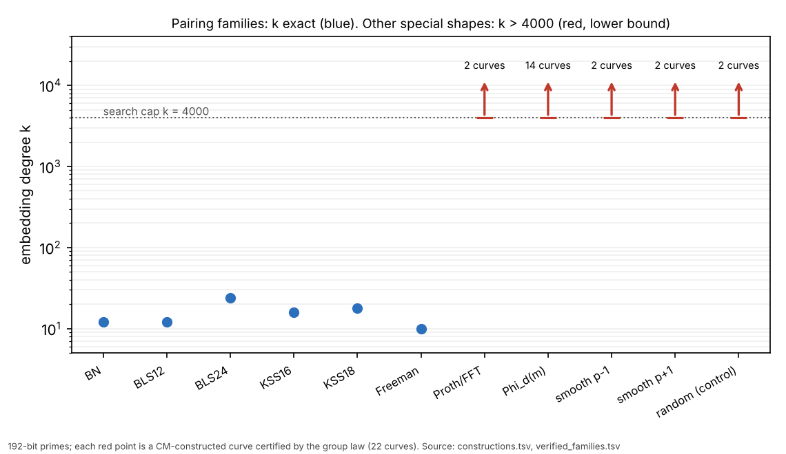

# Curves over the other special prime shapes: constructed, certified, embedding degree

Instrument: [`examples/special_prime_curve_constructions.rs`](../../examples/special_prime_curve_constructions.rs)
(run time 1.4 s, seed `20261023`, 192-bit primes). Rows:
[`constructions.tsv`](constructions.tsv), log `constructions.log`.
Figure: [`figures/k_lower_bounds.svg`](figures/k_lower_bounds.svg).
Follows the open item in
[`research/snfs_prime_families_20261023`](../snfs_prime_families_20261023/README.md):
Proth/FFT, `Φ_d(m)` and smooth `p ± 1` primes were stated to give no small `k`;
this builds the curves and computes it.

## What was constructed

For each shape, primes of about 192 bits, then for each prime an explicit curve
`y² = x³ + ax + b` over `F_p` whose group order is `r·h`, `r` prime and
`h ∈ {1, 2, 3, 4, 6, 8}`, by the CM method with class-number-one discriminants
`D ∈ {3, 4, 7, 8, 11, 19, 43, 67, 163}`: Cornacchia gives `4p = t² + D v²`, the
candidate orders are `p + 1 − τ` over the twist traces `τ`, and the twist is
found by random search.

- **Proth/FFT**: `c·2^178 + 1`, `c` odd of 14 bits.
- **`Φ_d(m)`**: `d ∈ {3, 4, 5, 6, 8, 10, 12}`, `m` random.
- **Smooth `p − 1`** and **smooth `p + 1`**: `2·∏q + 1` and `2·∏q − 1`, with
  `q` random primes below `2^20`.
- **Generic control**: random 192-bit primes through the same pipeline.

## Certificates and checks (exact computation)

Each of the 22 rows carries the curve `(a, b)` and a point `Q`. Certificate: `Q`
on the curve, `Q ≠ O`, `[r]Q = O`, `r` prime and `r > 4√p`. The point `Q` then
has order exactly `r`, so `r ∣ #E`; Hasse's interval has width `4√p < r`, so
`#E = r·h` is forced. The embedding degree is computed as the order of `p` mod
`r`, up to a cap of 4000.

- All 22 rows certified by the program.
- An independent cross-check in a separate implementation (Python in scratch,
  not committed: re-derives the candidate orders by its own Cornacchia, finds
  the `r` with `[r]Q = O`, tests primality, and checks `k > 4000`) passed 22
  of 22.

## Result

| shape | curves | `D` used | `h` | `log₂ r` | `k` |
|:--|--:|:--|:--|:--|:--|
| Proth/FFT | 2 | 3, 4 | 1, 2 | 192 | `> 4000` |
| `Φ_d(m)`, 7 values of `d` | 14 | 3, 4, 19, 43, 163 | 1–8 | 187–192 | `> 4000` |
| smooth `p − 1` | 2 | 67, 163 | 1 | 202, 208 | `> 4000` |
| smooth `p + 1` | 2 | 3, 4 | 4 | 192, 200 | `> 4000` |
| random (control) | 2 | 163 | 1 | 192 | `> 4000` |

For contrast, the pairing-friendly rows from the sibling report have exact
`k` of 10 to 24 at the same subgroup size. Special shape of `p` does not
produce a small `k`: nothing here departs from the random control.

## What this does not show

- A cap of 4000 is not a proof that `k` is huge. For `r` of 190 bits, `k` is
  expected near `r`; the exact value would need the factorisation of `r − 1`.
- It builds, per shape, two curves of prime or near-prime order. It does not
  test whether special primes make small `k` more or less *likely* over all
  curves. That needs a protocol with a null and a power check, and the hit
  counts here (2 per shape) support no such comparison. The number of primes
  tried before a hit is not evidence of anything.
- The `Φ_d` family also contains CM curves where `r` is a `Φ_{d'}` value
  (for instance `p = Φ_3(m)` has a `D = 3` curve of order `Φ_6(m)`). These are
  among the structured curves; this run found them only when the random search
  landed on them, and it did not look for them on purpose.
- It says nothing about the PKM factor-base route (measured separately, no
  gain), about `F_p*` (where Proth primes with small `c` and `Φ_d(m)` primes are
  SNFS-special), or about security.
