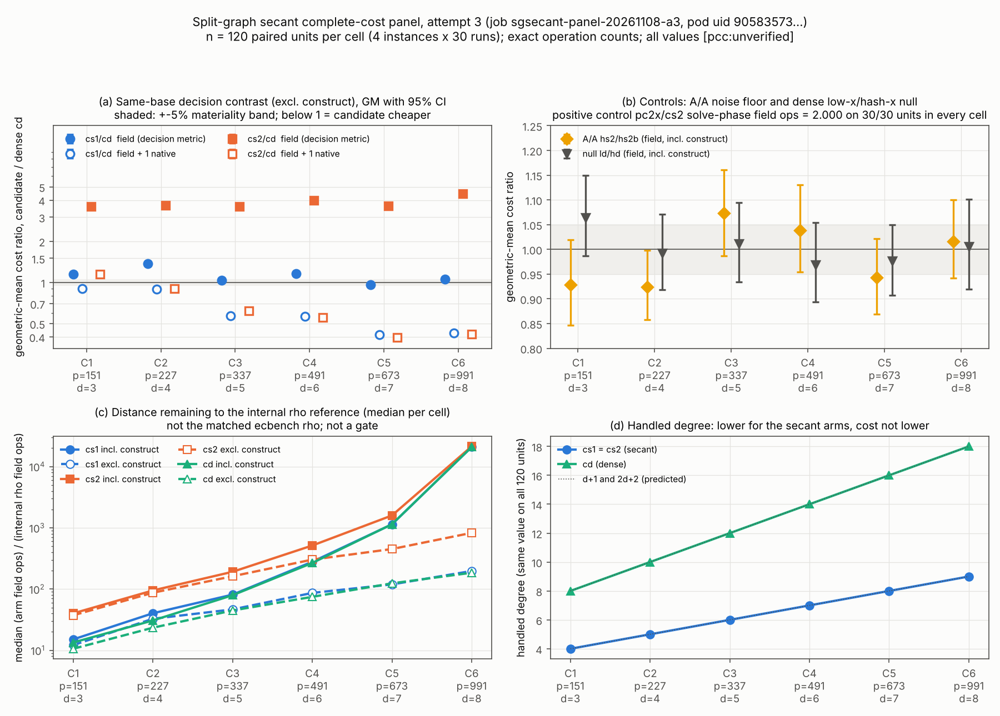

# RESULTS: split-graph secant complete-cost panel, attempt 3 (slug sgsecant)

**Verdict (PROTOCOL.md section 9, applied mechanically to the admitted attempt-3 panel):**
**REJECTED at the tested scale for both candidates, `cs1` and `cs2`, and additionally UNRANKED under section 5a.** `[pcc:unverified]`

All gates in section 8 pass, and all 6 cells are clean. No cell advances for either candidate.
- **`cs1`** (secant, four solves): its `field` verdict against the same-base dense arm `cd` is `higher` in 4 cells and `indistinct` in 2. It is never `lower`.
- **`cs2`** (secant, two epsilon-shared solves): its `field` verdict is `higher` in all 6 cells, with ratios from 3.59 to 4.44.

The handled degree falls from 2d+2 (dense) to d+1 (secant) on every unit. The complete same-base field-operation cost per independent relation does not fall.

With native work priced at 1 unit per operation, the order reverses: in 6/6 cells for `cs1` and in 5/6 cells for `cs2`. Under section 5a the pair is therefore not ranked in the candidate's favour, and not against it either. The one exception is `cs2` in C1, where the order holds across the whole band, against the candidate.

This is a toy-field, operation-count result for this counted Buchberger/FGLM engine. It is not a timing result and not a leaderboard row.

Evidence classes:
- **measured:** read from `results/A3/90583573-94c9-4b32-9381-df556d030f0c/panel/records.jsonl`, `summary.json` or `summary.txt`.
- **derived:** computed from the measured rows by the scratchpad analysis (section "Provenance of this analysis"). The output is `results/A3/analysis/a3sgsecant_summary.json`.

Every number is `[pcc:unverified]`. Each table names its source file.

## 0. Identity of the inputs (checked before analysis)

- **PROTOCOL.md** (measured): sha256 `20acbf94d87b87f47fa20b4866c79143e9df6154e64cc1a07de9e56e10a84ed1`, which equals the frozen value. Git shows a single commit touching it (`0bd1d78cbf`, 2026-11-07 20:36Z). That is before the attempt-3 pod ran (2026-11-08 10:46Z).
- **Source lock** (measured): `native/SHA256SUMS` passes `sha256sum -c` on all 9 files. The hashes equal those listed in PROTOCOL.md section 2.
- **Request** (measured): `provenance.protocol_sha256` in `eks/r2img_request_attempt3.json` equals the frozen hash. Card A3-V01 step `request-protocol-identity` returned `true`.
- **Image and binary** (measured):
  - Image: `isolab/tasks@sha256:d1ab2c5c44bc…`, tag `sgsecant-f13a690df016`, from `eks/layer-receipt.json`.
  - Source revision: `f13a690df016d0a457bd40579fbb9d054f486adf`.
  - Binary: the run's `SHA256SUMS` lists `/opt/sgsecant/sgsecant` with sha256 `dc7c013bc2ac19ae…`. That equals the build-host hash in `eks/R2_READY.md`. The binary itself is not in the results directory, so only the hash line was compared.
- **Result files** (measured): `sha256sum -c SHA256SUMS` in `results/A3/90583573-…/` passes on `records.jsonl`, `summary.json`, `summary.txt` and `config.txt`.
- **Config** (measured, `config.txt`): `name=frozen domain=sgsecant/v1 seed=3141592653`, cells (151,3) (227,4) (337,5) (491,6) (673,7) (991,8), `instances=4 runs=30 tmax=400 boot=4000`. These are the frozen values of PROTOCOL.md section 3.
- **Rows** (measured): 7,380.
  - Expected: 6 cells x 4 instances x 30 runs x 10 arms, plus 6 x 30 `pc2x` rows (instance 0 only), which is 7,380.
  - Missing: none. Extra: none. Duplicate keys: none.

## 1. Gates and controls (PROTOCOL section 8)

| gate | rule as written | result | source |
|---|---|---|---|
| 8.1 exactness | every target exact; 0 replay failures, 0 unresolved, 0 non-zero-dim; lambda recovered | **PASS**: 7,380/7,380 rows completed at rank 2d+1. All of these are 0: `exact_mismatch`, `replay_fail`, `unresolved`, `nonzero_dim_systems`, `censored_systems`, `wrong_lambda`, `inconsistent`, triangular `fallbacks` | records.jsonl (measured) |
| 8.2 self ratio | `cs2/cs2 == 1` exactly | **PASS**: GM 1.0000 and every unit ratio 1.0 in all cells. As implemented, this ratio divides each record by itself, so it cannot fail. The determinism evidence is in 8.3 and in the next row | summary.json, records.jsonl (measured) |
| (determinism, supporting) | n/a | Construction ledgers of `cs1`, `cs2` and `cd` are identical on 720/720 units, and so are `targets` and `distinct_rel`. `ls1`=`ld` construction is identical too | records.jsonl (derived) |
| 8.3 positive control | `pc2x` solve-phase field ops (build, groebner, fglm, roots, replay, verify) exactly 2.000 x `cs2` on every unit | **PASS**: 30/30 units in each of the 6 cells, 180/180 in all. Every mul, add and inv entry of those 6 phases is exactly doubled (3,240/3,240 entries) | records.jsonl (derived) |
| 8.4 A/A | `hs2/hs2b` 95% CI overlaps the +-5% band | **PASS** in all 6 cells under both scopes (table below) | summary.json, recomputed (derived) |
| 8.5 null | `ld/hd` reported; a CI "far from 1" is flagged | Reported. All 6 CIs contain 1.0, so no flag is raised | derived |
| 8.6 historical caps | not part of this panel | n/a | PROTOCOL |
| clean cells | >= 3 cells with no unmeasured unit | **6 of 6** | derived |

### A/A, null and positive control per cell (derived; `field`; bootstrap as in section 2)

| cell | A/A hs2/hs2b incl GM [CI] | overlaps +-5% | A/A half-width (ratio) | A/A excl GM [CI] | overlaps | ld/hd incl GM [CI] | contains 1 | pc2x exact 2x units | self ratio |
|---|---|---|---|---|---|---|---|---|---|
| C1 | 0.928 [0.846, 1.019] | True | 0.087 | 0.923 [0.836, 1.020] | True | 1.065 [0.987, 1.150] | True | 30/30 | 1.0000 |
| C2 | 0.924 [0.858, 0.998] | True | 0.070 | 0.919 [0.849, 0.996] | True | 0.992 [0.919, 1.071] | True | 30/30 | 1.0000 |
| C3 | 1.073 [0.987, 1.161] | True | 0.087 | 1.075 [0.983, 1.169] | True | 1.011 [0.934, 1.095] | True | 30/30 | 1.0000 |
| C4 | 1.039 [0.955, 1.130] | True | 0.088 | 1.040 [0.951, 1.137] | True | 0.969 [0.893, 1.055] | True | 30/30 | 1.0000 |
| C5 | 0.943 [0.870, 1.022] | True | 0.076 | 0.943 [0.864, 1.027] | True | 0.977 [0.908, 1.049] | True | 30/30 | 1.0000 |
| C6 | 1.016 [0.942, 1.100] | True | 0.079 | 1.017 [0.941, 1.102] | True | 1.006 [0.920, 1.101] | True | 30/30 | 1.0000 |

The noise floor of section 8.4 says that no effect smaller than the observed A/A half-width is claimed. The half-width is 0.070 to 0.088 in ratio units (derived). In log units it is 0.076 to 0.093, which gives the same exclusions. The following effects are smaller than their cell's A/A half-width, so **no difference is claimed** for them:
- `cs1/cd` on `field`, excl. construct, in C3 (1.034), C5 (0.958) and C6 (1.060). The C6 bootstrap verdict is `higher`, but by this rule that 6% excess is not claimed as an effect.
- `cs1/cd` on `field+0.1native` in C1 (1.071).

None of these exclusions changes the section 9 outcome. REJECTED needs only that the `field` verdict is "not lower", and no cell is `lower` either way.

## 2. Statistics: reproduced exactly, then cross-checked

PROTOCOL section 6 fixes the statistic:
- the ratio of total cost A/B per paired unit;
- the geometric mean per cell;
- a percentile bootstrap over 4,000 resamples of the paired units, with a fixed seed;
- the margin: `lower` iff the CI upper bound is < 0.95, `higher` iff the CI lower bound is > 1.05.

The protocol does not name the RNG. The analysis re-implemented the instrument's own SplitMix64 bootstrap (`sgsecant_panel.rs`, seed `3141592653 XOR (cell_index*7919+13)`) from the records alone. Results (derived):
- **Reproduction:** all 204 comparison rows of `summary.json` were reproduced. The maximum absolute deviation of GM, CI low and CI high is 5.0e-7, which is the 6-decimal rounding of the file. There are 0 verdict mismatches.
- **Card recheck:** card A3-V01's `sgsecant_recheck.py` independently found 600 GM rows with 0 mismatches (measured, `cards/CARD-…-A3-V01.recheck.stdout`).
- **Second bootstrap:** an independent bootstrap with a different generator (Python Mersenne Twister, 4,000 resamples) gives the same verdict on every decision-relevant row. The only row whose verdict moves is `cs2/cs1` on `field+0.1native`, incl. construct, in C6 (`higher` becomes `indistinct`). That row is descriptive and not in the protocol.

## 3. Decision table (PROTOCOL section 9; same base, excl. construct; source: summary.json, reproduced)

`advancing` means a `lower` verdict on `field` with no other convention `higher`. The band column gives the verdicts at native weights 0, 0.1 and 1, where H is higher, L is lower and ~ is indistinct.

### cs1/cd

| cell | p | d | n | `field` GM [95% CI] | `field` verdict | mul_only | inv_x10 | +0.1 native | +1 native GM [CI] | +1 native | advancing | sec. 5a band (0/0.1/1) |
|---|---:|---:|---:|---|---|---|---|---|---|---|---|---|
| C1 | 151 | 3 | 120 | 1.149 [1.138, 1.160] | **higher** | higher | higher | higher | 0.898 [0.882, 0.914] | lower | no | H/H/L (order changes) |
| C2 | 227 | 4 | 120 | 1.368 [1.359, 1.377] | **higher** | higher | higher | higher | 0.892 [0.879, 0.907] | lower | no | H/H/L (order changes) |
| C3 | 337 | 5 | 120 | 1.034 [1.030, 1.038] | **indistinct** | higher | higher | lower | 0.571 [0.562, 0.581] | lower | no | ~/L/L (order changes) |
| C4 | 491 | 6 | 120 | 1.157 [1.151, 1.162] | **higher** | higher | higher | lower | 0.567 [0.558, 0.577] | lower | no | H/L/L (order changes) |
| C5 | 673 | 7 | 120 | 0.958 [0.955, 0.961] | **indistinct** | indistinct | indistinct | lower | 0.413 [0.407, 0.420] | lower | no | ~/L/L (order changes) |
| C6 | 991 | 8 | 120 | 1.060 [1.057, 1.063] | **higher** | higher | higher | lower | 0.426 [0.420, 0.433] | lower | no | H/L/L (order changes) |

`cs1`: 6 clean cells, 0 advancing, 4 `higher` on `field`, 6 not `lower`. Outcome: **REJECTED**, with the **UNRANKED** label.

### cs2/cd

| cell | p | d | n | `field` GM [95% CI] | `field` verdict | mul_only | inv_x10 | +0.1 native | +1 native GM [CI] | +1 native | advancing | sec. 5a band (0/0.1/1) |
|---|---:|---:|---:|---|---|---|---|---|---|---|---|---|
| C1 | 151 | 3 | 120 | 3.592 [3.523, 3.660] | **higher** | higher | higher | higher | 1.146 [1.115, 1.178] | higher | no | H/H/H (order holds) |
| C2 | 227 | 4 | 120 | 3.648 [3.599, 3.694] | **higher** | higher | higher | higher | 0.898 [0.879, 0.917] | lower | no | H/H/L (order changes) |
| C3 | 337 | 5 | 120 | 3.586 [3.548, 3.622] | **higher** | higher | higher | higher | 0.620 [0.605, 0.634] | lower | no | H/H/L (order changes) |
| C4 | 491 | 6 | 120 | 3.981 [3.936, 4.022] | **higher** | higher | higher | higher | 0.557 [0.542, 0.571] | lower | no | H/H/L (order changes) |
| C5 | 673 | 7 | 120 | 3.639 [3.611, 3.666] | **higher** | higher | higher | higher | 0.395 [0.385, 0.404] | lower | no | H/H/L (order changes) |
| C6 | 991 | 8 | 120 | 4.443 [4.416, 4.470] | **higher** | higher | higher | higher | 0.418 [0.409, 0.427] | lower | no | H/H/L (order changes) |

`cs2`: 6 clean cells, 0 advancing, 6 `higher` on `field`, 6 not `lower`. Outcome: **REJECTED**, with the **UNRANKED** label.

The instrument's own classification agrees: summary.txt "PROTOCOL DECISION", and `summary.json` `decision` reads REJECTED for both candidates (measured). It counts 6 and 5 convention-dependent cells for `cs1` and `cs2`.

**Rule-reading notes.** Neither note changes the outcome, so neither is UNRESOLVED.
- **"Order differs" in the UNRANKED clause.** Read as a strict reversal (`field` higher, another convention lower), the clause covers `cs1` cells C1, C2, C4, C6 and `cs2` cells C2 to C6. Read as any verdict difference, it covers all 6 `cs1` cells and the same 5 `cs2` cells. Both readings give "some cells", so the UNRANKED label holds under either.
- **Metric and scope of the A/A check.** The protocol does not state which metric and scope 8.4 uses. The gate passes under `field` with construction included and with it excluded.

### Construction included (reported alongside, section 7; source: summary.json)

| cell | cs1/cd field GM [CI] | verdict | cs2/cd field GM [CI] | verdict |
|---|---|---|---|---|
| C1 | 1.126 [1.116, 1.136] | higher | 3.133 [3.047, 3.219] | higher |
| C2 | 1.286 [1.273, 1.298] | higher | 3.034 [2.951, 3.114] | higher |
| C3 | 1.022 [1.019, 1.024] | indistinct | 2.529 [2.456, 2.607] | higher |
| C4 | 1.045 [1.040, 1.050] | indistinct | 1.785 [1.700, 1.874] | higher |
| C5 | 0.994 [0.993, 0.995] | indistinct | 1.363 [1.307, 1.422] | higher |
| C6 | 1.001 [1.001, 1.002] | indistinct | 1.073 [1.058, 1.089] | higher |

The shared graph construction dilutes the ratio toward 1, as section 7 says it will. At d = 8 it is about 99% of each graph arm's complete cost.

### Cross-base controls (`field`; section 7: primary scope incl. construct, reported, not decision-gating; source: derived)

| cell | cs1/ls1 incl | cs1/hs1 incl | cs2/ls2 incl | cs2/hs2 incl | cs1/ls1 excl | cs1/hs1 excl | cs2/ls2 excl | cs2/hs2 excl |
|---|---|---|---|---|---|---|---|---|
| C1 | 0.70 L | 0.75 L | 1.89 H | 2.05 H | 0.63 L | 0.68 L | 1.91 H | 2.09 H |
| C2 | 0.88 L | 0.87 L | 1.83 H | 1.82 H | 0.76 L | 0.76 L | 1.78 H | 1.77 H |
| C3 | 1.06 ~ | 1.05 ~ | 1.95 H | 1.96 H | 0.68 L | 0.68 L | 1.72 H | 1.74 H |
| C4 | 2.77 H | 2.66 H | 3.35 H | 3.25 H | 0.78 L | 0.74 L | 1.84 H | 1.77 H |
| C5 | 7.00 H | 6.85 H | 6.42 H | 6.27 H | 0.71 L | 0.69 L | 1.73 H | 1.68 H |
| C6 | 60.04 H | 60.64 H | 39.00 H | 39.46 H | 0.72 L | 0.73 L | 1.81 H | 1.83 H |

Excluding construction, the four-solve secant on the graph base (`cs1`) costs 0.63 to 0.78 of the same extractor on an equal-size nongraph base. Including construction, the graph search makes it 2.7x to 60x more expensive from d = 6 on.

## 4. Per-arm medians (source: derived from records.jsonl; the `cs1`, `cs2` and `cd` medians agree with summary.txt)

These are field ops per independent relation (the rank, 2d+1). Native ops are excl. construct. "Rho distance" is the arm's complete field ops divided by the internal rho reference's field ops on the same `(E, G, H)`. It is distance remaining, not a gate.

| cell | arm | field/rel incl | field/rel excl | native/rel | construct share | targets | handled deg | quotient dim (sum) | solves | rho distance incl | rho distance excl |
|---|---|---:|---:|---:|---:|---:|---:|---:|---:|---:|---:|
| C1 | cs1 | 9094 | 7736 | 16752 | 0.165 | 16.0 | 4 | 14.0 | 64 | 15.1 | 12.2 |
| C1 | cs2 | 26477 | 24646 | 7022 | 0.059 | 16.0 | 4 | 190.0 | 32 | 40.1 | 37.3 |
| C1 | cd | 8089 | 6816 | 20751 | 0.184 | 16.0 | 8 | 14.0 | 16 | 13.4 | 10.6 |
| C2 | cs1 | 19544 | 15686 | 41432 | 0.167 | 20.0 | 5 | 20.0 | 80 | 40.3 | 32.7 |
| C2 | cs2 | 46223 | 42972 | 15191 | 0.070 | 20.0 | 5 | 317.5 | 40 | 94.9 | 87.1 |
| C2 | cd | 15118 | 11354 | 50748 | 0.220 | 20.0 | 10 | 20.0 | 20 | 30.7 | 23.4 |
| C3 | cs1 | 34417 | 20468 | 60996 | 0.401 | 26.0 | 6 | 27.0 | 104 | 81.1 | 46.5 |
| C3 | cs2 | 85651 | 72233 | 18434 | 0.162 | 26.0 | 6 | 518.5 | 52 | 191.4 | 161.8 |
| C3 | cd | 33815 | 19695 | 119980 | 0.410 | 26.0 | 12 | 27.0 | 26 | 79.3 | 44.7 |
| C4 | cs1 | 116590 | 35881 | 122942 | 0.694 | 32.0 | 7 | 35.5 | 128 | 279.0 | 86.5 |
| C4 | cs2 | 216034 | 125808 | 33514 | 0.387 | 32.0 | 7 | 767.0 | 64 | 513.9 | 302.6 |
| C4 | cd | 110517 | 30557 | 243269 | 0.725 | 32.0 | 14 | 35.5 | 32 | 266.7 | 74.6 |
| C5 | cs1 | 661219 | 44472 | 171995 | 0.893 | 40.0 | 8 | 43.5 | 160 | 1139.0 | 119.2 |
| C5 | cs2 | 816664 | 168342 | 37745 | 0.692 | 40.0 | 8 | 1119.5 | 80 | 1590.6 | 450.5 |
| C5 | cd | 663443 | 46835 | 481296 | 0.888 | 40.0 | 16 | 43.5 | 40 | 1144.0 | 124.1 |
| C6 | cs1 | 7846192 | 69369 | 297642 | 0.990 | 48.5 | 9 | 51.0 | 192 | 20837.0 | 197.1 |
| C6 | cs2 | 8143365 | 290857 | 65313 | 0.958 | 48.5 | 9 | 1534.5 | 96 | 21343.3 | 827.2 |
| C6 | cd | 7840469 | 66131 | 807693 | 0.991 | 48.5 | 18 | 51.0 | 48 | 20830.0 | 184.7 |

**Distance remaining to the internal rho reference** (median, `field`, incl. construction, derived). This is the internal r-adding Floyd walk on the same instance. It is **not** the matched ecbench rho with the section 5a band, which a leaderboard row would need.

| cell | cs1 | cs2 | cd |
|---|---:|---:|---:|
| C1 | 15.1x | 40.1x | 13.4x |
| C2 | 40.3x | 94.9x | 30.7x |
| C3 | 81.1x | 191.4x | 79.3x |
| C4 | 279.0x | 513.9x | 266.7x |
| C5 | 1,139x | 1,591x | 1,144x |
| C6 | 20,837x | 21,343x | 20,830x |

These medians equal `summary.json` `gap_to_internal_rho_median` to 3 decimals. Excluding construction, the distance at d = 8 is 197x (`cs1`), 827x (`cs2`) and 185x (`cd`). The distance grows with the cell for every arm.

## 5. Pre-registered expectations (PROTOCOL section 10) and whether they held

| # | expectation (section 10, disclosed from development runs) | result | held |
|---|---|---|---|
| E1 | the extractor is exact | 0 mismatches, replay failures, unresolved, non-zero-dim, censored or fallbacks on 7,380 rows | **held** |
| E2 | handled degree d+1 for the candidate against 2d+2 for dense | `cs1`, `cs2`: exactly d+1 (4, 5, 6, 7, 8, 9) on every unit. `cd`: exactly 2d+2 (8 to 18) on every unit | **held** |
| E3 | `cs1` complete same-base field cost at or above `cd`, "about 1.0 to 1.4x" | GM 1.149, 1.368, 1.034, 1.157, 0.958, 1.060. Never `lower`. C5 is 0.958, below 1.0 but `indistinct` (CI [0.955, 0.961], just outside the 0.95 margin) | **held in 5/6 cells as a literal range; C5 below the stated range but within materiality** |
| E4 | `cs2` "about 2 to 4x" above `cd` | 3.59, 3.65, 3.59, 3.98, 3.64, 4.44 | **held in 5/6; C6 (4.44) above the stated range** |
| E5 | `+1 native` flips the order for `cs1` and `cs2` in several cells | `+1 native` is `lower` for `cs1` in 6/6 cells and for `cs2` in 5/6 (not C1) | **held** |
| E6 | expected frozen outcome: REJECTED on field ops with a native-weight-dependent order (UNRANKED under 5a) | REJECTED and UNRANKED for both candidates | **held** |

Two other expectations from DESIGN.md and README.md are not section-10 predictions. They are scored descriptively:
- **E2 costs more than E1.** DESIGN.md section 3 says PROTOCOL.md pre-registers this as a secondary comparison, but PROTOCOL.md has no `cs2/cs1` contrast. Descriptively, `cs2/cs1` on `field` excl. is 2.67 to 4.19, `higher` in all 6 cells. On `+1 native` it is `indistinct` in C2 and C4 to C6, and `higher` in C1 and C3 (derived).
- **Construction dominates at d >= 7.** The README development note expected this. Construction share of the graph arms' complete cost is 0.89 (C5) and 0.99 (C6), so it held.

## 6. Figure

SVG: `results/A3/analysis/a3sgsecant_fig1.svg`. PNG: `a3sgsecant_fig1.png` (150 dpi). Report PDF: `results/A3/analysis/a3sgsecant_report.pdf`. The panels:
- (a) the same-base decision contrasts, `field` and `field + 1 native`, with 95% CIs and the +-5% band;
- (b) the A/A and null controls;
- (c) the median distance to the internal rho reference;
- (d) the handled degree.

All panels plot values from `a3sgsecant_summary.json`.

## 7. Execution record

| attempt | job | outcome | data | source |
|---|---|---|---|---|
| 1 | `sgsecant-panel-20261107` | Job created 04:59:57Z. Pod `…-9lfxh` stayed `Pending` (`node: null`) in all 36 polls. `DeadlineExceeded` at 05:59:57Z (`activeDeadlineSeconds` 3600) | none (S3 prefix holds only `launcher/`) | `eks/ATTEMPT2.md`, `receipts/R2/status/` |
| 2 | `sgsecant-panel-20261108-a2` | Never scheduled. The scheduler reported "1 node(s) didn't match pod anti-affinity rules": the only `cpu-spot` node (16 vCPU, filling the nodepool limit) was held by an outside job. `DeadlineExceeded` about 09:07Z (10,800 s). Local status polls lost at 06:45:56Z to a test loop's `rm -rf receipts/A2` | none | `eks/ATTEMPT2.md`, card A2-1 wait logs |
| 3 | `sgsecant-panel-20261108-a3` (job uid `517e76f8-a6c1-482f-aed0-3c15347e88e3`) | **Succeeded.** Pod `sgsecant-panel-20261108-a3-l9dtd` (uid `90583573-94c9-4b32-9381-df556d030f0c`) was created 09:18:49Z and ran 10:46:31 to 10:51:26Z, exit 0, reason `Completed`, on node `ip-10-84-107-139` | **admitted**: the only data | audit log, card A3-V01 |

The three attempt-3 requests differ from the attempt-1 request in only three fields: the job name, `seconds` (3600, then 10800, then 43200) and a provenance note. The image, command, protocol hash, cpu and memory are identical (`eks/ATTEMPT2.md`, `jq -S` check). Attempts 1 and 2 produced no data, so admitting attempt 3 is not a choice made after seeing data (PROTOCOL section 11: a full rerun under a new job name, with every attempt retained).

**Audit-log pod evidence (measured, `receipts/A3/collect-v01/status-with-audit-pod.json`).** The pod object was deleted at 11:00:43Z when its node was removed. Every later `command-status` answer therefore reads `state succeeded, pods: []`. Card A3-C02's unchanged `verify` step stopped with exit 50 for that reason. Card A3-V01's step `pod-from-audit` (`cards/status_with_audit_pod.sh`) rebuilt the pod from the EKS API-server audit log (`/aws/eks/isolab/cluster`, window 2026-11-08T00:00Z to 12:06:59Z). It accepted the result because:
- exactly one pod create (HTTP 201) was made by `system:serviceaccount:kube-system:job-controller`, with an ownerReference to job uid `517e76f8…` (audit id `3c7121e0-…`);
- exactly one terminated status report was made by `system:node:ip-10-84-107-139…`, giving exit code 0.

The unchanged `verify_results.sh` then passed:
- the binary hash line is present;
- `sha256sum -c` is OK on the 4 panel files, with 5 lines in `SHA256SUMS`;
- the output was "verified: job … job_uid 517e76f8… pod_uid 90583573…" (measured, `cards/CARD-…-A3-V01.verify.stdout`).

Card A3-C01 was killed during its first poll when the executor's turn ended and wrote no receipt. It is kept.

**Recheck.** `sgsecant_recheck.py` ran over `results/A3/…/panel` and reported "600 comparison rows recomputed, 0 mismatches" (measured, `cards/CARD-…-A3-V01.recheck.stdout`). The script recomputes only the GMs, not the CIs or verdicts. Section 2 of this report reproduces the CIs and verdicts as well. The raw files are recorded and uploaded in `benchmarks/records/20261108T0449Z-split-graph-secant-panel.json`, There are 7 raw entries: 5 run files, the A3 status-poll archive and this analysis's scripts archive.

## 8. Caveats

- **Scope.** These are exact operation counts from one counted Buchberger + FGLM engine, not matrix F4 or msolve (DESIGN.md section 7). The fields are toy prime fields (p from 151 to 991, n close to p). The arity is 2. No timing claim is made (`secs_L0` is diagnostic). Nothing here speaks to 256-bit fields, higher arity or the Boolean-offset successor (Stage 2, not frozen).
- **Clustering.** The paired units within a cell share 4 instances (curve and base). The protocol's bootstrap resamples the 120 units, not instances, so its CIs do not include between-instance variance. Checked over all 60 same-base excl.-construct decision rows (`cs1/cd` and `cs2/cd`, 5 conventions, 6 cells), each instance's GM falls on the same side of 1, and of the +-5% band, as its cell GM, with two exceptions (derived, in `a3sgsecant_summary.json`). Both exceptions are in C5, for `cs1/cd`, and both are `indistinct` rows:
  - On `field`, the instances are 0.947, 0.963, 0.962 and 0.961; instance 0 is below 0.95.
  - On `mul_only`, they are 0.997, 1.013, 1.014 and 1.013; instance 0 is below 1.
- **A/A versus paired CIs.** The A/A contrast is cross-base (two independent hash-x draws). Its half-width (about 7 to 9%) is about 10x the same-base paired CIs (about +-0.3 to 1%). In C2 the A/A CI [0.858, 0.998] excludes 1.0 although both arms use the same recipe. Section 8.4's noise-floor rule is applied as written in section 1. It removes the small `cs1/cd` effects in C3, C5 and C6 from what is claimed.
- **Self-ratio gate.** As implemented, the gate is a tautology: it divides each record by itself. Determinism rests on the exact 2x positive control and on the identical construction, target and relation counts across same-base arms.
- **Labels.** `summary.txt` and `summary.json` label `cs2/cd` "PRIMARY" and `cs1/cd` "sec". DESIGN.md section 3 calls E2 (`cs2`) *not* the primary, and README.md says both are pre-registered candidates. Section 9 evaluates the two separately, so the labels do not affect the verdict.
- **Native ops** are an engine-specific proxy. With native work weighted at 1, the candidate is `lower` in 11 of the 12 candidate-cell pairs. A ranking claim for or against either candidate therefore depends on that price, except `cs2` in C1, which is higher across the band.
- **Distance to rho** uses the internal rho reference only. A leaderboard-grade statement needs the matched ecbench rho with the section 5a band, a replay certificate and a validator report (validation gate); none exist here. This is not a leaderboard row.
- **Records.** `benchmarks/records/20261108T0449Z-split-graph-secant-panel.json` is still open. Its `reports` block (pdf, png, svg) is not filled. Closing it is left to the main session.

## 9. UNRESOLVED items

None affects the verdict. Each ambiguity found had a single answer under every reading tried:
- the metric and scope of the A/A check;
- the "order differs" reading of the UNRANKED clause;
- the RNG of the bootstrap;
- the ratio or log scale of the A/A half-width;
- the undefined "far from 1" threshold of 8.5, which is moot because every CI contains 1.

One wording item is noted without a decision: the protocol does not say which arm or statistic its "distance to the internal rho reference … per cell" uses. Medians of `field` incl. and excl. construction are reported for `cs1`, `cs2` and `cd`, as the instrument did.

## Provenance of this analysis

AGENTS.md forbids Python for research result generation, so the analysis scripts are not committed. They were run from the scratchpad with `python3 -I` and archived to S3 by sha256; see `results/A3/analysis/scripts-archive.json`. They:
- read the recorded rows;
- reproduce the instrument's bootstrap;
- apply the rule;
- tabulate, plot and render the PDF.

A native re-derivation would be needed before any promotion.

- `a3sgsecant_analyze.py` (sha256 `4fb5130be03f8ed4b77e09b0f563166db1eb8663bc0870d5303a1fbf06188442`): identity checks, gates, statistics, decision, predictions. Output: `results/A3/analysis/a3sgsecant_summary.json`, sha256 `ce84586db5f7c5583c9695d5bb69a2616778cbae8d30f0842b975ea7da8488e7`.
- `a3sgsecant_tables.py` (sha256 `5be26cb4c950b45003550063054a6d42c66280552a5778e21415907dc9c5e308`): the Markdown tables above, layout only.
- `a3sgsecant_fig.py` (sha256 `d3776fb1a80cf50a8ccc58396bf2b4818971c1d86381246fc3902995a628b702`): figure 1, SVG and PNG.
- `a3sgsecant_pdf.py` (sha256 `56b111c7715d1174c0c5de159714c7c762a644df932c8c7d607d1bf25c4c0c43`): the report PDF, built with matplotlib's PDF backend. No Typst or LaTeX is installed, and pandoc has no PDF engine.
- Archive: `scripts.tar.gz`, sha256 `9e3ce3e4d439735a6bc2d469cf0d86bd3ea31ca1f7413ece5881b3bd7332ae94`, at `s3://setec-astronomy-artifacts/store/sha256/9e/9e3ce3e4…`. It is recorded as a raw entry of the bench record under the logical path `research/split_graph_secant_cost_20261107/results/A3/analysis/scripts.tar.gz`. The S3 copy was downloaded and re-hashed (match).
- Bench record metrics: 12 entries, `cs1_over_cd.field.excl_construct.gm.c<i>_p
_d<d>` and the same for `cs2`. Each is the section 6/9 decision statistic, in unit `ratio`, with `better: lower` and the 95% CI as the spread. The ratio is candidate/reference, the opposite of the unit's default reading; each metric's note says so.
- Raw input: `results/A3/90583573-94c9-4b32-9381-df556d030f0c/panel/records.jsonl`, sha256 `10bc7b34e784d3e6…`, also in S3 per the bench record.

Sources checked: research-kb and Conductor are not installed in this environment, and neither was queried. The literature and "not tried" context is as recorded in README.md "Sources checked".
