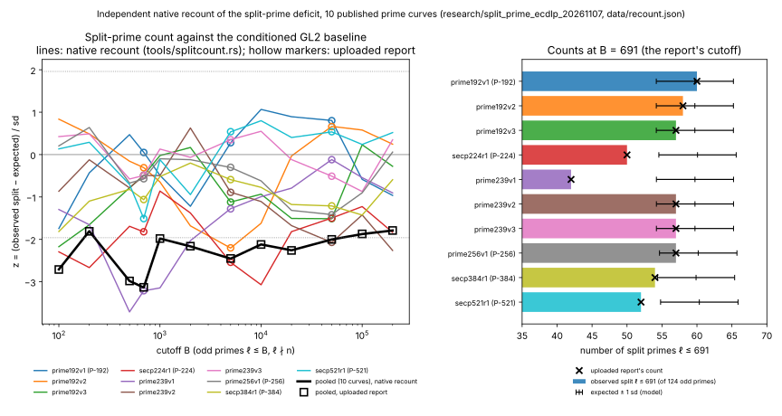
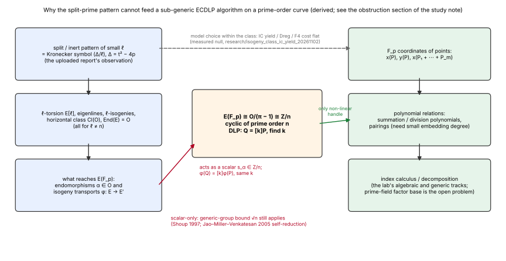

# Split-prime pattern and the ECDLP: a scalar-only obstruction, an independent recount, and the routes that stay open (2026-11-07)

Status: **derived obstruction plus a native recount; no algorithm claim.**
Result class: **boundary study; lead closure for the scalar / generic route only, not a cost reduction for any ECDLP method.**
`S` and end-to-end cost are **unset**, no cost ratio is reported; no leaderboard, benchmark or
rho comparison is touched (CLAUDE.md success criterion is not engaged).

Request (user, 2026-11-07): a novel ECDLP algorithm based on something unique
and not tried before, for example the prime-splitting pattern observed in the
published prime curves (uploaded report `split_prime_report.pdf`,
sha256 `d38be158cd13f03439aab94e060aba821700f46872644cf955e8a7a0f6d7a0c8`,
"Split-prime deficit in published NIST / X9.62 prime curves", 7 pages).

Answer in one paragraph. The pattern is real (recounted here from the curve
parameters; every split count and z the recount can compare agrees with the
report, while the report's calibrated bands and its L(1, χ) normalisation are
not reproduced and one of them is questioned in §4), but it cannot feed an
ECDLP algorithm below the generic bound on these curves: for every prime
ℓ ≠ n, the objects it governs (ℓ-torsion, Frobenius eigenlines, the two
rational ℓ-isogenies of a split ℓ, the class group of the Frobenius order,
the endomorphism ring) reach the prime-order group E(F_p) only as
multiplication by a known scalar or as an isomorphism that preserves the
discrete logarithm. This is a short theorem (§3), consistent with the lab's
isogeny-class invariance framing and with the measured null on index-calculus
yield across a class. Inside the generic model the pattern's one consequence for ECDLP work is a
lower degree of the horizontal expander used by random self-reduction (§5);
whether it correlates with coordinate-method yield *between* classes is
untested and is proposal P3 of §6.
The candidate directions that survive the obstruction, with their cheapest
tests, are in §6; none is a claim.

Problem record: [`problems/split-prime-pattern-scalar-only.md`](../../problems/split-prime-pattern-scalar-only.md).

## 1. Question and scope

- **Instances.** The ten prime-order curves of the report: prime192v1
  (P-192), prime192v2, prime192v3, secp224r1 (P-224), prime239v1/v2/v3,
  prime256v1 (P-256), secp384r1 (P-384), secp521r1 (P-521). Parameters p and
  n from `openssl ecparam -name <curve> -param_enc explicit -text -noout`
  (OpenSSL 3.0.13), cofactor 1 for all. (No ICV1 slugs: no curve-level
  measurement is made here; the curves enter only through p and n.)
- **Objects.** t = p + 1 − n, Δ = t² − 4p < 0, K = Q(√Δ), the Frobenius
  order Z[π] and its over-orders, and for each odd prime ℓ the Kronecker
  symbol χ(ℓ) = (Δ/ℓ): split (+1, two rational ℓ-isogenies, "Elkies"),
  zero (ℓ ∣ Δ: ramified in K, or ℓ dividing the conductor f of Z[π], which
  the recount does not separate, e.g. 3 ∣ f for P-224 and 5 ∣ f for
  prime239v2 per the red-team pass), inert (−1, "Atkin"). The tables below
  keep the report's label "ramified" for the zero case.
- **Question A.** Is the report's deficit reproducible from the parameters
  with an exact baseline? (§4.)
- **Question B.** Can the ℓ-adic or class-group structure that the pattern
  describes enter a classical ECDLP algorithm on E(F_p) other than through
  scalars? (§3.)
- **Question C.** Which novel directions remain, and what is the cheapest
  discriminating test for each? (§6.)

## 2. Sources checked

- **KB unavailable:** the `research-kb` MCP server is not loaded in this
  runtime and `scripts/research-kb` finds no executable
  (`research-kb: no executable found`). The lead atlas
  (`crypto-autoresearcher:knowledge/leads/ecdlp/`) is not checked out here.
  The fallback was repository paths, read directly:
- `repo:research/isogeny_class_difficulty_20261008/README.md`: the framing
  theorem ("within an isogeny class, difficulty is invariant up to transport
  cost"; only transport cost, automorphisms and model-dependent non-generic
  structure can vary). This study's §3 is the same statement pushed one step
  further: the pattern that *selects* the horizontal edges is itself
  scalar-only.
- `repo:research/isogeny_class_ic_yield_20261102/p2_prime_analogues/RESULTS.md`
  and `report/REPORT.md`: measured null for index-calculus yield, Dreg and
  F4 cost across two full conductor-1 prime-field classes (h = 128 and 300)
  at 24, 28, 32 bits, m = 2, 3, with A/A, isomorphic-model and planted
  controls. This closes the indirect route "pick a better model in the class".
- `repo:RESEARCH_ISOGENY_FIBERS_ECDLP.md` §15.1, Theorem 15.1 (2026-10-11,
  [pcc:unverified] there): the isogeny-augmented generic group model. Oracles
  for every rational isogeny in the class with their scalars leave the success
  probability of a Q-query algorithm at most (Q + 2)²/r + 1/r. This is the
  lab's prior statement of the obstruction in §3 below, found through the
  idea-generator pass; §3 is its specialisation to the split-prime pattern
  (the pattern is the Kronecker symbol that selects those oracles), not a new
  theorem. Found after the first commit of this study.
- `repo:research/nist_skip_criterion_20261025/strict_elkies_20261029/REPORT.md`
  and `results/at691.tsv`: the lab already computed the same statistic
  (`E691`, strictly split odd primes ≤ 691) for the 8 published and 11
  omitted curves in the four fields, as a separator for the skipped-curve
  question, reproducing an externally reported pattern. Its published-curve
  counts (60, 57, 58; 50; 42, 57, 57; 57; 54; 52) equal this study's §4
  column, curve for curve. Found after the first commit of this study.
- `repo:problems/prime-scalar-exact-splitting.md`,
  `repo:problems/tree-glued-pdp-separator-coupling.md`,
  `repo:problems/curve25519-family-algebraic-ic-tower.md`: the standing
  prime-field index-calculus obstructions (factor-base description, solving
  degree). §6 does not duplicate them.
- `repo:docs/endomorphism-rules.md`: existence, executable construction,
  subgroup action and unknown-scalar recovery are separate claims; this
  study keeps them separate (§7).
- Literature (from memory, primary sources not re-read in this session;
  stated as such): H. W. Lenstra Jr., "Complex multiplication structure of
  elliptic curves", J. Number Theory 77 (1996): E(F_q) ≅ O/(π − 1) as
  O-modules when End(E) = O. D. Jao, S. D. Miller, R. Venkatesan, "Do all
  elliptic curves of the same order have the same difficulty of discrete
  log?", ASIACRYPT 2005: random self-reducibility inside an isogeny class via
  expander walks over small split ℓ, under GRH. V. Shoup, "Lower bounds for
  discrete logarithms and related problems", EUROCRYPT 1997: Ω(√n) generic
  bound. Schoof–Elkies–Atkin: split ℓ speed up point counting only.

## 3. The obstruction (derived; no Lean proof yet; prior form: Theorem 15.1 of `RESEARCH_ISOGENY_FIBERS_ECDLP.md`)

**Prior work in this repository.** Theorem 15.1 of
`RESEARCH_ISOGENY_FIBERS_ECDLP.md` (2026-10-11) already states, in the
generic group model augmented with oracles for every rational isogeny of the
class and their scalars, that a Q-query algorithm succeeds with probability
at most (Q + 2)²/r + 1/r, i.e. isogeny maps add nothing generic. The theorem
below is that statement specialised to the objects the split-prime pattern
governs, with the scalar made explicit through Lenstra's isomorphism and with
the ℓ-pairing and fiber-polynomial cases spelled out; it is not new.

**Setting.** E/F_p ordinary, #E(F_p) = n prime, cofactor 1, Frobenius π with
π² − tπ + p = 0, O = End(E) ⊇ Z[π], N = (π − 1) the ideal of O of norm n.
Standing assumptions, made explicit after the red-team pass: E ordinary, so
End(E) is defined over F_p; gcd(n, Δ) = 1 (checked for all ten curves by the
red team), so s_α below is defined for α ∈ O ⊋ Z[π] and N is prime to the
conductor; O^× = ±1 (j ∉ {0, 1728}). The exclusion ℓ ≠ n is a convenience,
not a gap: the two rational n-isogenies are the endomorphisms π − 1 and
π − p, acting as the scalars 0 and 1 − p.

**Theorem (scalar-only action).** Let ℓ be a prime different from n and p.
Every F_p-rational isogeny φ: E → E′ whose degree is a power of ℓ (in
particular each horizontal ℓ-isogeny of a split ℓ, their compositions around
the class group, and every vertical ℓ-isogeny), and every endomorphism
α ∈ O, satisfies:

1. φ restricted to E(F_p) is a group isomorphism onto E′(F_p) and
   φ([k]P) = [k]φ(P); so a DLP instance transported by φ has the same answer.
2. α acts on E(F_p) as multiplication by the scalar s_α = α mod N ∈ Z/n,
   computable from the coordinates of α in O (for α = u + vπ, s_α = u + v).
3. The ℓ-torsion Galois module E[ℓ], its Frobenius eigenvalues λ, μ, the
   fiber polynomials of φ, and every ℓ-pairing value involving a point of
   E(F_p) are independent of which point of E(F_p) is considered.

*Proof sketch.* (1) deg φ is prime to n, so ker φ ∩ E(F_p) = {O} and φ is
injective on the finite group E(F_p); E′(F_p) has the same order n
(isogenous curves over F_p have the same number of points), so φ is onto; it
is a homomorphism, hence [k] commutes with it. (2) E(F_p) is cyclic of prime
order, so every endomorphism of it is a scalar; which scalar is given by
Lenstra's isomorphism E(F_p) ≅ O/N under which π ↦ 1. (3) E[ℓ] and E(F_p)
are different Galois modules with coprime orders; a bilinear pairing
t(T, P) with ord T = ℓ and ord P = n satisfies t^ℓ = t^n = 1, hence t = 1;
the fiber of φ above φ(P) is P + ker φ and its Galois structure is that of
ker φ. ∎

**Corollary (what an algorithm sees).** An algorithm whose only operations
are the group law on E(F_p), the maps of the theorem, and point-independent
Galois data is a generic-group algorithm with scalar oracles: every oracle
answer is the encoding of a known degree-one polynomial in the unknown log,
so Shoup's simulation argument applies verbatim (this is the proof of
Theorem 15.1) and gives Ω(√n) oracle calls. So the split-prime pattern alone, for
any cutoff and any deficit, cannot yield a sub-generic algorithm on a
prime-order curve. By the JMV self-reduction, every curve reachable by the
horizontal edges that the split primes provide is exactly as hard.

**What the theorem does not cover.** Anything that reads F_p-coordinates
non-linearly: summation polynomials, division polynomials, and (for small
embedding degree only, which these curves do not have) the n-pairing. Those
are the lab's existing index-calculus tracks. The pattern can still enter
there indirectly, by choosing which curve of the class to decompose on; the
lab measured that choice null (`isogeny_class_ic_yield_20261102`, P2: ICC
not distinguishable from zero at 24–32 bits, planted-20 % power 0.99–1.00 in
the informative cells and two 24-bit m = 3 cells not informative, one
suspected curve effect not replicated). Two presentations sit outside the
theorem's hypotheses, as Theorem 15.1's own reading says: the Weil/Tate
pairing on the n-torsion (needs small embedding degree; the red team
checked the embedding degree exceeds 20,000 on all ten curves), and the
p-adic lift. Since π ≡ 1 mod N, the n-torsion of the canonical lift is
defined over Z_p, so every point of E(F_p) has a computable canonical lift
with p-adic coordinates, a third presentation that neither the theorem nor
the measured null covers. For n ≠ p the p-adic elliptic logarithm vanishes
on torsion, which is why Smart's attack needs n = p; that this closes the
presentation is a known-result assertion here [pcc:unverified], not a
checked claim, and is recorded in the problem record.

**The one reformulation that looks like a way in, and why it is not.** By
Shimura reciprocity the DLP k is the element of Gal(K_N/H) ≅ (O/N)^×/±1
that maps the canonical-lift torsion point P̃ to Q̃, and the Artin symbol of
a principal ideal (α) acts as α mod N. Writing k as a product of the known
scalars s_α of smooth principal α is a multiplicative DLP in F_n^× and would
be feasible by index calculus — but only on the *residue* k, which is the
unknown. The group is presented by coordinates, never by residues in O/N,
so "index calculus in O" has no first step. Enumerating smooth α and
comparing α(P) with Q (isogeny-chain evaluation, cost about one scalar
multiplication each) is baby-step giant-step with an unusual giant-step set
and the same √n cost.

## 4. Independent recount of the deficit (measured, native)

**Method.** `tools/splitcount.rs` (dependency-free Rust, `rustc -O`). For
each odd prime ℓ ≤ 200,000 it reduces the hex parameters p and n modulo ℓ,
forms t ≡ p + 1 − n and Δ ≡ t² − 4p, and takes the Legendre symbol by
Euler's criterion. The baseline is the report's model, re-derived in the
source comment: Frobenius mod ℓ uniform among matrices of GL2(F_ℓ) with
determinant p, so P(split) = (ℓ − 2 − χ(p))/(2(ℓ − 1)) and
P(ramified) = (1 + χ(p))ℓ/(ℓ² − 1); the trace class τ ≡ p + 1 (which would
give ℓ | n) is removed and the rest renormalised. z = (observed − Σ P)/√Σ P(1 − P)
over the odd primes ℓ ≤ B. Twelve cutoffs B as in the report. Output:
[`data/recount.json`](data/recount.json) (sha256 of source and output in
§8). The report's own numbers are transcribed in
[`data/uploaded_report_values.json`](data/uploaded_report_values.json) and
plotted as hollow markers; they are the report's assertions, not measurements
of this study.

**Results at B = 691 (124 odd primes; no ℓ ≤ 200,000 divides any n).**

| curve | split (observed) | expected | sd | z | z @ 5,000 | z @ 50,000 | ∏(1 − χ(ℓ)/ℓ)⁻¹ ÷ model, ℓ ≤ 200,000 |
|---|---:|---:|---:|---:|---:|---:|---:|
| prime192v1 (P-192) | 60 | 59.7 | 5.51 | +0.05 | +0.28 | +0.80 | 0.93 |
| prime192v2 | 58 | 59.7 | 5.51 | −0.31 | −2.20 | +0.66 | 1.20 |
| prime192v3 | 57 | 59.7 | 5.51 | −0.49 | −1.12 | −1.51 | 0.80 |
| secp224r1 (P-224) | 50 | 60.1 | 5.53 | −1.82 | −2.54 | −1.50 | 0.64 |
| prime239v1 | 42 | 59.7 | 5.51 | −3.21 | −1.28 | −0.12 | 0.56 |
| prime239v2 | 57 | 59.7 | 5.51 | −0.49 | −0.89 | −2.07 | 0.86 |
| prime239v3 | 57 | 59.7 | 5.51 | −0.49 | +0.35 | −0.51 | 0.93 |
| prime256v1 (P-256) | 57 | 60.2 | 5.54 | −0.57 | −0.30 | −1.42 | 1.27 |
| secp384r1 (P-384) | 54 | 59.9 | 5.52 | −1.06 | −0.59 | −1.21 | 0.62 |
| secp521r1 (P-521) | 52 | 60.3 | 5.54 | −1.51 | +0.54 | +0.54 | 1.01 |

Pooled z over the ten curves, (Σ observed − Σ expected)/√Σ variance, at
B = 100, 200, 500, 691, 1,000, 2,000, 5,000, 10,000, 20,000, 50,000,
100,000, 200,000: −2.71, −1.81, −2.98, −3.13, −1.98, −2.16, −2.45, −2.12,
−2.26, −2.00, −1.87, −1.79 (Stouffer Σz/√10 agrees to two decimals).

**Agreement with the uploaded report and with the lab's own census.** Every
split count at 691, every per-curve z at 691, 5,000 and 50,000, and every
pooled z at the twelve cutoffs matches the report's table and list to the
printed precision [pcc:unverified]. The ten counts at 691 also equal the
`strict691` column of
`research/nist_skip_criterion_20261025/strict_elkies_20261029/results/at691.tsv`
for the published rows (p192-139 = 60, p192-6013 = 58, p192-5228 = 57,
p224-7026 = 50, p239-2185 = 42, p239-2320 = 57, p239-3048 = 57,
p256-1842 = 57, p384-2688 = 54, p521-1136 = 52), a third producer with
its own code [pcc:unverified]. The report's numbers are therefore reproducible from the
public parameters with the stated model; this study did not reproduce the
report's random-curve calibration (4,267 SEA-counted curves) or its
percentiles, and makes no statement about them. The last column is this
study's own normalisation of the partial Euler product (ratio to
exp E[log ∏] under the conditioned model, per field), which is not the
report's "× typical" column (a calibrated median); the two lowest
(prime239v1, P-384) and the highest (P-256) agree, the rest of the order
does not, and the column values differ from the report's by a factor of
about 0.78–0.80 on seven curves. **Red-team finding on that gap (plausible,
`ideas/red-team.md` F4).** The report's Figure 4 says its bands come from
the P-224 field, and the ratio of its "× typical" to this study's raw
partial product implies one normaliser (about 0.83–0.84) for all ten
curves. But for a prime-order curve over a field with p ≡ 2 (mod 3)
(the P-192, P-239 and P-384 fields) the prime ℓ = 3 is forced inert
(t ≢ 0 and Δ ≡ t² + 1 ≢ 0 mod 3), so the Euler factor at 3 is exactly 3/4
and the model's expected partial product is about 0.66 there against about
0.84–0.86 for p ≡ 1 (mod 3) (P-224, P-256, P-521). The report's "prime239v1
× 0.44 and P-384 × 0.49 outside the 95 % band" is therefore at least partly
a field-mismatch artefact; field-matched, they are 0.56 and 0.62. This is an
observation about the report's §4, not a re-analysis of it.

*Figure 1. Left: z against cutoff for each curve (lines, native recount) with
the report's values as hollow markers; black: pooled. Right: counts at
B = 691 against the model expectation ± 1 sd. Source `figures/plot.py`, data
`data/recount.json`; n = 124 primes at B = 691.*

**Interpretation at this scope.** The deficit in split counts is a property
of the ten discriminants Δ; the recount confirms it and the report's own
caveats stand
(cutoff chosen after the fact, correlated cutoffs, min-of-three families,
ten curves). Nothing here bears on the cause.

## 5. The one ECDLP-adjacent effect inside the generic model: horizontal expander degree

The JMV random self-reduction walks the horizontal class along ℓ-isogenies
for split ℓ ≤ B; the graph has degree 2 × #{split ℓ ≤ B}. A deficit lowers
the degree for a given B: at B = 691, P-224 has 50 split primes (degree 100)
against 60 expected (degree 120), and prime239v1 has 42 (degree 84). The
walk needs a slightly larger B for the same mixing, i.e. a slightly larger
transport cost, and that is the whole effect: by §3 the destination curve is
exactly as hard. The lab's I-2 protocol
(`research/isogeny_class_difficulty_20261008/PROTOCOL-I2-transport-cost.md`)
already prices transport; this study adds only the observation that the
report's statistic is the degree of that graph. Outside the generic model
this section claims nothing: Δ is a class invariant, so the within-class
null of 2026-11-02 cannot say whether the pattern correlates with
coordinate-method yield between classes (red-team F1); that is proposal P3
in §6, with its pre-registered kill line.

*Figure 2. Where the pattern lives (left), the group it must reach (centre),
and the only non-linear handle on that group (right). Derived; the dashed
link is the route the lab measured null on 2026-11-02.*

## 6. Candidate novel directions that survive the obstruction

From the idea-generator (Sonnet) and idea-synthesist (Opus) passes of this
session (scratch outputs in the session, summarised here; both report KB
unavailable and cite repository paths only). Every item is **proposed**,
none is run, none is a claim. Both passes independently re-derived the §3
obstruction and **neither found a mechanism in which the split-prime deficit
enters**: nine candidate uses were killed on paper (isogeny-pullback towers
on a prime-order curve, where every isogeny fiber has exactly one
F_p-point; twist-torsion translations, defined over F_{p²}; class-group
label cycles, which give scalars only; smooth-norm endomorphisms as x-line
maps; torus-coset bases with a trace map; Kummer-plus-Dickson unions;
cross-target Gröbner; twist or Tate leakage; the CM lift and ray class
field, whose isomorphism E(F_p) ≅ Ẽ[π − 1] is defined only up to
Gal(K_N/K), which acts as every scalar). The directions below are therefore
*coordinate-side* proposals for prime-order curves in the NIST field shape,
ranked by the proposers' information per hour, with their own priors.

| id | mechanism (one line) | closest prior work (as named by the proposer) | cheapest discriminating test (native) | kill line | proposer's prior of lowering the prime-field IC baseline |
|---|---|---|---|---|---|
| P1 `IDEA-20261107-RR-DICKSON-TORUS` | Separator-free Riemann–Roch norm-divisibility system with a Dickson-torus membership tower, for prime-order curves with p ≡ 3 (mod 4) and 2^t ∣ p + 1 (the NIST shape, where the Kummer tower does not exist) | in-repo `round7_rr` (RR-Kummer, D_RR = 4 vs D_T = 6 at m3 t4 [pcc:unverified]), `pkm_dickson_torus_20261015`; Petit–Kosters–Messeng PKC 2016, Nagao ePrint 2013/548 | Rust emitter into msolve 0.6.5; four systems (RR-Dickson, T-Dickson, RR-Kummer, T-Kummer) on the same planted prime-order instance at T24 = 14,680,063 and T31 = 2,046,820,351; m = 3, t = 3–5; about 1 h | D_RR(Dickson) ≥ D_T(Dickson) everywhere; or \|D_RR(Dickson) − D_RR(Kummer)\| ≥ 2; or the RR-Kummer control fails to reproduce round7 | 0.55 for D below the tree at m = 3 in a torus cell; 0.05 for the repo's criterion (m ≥ 5, blocked by 15 GB); 0.01 end-to-end |
| P2 `IDEA-20261107-TWIST-PURE-COSET` | Select the 2-power coset or torus element whose 2^t abscissae are mostly on E (not the twist), with a derived purity lemma (twist parts of any x-only relation sum to O, so twist columns are inert) and a derived decay law c_sel/c_mean ≈ 1 + √(2 ln C / 2^t) | in-repo `curve25519_frame_search_20261103` (frame choice, 4.71× at t = 5 [pcc:unverified]); FGHR J. Cryptology 2014 as the symmetry precedent | existing PKM oracle crate and ecbench: random vs argmax coset at equal (m, t), exact m = 2 coverage by pair enumeration, restricted-base control; prime-order curves at 2^20–2^32; a few hours | F4 cost differs by > 10 % between cosets at equal (m, t); coverage ratio off by > 20 %; or the lemma fails on exhaustive S_3 enumeration at p ≤ 10^4 | 0.85 toy-scale F4 work per relation; 0.05 cold end-to-end S with selection charged (selection cost exceeds a whole rho run at 2^24); 0 at cryptographic size (gain → 1 as t grows) |
| C1 (synthesist) | Presentation × arithmetic test: original model, dense random shift, curve-sparse shift (for a = −3, x = X ± 1 removes the linear term) and tower-sparse shift, on j = 0/1728 twists, 64 a = −3 curves and 64 curves with −a/3 a square, at p = 786433 and one 24-bit prime; rests on a derived lemma that Semaev polynomials are weighted-homogeneous (x:1, a:2, b:3), so their top form is curve-independent and curve dependence sits in lower-order coefficients | in-repo `isogeny_class_ic_yield_20261102` P1 (F4 flat within 3.85e-5 across 27 curves [pcc:unverified]); FGHR 2014 | `pkm_ss_tower f4` in Rust; 0.5–5 CPU-hours after 1–2 days of code | arithmetic hypothesis dies if a j = 0/1728 difference vanishes under the dense random shift; engineering lever dies if sparse/dense mul-add ratio > 0.90 on ≥ 2 of 4 cells or D rises in any row | 0.02 that an arithmetic effect exists; 0.03 engineering gain (a = −3 family, toy scope) |
| C2 (synthesist) | Full j-line census at p = 786433: every prime-order curve, analysed per trace (about 250 Frobenius fields) against the seed's covariates (split count, L(1,χ), h, conductor); random samples never reach the CM strata | in-repo `isogeny_class_difficulty_20261008`, `p2_lift_defect_20261101`, `prime_field_leads_20261031/C1_lift_torsion` | Rust census; 1–25 CPU-hours | the "no K effect" null is rejected only if an unexplained exception reproduces on fresh targets and is enriched in one K stratum (Bonferroni α = 0.0025) | 0.01 that any exception is K-related; ≤ 0.005 baseline gain |
| P3 `IDEA-20261107-SEED-NEGATIVE-CONTROL` | Cross-trace covariate test: 2,000 random prime-order curves per prime at 2^24, 2^28, 2^32; ecbench rho.negation S and ic.pipeline yield against E_691, partial L(1,χ) and division-polynomial root counts, conditioned on n (the lab's class tests held the Frobenius field fixed; this varies it) | in-repo `isogeny_class_ic_yield_20261102` P2, `nist_skip_criterion_20261025/strict_elkies_20261029`; JMV 2005 | ecbench (existing), planted +2 % yield arm as positive control, shuffled-trace permutation as negative; hours at 24–28 bits | a replicated partial effect ≥ 1 % of yield or S with FDR < 0.01 at two primes would *reject the null* and make the seed a mechanism lead | 0.02 non-null; 0 baseline gain (a seed falsifier, not an algorithm) |

**Reading.** The honest state is that the only proposals with a non-trivial
prior (P1, P2) are transfers of in-repo levers to the prime-order field
shape, not new mechanisms, and their priors for the repository's own
criterion are 0.05 or lower; the two that touch the seed (C2, P3) are
falsifiers whose expected outcome is a null that closes it for the
coordinate tracks too. Any run follows the lab's rules: frozen task card
through `experiment-director`, `.resume/RESUME.md`, bench record, pricing at
0, 0.1 and 1 GAE, and the `controlled-experiment` controls. Nothing here is
scheduled.

## 7. Status of every statement

| statement | status |
|---|---|
| Split counts, expectations, z at twelve cutoffs for ten curves (§4) | measured natively from public parameters; agrees with the uploaded report; not independently verified by a second producer [pcc:unverified] |
| Theorem and corollary (§3) | derived (proof sketch); no Lean proof; no identity certificate (it is not a bilinear or summation identity) |
| "Model choice within the class is null" | measured by the lab on 2026-11-02 at 24–32 bits, cited, not re-measured |
| Expander-degree effect (§5) | derived from the counts; transport cost not measured here |
| Candidate directions (§6) | proposed; not run |
| Red-team review of §3–§5 (`ideas/red-team.md`) | done on commit 5e9c756773; mechanics confirmed (tool rebuilt byte-identical, parameters against OpenSSL, independent big-integer recount at all twelve cutoffs with zero mismatches, baseline formulas brute-forced for ℓ ≤ 13, at691 census matched); wording and scope findings F1–F8 folded in here; F4 on the report's normalisation is the reviewer's plausible finding, not re-analysed |

Claim record for the recount: `PCC-20261107-3403f9` (`pcc/claims/PCC-20261107-3403f9.json`,
kind `statement`; standing unverified until CI signs it) [pcc:unverified].

## 8. Files

- `tools/splitcount.rs` — the recount (sha256 `cb1dc02ce99311ca51ff5ca71060c8dc37fb860aa8ee43ee6b5c1b080cde7550`);
  build and run: `rustc -O --edition 2021 tools/splitcount.rs -o /tmp/splitcount && /tmp/splitcount > data/recount.json`.
- `data/recount.json` — output (sha256 `e84f89d331202e1b6681d243c32fac3f5f258c6cc0d682a9ea54feaeb4997d98`).
- `data/uploaded_report_values.json` — numbers transcribed from the uploaded report.
- `figures/plot.py` — plots recorded values only; `figures/recount_z.{svg,png}`, `figures/obstruction_diagram.{svg,png}`.
- `report/REPORT.typ`, `report/REPORT.pdf` — this note with both figures, rendered with Typst.
- `ideas/idea-generator.md`, `ideas/idea-synthesist.md` — the two idea passes' full outputs (model output, proposals only); `ideas/red-team.md` — the adversarial review of §3–§5 and of the problem record (model output; its findings are folded into this note as stated in §7).
- `../../problems/split-prime-pattern-scalar-only.md` — the obstruction record.

## 9. Next steps

1. Lean statement of §3 (i)–(iii) in `crypto-lean`, so the closure is a
   Lean-checked theorem (problem record, next discriminating step).
2. For the deficit itself, the report's pre-registered next tests (fresh
   cutoff range, Brainpool out-of-sample, exact class numbers) are
   descriptive number theory, not ECDLP work; run them only if the owner
   wants the fingerprint question answered.
3. Of the §6 candidates, run the one with the best prior under a frozen
   protocol on 24–32-bit toy classes, with the controls of
   `controlled-experiment`.
