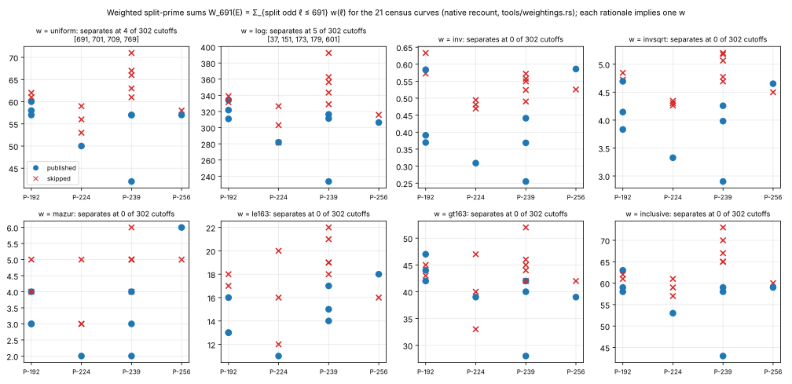
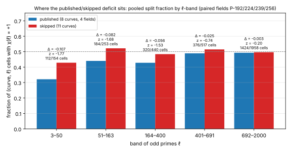
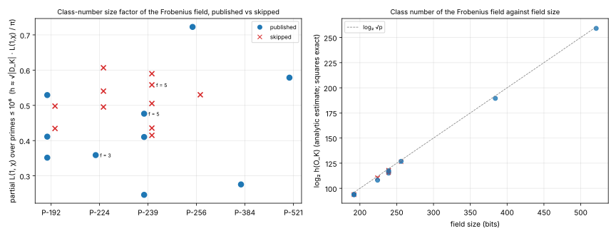
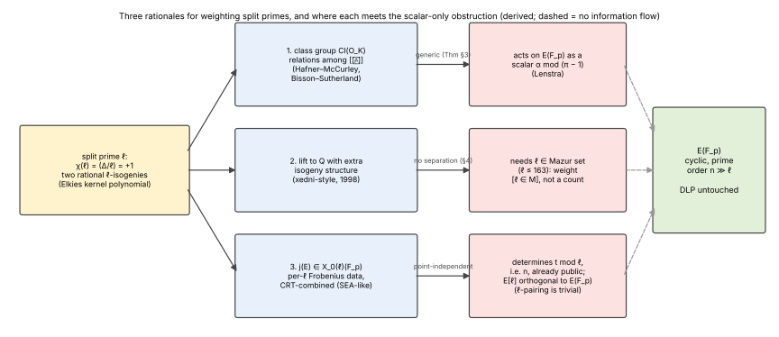

# Three attack rationales for a uniform split-prime weighting: class-group relations, rational-isogeny lifting, modular-curve embedding (2026-11-08)

Status: **derived analysis of three candidate rationales, plus a native
re-weighting of the lab's 21-curve census and a class-group computation for
the Frobenius fields; no algorithm claim.**
Result class: **boundary study, follow-up to
[`../README.md`](../README.md) (§3 obstruction, §5 expander degree) and to
the skipped-curve census
[`../../nist_skip_criterion_20261025/strict_elkies_20261029/`](../../nist_skip_criterion_20261025/strict_elkies_20261029/REPORT.md).**
`S` and end-to-end cost are **unset**; no cost ratio, leaderboard, benchmark
or rho comparison is touched (CLAUDE.md success criterion not engaged).

Request (user, 2026-11-08, continuing the split-prime thread): assess three
stories under which a curve generator of 1997–98 would have *counted* split
primes ℓ ≤ 691 with roughly uniform weight per prime, and whether any of
them is an attack:

1. **Class-group relation attacks.** Each split ℓ = 𝔩𝔩̄ hands the attacker a
   generator [𝔩] of Cl(O_K) with a cheap Elkies realisation as an isogeny;
   relations among the [𝔩] (Hafner–McCurley, Bisson–Sutherland) need many
   small split primes, with roughly uniform value per prime. An attack that
   turned Cl(O_K) structure into DLP leverage would be what sparsity defends
   against.
2. **Lifting attacks that need rational isogenies.** Xedni-style lifting to
   Q (1998) and the anomalous attacks (1997–98) were contemporaneous with
   the generation streams; a curve with many rational ℓ-isogenies mod p is
   "closer" to reductions of curves on X_0(ℓ). Stated weakness: rational
   ℓ-isogenies over Q exist only for ℓ ≤ 163.
3. **Modular-curve embedding.** Split ℓ means j(E) is an F_p-point of X_0(ℓ)
   with an explicit degree-ℓ map and Frobenius eigenvalue on E[ℓ]; an attack
   CRT-combining per-ℓ information (as SEA does for the order) would cost
   proportionally to the number of usable ℓ. Stated missing step: how per-ℓ
   data on E[ℓ] says anything about the subgroup of prime order n ≫ ℓ.

**Answer in one paragraph.** None of the three is an attack, and none of the
three predicts the weighting that the census actually shows. (i) The class
group route gives only scalars on E(F_p) (the §3 theorem of the parent
study, prior form Theorem 15.1 of `RESEARCH_ISOGENY_FIBERS_ECDLP.md`), and
its natural scale is wrong: a Hafner–McCurley factor base for a 194-bit
discriminant reaches norms near 10⁸ and the GRH generation bound 6 ln²|Δ| is
near 10⁵, so ten split primes more or fewer below 691 change the cost of any
class-group algorithm by nothing measurable; the documented class-group
defence in a published standard (Brainpool, RFC 5639 §2.1 item 3) is a
*class-number* floor, h > 10⁷, not a split count, and its stated motive is
lifting plus JMV reachability. The class groups computed here for the
smaller fields (§5) do not separate published from skipped curves either.
(ii) The lifting route can only use ℓ in Mazur's set
{2, 3, 5, 7, 11, 13, 17, 19, 37, 43, 67, 163}, and at most two such odd
primes at once (Kenku's cyclic-degree list stops at 163 and contains no
product of two primes ≥ 5 except 15 and 21); the weight it implies,
w(ℓ) = [ℓ ∈ M], separates published from skipped curves at **no** cutoff in
the census, and at B = 691 the P-256 published curve has *more* Mazur-split
primes (6) than its skipped sibling (5). The conductor argument in the
story is not a mechanism: isogenous curves over Q share their conductor.
(iii) The modular-curve route CRT-combines Frobenius data mod ℓ into t, i.e.
into n, which is public; the Galois modules E[ℓ] and E(F_p)[n] have coprime
orders, so every per-ℓ datum is point-independent (parent §3(3)). Its
implied weight ln ℓ separates at 5 of 302 cutoffs against 4 for the uniform
count, so the census cannot tell these two apart; both are post-hoc fits.
The census does say where the deficit sits: the published-minus-skipped
split fraction is −0.107 at ℓ ≤ 50, −0.082 at 51–163, −0.056 at 164–400,
−0.025 at 401–691 and −0.003 beyond 691 (two-proportion z −1.8, −1.7, −1.5,
−0.7, −0.2; descriptive), i.e. a deficit spread over ℓ ≲ 400 that is absent
above the cutoff, with no single band carrying it. Nothing here bears on
the historical cause, and nothing here reduces any ECDLP cost.

## 1. Question and scope

- **Instances.** The lab's census of the four seed streams with both
  published and skipped curves (P-192: 3 + 2; P-224: 1 + 3; P-239: 3 + 5;
  P-256: 1 + 1) plus the singleton published P-384 and P-521 controls:
  21 curves, parameters from
  [`../../nist_skip_criterion_20261025/inputs.tsv`](../../nist_skip_criterion_20261025/inputs.tsv)
  (p, n, the X9.62 seed and the stream index). The `index` column is the
  position in the seed stream the user calls "the streams". No new point
  count or primality proof is made here; p and n are inherited.
- **Objects.** t = p + 1 − n, Δ = t² − 4p, K = Q(√Δ), D_K = disc K,
  conductor f with Δ = f² D_K, χ(ℓ) = (Δ/ℓ) for odd primes ℓ, and the class
  group Cl(O_K).
- **Question A.** What does each rationale *need* from the curve, and what
  weight w(ℓ) on a split prime does it imply? (§3.)
- **Question B.** Which weightings separate published from skipped curves
  in the census, and where in ℓ does the deficit sit? (§4, measured.)
- **Question C.** Do the class groups of the Frobenius fields separate the
  two roles, and are they "well generated" by the small split primes? (§5,
  measured, PARI under GRH.)
- **Question D.** Where does each rationale meet the scalar-only
  obstruction? (§6, derived.)

## 2. Sources checked

- **KB unavailable** in this runtime: no `research-kb` MCP server;
  `scripts/research-kb` reports `no executable found`. The lead atlas is not
  checked out. Repository paths were read directly:
- `repo:research/split_prime_ecdlp_20261107/README.md` §3 (scalar-only
  theorem, Lenstra isomorphism, ℓ-pairing triviality), §5 (expander degree
  as the only generic-model effect), §6 (nine killed mechanisms including
  class-group label cycles and the CM lift); `ideas/idea-synthesist.md`
  rows "CM lift / ray class field" and "endomorphisms evaluated as maps".
- `repo:research/split_prime_ecdlp_20261107/followups/README.md`: P3 null
  (the split statistic does not move relation coverage or rho cost across
  4,000 random prime-order curves).
- `repo:research/nist_skip_criterion_20261025/strict_elkies_20261029/REPORT.md`
  and `results/at691.tsv`: the strict-count separator (cutoffs 691, 701,
  709, 769; 23 of 4,480 labelings admit some separating cutoff; the
  inclusive variant does not separate at 691). This study's uniform-weight
  control reproduces its four cutoffs exactly (§4).
- `repo:research/nist_skip_criterion_20261025/sea_replay_20261026/REPORT.md`:
  the SEA coverage proxy (product of eligible ℓ until it exceeds the Hasse
  width) separates in neither direction (exact counterexamples both ways),
  which bears on §3.3.
- `repo:RESEARCH_ISOGENY_FIBERS_ECDLP.md` §15.1, Theorem 15.1
  (isogeny-augmented generic group model, [pcc:unverified] there).
- `repo:problems/split-prime-pattern-scalar-only.md`: the obstruction
  record; this note adds no new entry point and changes its status in no
  way.
- Literature, with how it was checked in this session:
  - Mazur, "Rational isogenies of prime degree" (Invent. Math. 1978): prime
    degrees of rational isogenies over Q are exactly
    {2, 3, 5, 7, 11, 13, 17, 19, 37, 43, 67, 163}. Checked against two
    expository sources found by web search
    ([arXiv 2209.03153](https://arxiv.org/abs/2209.03153),
    [arXiv 2206.08891](https://arxiv.org/abs/2206.08891), the latter's
    Table 1.1 is Mazur–Kenku's full cyclic list). Kenku's composite cyclic
    degrees (N ≤ 19, 21, 25, 27, 37, 43, 67, 163) and the bound of 8 curves
    per Q-isogeny class are **from memory**; the PDF's table did not render
    in this session.
  - RFC 5639 (Brainpool, 2010), §2.1 item 3, read directly: "The class
    number of the maximal order of the quotient field of the endomorphism
    ring End(E) of E is larger than 10⁷", motivated by the impossibility of
    lifting E to a number field L with End(E) = End(E′) "unless the degree
    of L over the rationals is larger than the class number of End(E)" and
    by [JMV] and [HR] "as argument for the class number condition"; item 2
    excludes trace one (Satoh–Araki, Semaev, Smart). Verified text.
  - Hafner–McCurley, J. AMS 2 (1989): rigorous subexponential class group
    algorithm for imaginary quadratic fields under GRH, factor base of prime
    ideals of norm below a bound, heuristic L_{|Δ|}(1/2, √2); confirmed by
    web search ([mathdoc](https://geodesic.mathdoc.fr/articles/10.1090/S0894-0347-1989-1002631-0),
    [arXiv 1810.12010](https://www.arxiv.org/pdf/1810.12010)). Bach's GRH
    bound 6 ln²|Δ| for a generating set of prime ideals: from memory.
  - Bisson–Sutherland, J. Number Theory 2011 ([arXiv 0902.4670](https://arxiv.org/abs/0902.4670)):
    End(E) of an ordinary curve in subexponential time from random
    relations in Cl(O) for the candidate orders Z[π] ⊆ O ⊆ O_K, small
    conductor primes by isogeny climbing; confirmed by web search. Biasse–
    Fieker–Jacobson (LMS JCM 2016) on short relations: web search.
  - Jacobson–Koblitz–Silverman–Stein–Teske, "Analysis of the xedni
    calculus attack", DCC 20 (2000) ([PDF](https://pages.cpsc.ucalgary.ca/~jacobs/PDF/xedni.pdf)):
    Silverman presented xedni at ECC '98, Waterloo, 14–16 September 1998;
    the paper shows it fails. Confirmed by web search. Silverman–Suzuki
    (ASIACRYPT 1998, lifting index calculus) and Miller (1986) are cited
    from memory.
  - ANSI X9.62: developed 1998, approved January 1999 (web search, a 1998
    letter to NIST). The X9.62 prime curves' generation dates were not
    found; FIPS 186-2 (2000) for the NIST curves is from memory.
  - Jao–Miller–Venkatesan (ASIACRYPT 2005), Lenstra (JNT 1996), Shoup
    (EUROCRYPT 1997), Schoof–Elkies–Atkin: as in the parent study, from
    memory.

## 3. What each rationale needs, and the weight it implies

Write M = {3, 5, 7, 11, 13, 17, 19, 37, 43, 67, 163} for the odd Mazur
primes and W_B(E) = Σ_{odd ℓ ≤ B, χ(ℓ) = +1} w(ℓ) for a weighted split
count.

### 3.1 Class-group relations (story 1)

*What it uses.* Cl(O) acts simply transitively on the curves of the class
with End = O; a split ℓ gives the classes [𝔩], [𝔩̄] = [𝔩]⁻¹ and the two
horizontal ℓ-isogenies, computable from the Elkies kernel polynomial in
Õ(ℓ) to O(ℓ²) field operations. Hafner–McCurley collect relations
∏[𝔩_i]^{e_i} = 1 over all split primes of norm ≤ B_HM; Bisson–Sutherland
turn such relations into the conductor of End(E) by checking whether the
corresponding isogeny cycle closes on E.

*Scale.* The factor-base bound is B_HM = L_{|Δ|}(1/2, c) with c ≈ 1/√2 for
the rigorous variant. For |Δ| ≈ 2^194 (P-192), ln|Δ| ≈ 134.5,
√(ln|Δ| · ln ln|Δ|) ≈ 25.7, so B_HM ≈ e^{18.2} ≈ 7.6 × 10⁷ and the factor
base holds about 2.3 million split primes; the deficit of about 10 split
primes below 691 is a relative change of order 10⁻⁵ in that base. The
GRH generating bound (Bach) is 6 ln²|Δ| ≈ 1.1 × 10⁵ for P-192 and
≈ 1.9 × 10⁵ for P-256. Neither scale is 691. A rationale in this family
that produced a cutoff near 691 would have to be a *structural* one ("is
Cl(O_K) already generated by the first few dozen split primes, and is h
smooth?"), which is what §5 measures.

*Implied weight.* One generator and one matrix column per split prime:
w(ℓ) = 1 (uniform), or, if the rationale is smoothness yield rather than
generation, w(ℓ) ≈ 2/ℓ (the probability that 𝔩 or 𝔩̄ divides a random
reduced form's norm). Both are in the §4 sweep.

*Does it threaten the DLP?* No, by the parent §3 theorem: every element of
Cl(O) acts on E(F_p) through an isomorphism that commutes with scalars, and
every endomorphism is the scalar α mod (π − 1). Relations in Cl(O) are
identities among such maps; the only DLP-relevant content of the torsor is
the JMV self-reduction, which makes the class uniformly hard. Knowing
Cl(O_K) completely (which this study does for the smaller fields, §5) adds
no operation to the generic-group toolbox on E(F_p). The one published
defence of this family, Brainpool's h > 10⁷, is explicitly a defence against
*lifting with End preserved* (the lift needs [L : Q] ≥ h) and against the
JMV/HR reachability picture, not against relations.

### 3.2 Lifting with rational isogenies (story 2)

*What it uses.* A lift Ẽ/Q of E with "extra isogeny structure". A rational
ℓ-isogeny of Ẽ reduces to a rational ℓ-isogeny of E, so split (or ramified)
ℓ are necessary for the lift to carry one. The anomalous attacks need
t = 1 and use no isogeny at all; xedni and Silverman–Suzuki lift points and
need Mordell–Weil dependence, not isogenies; the isogeny version of the
story is the user's own synthesis, and the census can test its weight.

*Hard limits.* Over Q a cyclic rational isogeny has degree in Kenku's list
(prime degrees in M ∪ {2}); so a lift can carry an ℓ-isogeny only for
ℓ ∈ M, and two distinct odd primes ≥ 5 at once only for degrees 15 and 21
(from memory; the prime list is checked). A split ℓ > 163 is invisible to
any such lift. The conductor claim in the story does not hold as stated:
isogenous curves over Q have the same conductor, so adding isogeny
structure cannot lower it; the conductor of a lift is governed by the
choice of bad primes, which xedni already optimises independently of
isogenies.

*Implied weight.* w(ℓ) = [ℓ ∈ M], or more generously [ℓ ≤ 163]; the
complement [ℓ > 163] is the control that the story predicts carries
*nothing*.

*Does it threaten the DLP?* Not through isogenies: the reduction of an
ℓ-isogeny of Ẽ is one of the two horizontal ℓ-isogenies of E, a scalar
action on E(F_p) by the parent theorem. The lift itself is the standing
xedni/Silverman–Suzuki obstruction (heights, Lang's conjecture, the JKSST
analysis), untouched here.

### 3.3 Modular-curve embedding (story 3)

*What it uses.* χ(ℓ) ≥ 0 iff Frobenius has an eigenvalue in F_ℓ iff E has an
F_p-rational ℓ-isogeny iff (j(E), C) is an F_p-point of X_0(ℓ) for some
cyclic C ⊂ E[ℓ]. The Elkies kernel polynomial gives the eigenvalue λ and
hence t ≡ λ + p/λ (mod ℓ); CRT over enough ℓ gives t. That is SEA. Every
curve in the census has an F_p-point on X_0(ℓ) for about half of all ℓ;
"sitting on many modular curves simultaneously" is the generic situation,
and the deficit is a few percent of it.

*Implied weight.* CRT information is log ℓ bits per usable ℓ: w(ℓ) = ln ℓ.
If the rationale were SEA *cost* rather than information, the operative
quantity is the product of usable ℓ until it exceeds the Hasse width,
which the lab already replayed (`sea_replay_20261026`): it separates in
neither direction, with exact counterexamples (published P-256: 191 vs
skipped 211; published P-224: 257 vs skipped 139, 179, 233).

*Does it threaten the DLP?* No. The data CRT can combine are functions of
(E, ℓ), i.e. of Frobenius on E[ℓ], and E[ℓ] is a Galois module of order ℓ²
coprime to n: there is no non-zero Galois-equivariant Z-linear map in
either direction between E[ℓ] and E(F_p) ≅ Z/n, and every ℓ-pairing value
with a point of order n is 1 (parent §3(3)). What CRT reconstructs is t,
hence n, which is published with the curve. The "Weil pairing argument from
earlier in this thread" is exactly this statement.

### 3.4 A fourth reading, stated as speculation: isogeny mobility

A generator in 1997–98 that feared *moving* a DLP instance to a weaker
isogenous curve (the idea behind Frey's Weil-descent talk at the same
ECC '98 and, later, Galbraith 1999 and Galbraith–Hess–Smart 2002 for
extension fields) would want few cheap rational isogenies, i.e. a small
horizontal degree. The operative statistic is exactly the strict count: one
cheap edge pair per split ℓ up to the ℓ at which an Elkies step was deemed
affordable, with a hard cutoff. This reading predicts the same uniform
weight and a hard cutoff, so the census cannot distinguish it from story 1
(§4); it differs in predicting *no* dependence on h or on generation of
Cl(O_K) (§5). For prime fields the moved-to curve is exactly as hard (JMV
and the parent theorem), so it is not a vulnerability either. No source for
this reading was found; it is recorded so that the next session does not
rediscover it.

## 4. Census re-weighting (measured, native)

**Method.** `tools/weightings.rs` (dependency-free Rust, `rustc -O`) reads
the 21-row census, computes χ(ℓ) for every odd prime ℓ ≤ 2,000 (302
cutoff positions, the same family as the strict study) by reducing p and n
modulo ℓ, and for eight weights w forms W_B(E) at every cutoff B. A weight
*separates* at B when, in each of the four paired fields, every published
W_B is below every skipped W_B ("lower"); the reverse direction is also
recorded ("upper"). Output: [`data/weightings.json`](data/weightings.json).
Control: the 21 strict counts at 691 equal the `strict691` column of the
strict study's `at691.tsv` row for row (21 of 21), a third producer for that
column [pcc:unverified].

**Result 1: which weightings separate.**

| weight w(ℓ) | rationale | lower-separating cutoffs (of 302) | upper | margins at 691 (published max → skipped min), P-192 / 224 / 239 / 256 |
|---|---|---|---|---|
| 1 (uniform) | story 1 generation, §3.4 mobility | **4**: 691, 701, 709, 769 | 0 | 60→61 / 50→53 / 57→61 / 57→58 |
| ln ℓ | story 3 CRT information | **5**: 37, 151, 173, 179, 601 | 0 | 334.0→331.5 ✗ / 281.9→281.5 ✗ / 316.4→329.0 / 306.4→315.9 |
| 1/ℓ | story 1 smoothness yield | 0 | 0 | 0.584→0.572 ✗ / 0.309→0.469 / 0.441→0.490 / 0.586→0.526 ✗ |
| 1/√ℓ | intermediate | 0 | 0 | 4.69→4.72 / 3.33→4.26 / 4.26→4.69 / 4.65→4.50 ✗ |
| [ℓ ∈ M] | story 2 (Mazur set) | **0** | 0 | 4→4 ✗ / 2→3 / 4→4 ✗ / 6→5 ✗ |
| [ℓ ≤ 163] | story 2 (bound only) | 0 | 0 | 16→17 / 11→12 / 17→18 / 18→16 ✗ |
| [ℓ > 163] | story 2's blind range | 0 | 0 | 47→43 ✗ / 39→33 ✗ / 42→42 ✗ / 39→42 |
| 1 on χ ≥ 0 | inclusive (strict study's sensitivity family) | 0 | 0 | 63→61 ✗ / 53→57 / 59→65 / 59→60 |

(✗ marks a field where the lower direction fails at 691.) The uniform row
reproduces the strict study's four cutoffs exactly (positive control). The
Mazur-set weight fails at three of four fields at 691 and at every cutoff;
the published P-256 curve has six Mazur-split odd primes
(11, 13, 17, 37, 43, 163) against five for its skipped sibling. The
[ℓ > 163] weight alone also fails everywhere: the separation needs both
ranges together, which is what a uniform count over all ℓ ≤ 691 provides.
The ln ℓ weight separates at five cutoffs, none of them 691; with 302
correlated, post-hoc cutoffs, four against five is no evidence for either
weighting over the other.

**Result 2: where the deficit sits.** Pooled over the four paired fields
(8 published, 11 skipped curves), the fraction of (curve, ℓ) cells with
χ(ℓ) = +1:

| band of odd ℓ | published split / cells | skipped split / cells | difference | two-proportion z (descriptive) |
|---|---:|---:|---:|---:|
| 3–50 | 36 / 112 = 0.321 | 66 / 154 = 0.429 | −0.107 | −1.77 |
| 51–163 | 81 / 184 = 0.440 | 132 / 253 = 0.522 | −0.082 | −1.68 |
| 164–400 | 137 / 320 = 0.428 | 213 / 440 = 0.484 | −0.056 | −1.53 |
| 401–691 | 184 / 376 = 0.489 | 266 / 517 = 0.514 | −0.025 | −0.74 |
| 692–2,000 | 702 / 1,424 = 0.493 | 972 / 1,958 = 0.496 | −0.003 | −0.20 |

The z values treat cells as independent Bernoulli trials; the cells of one
curve share its discriminant, so they are a yardstick, not a calibrated
test. Reading: the deficit is spread over ℓ ≲ 400, is weak per band, and
is absent above 691. A rule that weighted only the Mazur range would leave
the 164–400 band untouched; a rule that weighted only information (ln ℓ)
would put most of the deficit in the upper bands. The observed profile is
compatible with a uniform count under a hard cutoff and also with a weight
decreasing slowly in ℓ; with 19 curves it cannot choose between them.

*Figure 1. W_691(E) per field for each weight; circles published, crosses
skipped; title gives the number of separating cutoffs of 302. Source
`figures/plot.py`, data `data/weightings.json`.*

*Figure 2. Pooled split fraction by ℓ-band, published against skipped, with
difference, descriptive z and cell counts.*

## 5. Class groups of the Frobenius fields (measured, PARI/GP 2.15.4)

**The class number is the split pattern, to first order (derived).** The
analytic class number formula for an imaginary quadratic field,
h(O_K) = (w/2π) √|D_K| L(1, χ) with L(1, χ) = ∏_ℓ (1 − χ(ℓ)/ℓ)⁻¹, gives
log h = ½ log|D_K| + Σ_ℓ χ(ℓ)/ℓ + O(1), so the split-prime statistic is the
leading term of the class number's deviation from √|D_K|: a deficit of
split primes *is* a class-number deficit. The published curves of the
deficit therefore have *smaller* class groups than their skipped siblings
wherever the deficit holds. A defender who wanted a large class group, the
only documented class-group criterion (Brainpool's h > 10⁷) and the natural
reading of "smooth, well-generated Cl(O_K) is dangerous" as "small Cl(O_K)
is dangerous", would have selected for *more* split primes, the opposite of
the observed direction. The observed direction is what a defender worried
about *availability* of cheap edges or relations (§3.1, §3.4) would pick,
and §3.1 showed that 691 is not a scale at which either matters.

**Exact facts for all 21 curves** (`tools/classgroup.gp`, stage `facts`:
full factorisation of Δ, fundamental discriminant, conductor, partial Euler
product for L(1, χ) over ℓ ≤ 10⁶; output
[`data/cl/facts.jsonl`](data/cl/facts.jsonl), 3 minutes in total, the
longest factorisation 360 s for P-384).

| label | role | bits | conductor f | largest prime of Δ (bits) | L(1, χ) partial, ℓ ≤ 10⁶ | log₂ h estimate |
|---|---|---:|---:|---:|---:|---:|
| p192-139 (P-192) | published | 192 | 1 | 184 | 0.411 | 94.0 |
| p192-2198 | skipped | 192 | 1 | 157 | 0.498 | 93.6 |
| p192-5228 (prime192v3) | published | 192 | 1 | 84 | 0.352 | 93.8 |
| p192-5405 | skipped | 192 | 1 | 119 | 0.434 | 94.0 |
| p192-6013 (prime192v2) | published | 192 | 1 | 179 | 0.529 | 93.6 |
| p224-777 | skipped | 224 | 1 | 97 | 0.607 | 110.5 |
| p224-1485 | skipped | 224 | 1 | 211 | 0.495 | 110.3 |
| p224-5736 | skipped | 224 | 1 | 112 | 0.540 | 110.4 |
| p224-7026 (P-224) | published | 224 | **3** | 149 | 0.359 | 108.1 |
| p239-36 | skipped | 239 | 1 | 205 | 0.436 | 117.1 |
| p239-1562 | skipped | 239 | 1 | 160 | 0.590 | 118.1 |
| p239-2185 (prime239v1) | published | 239 | 1 | 217 | 0.246 | 116.8 |
| p239-2320 (prime239v2) | published | 239 | **5** | 132 | 0.476 | 115.2 |
| p239-2491 | skipped | 239 | 1 | 177 | 0.415 | 117.6 |
| p239-2682 | skipped | 239 | **5** | 81 | 0.558 | 115.7 |
| p239-2863 | skipped | 239 | 1 | 149 | 0.505 | 117.7 |
| p239-3048 (prime239v3) | published | 239 | 1 | 239 | 0.410 | 117.5 |
| p256-876 | skipped | 256 | 1 | 134 | 0.530 | 126.4 |
| p256-1842 (P-256) | published | 256 | 1 | 136 | 0.723 | 126.9 |
| p384-2688 (P-384) | published | 384 | 1 | 265 | 0.276 | 189.5 |
| p521-1136 (P-521) | published | 521 | 1 | 277 | 0.579 | 259.0 |

The h estimate is (w/2π)√|D_K| times the partial product; its tail is
heuristic, so the column is a size, not a class number. The conductor is
exact: Δ was fully factored for every curve. Eighteen Frobenius orders
Z[π] are maximal; the published P-224 has f = 3 and prime239v2 and the
skipped p239-2682 have f = 5 (the parent study's red team had noted 3 | f
and 5 | f for the two published ones), so for those three the class is a
depth-one volcano at 3 or 5 and End(E) ∈ {Z[π], O_K} is not determined
here.

**Does class-number size separate the roles?** Per field, L(1, χ) partial
(the factor that carries the split pattern; √|D_K| is the same to within
2⁻⁹⁰ across a field, except for the f > 1 rows):

| field | published | skipped | ratio of means | published all below skipped | published all above skipped |
|---|---|---|---:|---|---|
| P-192 | 0.411, 0.352, 0.529 | 0.498, 0.434 | 0.92 | no (0.529 > 0.434) | no |
| P-224 | 0.359 | 0.607, 0.495, 0.540 | 0.66 | yes | no |
| P-239 | 0.246, 0.476, 0.410 | 0.436, 0.590, 0.415, 0.558, 0.505 | 0.75 | no (0.476 > 0.415) | no |
| P-256 | 0.723 | 0.530 | 1.36 | no | **yes (reversed)** |

Class-number size separates in neither direction: it fails the lower
direction in three fields and the published P-256 has the *larger* class
group. The strict count at 691 separates where L(1, χ) does not because
L(1, χ) weights ℓ by 1/ℓ (the `inv` row of §4, which also separates at no
cutoff) and is dominated by ℓ = 3, 5, 7, whereas the deficit is spread to
ℓ ≈ 400. So whatever selected the published curves was not selecting on
the class number.

*Figure 4. Left: partial L(1, χ) per field, published against skipped
(annotated where f > 1). Right: log₂ of the class-number estimate against
field size; squares mark exact values where `quadclassunit` has finished.
Source `figures/plot.py`, data `data/cl/facts.jsonl` and `data/cl/cl_*.jsonl`.*

**Exact class groups and generation by the small split primes (P-192 field;
pending at the time of writing).** `quadclassunit` on this PARI build
(2.15.4, GMP kernel) took 27 s for a 40-digit discriminant and did not
finish a 45-digit one in 70 s or the 59-digit P-192 discriminant in 25
minutes, so exact h(O_K), its factorisation and the orders of the prime
forms above the split ℓ (stage `orders` of `tools/classgroup.gp`: order of
each form from the factorisation of h; index of the subgroup generated by
the split ℓ ≤ B for B ∈ {50, 163, 691, 2000} as h / lcm of orders, exact
when Cl is cyclic; the Mazur subset; the smallest ℓ whose form has full
order) are running for the four other P-192 curves (`data/cl/cl_<label>.jsonl`,
commands `data/cl/call_<label>.txt`) and are not attempted for the larger
fields (the L(1/2) growth from 40 to 59 digits is a factor of order 10³;
P-224 to P-256 would be days). Whatever these return, they bear only on
the structural reading of story 1 and cannot reverse §4 or the direction
argument above; the GRH bound already says Cl(O_K) is generated by primes
below 6 ln²|Δ| ≈ 1.1 × 10⁵, and the heuristic expectation is generation by
the first handful of split primes for every curve, published or skipped.
Outcome (2026-11-08, 09:25 UTC): two attempts produced no result. The first
set of four runs was lost to a container restart after 16 minutes; the
second ran four `quadclassunit` processes in parallel on four cores for the
harness's two-hour cap and none finished (`data/cl/cl_*.jsonl` empty). The
exact P-192 class groups therefore exceed two hours per curve on this PARI
build and remain **pending**; a dedicated host or a faster class-group
implementation is needed, and nothing in §4 or §5 above depends on them.

## 6. Where each rationale meets the obstruction (derived)

*Figure 3. The three rationales and the point at which each loses contact
with E(F_p). Derived; the dashed arrows carry no information about the
discrete logarithm.*

| rationale | object it reads | how it reaches E(F_p) | status |
|---|---|---|---|
| 1 class-group relations | Cl(O_K), [𝔩] for split ℓ, relation lattice | isomorphisms φ with φ([k]P) = [k]φ(P); endomorphisms as α mod (π − 1) | scalar-only (parent §3 (1), (2)); knowing Cl(O_K) adds no generic operation |
| 2 lifting with isogenies | Ẽ/Q with a rational ℓ-isogeny, ℓ ∈ M | reduction of the isogeny is a horizontal edge of E | scalar-only; the lift's DLP content is the standing xedni obstruction |
| 3 modular-curve embedding | (j(E), C) ∈ X_0(ℓ)(F_p), λ ∈ F_ℓ | CRT over ℓ gives t, hence n | point-independent (parent §3 (3)); reconstructs a public parameter |
| 4 mobility (speculative) | horizontal degree 2·#{split ℓ ≤ B} | transport cost of JMV walks | generic-model effect only (parent §5) |

Nothing in this note exhibits the non-scalar map that
`problems/split-prime-pattern-scalar-only.md` asks for; its status is
unchanged.

## 7. Status of every statement

| statement | status |
|---|---|
| Separating-cutoff counts and margins for eight weights, 21 curves (§4, Result 1) | measured natively; uniform row equals the strict study's four cutoffs; strict counts equal `at691.tsv` (third producer) [pcc:unverified] |
| Band profile of the deficit (§4, Result 2) | measured natively; z descriptive, not calibrated [pcc:unverified] |
| Class numbers, structures, conductors and generation indices (§5) | measured with PARI/GP under GRH; no certification run; no second producer [pcc:unverified] |
| Scale arguments for story 1 (§3.1) | derived from the L-notation and the Bach bound (the latter from memory) |
| Mazur prime list (§3.2) | checked against two expository sources this session; Kenku's composite list from memory |
| Conductor invariance under isogeny (§3.2) | standard fact, from memory |
| RFC 5639 class-number requirement and motive (§3.1) | read directly this session |
| Obstruction statements (§6) | derived in the parent study; Lean obligations tracked in aburan28/crypto-lean#3; not re-derived here |
| Fourth reading (§3.4) | speculation, labelled; no source found |
| "Nothing here bears on the historical cause" | the strict study's conclusion stands: no authenticated acceptance trace exists |

## 8. Files

- `tools/weightings.rs` — census re-weighting (dependency-free Rust); build
  and run: `rustc -O --edition 2021 tools/weightings.rs -o /tmp/weightings &&
  /tmp/weightings ../../nist_skip_criterion_20261025/inputs.tsv > data/weightings.json`.
- `tools/classgroup.gp` — PARI/GP script for §5 in three stages (`facts`,
  `cl`, `orders`); one JSON object per call on stdout;
  `gp -q -f tools/classgroup.gp < data/cl/calls_facts.txt > data/cl/facts.jsonl`.
- `data/weightings.json` — §4 output; `data/cl/facts.jsonl` — §5 facts for
  all 21 curves; `data/cl/calls_*.txt`, `data/cl/call_*.txt` — the exact
  calls; `data/cl/cl_<label>.jsonl` — exact class groups as they land;
  `data/SHA256SUMS`.
- `figures/plot.py` — plots recorded values only; `figures/*.svg` (PNG
  renders are store-managed as in the parent study).
- `report/REPORT.typ`, `report/REPORT.pdf`, `report/build.sh` — this note
  with the figures, rendered with Typst.

## 9. Next steps

1. Out-of-sample prediction, pre-registered here: if the generator used a
   uniform strict count with a hard cutoff in [691, 769], then any further
   curve from the same streams that was *published* has W_691 at or below
   its field's published envelope (60, 50, 57, 57) and the deficit profile
   of a larger skipped set is flat in ℓ up to the cutoff. No such curves are
   available; the Brainpool curves were generated by a different, documented
   procedure and are not a test of these streams.
2. The class-group computation can be extended to P-384 and P-521 only with
   a dedicated run (hours to days under PARI); nothing in §5 suggests it
   would change the reading.
3. The Lean obligations of the parent study (crypto-lean#3) cover §6; no
   new obligation arises here.
