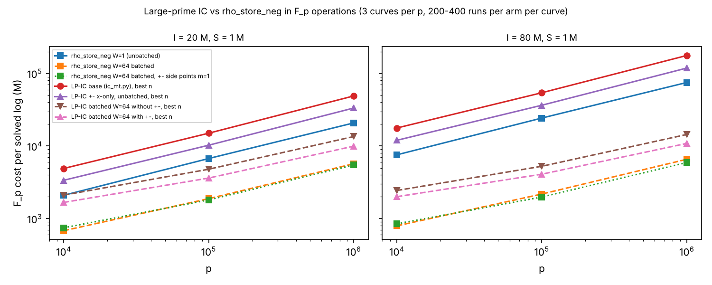

# Track 2: x(R+F) and x(R-F) from one inversion, counted in F_p operations

This track asks whether the large-prime IC (LP-IC) of `../ic_e2e/ic_mt.py` gets
closer to Pollard rho once both are counted in F_p operations and the IC computes
each leftover pair R - F_k, R + F_k with one shared inversion. The answer is
partly. Against a plain rho the gap shrinks from about 2.3x to about 1.6-1.75x.
But once rho gets the same tools (batch inversion and the same shared-inversion
+- side points), the best IC is still about 2x the best rho at p = 1000003, so
the trick does not narrow the matched gap.

Exploratory runs, not a bench.record benchmark. Every number below comes from
`runs/*.json` through `analyze.py`. All claims are [pcc:unverified].

## Setup

- `ic_pm.py` started as a copy of `../ic_e2e/ic_mt.py` (sha256 `087c0d32...33ba8`,
  left unchanged) and was then extended. It counts every F_p multiplication (M),
  squaring (S) and inversion (I) through counted helper functions (`fm`, `fs`,
  `fi`). Additions, subtractions and small-constant multiples are not counted.
  The cost of a run is M + S + c*I with c = 20 and c = 80. `summary.json` also
  has S = 0.8 M.
- Curves: the 9 prime-order curves of `../ic_e2e/runs_lp_slack1/` (3 per p for
  p = 10007, 100003, 1000003), passed as `--curve=A,B,r`. The script checks that
  r is prime, lies in the Hasse interval and satisfies r*P = O.
- A self-test at startup checks `pm_x` against the reference addition on 200
  random pairs, and checks `addc` and `batch_inv`, including its 1 I + 3(n-1) M
  count. The counters are reset afterwards.
- Formulas: an affine addition costs 1I + 2M + 1S, and a doubling 1I + 2M + 2S.
  The +- pair x(R-F), x(R+F) from one inverse 1/(x_F - x_R) costs 2M + 2S, with
  y computed only on a hit, for 1M. Montgomery batch inversion of n values costs
  1I + 3(n-1)M.
- LP-IC arms. All use `--slack=1`, n in {1, 2, 4} and 200 runs per (curve, n,
  arm). The table's sign resolution uses stored points.
  - `base`: one target walk. Every leftover is a full affine addition with its
    own inversion. This is `ic_mt.py --lp` counted in field ops.
  - `pm`: one walk. x(R-F_k) and x(R+F_k) share one inversion and are x-only.
    No batching.
  - `bbW`: W parallel walks with one Montgomery batch per round over all walk
    steps and leftovers, but no +- sharing: R-F and R+F each take a batch slot
    and are full points. This is the batching-only control.
  - `pmbW`: W parallel walks with batching plus +- sharing (W = 1, 16, 64).
  - `base`, `pm`, `bbW` and `pmbW` with the same seed and W walk identical
    targets, so the comparison is paired.
- Rho arms. `rho_store_neg` from `ic_mt.py`: an r-adding walk with 20
  multipliers that stores every point by x and matches +-X. 400 runs per
  (curve, W, m).
  - `W` = 1, 16, 64 parallel walks with a shared store and one batch inversion
    per round.
  - `m` = 0, 1, 4: rho gets the same +- tool. For every walk point X it also
    stores x(X - S_k) and x(X + S_k) for m fixed random combinations S_k, using
    the same shared-inversion formula and batch slots as the IC. Side points are
    stored, not walked. m = 0 is the plain reference.
- Equal treatment of setup. In both methods the multipliers, walk 0's start and
  the factor base use uncounted scalar multiplications, as in `ic_mt.py`. Walks
  1..W-1 start at X0 + SM_j, with the SM_j precomputed and uncounted. Those W-1
  additions are counted and share one batch inversion. The IC's n^2 table
  additions are counted. Linear algebra mod r is not counted (n <= 4).

## Commands

```
cd research/stange_torsion_division_20261113/ic_e2e_pm
./run_all.sh        # 9 curves in parallel, ~3 min; writes runs/pm_p<p>_s<seed>.json (+ .err, empty)
python3 analyze.py  # writes summary.json, tables.md, pm_vs_rho.{png,svg,pdf}
```

`run_all.sh` calls `ic_pm.py <p> <seed> 1,2,4 --curve=A,B,r --slack=1
--reps-ic=200 --reps-rho=400 --W=1,16,64 --m=0,1,4`.

## Results

Each cost is the mean of 3 curves (each curve is the mean of its runs), in units
of M per solved log [pcc:unverified]. The IC is shown at its best n, given in parentheses. The
full table, including every n and the M/S/I split, is in `tables.md`.

Cost at I = 20 M:

| p | rho W1 m0 | rho W64 m0 | rho W64 best m | IC base | IC pm | IC bb64 | IC pmb64 |
|---|---|---|---|---|---|---|---|
| 10007 | 2098 | 682 | 682 (0) | 4912 (1) | 3378 (1) | 2110 (1) | 1674 (1) |
| 100003 | 6735 | 1886 | 1811 (1) | 15030 (1) | 10269 (1) | 4796 (1) | 3624 (1) |
| 1000003 | 20824 | 5706 | 5148 (4) | 49000 (1) | 33409 (1) | 13523 (1) | 9963 (1) |

Cost at I = 80 M:

| p | rho W1 m0 | rho W64 m0 | rho W64 best m | IC base | IC pm | IC bb64 | IC pmb64 |
|---|---|---|---|---|---|---|---|
| 10007 | 7572 | 797 | 797 (0) | 17725 (1) | 11998 (1) | 2444 (1) | 2007 (1) |
| 100003 | 24306 | 2184 | 1987 (1) | 54237 (1) | 36485 (1) | 5268 (1) | 4097 (1) |
| 1000003 | 75148 | 6575 | 5354 (4) | 176824 (1) | 118703 (1) | 14446 (1) | 10886 (1) |

Gap ratios (IC / rho; a value above 1 means the IC costs more). Each cell gives
I = 20 M / I = 80 M:

| p | base / rho W1 m0 | pm / rho W1 m0 | bb64 / rho W64 m0 | pmb64 / rho W64 m0 | pmb64 / rho W64 m1 | best IC / best rho (any arm) |
|---|---|---|---|---|---|---|
| 10007 | 2.34 / 2.34 | 1.61 / 1.58 | 3.09 / 3.07 | 2.45 / 2.52 | 2.24 / 2.36 | 2.07 / 2.35 |
| 100003 | 2.23 / 2.23 | 1.52 / 1.50 | 2.54 / 2.41 | 1.92 / 1.88 | 2.00 / 2.06 | 2.06 / 2.12 |
| 1000003 | 2.35 / 2.35 | 1.60 / 1.58 | 2.37 / 2.20 | 1.75 / 1.66 | 1.81 / 1.84 | 1.96 / 2.03 |

At p = 1000003 the best IC arm is pmb16 (I = 20) or pmb64 (I = 80), both with
n = 1. The best rho arm is W16 m4 (I = 20) or W64 m4 (I = 80).

At p = 1000003 the pooled standard error of the I = 80 cost is 1-2% of the mean
for the batched arms (rho W64 m0: 98 on 6575; IC pmb64 n1: 178 on 10886) and
about 1.5% for the unbatched ones. Logs solved and checked against the true
value: 75600, with none wrong (each run asserts its log) [pcc:unverified].



## Findings

- What the +- trick saves on its own, with identical targets: unbatched,
  base -> pm cuts the IC cost by 32-33% at both I ratios (p = 1000003, n = 1:
  49000 -> 33409 at I = 20). Batched with W = 64, bb64 -> pmb64 saves 25-26%
  (13523 -> 9963 at I = 20; 14446 -> 10886 at I = 80) [pcc:unverified].
- Against a rho that does not batch and has no side points (the ic_mt setting
  counted in field ops), the gap falls from 2.35 to 1.60 at p = 1000003 for both
  I ratios. Against a batched rho with W = 64 and m = 0, pmb64 has a gap of 1.75
  (I = 20) or 1.66 (I = 80), against 2.37 / 2.20 for bb64. So the trick narrows
  the gap to a rho that lacks it [pcc:unverified].
- That comparison is not matched, because rho can use the same trick. A rho that
  also stores x(X -+ S_k) from X's batch slot gets cheaper (W64: 5706 -> 5148 at
  I = 20, 6575 -> 5354 at I = 80). The best IC over the best rho is then 1.96
  (I = 20) and 2.03 (I = 80) at p = 1000003. That is about the same constant gap
  of roughly 2 that `../ic_e2e` reported in group operations. No arm beats rho at
  any p or I ratio [pcc:unverified].
- Why the gap stays (from the counts at p = 1000003, I -> 0). With batching, one
  IC target at n = 1 and one rho walk point at m = 1 cost the same: a 2-slot batch
  (6M), one walk step (2M + 1S) and one +- pair (2M + 2S), about 13M. Rho stores
  3 points from that work (X, X - S, X + S) and needs 1 collision. The IC stores
  2 (R - F, R + F) and needs n + 1 = 2. The +- trick lowers the per-point cost of
  both methods equally, so it cannot remove a gap that comes from needing a
  second collision [pcc:unverified].
- Side points are worth less than random points. Rho with m = 1 needs about 1.3x
  more stored points than with m = 0 (1223 against 905 at W = 1, p = 1000003),
  because X + S_k and Y + S_k collide only when X = Y. The IC's R + F_k leftovers
  have the same structure. Both pay this cost [pcc:unverified].
- At p = 10007 and 100003, W = 64 walks overshoot: up to 63 extra points per
  round, plus counted start points, set against sqrt r of 100-316. So the
  batched ratios at small p are noisier and less favourable to the IC. The
  p = 1000003 row is the most informative.
- Larger n does not help in field ops either. At p = 1000003, I = 80, pmb64
  costs 10886 at n = 1, 12809 at n = 2 and 16160 at n = 4. In the within-walk-batched pmb1 arm
  n = 4 wins at I = 80, because a larger n spreads each walk-step inversion over
  more leftovers (pmb1: 64038 at n = 1, 40669 at n = 4); the truly unbatched arms
  (base, pm) are best at n = 1 (pm: 118703 at n = 1 vs 147729 at n = 4) [pcc:unverified].

## Limits

- Toy primes (up to about 10^6) and Python. The counts are F_p operation counts
  under the stated weights, not times. Field additions, hashing, table lookups
  and memory are not charged in either method.
- Only the I/M ratio is varied (20, 80). S = 1 M is the headline; S = 0.8 M is
  in `summary.json` and not discussed.
- Setup is uncounted in both methods, as in `ic_mt.py`. This covers the 20 walk
  multipliers, W - 1 start offsets, m side multipliers, walk 0's start and the
  factor base.
- The rho is an r-adding walk with a full store (no distinguished points, no
  cycle handling needed). It is not a negation-map walk on classes.
- Not tested: also storing x(R) itself as a partial relation in the IC. This
  would give 3 points per target, like rho with m = 1. The same structural
  argument suggests it cannot remove the 2-collision penalty, but that is not
  measured.
- No preregistration, no A/A arm, no bench.record. This is exploratory evidence
  only.

## Errors hit

- First full run: in the parallel-walk start code, a start equal to O was
  dropped, so `walks` became shorter than W (IndexError). Fixed by setting
  W = len(walks).
- `randcomb` could return O (a random aP + bQ = O, probability 1/r), giving
  `NoneType` errors at p = 10007. Fixed by resampling.
- A walk restart could produce O. Fixed with a `restart` helper that resamples.
  These faults showed up only at p = 10007 with W = 64. All runs were redone
  after the fixes; the `.err` files are empty.
- The first rho arms had no side points (m = 0 only). On review, that comparison
  gave the IC a tool rho did not have. The m = 1, 4 arms were added and
  everything was re-run. The earlier numbers are not reported.

## Files

- `ic_pm.py` (sha256 `ff0f9f89...87845`): the counted IC and rho arms.
- `run_all.sh`: the exact commands.
- `analyze.py`: produces the summary, tables and plot.
- `runs/pm_p{10007,100003,1000003}_s{1,2,3}.json`: raw per-run M/S/I counts.
- `summary.json`, `tables.md`: derived values.
- `pm_vs_rho.{png,svg,pdf}`: the plot.

## Independent review notes (2026-11-15)

A separate reviewer reran cells, reproduced the tables, and found the result
holds with these caveats [pcc:unverified]:

- Setup work is not counted, and it is larger than the counted work at these primes. At p = 1000003 the batched arms (rho W64 m4, IC pmb64 n1) each do about 5000 uncounted affine group operations in scalar multiplications (multipliers, start offsets, side points), against about 700-1200 counted stored points. That is about 4e5 M at I = 80, against counted costs of about 4e3-1e4 M. The batched figures (the 25-26% saving and the 1.66-1.75 gaps) therefore apply only asymptotically, where setup amortizes. Comparisons within one W are unaffected.
- "Best IC / best rho" takes the minimum over 24 IC means and 9 rho means. That selection bias is small (SE 1-2%), but the 1.96 vs 2.03 difference sits inside the uncertainty.
- The `log_ok` field in the JSON is hard-coded. Log checking actually comes from `assert sol == w`, which would abort the run on failure.
- n = 1 "IC" is close to a two-collision rho variant, so this says little about index calculus with larger factor bases.
