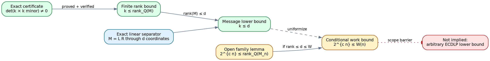

# Outcome

For a width-$w$ Boolean boundary tensor flattened into
$M \in \mathbb{Z}^{2^a \times 2^{w-a}}$, the following statements are now
formalized in Lean and the finite lower bound has an independent native
certificate:

$$
0 \leq \operatorname{rank}_{\mathbb Q}(M)
\leq \min(2^a, 2^{w-a}).
$$

A nonzero determinant of a $k\times k$ minor proves
$k\leq\operatorname{rank}_{\mathbb Q}(M)$. If an exact linear separator
factors $M=LR$ through $d$ coordinates, then
$\operatorname{rank}_{\mathbb Q}(M)\leq d$. Therefore the certificate proves
$k\leq d$.

{width=95%}

# Certificate and verification

`tensor-census` schema v2 emits the split positions, selected rows and columns,
and exact signed determinant for both the canonical and selected best balanced
split. The verifier reconstructs the matrix from the exact boundary tensor and
recomputes only that determinant using fraction-free Bareiss elimination. It
does not call the rank routine.

The deterministic control checks 1,152 integer matrices from $1\times1$
through $6\times6$: exact fraction-free rank agrees with rational Gaussian
elimination, and each discovered rank-profile minor has nonzero determinant.
A changed determinant is rejected.

# Formal theorem and family gap

The Lean project proves:

1. matrix and Boolean-flattening upper bounds;
2. nonzero minor $\Rightarrow$ rank lower bound;
3. exact linear factorization $\Rightarrow$ rank at most separator dimension;
4. their combined finite separator lower bound; and
5. if $2^{e(n)}\leq\operatorname{rank}(M_n)\leq d(n)\leq W(n)$ and
   $cn\leq e(n)$, then $2^{cn}\leq W(n)$.

The last theorem is conditional by design. No uniform exponential minor or
rank lower bound is currently proved for the production hashed prime-field
family. No production semantic cut or E1 rank row has been generated.

# Claim boundary

These results cover exact linear separator messages for the registered
boundary matrices. They do not cover nonlinear compression, randomized or
approximate contraction, alternate encodings, separator-avoiding algorithms,
or arbitrary classical/quantum ECDLP algorithms. Even a future full-rank family
theorem would refute this architecture, not subexponential ECDLP in general.

# Reproducibility

The formal project pins Lean 4.35.0 and exact `crypto-lean` and Mathlib
revisions. Full digests, statements, proof map, source citations, validation
receipts, and the named open obstruction are in `RIGOROUS_BOUNDS.md`.
