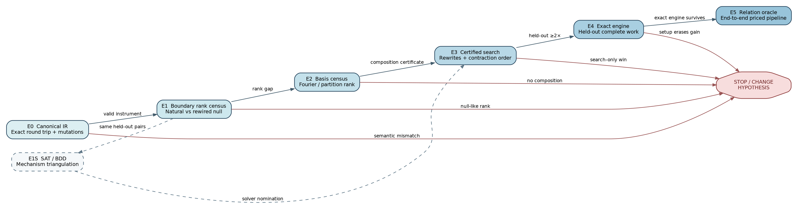

# Finding the next tensor–Boolean breakthrough

**Decision brief — 2026-10-31**

## Recommendation

Finish the canonical IR coverage gate, then run a boundary-tensor rank census. Test SAT immediately afterward as a mechanism triangulation, not as an unstructured solver race.

The strongest actionable hypothesis is that the natural hashed ECDLP network emits lower-dimensional boundary messages than a close rewired null. This is where tensor contraction, SAT propagation, BDD width, and variable elimination meet: each benefits when the information crossing a cut is compressible. Measuring the invariant first makes a later solver or contraction win interpretable. If E1 passes, E1S exports the same natural/null pairs to parsimonious CNF, CNF-XOR, and an exact BDD path, then asks whether complete solver work tracks the measured rank.

*Figure 1. The critical path has an explicit stop branch at each stage. E1S is a parallel SAT/BDD triangulation after E1, not a prerequisite for the mathematical basis census.*

## The first falsifiable test

At a frozen semantic cut, contract one side of the Boolean network exactly and leave its cut edges open. The resulting integer tensor counts internal completions for each boundary assignment. Reshape that tensor across balanced partitions and compute exact integer matrix ranks.

Natural instances are paired with nulls made by degree-preserving edge swaps inside fixed cut-edge classes. The null preserves every local predicate, degree, edge count, interface, pin, evaluator, cut width, and per-vertex cut degree while disrupting the global arithmetic alignment. An exact solution-count stratum blocks the easiest satisfiable/unsatisfiable confound. A known-rank positive control tests the rank code; a fresh-process A/A control must agree bit for bit.

The experiment advances only on held-out sizes if the natural network has both a material normalized-rank gap and a lower rank-growth slope. If it is full-rank like the null with adequate completion, this route stops.

## What a positive result buys

A positive E1 result chooses the next basis search:

| E1 signature | Next mechanism test | Candidate engine |
|---|---|---|
| Sparse Walsh/Fourier spectrum | Character-basis composition | Fourier message passing |
| Low balanced partition rank | Exact factor certificates | Rank-factored contraction |
| Repeated equal rows/columns | State minimization | BDD/automaton quotient |
| Gap only after arithmetic rewrites | Certified rewrite search | Hybrid algebraic–Boolean elimination |
| No reproducible gap | Stop this route | Return to a different representation hypothesis |

The SAT suspicion receives a sharp falsifier in E1S: natural and rewired instances have the same local predicates and a matched model-count stratum, and each frozen solver sees a parsimonious export from the same IR. A same-sign work reduction in CaDiCaL and CryptoMiniSat, together with a held-out association between rank and log work, nominates those bundles for E4. A solver-only win without the association remains an implementation result, not the tensor mechanism.

Local structure does not count unless it composes. E2 therefore requires a checked composition certificate predicting lower global exact work. E3 then searches rewrites and orders on training instances only; E4 tests the frozen engine on untouched holdouts.

## E0 implementation status

The graph originally recorded predicate behavior only behind `Arc<dyn Predicate>`, so shape-only serialization could silently lose semantics. E0 now supplies `BTNIR001`: construction-order incidence, ordered ports and interface, pins, provenance, tags, and exact semantic bodies share stable bytes and a SHA-256 identity. Predicates through 16 ports use complete truth tables. A representative tiny decomposition exposed a 132-port Fourier relation, so larger built-in relations use strict typed programs that are also their live evaluators before export and after import.

Tiny controls pass round-trip count, every interface-prefix count, least-witness, parser, and five mutation checks. This establishes the core comparison instrument, not the E1 result: optional high-arity selector/custom predicates, final-ladder preflight, and the fresh-process A/A runner remain open. No affected rank or solver data has been taken.

## E1 census implementation status — 2026-11-01

The exact arithmetic core named by the protocol now exists. It contracts an
explicit side of a canonical BTNIR cut under a free-edge cap, emits exact
arbitrary-precision completion counts and a stable tensor digest, and computes
canonical and exhaustive balanced flattening ranks using fraction-free integer
elimination. Known ranks 1, 2 and 4 pass; 1,152 deterministic small matrices
match an independent rational eliminator. See
[`E1_IMPLEMENTATION.md`](E1_IMPLEMENTATION.md) and the dated
[lead reconciliation](SEARCH_20261101.md).

The census now emits independently recomputable nonzero-minor certificates.
[pcc:unverified]
A Lean-checked theorem proves that an order-`k` certificate forces every exact
linear separator factorization to use at least `k` coordinates. A second
theorem makes the asymptotic gap precise: exponential rank on a linear-width
family, plus an explicit message-to-work condition, forces exponential work
for that architecture. The required production family rank lemma is still
open. See [`RIGOROUS_BOUNDS.md`](RIGOROUS_BOUNDS.md).

This is instrument verification, not an E1 row. Stable production semantic
cuts, matched rewired nulls, a fresh-process A/A runner, disjoint preflight and
the final frozen identities remain open. No affected rank data has been taken.

## Fixed-arity recovery update — 2026-11-19

The separate fixed-arity route now has a kernel-checked planted-dense fallback.
Mathlib's verified Bird determinant is lifted to adjugates, and the resulting
executable `ZMod` formula is proved equal to the nonsingular matrix inverse
under a unit-determinant hypothesis. Exact natural arithmetic also shows that
a prospective `rows^6` implementation has fixed numerator six and is therefore
absorbed by the already checked fixed-arity diagonal. This does not yet prove
the full bit runtime, but the scalar-ring bound is now checked: array-backed
eager states compute the same determinant, an instrumented entry count yields
`4(n+1)^4` operations per determinant, and all `n²` cofactors cost at most
`4(n+1)^6`. Counting the extra determinant and final scaling gives the checked
whole-inverse ring bound `4(n+1)^6 + 4(n+1)^4 + n^2`; a conditional bit-work
theorem multiplies it by an explicit polynomial modular-operation cost and
adds one explicit polynomial extended-GCD inversion cost. The latter two
polynomial bounds remain hypotheses because the pinned Mathlib contains no
machine-time proof for `Nat.gcdA`. The generic planted-block binding is checked
too: the executable Bird kernel satisfies
the annihilation and identity-right-block laws used by the upstream uniformity
proof. The remaining tasks are the cross-project specialization,
array/indexing cost and proofs of the two stated modular bit-cost hypotheses.
The rectangular `R * B^-1` work is no longer open: an exact counted dot-product
implementation yields `2sf^2` charged operations and `sf` output negations.
The sampler side now has an exact finite rejection theorem as well: equal
accepted fibres imply uniform outputs and pair events, with expected retry
count `total/accepted`. The concrete signed-x elliptic-curve decoder remains to
be bound to those hypotheses.
The exact upstream-shaped `Ttop`/`Rint`/`nu`/`q` specialization is
now checked locally; only integration into the external pinned tree remains.
[pcc:unverified] See
[`FIXED_ARITY_DIAGONAL.md`](FIXED_ARITY_DIAGONAL.md).

## Claim boundary

No result in the proposed rank census proves a subexponential ECDLP algorithm. E1 can identify or reject a finite-size compression mechanism. E4 can establish an exact-engine improvement on a frozen ladder. E5 can establish complete relation-oracle progress. A complexity claim still needs a proved family invariant and complete end-to-end cost theorem. [pcc:unverified]

## State of evidence

This package contains designs, controls, stop gates, a draft schema record, and the core E0 canonical-IR implementation. It contains no E1 measurements, no benchmark rows, and no frozen protocol. The protocol intentionally blocks data collection until the remaining E0 coverage, census binary and hashes, preflight, power justification, and final ladder are committed.
