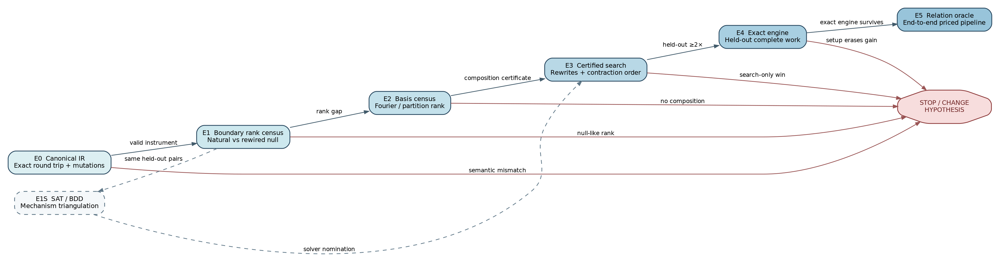

# Finding the next tensor–Boolean breakthrough

**Decision brief — 2026-10-31**

## Recommendation

Finish the canonical IR coverage gate, then run a boundary-tensor rank census. Test SAT immediately afterward as a mechanism triangulation, not as an unstructured solver race.

The strongest actionable hypothesis is that the natural hashed ECDLP network emits lower-dimensional boundary messages than a close rewired null. This is where tensor contraction, SAT propagation, BDD width, and variable elimination meet: each benefits when the information crossing a cut is compressible. Measuring the invariant first makes a later solver or contraction win interpretable. If E1 passes, E1S exports the same natural/null pairs to parsimonious CNF, CNF-XOR, and an exact BDD path, then asks whether complete solver work tracks the measured rank.

*Figure 1. The critical path has an explicit stop branch at each stage. E1S is a parallel SAT/BDD triangulation after E1, not a prerequisite for the mathematical basis census.*

## The first falsifiable test

At a frozen semantic cut, contract one side of the Boolean network exactly and leave its cut edges open. The resulting integer tensor counts internal completions for each boundary assignment. Reshape that tensor across balanced partitions and compute exact integer matrix ranks.

Natural instances are paired with nulls made by degree-preserving edge swaps inside fixed cut-edge classes. The null preserves every local predicate, degree, edge count, interface, pin, evaluator, cut width, and per-vertex cut degree while disrupting the global arithmetic alignment. An exact solution-count stratum blocks the easiest satisfiable/unsatisfiable confound. A known-rank positive control tests the rank code; a fresh-process A/A control must agree bit for bit.

The experiment advances only on held-out sizes if the natural network has both a material normalized-rank gap and a lower rank-growth slope. If it is full-rank like the null with adequate completion, this route stops.

## What a positive result buys

A positive E1 result chooses the next basis search:

| E1 signature | Next mechanism test | Candidate engine |
|---|---|---|
| Sparse Walsh/Fourier spectrum | Character-basis composition | Fourier message passing |
| Low balanced partition rank | Exact factor certificates | Rank-factored contraction |
| Repeated equal rows/columns | State minimization | BDD/automaton quotient |
| Gap only after arithmetic rewrites | Certified rewrite search | Hybrid algebraic–Boolean elimination |
| No reproducible gap | Stop this route | Return to a different representation hypothesis |

The SAT suspicion receives a sharp falsifier in E1S: natural and rewired instances have the same local predicates and a matched model-count stratum, and each frozen solver sees a parsimonious export from the same IR. A same-sign work reduction in CaDiCaL and CryptoMiniSat, together with a held-out association between rank and log work, nominates those bundles for E4. A solver-only win without the association remains an implementation result, not the tensor mechanism.

Local structure does not count unless it composes. E2 therefore requires a checked composition certificate predicting lower global exact work. E3 then searches rewrites and orders on training instances only; E4 tests the frozen engine on untouched holdouts.

## E0 implementation status

The graph originally recorded predicate behavior only behind `Arc<dyn Predicate>`, so shape-only serialization could silently lose semantics. E0 now supplies `BTNIR001`: construction-order incidence, ordered ports and interface, pins, provenance, tags, and exact semantic bodies share stable bytes and a SHA-256 identity. Predicates through 16 ports use complete truth tables. A representative tiny decomposition exposed a 132-port Fourier relation, so larger built-in relations use strict typed programs that are also their live evaluators before export and after import.

Tiny controls pass round-trip count, every interface-prefix count, least-witness, parser, and five mutation checks. This establishes the core comparison instrument, not the E1 result: optional high-arity selector/custom predicates, final-ladder preflight, and the fresh-process A/A runner remain open. No affected rank or solver data has been taken.

## Claim boundary

No result in the proposed rank census proves a subexponential ECDLP algorithm. E1 can identify or reject a finite-size compression mechanism. E4 can establish an exact-engine improvement on a frozen ladder. E5 can establish complete relation-oracle progress. A complexity claim still needs a proved family invariant and complete end-to-end cost theorem.

## State of evidence

This package contains designs, controls, stop gates, a draft schema record, and the core E0 canonical-IR implementation. It contains no E1 measurements, no benchmark rows, and no frozen protocol. The protocol intentionally blocks data collection until the remaining E0 coverage, census binary and hashes, preflight, power justification, and final ladder are committed.
