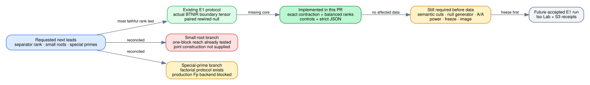

# Prime-field separator-rank lead reconciliation

Date: 2026-11-01  
Scope: literature/repository search and native instrument implementation; no scientific run

## Question and outcome

The requested next test was separator rank or small-root lattice growth as
relation arity increases, with special-prime structure as a second lead. The
repository already contains the more faithful separator-rank experiment:
E1 contracts the actual Boolean network at a semantic cut and computes exact
balanced flattening ranks. Its arithmetic instrument was missing, so this
round implemented that instrument instead of adding another fixed-arity timing
or importing a toy group-sum proxy.

The result of this round is an implementation result, not an E1 measurement.
The protocol remains draft until production cuts, matched nulls, A/A, power,
resource and image identities are frozen.

## Sources and existing evidence checked

| Source | What it establishes for this decision |
| --- | --- |
| `RESEARCH_PRIME_FIELD_BREAKTHROUGH_PROGRAM.md` | Small-root reach and the complete relation/linear-algebra cost bridge; the convex one-block Semaev lattice is already measured far below its needed exponent. |
| `research/prime_s5_small_root_leads_20261028/` and the 31 October lead review | The known one-block small-root lane is closed at its stated scope; a constructive joint-system advantage remains a different hypothesis. |
| `research/prime_digit_presentation_20261029/` | The digit presentation lowers degree relative to the plain presentation, but its last fall degree grows and the Macaulay space occupies 60–100% of the toy ring; the curve-free block null reproduces the early fall. |
| `research/tensor_boolean_breakthrough_20261031/` | E1 already preregisters exact boundary-tensor ranks against topology-preserving rewired nulls. The README explicitly listed `tensor-census` as the next missing implementation. |
| `research/prime_ic_lead_review_20261031/` | Ranks the hashed Boolean tensor route first and defines a separate factorial special-prime/special-curve solver control. |
| `research/special_prime_curves_20261023/` | Special prime shape did not create small embedding degree in 22 certified constructions; it does not answer the Boolean-representation question. |
| Petit–Kosters–Messeng, PKC 2016 | Prime-field algebraic factor bases leave generalized root finding as the open solver problem. |
| Bochum v0.2 and OpenAI Appendix D, at the revisions pinned by the lead review | Supply the conditional hashed-factor-base reduction and implicit contraction theorem under audit; finite rank data neither prove nor refute that theorem. |

## Why the scratch alternatives were not imported

The earlier special-prime scratch panel compared different curves and group
orders, used only two curve draws per prime type and 24 within-instance nulls,
and searched six predicates across sizes without a frozen family-wise decision
rule. It cannot isolate prime shape from curve/order effects. The current lead
review's factorial design is the applicable experiment and depends on the
still-unimplemented production `F_p` theory backend.

The earlier group-sum separator panel did identify the elementary phenomenon
that balanced sum supports approach the whole toy group as arity grows. But it
does not contract the actual hashed Boolean representation or compare the
natural network with a wiring-matched null. E1 measures the live object and is
therefore the stronger discriminator.

## What was implemented and independently checked

[`E1_IMPLEMENTATION.md`](E1_IMPLEMENTATION.md) records the exact boundary
contraction and rank engine. The principal checks are:

- rank 1, 2 and 4 controls;
- a canonical equality-network contraction whose flattening is the 2-by-2
  identity;
- explicit failure on cut pins and free-edge cap exhaustion;
- 1,152 deterministic rectangular matrices cross-checked against rational
  Gaussian elimination;
- Rust 1.78 format, focused release tests and CLI build; current-stable
  all-target Clippy with warnings denied.

These are development correctness checks. No declared E1 cell was generated,
and no number from the discarded scratch panels enters this study.

## Requirement status

| Requested item | Status | Evidence or exact gap |
| --- | --- | --- |
| Measure separator rank as arity grows | **implemented instrument, not run** | Exact engine and CLI now exist; production cut/null generator and frozen E1 ladder remain open. |
| Evaluate small-root growth | **already evaluated at the applicable one-block scope** | Existing small-root and digit-presentation studies; no new joint-system construction was supplied to test. |
| Evaluate special-prime alternatives | **protocol exists, backend blocked** | Factorial design in the lead review; scratch comparison rejected as confounded. |
| Make a PR in `isogeny-labs/crypto` | **in progress in this branch** | Code, receipt, report, diagram and PDF are prepared for the regular PR workflow. |
| Establish or disprove subexponential prime-field ECDLP | **not established** | Finite rank and solver panels cannot by themselves prove an asymptotic family statement. |

## Next technical step

Add stable semantic-region metadata to the production encoder and generate the
primary cut immediately after slot `ceil(m/2)`. Then implement the constrained
double-edge-swap null and a fresh-process A/A runner. Only after those fixtures,
preflight limits, power record, hashes and image digest are committed should
the E1 ladder run on Iso Lab.

Canonical scoreboard, progress timeline, leaderboard and curve browser were
checked conceptually and remain unchanged: this round adds no admitted numeric
comparison, curve, factor base, recipe, phase cost or reference change.

