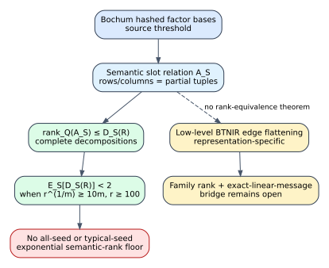

# Semantic relation-rank bound for hashed prime-field decomposition

Date: 2026-11-18
Status: locally kernel-checked structural theorems; PCC standing unverified
until a signed CI verdict; low-level BTNIR boundary family remains separate

## Result

Fix a prime-order elliptic-curve group `G` of order `r`, a target `R`, `m`
independent hashed factor bases `F_1,...,F_m`, and a split after slot `k`.
Index rows by tuples in `F_1 × ... × F_k`, columns by tuples in
`F_(k+1) × ... × F_m`, and define

```text
A_S[x,y] = 1  if sum(x) + sum(y) = R,
           0  otherwise.
```

Let `D_S(R)` be the exact number of full decompositions of `R` for seed `S`.
Every nonzero entry of `A_S` is one full decomposition, so

```text
rank_Q(A_S)
    <= number of nonzero rows of A_S
    <= number of nonzero entries of A_S
     = D_S(R).                                               (1)
```

The generic finite-relation statement is claim
`PCC-20261118-4717cb`, whose local proof verifier passes and whose signed PCC
standing is currently `unverified`. [pcc:unverified]

Equation (1) is independent of the slot split.  Combined with the source
threshold below, it rules out an exponential-rank lower bound uniform over all
seeds, or holding with nonnegligible seed probability, for this semantic
matrix in the stated asymptotic regime. [pcc:unverified]

## Source-threshold consequence

Write `n = r - 1`, `rho = tau / s`, and `L = n rho`, using the notation of
Akshima et al., Bochum v0.2, Lemmas 9--13.  For a fixed target, at most
`n^(m-1)` tuples of nonidentity points sum to it: choose the first `m-1`
points, after which the last is determined.  Independent slot hashes accept a
fixed tuple with probability `rho^m`.  Therefore

```text
E_S[D_S(R)] <= n^(m-1) rho^m = L^m / n.                     (2)
```

The source selects

```text
tau = ceil((s/n) max(r^(1/m), 10m)).
```

In its asymptotic regime put `q = r^(1/m) >= 10m`, so the maximum is `q`.
For the cofactor-one curves in Theorem 4, `r = #E(F_p)` and `p > 3`.
Hasse's bound and `s >= 2p` give

```text
n = r - 1 <= p + 2 sqrt(p) < 2p <= s.
```

Since `ceil(x) < x + 1`, it follows that `L < q + n/s < q + 1`.  For
`r >= 100`,

```text
E_S[D_S(R)]
  < (q+1)^m / (r-1)
   = (r/(r-1)) (1 + 1/q)^m
  <= (100/99) exp(m/q)
  <= (100/99) exp(1/10)
   < 2.                                                       (3)
```

Combining (1)--(3), for every integer `K > 0`,

```text
E_S[rank_Q(A_S)] < 2,
Pr_S[rank_Q(A_S) >= K] <= 2/K.                              (4)
```

If every seed had rank at least the integer `K`, then in fact `K < 2`, hence
`K <= 1`.  The Lean endpoint records the slightly weaker integer relaxation
`K <= 2` from an average upper bound of two.  Either form contradicts a
lower bound `2^(c b)` uniform over all seeds for any fixed `c > 0` once `b`
is large.  More generally, (4) gives
`Pr[rank_Q(A_S) >= 2^(c b)] <= 2^(1-c b)`, so such a lower bound does not hold
with nonnegligible probability for a uniformly sampled source seed.  This
average argument alone does not exclude an adversarially selected exceptional
seed sequence.
The finite averaging endpoint is claim `PCC-20261118-e6722e`; its local proof
verifier passes and its signed PCC standing is currently `unverified`.
[pcc:unverified]

This conclusion matches the construction's parameter choice: the expected
number of decompositions of one fixed target is constant-order while the
second-moment argument gives constant probability of at least one
decomposition. [pcc:unverified]

## Which matrix is bounded

`A_S` is the encoding-independent communication matrix obtained by
partitioning factor-base slots.  It is the natural object for a lower bound
intended to constrain every exact method solely through the decomposition
relation.

E1's registered census instead contracts a chosen set of low-level BTNIR
vertices, leaves individual Boolean edges open, and flattens those edge
coordinates.  That matrix also represents a particular multiplication,
comparison, equality-tree and point-addition implementation.  Its rank can be
larger than `rank(A_S)`.  Equations (1)--(4) neither compute nor upper-bound
that representation-specific rank.

Conversely, a high BTNIR rank would constrain only a backend shown to expose
an exact linear message across that exact cut.  It would not become a semantic
lower bound for nonlinear, randomized, approximate, separator-avoiding, or
different exact decomposition algorithms without another theorem.



## Lean instance and proof map

Source: [`lean/TensorBoundaryBounds.lean`](lean/TensorBoundaryBounds.lean).
The six-field instance analysis and inheritance table are in
[`../ic_yield_rank_frontier_20261118/PROOF_MAP.md`](../ic_yield_rank_frontier_20261118/PROOF_MAP.md).

| Report claim | Lean declaration or inherited theorem | Local status |
| --- | --- | --- |
| Rank is bounded by a finset containing all nonzero rows | Mathlib `Matrix.rank_le_card_of_support_subset` | Imported as stated |
| Semantic rank is bounded by matched left tuples | `decompositionRelationRankLeMatchedLeft` | Kernel build passes |
| Matched left tuples inject into full decompositions | `matchedLeftCardLeDecompositions` | Kernel build passes |
| Equation (1) | `decompositionRelationRankLeDecompositions` | Local PCC verifier passes; standing unverified |
| Finite Markov inequality in (4) | `highRankSeedCountBound` | Kernel build passes |
| Uniform floor is bounded by average solutions | `uniformRankLeAverageSolutionBound` | Local PCC verifier passes; standing unverified |

The exact hash expectation (2) specializes Bochum Lemma 9: slot seeds are
independent and each fixed point passes one slot with probability `tau/s`.
The elementary real estimates in (3) are written out above.  Lean formalizes
the finite matrix-rank and averaging implications, not the source's
probability space or real exponential inequality.

No `identity.certificate/v1` record is attached.  That schema certifies fixed
polynomial equalities over `F_(2^61-1)`; it cannot express finite-set
cardinalities, inequalities, varying `m`, or matrix rank.  A surrogate
fixed-`m` polynomial would not certify this result.

## Sources checked

- Akshima et al., *A Subexponential Time Algorithm for Elliptic Curve
  Discrete Logarithm*, Bochum v0.2, revision
  `1ee44e562b1b9a50ea339f3b8f81112b5a24b96f`, especially Definition 4,
  Lemmas 9--13, Theorem 4 and Remark 2.  The downloaded PDF has SHA-256
  `82e273629b437660607117d5e99f400141ed7aa78b25c6749b03651f42deaa11`.
- [`docs/leads/2026-11-18/subexponential-proof/REPORT.md`](../../docs/leads/2026-11-18/subexponential-proof/REPORT.md),
  for the current repository audit of the Bochum reduction and its explicit
  separation between relation collection and tensor contraction.
- Atlas paths `LEAD-EXO-hashed-factor-base-tensor-ecdl` and
  `LEAD-ICB-decomposition-encoding-and-sat`.  The current atlas checkout is
  vault-locked and the key is unavailable; the paths were located but not
  reread in this environment.
- The E1 protocol, canonical BTNIR implementation, exact census and earlier
  architecture-level Lean bounds in this directory.

The research-KB connector was not loaded, and all four required fallback
queries plus the theorem query returned `research-kb: no executable found`.
No-retrieval is not treated as absence; the pinned primary source and the
committed repository audit above are the bounded fallback.

## Requirement status

| Requirement | Status | Evidence or remaining obligation |
| --- | --- | --- |
| Bound the semantic hashed prime-field relation family | Complete at locally checked, PCC-unverified scope | Equations (1)--(4), five new Lean theorems, two claim records |
| Prove an all-seed or nonnegligible-probability exponential lower bound for that matrix | Refuted at the stated source parameters, PCC-unverified | Expected semantic rank is below two in the source regime; exceptional selected seeds are not excluded |
| Bound the exact low-level BTNIR boundary family | Open, narrowed | Freeze semantic regions and Boolean-edge split, then prove a family theorem for that representation |
| Convert a low-level rank bound into contractor work | Open | Exact-linear-message and work-per-coordinate bridge for the named backend |

No performance run, curve record, leaderboard row, progress point or
benchmark record changes.  The canonical IC yield/right-rank graph was checked
and left unchanged because it tracks coefficient-matrix kernel modes, not this
slot-partition communication matrix.
