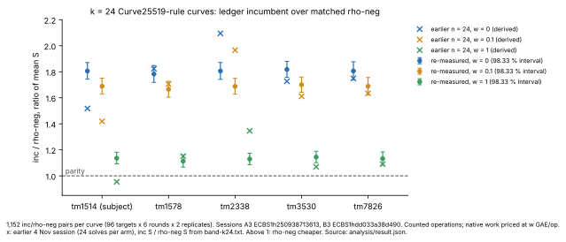
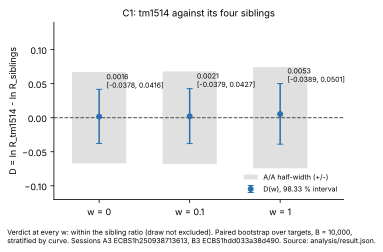

# tm1514 recheck at k = 24: results

Protocol `XP-20261106-tm1514-recheck`, `PROTOCOL.json` version 2 and
`PROTOCOL-AMENDMENT-1.md` (counted-only; C3 deferred). 2026-11-10.

**Standing.** Counted operations only, from two local `ecbench` sessions on a
development host at isolation L0 (one shared 4-vCPU KVM guest, Intel Xeon
2.10 GHz). No wall time, cycle count or isolation level enters any result. The
study has no `VALIDATION.json`, no independent replay certificate and no
validator report under the validation gate (`docs/VALIDATION_GATE.md`), so it
is not an admitted benchmark or leaderboard row. Every number below is copied
from the frozen analysis output and is recorded as statement claim
`PCC-20261110-97c3b6`, standing unverified [pcc:unverified].

## Result

On `icv1-fp24-tm1514-dce9313c`, rho with negation (`rho-neg`) is cheaper than
the ledger incumbent (`inc`, `wwalkGg-x09-sr-n2`) at every weight of the §5a
band [pcc:unverified]. The inc/rho-neg ratio of mean S, over 1,152 paired
solves per arm, is:

| w (GAE per native op) | R_tm1514 (95 % interval) | C4 verdict |
|:--|:--|:--|
| 0 | 1.8058 [1.7543, 1.8598] | R_tm1514 above 1 |
| 0.1 | 1.6890 [1.6402, 1.7404] | R_tm1514 above 1 |
| 1 | 1.1359 [1.1001, 1.1739] | R_tm1514 above 1 |

tm1514 sits within its four siblings' ratio. The earlier 1.52 at w = 0 (and
0.95 at w = 1), from 24 solves per arm in the 4 November multi-curve session,
was a small-sample draw. [pcc:unverified]

| claim | frozen rule | outcome |
|:--|:--|:--|
| C0 | every row verified; twins reproduce partners exactly | holds (no failures, nothing censored) |
| C1, w = 0 | 98.33 % interval of D = ln R_tm1514 − ln R_siblings, against the A/A half-width | D 0.0016 [−0.0378, 0.0416], A/A half-width 0.0670: within the sibling ratio (draw not excluded) |
| C1, w = 0.1 | as above | D 0.0021 [−0.0379, 0.0427], A/A half-width 0.0680: within the sibling ratio (draw not excluded) |
| C1, w = 1 | as above | D 0.0053 [−0.0389, 0.0501], A/A half-width 0.0743: within the sibling ratio (draw not excluded) |
| C1 (secondary, non-overlap) | tm1514's R interval entirely below the siblings' | within the sibling ratio at all three weights |
| C1b | 95 % interval of R_tm1514(0) excludes 1.52 | 1.8058 [1.7543, 1.8598]: the earlier 1.52 was a draw |
| C2 (positive control) | pooled rho-plain/rho-neg 95 % lower end ≥ 1.20, every curve > 1.10 | 1.2821 [1.2609, 1.3030]; per curve 1.2549 to 1.3076: detected |
| C3 | measured native price | deferred (AMENDMENT-1 §2.4) |
| C4 | 95 % interval of R_tm1514(w) against 1 | above 1 at w = 0, 0.1 and 1 |

The pooled sibling ratio R_siblings is 1.8029 [1.7717, 1.8358] at w = 0,
1.6855 [1.6560, 1.7168] at w = 0.1 and 1.1298 [1.1074, 1.1535] at w = 1
(98.33 %). Per curve (point values; 98.33 % intervals in `result.json` and
Figure 1):

| curve | role | R(0) | R(0.1) | R(1) | rho-plain/rho-neg (w = 0) |
|:--|:--|--:|--:|--:|--:|
| icv1-fp24-tm1514-dce9313c | subject | 1.8058 | 1.6890 | 1.1359 | 1.2993 |
| icv1-fp24-tm1578-e83ed1b2 | sibling | 1.7826 | 1.6657 | 1.1131 | 1.2619 |
| icv1-fp24-tm2338-191c1070 | sibling | 1.8057 | 1.6877 | 1.1292 | 1.2549 |
| icv1-fp24-tm3530-7cdfa218 | sibling | 1.8176 | 1.7002 | 1.1446 | 1.2874 |
| icv1-fp24-tm7826-eab5872b | sibling | 1.8063 | 1.6888 | 1.1329 | 1.3076 |

The earlier 24-solve values (derived from `band-k24.txt`) fall on both sides
of the new 98.33 % intervals: outside them at all three weights on tm1514
(below), tm2338 (above) and tm3530 (below), and inside them on tm1578 and
tm7826.

## Design and data

- Question: is tm1514's 1.52 a draw, or does it sit below its four family
  siblings (`PROTOCOL.md`)? Five `prime_explicit` curves of
  `research/curve25519_autolab_20261104/multicurve/spec-k24.json`, p near
  2^24, r ≈ 2^21; arms `rho-neg`, `rho-neg-aa`, `inc`, `inc-aa`, `rho-plain`;
  96 targets per curve from `target_seed` 546787239895877; 6 measured rounds
  and 1 warmup.
- Protocol: `PROTOCOL.json` version 2, protocol_sha256 `d348123a…81d6`, frozen
  2026-11-10T17:17:31Z before any A3/B3 record existed;
  `PROTOCOL-AMENDMENT-1.md` governs where they differ.
- Sessions (spec id, seed): A3 `ECBS1h250938713613` (spec
  `ECS1h3d4c0d4813f4`, seed 8671006997891351) and B3 `ECBS1hdd033a38d490`
  (spec `ECS1h58d3eafbe575`, seed 6232168080843969). 16,800 executions each, all `verified` (2,880 per arm).
  One locally built release `ecbench`, sha256 `b8570e7f…5603` in each
  `host.json`. [pcc:unverified]
- Audit: `ecbench verify --replay-all` on each session: `ok`, 16,800 records,
  16,800 verified, 14,400 replays reproduced, 0 problems
  (`audit/verify-A3.json`, `audit/verify-B3.json`). These are self-audits by
  the same binary on the same host, not an independent replay certificate.
- Analysis: `examples/tm1514_analyze.rs` (sha256 `6534cfe1…f197`), run as
  `tm1514_analyze --a sessions/A3 --b sessions/B3 --out analysis`. Arm labels
  were masked while the verdicts were computed (key sha256 `4927ed61…ef85`).
  Paired percentile bootstrap over targets, stratified by curve, B = 10,000,
  seed 244596609222896; 98.33 % (Bonferroni over three weights) for C1 and the
  per-curve band ratios, 95 % otherwise. Output `analysis/result.json`
  (sha256 `c7c473de…d236`) and `analysis/summary.txt` (`1b9bb451…a596`).
- Raw data are in the artifact store (AGENTS.md §13): bucket
  `setec-astronomy-artifacts`, key `store/sha256/<aa>/<hex>`. The manifests
  (`.artifacts.json`) in `sessions/A3`, `sessions/B3` and `audit` name them;
  `artifacts.py pull` (in `tools/artifacts/`) on this directory hydrates
  them. The benchmark record is
  `benchmarks/records/20261110T1729Z-tm1514-recheck-a3b3.json`.

  | file | bytes | sha256 |
  |:--|--:|:--|
  | `sessions/A3/records.jsonl` | 127,081,439 | `ad6ba575…0423` |
  | `sessions/A3/plan.json` | 3,198,831 | `fd35135d…4b2e` |
  | `sessions/B3/records.jsonl` | 127,104,720 | `0a03a9fc…190e` |
  | `sessions/B3/plan.json` | 3,198,856 | `1b98ca5c…5710` |
  | `audit/verify-A3.json` | 1,822,675 | `74d0abc8…f2e7` |
  | `audit/verify-B3.json` | 1,822,675 | `bb77b988…bee4` |

- Figures: `figures/make_figures.py` reads `analysis/result.json` (and checks
  its sha256) and, for the earlier markers only,
  `research/curve25519_autolab_20261104/multicurve/band-k24.txt`. It computes
  no statistic; the earlier ratios are inc S / rho-neg S from that table and
  are labelled derived. `figures/build_report.sh` builds `REPORT.pdf`.

## What did not count

- **Replicate A is a dry run.** The EKS submission (GitHub run 42269476702)
  ended with exit 23 and no pod; the inferred cause is the L2 gate's 1 ms
  floor on per-execution solve time. Its records were never read and its
  seeds are not reused (AMENDMENT-1 §2.1).
- **Replicates A2 and B2 are withdrawn.** Development checks ran reduced
  copies of their specs on their real seeds and targets, so those seeds and
  targets were dropped before any full session; A3 and B3 use a new
  `target_seed` (AMENDMENT-1 §2.5).
- **C3 is deferred.** The price of one native operation in group additions
  needs timed samples of at least 5 ms each, which this instrument cannot
  give at k = 24; it goes to a separate protocol. The band weights 0, 0.1 and
  1 are the only prices used here.
- Two revisions of the executor card fixed runner-script errors without
  changing data or analysis: the benchmark-record path was read from the last
  line of `benchrec-path.txt` (revision 1), and the verify stop condition read
  `ecbench verify`'s summary from stderr instead of stdout (revision 2).

## Scope

The result concerns these five k = 24 Curve25519-rule miniatures, this
incumbent and this instrument. Four siblings cannot rank tm1514 as unusual
(best attainable rank p = 1/5); C1 asks only whether tm1514 differs from their
pooled ratio, and it does not detectably. Nothing here is a statement about
the 255-bit curve. The w = 0 ratios near 1.8 are close to the F = 2 collision
floor of 1.875 derived in `research/curve25519_rho_parity_bound_20261104/`.
