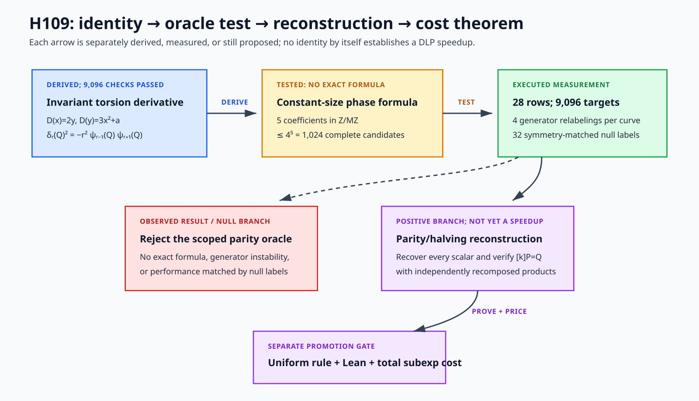

# H109 — torsion-local division-polynomial derivative oracle

Date frozen: 2026-10-31



Editable vector source: [`h109-torsion-derivative-flow.svg`](figures/h109-torsion-derivative-flow.svg).

The diagram separates four claims: the local algebraic identity, existence of
an exact compact phase formula, end-to-end scalar recovery, and a uniform
subexponential cost theorem.  Only the first is mathematically predicted at
freeze time; all other arrows are proposed or pending measurement.

## Requirement-to-evidence contract

- **Materially new mechanism:** use the invariant local derivative
  `D psi_r(Q)`, not a fitted span of character codewords.
- **Novelty screen:** preserve database queries, closest sources, and a scoped
  “novelty not established” conclusion.
- **Measurement:** evaluate every target on seven curves and four generator
  relabelings; report field, recurrence, character, and decoder costs.
- **Control:** use the paired H107/H108 baseline, local-identity checks, and
  symmetry-matched random parity labels with the same compact formula budget.
- **Proof:** provide Lean certificates for the derivation, phase/parity
  interface, and binary reconstruction.  A complexity theorem is required for
  any subexponential claim.
- **PR:** open one branch and one draft PR for H109 before implementation.

## Mechanism

For the invariant derivation on a short Weierstrass curve

```text
D(x) = 2y,
D(y) = 3x^2 + a,
```

let

```text
delta_r(Q) = D(psi_r)(Q),       Q in <P> minus {O}.
```

Every nonzero subgroup point is a simple zero of `psi_r`.  Comparing the
Laurent expansion of the multiplication formula

```text
x([r]R) = x(R) - psi_(r-1)(R) psi_(r+1)(R) / psi_r(R)^2
```

with `[r]^*(dx/(2y)) = r dx/(2y)` predicts the local identity

```text
delta_r(Q)^2 = -r^2 psi_(r-1)(Q) psi_(r+1)(Q).
```

H109 first checks this identity exactly at every frozen point.  It then tests a
constant-size family of multiplicative character formulas made from

```text
delta_r(Q), psi_(r-1)(Q), psi_(r+1)(Q), y(Q), constant primitive root.
```

Unlike H105--H108, the number of fitted coefficients is bounded independently
of `r`.  Division-polynomial values and invariant derivatives are evaluated by
memoized recurrence with dual-number/product-rule arithmetic.

## Frozen formula family and protocol

Let `M=2^v2(p-1)` and encode maximal base-field character phases in `Z/MZ`.
Completely enumerate every coefficient tuple

```text
(c0,c_delta,c_minus,c_plus,c_y) in (Z/MZ)^5
```

for the phase of

```text
g^c0 delta_r^c_delta psi_(r-1)^c_minus
    psi_(r+1)^c_plus y^c_y.
```

This is at most `4^5=1024` formulas on the frozen curves.  No coefficient
budget grows with `r`, and no heuristic search is permitted.

1. Run all seven retained curves, generator multipliers `1,2,3,5`, and every
   nonzero subgroup point.
2. Check `psi_r(Q)=0`, nonvanishing of the four formula inputs, the predicted
   squared-derivative identity, and agreement between memoized dual recurrence
   and a direct small-index symbolic/difference control.
3. Score every frozen formula against canonical scalar parity.  Retain exact
   formulas, best matches, all ties, coefficient vectors, and operation counts.
4. Run 16 symmetry-matched random parity-label controls on the primary
   `p=1 mod 4` row E101 and 16 on the primary `p=3 mod 4` row E127.  Each
   control assigns complementary bits to `k` and `r-k` and uses the identical
   complete formula family.
5. Compare with H107/H108's exact but linear-support character modules,
   charging their setup and support rather than only online character calls.
6. If any exact observed formula exists, execute the parity/halving decoder on
   every target for that row.  A primary positive must replicate across all
   four generators; the generic gate requires all 28 rows.
7. Independently reevaluate any exact formula through a separately composed
   field product and validate every reconstructed scalar by EC multiplication.

## Runtime and proof gates

The candidate qualifies as subexponential only if all of the following are
established:

- a public coefficient rule or the frozen constant-size enumeration constructs
  an exact formula on every generic row;
- memoized evaluation of the required values and derivatives has a proved
  `poly(log r, log p)` or `L_r(1/2,O(1))` bound including field operations;
- the parity decoder is exact and its total setup, advice, online work, memory,
  and verification stay within that bound;
- Lean proves the certificate-to-parity step, reconstruction, and the cost
  theorem actually used by the claim.

An exact toy formula without the uniform theorem is evidence on the frozen
instances, not a generic subexponential algorithm.

## Prior-art screen

Queries were run on Crossref, OpenAlex, and arXiv for combinations of
“division polynomial derivative,” “torsion point,” “elliptic divisibility
sequence derivative,” “theta group local parameter,” and “discrete logarithm.”
Closest located sources were:

- Coombes, [“Elliptic curves and logarithmic derivatives”](https://doi.org/10.1016/S0022-4049(97)00209-0);
- Silverman, [“p-adic properties of division polynomials and elliptic
  divisibility sequences”](https://doi.org/10.1007/s00208-004-0608-0);
- Burhanuddin and Huang, [“Elliptic curve torsion points and division
  polynomials”](https://doi.org/10.1142/9789812701640_0002);
- Lauter and Stange's [EDS/ECDLP equivalence](https://doi.org/10.1007/978-3-642-04159-4_20).

The bounded search did not locate the frozen derivative-phase parity formula,
but it is not source-complete.  Status: mechanism-distinct; novelty not
established.

The repository lead-atlas screen also found the closest internal predecessor,
[ECDLP-IDEA-006](https://github.com/isogeny-labs/crypto-autoresearcher/blob/main/ideas/ECDLP-IDEA-006_elliptic_net_short_annihilator_hypothesis.md),
and its [independent P1540 audit](https://github.com/isogeny-labs/crypto-autoresearcher/blob/main/ideas/artifacts/ECDLP-IDEA-006/p1540_r1_independent_audit.md).  Those records
test low-rank/annihilator and translated-coordinate index location; the audit
shows that the QRT state is birationally conjugate to the original elliptic
translation and that low-degree rational additive or multiplicative
linearization is unavailable.  H109 does not claim an annihilator or a new
state representation: its separately falsifiable question is whether the
*torsion-local invariant derivative* has a constant-size two-power character
phase that outputs scalar parity.  A positive formula must therefore survive
the complete formula enumeration, generator relabelings, matched random-label
controls, full scalar reconstruction, and total-cost gate below.  This
distinction is mechanism-level only and does not establish novelty.

## PR gate

Implementation may start only after this freeze is present in a draft H109 PR.
The canonical experiment PR belongs in `isogeny-labs/crypto`; the paired
reference-harness PR belongs in `isogeny-labs/cryptanalysis`.  Neither PR is a
result until the frozen matrix has run and its artifacts are committed.

## Executed experiment

The draft gates were opened as
[`isogeny-labs/crypto#3102`](https://github.com/isogeny-labs/crypto/pull/3102)
and
[`isogeny-labs/cryptanalysis#1342`](https://github.com/isogeny-labs/cryptanalysis/pull/1342).
Implementation commit `eb6cc02` then executed the protocol without changing
the coefficient family, curve cohort, target set, controls, or stopping rule.

All 9,096 target rows passed every algebraic control:

- `psi_r(Q)=0` and all four candidate inputs were nonzero;
- all squared local identities had residue zero;
- the memoized values agreed with the independent sequential recurrence;
- derivatives `D psi_2` through `D psi_8` agreed with independently
  differentiated symbolic polynomials at every target.

The evaluator materialized 412,328 non-base recurrence nodes (26--54 per
target as `r` grew from 83 to 947), used 10,674,040 counted field
multiplications and 211,712 inversions, and retained at most a small
logarithmic-size cache per target.  This validates the fast evaluator on the
frozen cohort; it does not supply a DLP oracle.

The complete formula searches examined 8,832 coefficient tuples across the
28 rows.  **No exact formula occurred on any row.**  Best agreement ranged
from 0.500000 to 0.611111, with median 0.530826.  The 32 symmetry-matched
controls ranged from 0.500000 to 0.629630, with median 0.509259, and likewise
had no exact formula.  On the two frozen primary comparisons:

```text
E101: candidate 0.500000; control mean 0.500000; empirical tail p=1.000000.
E127: candidate 0.574074; control mean 0.560185; empirical tail p=0.411765.
```

The empirical tail values use the conservative plus-one rank among 16 frozen
controls.  They are descriptive finite-panel statistics, not asymptotic
probabilities.  Because no row was exact, the preregistered parity/halving
decoder gate correctly did not open.

Diagnostic wall totals in the committed artifact were 6.3530 s for candidate
evaluation, 0.7493 s for formula enumeration, and 15.1463 s for the deliberately
expensive independent symbolic/value controls; the complete Python process
took 25.7005 s in the
recorded container.  These are unisolated diagnostic times, not performance
benchmarks.  The generic square-root references and H107/H108 artifact hashes
remain in the raw result for accounting.

A second complete run changed only diagnostic timing fields.  After removing
clock and environment fields, both runs had scientific-content SHA-256
`3991b25d2a2ddac0ebb1d25370c8b110051a40acca64a6bda3dd3baba4191b69`.

Lean 4.19.0 checked the tangent-derivation lemma, multiplicative-character
transport, exact phase-to-parity interface, binary reconstruction, and
conditional cost composition.  `#print axioms` reports only the named standard
Lean foundations for the applicable theorems.  The actual division-polynomial
local identity remains a written derivation plus exhaustive frozen check, not a
fully formalized division-polynomial theorem.

Result: the local identity and polylogarithmic-node evaluator are supported on
the frozen instances, but the constant-size phase-to-parity bridge is rejected
for the complete preregistered family.  This closes H109 only; it neither rules
out other functions of torsion-local data nor establishes a generic ECDLP
lower bound.  The next experiment must use a mechanism other than widening
this five-input multiplicative character formula.

Committed result SHA-256:
`940123c44c6194b247fab3596a9ed2e331ee7e01b2fb8830fc7e8465e354993a`.

