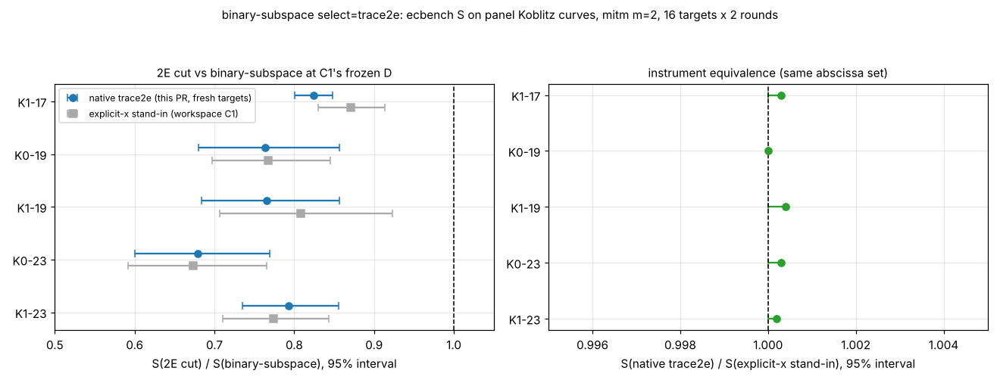

# Native `binary-subspace select=trace2e` factor base (2026-11-25)

**Request (owner, 2026-11-25):** "land the trace2e builder in crypto". PR
[#5196](https://github.com/isogeny-labs/crypto/pull/5196). Origin: workspace
[isogeny-labs/workspace#141](https://github.com/isogeny-labs/workspace/pull/141),
`docs/notes/binary-torsion-ic-20261125/ecbench/` ("Confirmatory C1"). That run
measured the 2E cut with an `explicit-x` stand-in.

## What landed

`binary-subspace:dimension=D,select=trace2e` (`src/cryptanalysis/ic_framework/plugins.rs`,
`BinarySubspaceBase` and `trace_cut`):

- **What it builds.** The subspace V (the prefix ⟨1, z, …, z^(D−1)⟩, or an explicit
  `basis=`) is cut to the abscissae with Tr(x) = Tr(a). A point of
  y² + xy = x³ + ax² + b lies in 2E iff Tr(x) = Tr(a), so every base point is
  in 2E.
- **How.** `trace_cut` returns the cut as `offset + span(cut)`. When the trace is
  not constant on V, that is a basis of ker Tr ∩ V (dimension D − 1), offset by a
  basis element of trace 1 when Tr(a) = 1.
- **Charge.** The builder enumerates only that coset, so the excluded half of V is
  never solved for and the base charges only what it scans. One trace per basis
  element is listed as `trace2e_basis_traces_uncharged` (§5a band).
- **Scope.** Any binary curve and any n, odd or even. Dimension ≥ 2.
  - K1 curves record an affine subspace, so linear-subspace consumers such as the
    algebraic descent refuse it, as they do for every affine base.
  - K0 curves record a linear one.

## Tests (`tests/trace2e_select.rs`, `cargo test --release --test trace2e_select`: 4 passed)

- **Exact match on the panel curves** (K1-17, K0-19, K1-19, K0-23, K1-23, and
  K0-13): the abscissa set equals the brute-force cut, which is exactly C1's
  `explicit-x` list. The dimension is D − 1. `as_solves` and `abscissae_scanned`
  equal the coset size, so nothing outside the cut is scanned. Every point lies
  in 2E, and K1 curves are recorded as affine.
- **Other inputs:** explicit bases, a non-Koblitz curve, and even n (12, 14),
  where Tr(1) = 0 and the pivot is not 1.
- **Refusals and edge cases:** a span on which the trace vanishes, dimension 1,
  unknown selections, and `strict4e` with a basis.
- **End to end:** `run_pipeline` with a `trace2e` base and the MITM oracle
  recovers a planted logarithm on K1-17 and K0-19.

The tests are an integration test, not a module in the library: compiling the
library's own test harness needs more than this host's 16 GB (`rustc` was
killed at about 13 GB).

## ecbench check (fresh targets)

Specs: `make_specs.py` → `specs/`.
- **Arms:** `rho.signed_frobenius`, `rho.negation`, `binary-subspace` at C1's
  frozen D, the native `trace2e`, the `explicit-x` stand-in with the same
  abscissa list, and `binary-subspace` at the cut's D where it differs.
- **Oracle:** `mitm:m=2,negation_folded=1` on every IC arm.
- **Workloads:** 16 public targets per curve (`target_seed` 20261129·curve id,
  unused by C1), 2 rounds plus 1 warm-up.
- **Binary:** ecbench `f6e16d11…` built from `77301e80e7`, clean.
- **Runs:** five sessions, 1,344 runs, all verified. `ecbench verify --replay-all`
  is clean on every session (`sessions/<curve>.audit.json`).
- **Records:** one `bench.record/v1` per curve under `benchmarks/records/`.

| curve | S rho-frob | S `binary-subspace` (D_sub) | S trace2e (D_cut) | trace2e / subspace (95%) | C1, stand-in, other targets | trace2e / stand-in |
|:--|--:|--:|--:|:--|:--|:--|
| K1-17 | 2.08* | 12.70 (6) | 10.47 (6) | **0.824 [0.801, 0.848]** | 0.871 [0.830, 0.914] | 1.0003 |
| K0-19 | 0.76 | 17.32 (6) | 13.22 (7) | **0.763 [0.680, 0.857]** | 0.767 [0.697, 0.845] | 1.0000 |
| K1-19 | 0.55 | 14.80 (6) | 11.33 (7) | **0.765 [0.684, 0.857]** | 0.808 [0.707, 0.923] | 1.0004 |
| K0-23 | 0.41 | 21.48 (7) | 14.59 (8) | **0.679 [0.600, 0.769]** | 0.673 [0.592, 0.765] | 1.0003 |
| K1-23 | 0.42 | 16.37 (8) | 12.98 (8) | **0.793 [0.735, 0.856]** | 0.774 [0.710, 0.843] | 1.0002 |

\* heavy-tailed on this panel (ecbench flags "more runs needed").

- **Equivalence.** The native builder equals the stand-in to within 0.04% in S. The
  intervals print as [1.000, 1.000] to 3 decimals. `ecbench compare` calls the
  order "unresolved inside the band" on four curves and native < stand-in on
  K1-17.
- **Reproduction.** On new targets the cut reproduces C1: every upper bound is below
  1, and the order holds across the §5a band (w = 0, 0.1, 1). At matched D
  (`trace2e` vs `binary-subspace` at the same D) it is 0.636 (K0-19), 0.813 (K1-19)
  and 0.623 (K0-23).
- **Mechanism.** It is the coset grading of GT-02 applied when the base is built: no
  pair-table entry mixes the two cosets of 2E, so none is dead.
- **What it is worth.** A constant-factor engineering gain of 1.2–1.5× in S for the
  m = 2 binary baseline. It is not an exponent change, and IC stays 17–36×
  `rho.signed_frobenius` on four curves. On K1-17 it is about 5×, against a
  heavy-tailed rho.

## Not done here

- **Leaderboard and benchmark tables.** No IC leaderboard row and no
  `benchmarks/README.md` row. The validation gate (`docs/VALIDATION_GATE.md`)
  requires a replay certificate, a validator report and `VALIDATION.json`
  first, and this PR produces none of them.
- **Isolation.** The host is a local 4-vCPU VM at L0/L1, so these are operation
  counts only. There is no EKS run and no second-host replay.
- **S3.** Raw session files are committed in Git (each is under 5 MB). They are
  not uploaded to the store, because this session has no AWS CLI or credentials.
- **Frobenius-orbit arms.** On these the cut is vacuous for `compact-orbit-scan`
  (cofactor-projected). See workspace `ecbench/README.md`, "F1".

## Files

`make_specs.py`, `specs/`, `sessions/<curve>/` with `sessions/<curve>.audit.json`,
`tables/` (`ecbench table` per curve, `compare.txt`), `report.py`,
`figures/trace2e.{svg,png}` and `reports/trace2e_report.pdf`.
