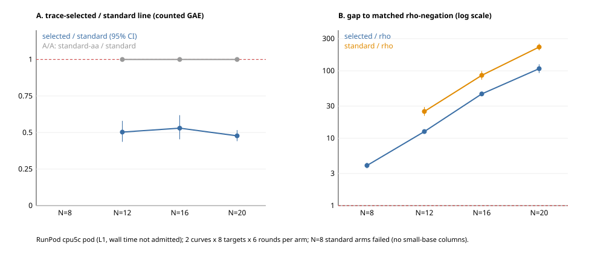

# Trace-line exact MITM reference panel on RunPod (2026-11-17)

These are measured results of the four frozen specs `../reference-d{2,3,4,5}.json`: the Tr_{N/d} trace-selected factor-base line against the standard subfield line, with a standard A/A control and matched rho-negation, at N = 8, 12, 16 and 20.

**Scope.** This is the exact four-summand 2LP **MITM correctness reference**, not the algebraic C1 experiment of [PROTOCOL.md](../PROTOCOL.md). The results are a **stage diagnostic** of relation yield and collector cost in counted GAE, not a priced end-to-end IC result. Every number is `[pcc:unverified]`.

## Route and identity

| field | value |
|---|---|
| host | RunPod pod `Z0jehpw47bv0s5`: SECURE, `cpu5c`, 8 vCPU, image `runpod/base:1.0.2-ubuntu2404`. Created through REST v2 (`api.runpod.io/v2`), files moved with `research/runpod_kit_20261112`, deleted after the run (HTTP 204) |
| binary | `ecbench` built at main `94479f7e3eb9de9ae59b764d2b2b50b3238f0a44`, SHA-256 `5bab9023013f06d18f5e54d390f39731667d36c9a8ec5284035d6dca7df39bc2`, hash re-checked on the pod |
| specs | unchanged; SHA-256 d2 `1a7653bd…`, d3 `1bca8a39…`, d4 `f6cf4885…`, d5 `7f661a97…` |
| isolation | records reached L1 at most. **Wall time is not admitted** (0 admitted pairs; the specs require L2). Only the counted-operation comparisons are reported |
| raw data | `results.tgz` (SHA-256 `1b228db151e8c2b0b7850ad41f2e8441aab307cd33b797f25d86b988c9237ed7`): sessions, run logs, host capsule |
| audit | `ecbench verify --dir` audit OK, 0 problems in every session (`verify/`). The tool reports "0 replays reproduced", so **no replay certificate exists**: the validation gate is not met |
| cost | under USD 0.05 for the run pod (a few minutes at USD 0.28/h), plus about USD 0.56 for an earlier idle pod (`eiajdvf464lh58`, about 2 h) and about USD 0.01 for a first pod (`dr1kjr0thl7lfg`), both deleted unused |

## Results (counted GAE, paired over 96 pairs on 16 workloads, 95% linearised-t CI)

| N | selected / standard | §5a band w = 0 / 0.1 / 1 | A/A | selected / rho | standard / rho |
|---|---|---|---|---|---|
| 8 | — (standard arms failed) | — | — | 3.94 [3.58, 4.33] | — |
| 12 | **0.503** [0.437, 0.580] | 0.503 / 0.568 / 0.925 | 1.0000 | 12.56 [11.77, 13.40] | 24.96 [21.45, 29.05] |
| 16 | **0.530** [0.454, 0.619] | 0.530 / 0.574 / 0.797 | 1.0000 | 45.44 [43.12, 47.89] | 85.74 [73.92, 99.45] |
| 20 | **0.478** [0.441, 0.517] | 0.478 / 0.497 / 0.591 | 1.0000 | 107.65 [92.62, 125.13] | 225.43 [201.25, 252.53] |

- **N = 8:** both standard arms errored on all 112 executions with `projected small factor base has no columns`. At d = 2 the one-dimensional nested small base of the standard line is empty after cofactor projection. These are retained failure rows from the frozen spec, not an infrastructure fault. The selected and rho arms verified 112/112 each.
- **The trace-selected line is about 2× cheaper than the standard line** (0.48–0.53) at every size, and the order holds across the whole §5a band. This is consistent with T4 of `research/trace_homomorphism_tests_20261109`, where every nonzero x on the trace line lifts. The README of `trace_c1_2lp_20261027` predicted that this reference would not show the 16× yield-model ratio, because it returns at most one decomposition per trial.
- **The A/A ratio is exactly 1** because counted operations are deterministic per seed, so it bounds the measurement noise of this statistic at zero.
- **Both lines are far above matched rho, and the gap widens with N.** The trace line costs 3.9×, 12.6×, 45× and 108× rho at N = 8, 12, 16 and 20, so its exponent is worse than rho's. The order holds at every band weight (selected/rho at N = 20: 108 / 114 / 148). This is the distance remaining; the MITM reference is not a competitive solver.

## What this does not establish

- The algebraic C1 per-trial cost on either line. That still needs the C1 x-line oracle.
- Any wall-time statement. No pair reached L2.
- A validated benchmark or leaderboard row. There is no replay certificate, no independent-host replay and no validator report.
