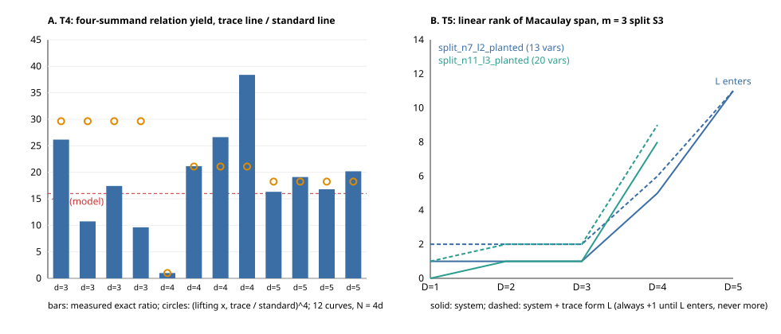

# Trace homomorphisms in ECDLP index calculus: exact tests

Tests every checkable claim in the 2026-11-09 desk assessment
(`docs/session-logs/2026-11-09.md`, PR #3748) against exact computation on
toy binary fields. All results are exact counts or exact linear-algebra
statements. **No timing was measured, and no benchmark or leaderboard row
changes.** Every statement below is `[pcc:unverified]` until a validator
re-derives it.



## Reproduce

```sh
cargo run --release > results/all.jsonl      # std only, single thread, ~16 s
python3 plot.py                              # layout only: figure.svg from results/all.jsonl
sha256sum -c results/SHA256SUMS
```

The seed is `0x5eed202611090001` (xorshift64*). You can select tests with
arguments (`T1` … `T5`). Self-tests are asserted in the program:

- the group law: associativity on random triples, `#E·P = O`, and every sum on the curve;
- the S3 summation polynomial vanishes on 200 random sums per T5 curve;
- `rv·G = O` for every subgroup generator.

`r` in the output is the full power `r^v` of the largest prime dividing `#E`.
`<G>` is that r-primary component, so `gcd(r, h) = 1`. For example, the
GF(2^11) Koblitz curve with `a = 0` has order `4·23²`.

## Results

### T1. The Kosters–Yeo class χ(P) = Tr(x + a) is a homomorphism onto F₂ with kernel 2E, and it vanishes on `<G>`

Fifteen curves were checked:

- Koblitz curves with `a ∈ {0, 1}`, `b = 1` and `n ∈ {5, 7, 11, 13, 17}`;
- five random curves with `n ∈ {8, 9, 10, 12, 14}`.

Additivity was checked exhaustively up to `#E ≤ 1500`, otherwise on 300,000
random pairs. There were **0 additivity violations**. On every curve,
`ker χ = 2E` exactly, χ is surjective, and **χ is 0 on all multiples of G**.
χ therefore carries no information about the discrete log.

### T2. Filter ceiling: pruning never loses a relation, and the saving is set by the cofactor

The test enumerated every multiset of 2 or 3 points from an 80-point base
(40 random abscissae, both signs) and counted those whose sum lies in `<G>`.

| curve | h | m | tuples | trace keeps | class keeps | sums in `<G>` | lost by trace | lost by class |
|---|---|---|---|---|---|---|---|---|
| Koblitz, n = 13 | 4 | 2 | 3,240 | 0.537 | 0.267 | 826 | 0 | 0 |
| Koblitz, n = 13 | 4 | 3 | 88,560 | 0.488 | 0.244 | 21,600 | 0 | 0 |
| random, n = 12 | 70 | 2 | 3,240 | 0.511 | 0.028 | 52 | 0 | 0 |
| random, n = 12 | 70 | 3 | 88,560 | 0.502 | 0.014 | 1,220 | 0 | 0 |

- The trace filter keeps half the tuples, a saving of at most 2×.
- The full cofactor class `[r^v]P` keeps about `1/h` and is exact, so it dominates the trace filter.
- Neither filter loses a relation.
- On a prime-order curve, `h = 1` and the saving is 1×.

### T3. The point trace Tr: E(F_{2^n}) → E(F₂) kills `<G>`

The trace was applied to every point of the Koblitz curves (`a ∈ {0, 1}`,
`n ∈ {7, 11, 13, 17}`):

- 0 traces fell outside E(F₂), and the image is all of E(F₂) (4 points, or 2);
- `Tr∘ι = [n]` held on every point of E(F₂);
- Tr was O on every multiple of G.

It is a homomorphism into a group of order 4 (or 2), so it carries nothing about the discrete log.

### T4. The Tr_{N/d} shifted line u·F_{2^d} (#2686 construction, N = 4d, a = 0)

The test used 12 curves (four values of b for each d ∈ {3, 4, 5}).

- **Every nonzero x on the trace line lifts:** 7/7, 15/15 and 31/31 in all 12 curves.
- On the standard subfield line, 3/7, 7/15 and 15/31 lift in 11 of the 12 curves.
- In one curve (d = 4, b = 17486) the standard line also lifts entirely, and there the gain is **exactly 1.0**.

The exact number of ordered four-summand decompositions per target in
`<G>\{O}` is in the table. "Predicted" is the lift ratio raised to the fourth power.

| d | b | lifting x, standard → trace | measured yield ratio | predicted |
|---|---|---|---|---|
| 3 | 1774 | 3 → 7 | 26.17 | 29.64 |
| 3 | 2850 | 3 → 7 | 10.74 | 29.64 |
| 3 | 3944 | 3 → 7 | 17.42 | 29.64 |
| 3 | 2469 | 3 → 7 | 9.63 | 29.64 |
| 4 | 17486 | 15 → 15 | **1.00** | 1.00 |
| 4 | 2936 | 7 → 15 | 21.16 | 21.09 |
| 4 | 5200 | 7 → 15 | 26.63 | 21.09 |
| 4 | 44421 | 7 → 15 | 38.38 | 21.09 |
| 5 | 490832 | 15 → 31 | 16.32 | 18.24 |
| 5 | 701637 | 15 → 31 | 19.11 | 18.24 |
| 5 | 684188 | 15 → 31 | 16.80 | 18.24 |
| 5 | 481232 | 15 → 31 | 20.19 | 18.24 |

- **The relation-yield half of the "16×" model holds in exact counts.**
  - As d grows, the ratio tends to the lift ratio to the fourth power (→ 2⁴).
  - At d = 5 the measured ratio is within 11% of the prediction.
  - At d = 3 the subgroups are small (r^v = 53–343) and the scatter is large.
- **The cost per trial stays unmeasured.** It still needs the algebraic C1 oracle from `research/trace_c1_2lp_20261027`.
- **The gain depends on b.** One curve in 12 already had a fully lifting standard line.
- **It does not apply at prime N such as ECC2K-130.**

### T5. Where the trace linear form L enters the Weil-descent ideal

L is `Σ Tr(x_i) + Tr(x_R) + (m+1)Tr(a)`, a linear form in the descent variables.

The test built degree-D Macaulay matrices over F₂, multilinear (field
equations implied), with a graded order. It recorded:

- the linear rank of the span;
- whether L lies in the span;
- a random linear form as a negative control;
- the same quantities with L appended.

It also enumerated every solution of each system by brute force.

| system | vars | L enters the span at D | linear rank without L, by D | change in linear rank with L appended |
|---|---|---|---|---|
| S3, m = 2, n = 11, ℓ = 3, planted | 6 | **2** (control: not at D = 2) | 0, 3, 6, 6, 6 | +1 at D ≤ 2 (the L·x rows the system itself reaches at D = 3), +0 at D ≥ 3 |
| S3, m = 2, n = 13, ℓ = 4, planted | 8 | **2** (control: never through D = 5) | 0, 3, 7, 7, 7 | +1 at D ≤ 2, +0 at D ≥ 3 |
| split S3, m = 3, n = 7, ℓ = 2, planted | 13 | **5** | 1, 1, 1, 5, 11 | **exactly +1** at D = 1–4, +0 at D = 5 |
| split S3, m = 3, n = 11, ℓ = 3, planted | 20 | **> 4** | 0, 1, 1, 8 | **exactly +1** at D = 1–4 |

- **m = 2: L is already in the degree-2 span.** This reproduces Kosters–Yeo Prop. 4.7 exactly. Appending it is redundant.
- **m = 3: L carries information the ideal lacks below degree 5**, but it adds exactly one linear relation at every degree. It sets off no extra degree falls, and the degree at which the linear rank peaks is unchanged. That is the measured content of "1 bit, degree of regularity unchanged".
- **Every brute-force solution satisfies L.** There were 0 violations across all six systems, and no solution uses an x-coordinate that lifts only to the twist.
- **Substituting L instead of appending it** removes one variable, and the Macaulay width drops by the factor `C(v−1, ≤D) / C(v, ≤D)`:
  - 6196 → 5036 columns (0.81) at v = 20, D = 4;
  - 2380 → 1586 at v = 13, D = 5.
- **Appending L instead adds rows without removing columns:** at v = 20, D = 3 the rank is 421 with L against 241 without. That fits the earlier measurement of +18.2% wall time for the appended form (`research/sat_factor_base_review_20260908/continuation-05-sota-gates/GATE_STATUS.md`). That earlier timing was not re-measured here.

## What is not tested here

- **Wall time for appending L versus substituting it.** This is a timing benchmark. It belongs on the isolab-eks route, and this container has no AWS identity. The column counts above bound the substitution gain: one variable, at most about 1.2× in dense elimination width at these sizes, tending to `1 + D/v`.
- **The algebraic cost per trial on the trace line.** This still needs the C1 oracle.
- **Large n, and ECC2K-130 itself.** Every test is a toy instance, chosen to make the counts exhaustive.

## Sources checked

`research/lift_dense_factor_base_20261027/README.md`;
`research/pdp_literature_leads_20261022/leads/LEAD-04.md`;
`research/trace_c1_2lp_20261027/README.md`;
`src/cryptanalysis/ecbench_large_prime/trace_line.rs` (the line construction reused in T4);
`research/sat_factor_base_review_20260908/continuation-05-sota-gates/GATE_STATUS.md`;
`research/ecdlp_weakness_census_20261104/trace_pullback/README.md`.

The `research-kb` MCP server and Conductor were not available in this session.
Sources were found by grep.

[PDF report](REPORT.pdf) · [figure](figure.svg) · raw rows: `results/all.jsonl`, hashes: `results/SHA256SUMS`.
