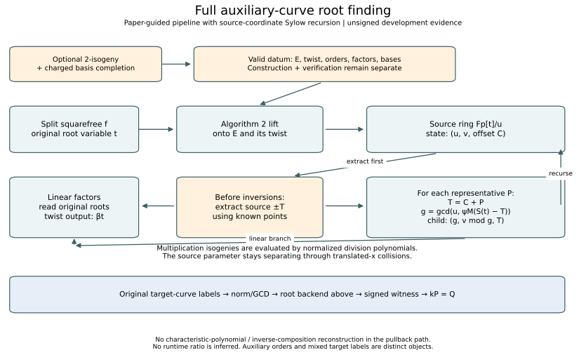

# Native auxiliary-curve root finding and incidence integration

[Three subsequent recurrence-optimization runs](recurrence_20261117/README.md) include FLINT recurrence, shared preinverse and block-size tuning, a standalone CLI and full-root controls. These are separate local measurements; original evidence below is preserved.

The [new local runtime report](measure_20261117/README.md) measures the
acceleration extension: at B128,5.27× median paired gain for the new Bloom pair
path and4.99× for composition versus same-generator Horner, with complete
setup/miss/recovery costs. This is a separate provisional local experiment;
the new pair path remains3.06× matched rho cost. [pcc:unverified]

The [new acceleration extension](accelerated/README.md) targets the incidence
norm and actual mixed-label pool generation. Its development checks are
registered as PCC-20261116-a777e8; new Runpod timings are pending.
[pcc:unverified]

The requested Runpod execution is complete. The given-datum paper root example
improved4.46× versus dense CPU time; complete degree256 trace translation
improved6.84–12.23× depending on support. Complete B128 pullback target work
remained0.571s median, versus7.88ms for batched pairs; its matched conditional
rho ratio was1079.96. These are descriptive shared-host observations.
[pcc:unverified]

[Runpod results and accounting](runpod/RESULTS.md) ·
[Three-page PDF](runpod/RUNPOD_REPORT.pdf) ·
[Sealed native summary](runpod/attempt-2/summary.json).

The current implementation follows the paper's complete auxiliary-curve and
quadratic-twist root-finding pipeline in native C++. A source-coordinate
variant keeps factors in the original quotient ring throughout Sylow descent,
avoiding canonical image reconstruction. Its derived online allowance, with
a valid datum supplied and fast polynomial arithmetic, is soft
O(Xi² d log²p + d log³p). Construction and validation remain separate cold
costs; the bound and priority status remain unsigned. [pcc:unverified]

- [Build and run the native code](native/README.md).
- [Source-coordinate derivation and cost chain](reports/PULLBACK.md).
- [Two-page source-linked report](reports/NATIVE_REPORT.pdf).
- [Independent-source correctness audit](native/audit-data/002-result.json).
- [Complete incidence/isogeny integration check](native/audit-data/004-result.json).



Checks include95 pullback root-finding calls and244 integrated relation solves
across four root backends, with original-curve scalar recovery. An explicit
auxiliary2-isogeny and twist-compatible codomain construction are included;
mapped generators alone span only36 of72 points, and complete basis
construction is counted. The current Rust rho adapter's three development
tests also pass after installing the native toolchain. These are unsigned
development checks, not an isolated timing comparison. The native incidence
panel uses p83/p97 and B2/3/4; it is separate from the historical growing-B
timing panel. [pcc:unverified]

The norm/GCD stage remains O(B²) degree-B quotient products. Native complete
costs and the explicit rho configuration now have a descriptive Runpod run.
Stronger external tuning, wider-field support, independent signed replay and
isolated admission remain pending.
No overall runtime ratio is inferred from a component count. [pcc:unverified]

| Requested deliverable | Current status and evidence |
| --- | --- |
| Full trace/dense translation, including collisions and exceptions | Implemented; native independent-source audit in `native/audit-data/002-result.json`. Unsigned development checks. |
| Paper-guided auxiliary curve, twist and isogeny | Implemented; counted toy datum completion and original-curve recovery in `native/audit-data/004-result.json`. General efficient datum construction remains open. |
| Stronger root-finding formulation | Implemented source-coordinate splitting; conditional cost derivation in `reports/PULLBACK.md`. Formal verification and priority review remain open. |
| Growing labelled pools with r approximately B³ | Executed native Runpod panel:60 public targets, five measured rounds, fresh charged pools, misses, memory and recovery. Shared-host descriptive data in `runpod/RESULTS.md`. |
| Repository quotient/GCD and pair controls | Pinned sources preserved; native same-target algebraic/pair controls and rho executed. The callable pair control is an algorithm-level adaptation, not an exact upstream Rust pair build. |
| Structured bases versus known mixed labels | Kept separate; public pool generation and rejected draws are charged. No free labelled structured-base construction is asserted. |
| Full comparison with rho and external root finding | Runpod execution complete under user override, with source-bound S3 checkpoints and raw custody. External FLINT uses the fixed paper polynomial. Broader external tuning, isolated admission and signed replay remain open. |

Implementation and test outcomes in this table remain unsigned. [pcc:unverified]

## Historical evidence import

The sections below describe the original import and its tool availability
at that stage. The native guide and current receipts above supersede the
earlier execution status while preserving the old evidence bytes.

This directory preserves the implementation and recorded evidence from the
existing workspace study, and adds a native adapter for a future matched rho
comparison. It does not record a new benchmark run. Historical timings and
self-checks are unsigned producer evidence. [pcc:unverified]

## What is here

- `historical/fast_trace/`: the trace kernel, native recurrence helper,
  paper-style dense matrix control, complete-call records and source hashes.
- `historical/trace_audit/`: separate point-set and algebra checks.
- `historical/incidence/`: Horner, blocked and modular-composition variants,
  the original timed source, the uninformative-first recovery correction and
  its regression, records, dimensions and retry accounting.
- `historical/repo_controls/`: pinned source assessments of both repositories,
  quotient/GCD and streamed batched-pair controls and support/memory audits.
- `historical/prime_fixtures/`: public synthetic inputs and separately named
  test-only `*.validation.json` truth files. The latter are not solver inputs.
- `historical/pool_design/`: public mixed-label construction and separate
  structured-base controls. No free labels for a PKM/isogeny base are assumed.
- `figures/`: original descriptive figures, preserved separately from any
  admitted benchmark dashboard.
- `check-native.sh`: a native C++ correctness check; it extracts no timing result.
- `../../examples/trace_incidence_rho.rs`: adapter for the existing Montgomery,
  batched, negation-aware `prime_fast::rho_parallel` engine.

`IMPORT.json` identifies preserved and deferred objects. `SHA256SUMS` is the
current file inventory, checked from the repository root; `FROZEN_SHA256SUMS`
preserves the original import inventory. Artifact-backed images require
materialization from their directory's `.artifacts.json` before checking the
frozen inventory. The native `SOURCES*.sha256` files retain claim-pinned source
snapshots and are not regenerated with the current inventory.
The oversized original `repo_controls/pair_benchmark.json` is **not in this
PR**: its exact digest and length are retained pending the approved S3
artifact route. Its derived CSV/summary and frozen producer sources are here;
do not mistake those for custody of the entire original raw object.

The Python sources retain their original bytes, absolute workspace paths,
versions and provenance as historical snapshots under AGENTS.md's preservation
rule. They are not a new Python execution path. Replace the relevant path
with native code before extending it or making further performance comparisons.
CSV CRLF endings are preserved; the local whitespace check explicitly treats
CR as an end-of-line byte instead of rewriting frozen evidence.

## Recorded component scope

The degree-256 trace records report about 10x dense/trace CPU ratio on generic
support, about 4x on collision-heavy support and about 8x with exceptional
points. Complete calls include lifting and exceptional handling; constructing
the input divisor is outside both arms. Trace loses at small degrees and
retains a quadratic recurrence. The paper's section 8.1 already proposes
trace power projection: no priority or improved arithmetic exponent is claimed.
[pcc:unverified]

The natural incidence panel uses B=8,16,32,64,128 with r approximately 8B^3,
three curves and four seeds per size. It retains 28 hits and 32 misses.
At B=128, the saved medians are 0.722 ms for native pairs, 404 ms for the
quotient target scan and 353 ms for blocked incidence; generation plus oracle
medians are 52.7, 456 and 408 ms respectively. These are initialized-runtime
complete calls, with process startup retained separately. CPU affinity on a
shared host is not L2 isolation. [pcc:unverified]

The separate saved checks report 1,444 complete translation checks, equality
of all 180 incidence GCD supports with independent affine enumeration, and
additional Jacobian witness checks. These remain unsigned assertions, not
PCC standing or an independent-host timing replay. [pcc:unverified]

## The requested rho evaluation

`rho-protocol.json` records the pending comparison and its admission conditions.
The native adapter consumes the same public P,Q and order, never validation
secrets. It emits censored outcomes and checks each returned scalar on the
original curve. Local Cargo was unavailable, so its Rust tests remain pending.

Crucially, the current implicit-incidence implementation does not call the
trace translation kernel. A trace/dense component ratio cannot be applied to
that solver's total runtime. An integrated native candidate and matched
complete runs are needed to measure movement toward parity. [pcc:unverified]

No EKS build or timing run was submitted. The latest session-log readback
reports monthly spend above its limit; the remaining live budget is unknown
in this runtime. The isolab-eks skill and COST_CONTROLS.md forbid a new launch
under those conditions. Checkpoint upload and artifact-store credentials are
also absent here. No hosted-CI or local timing substitute was used.

## Development checks

```sh
bash research/trace_incidence_20261116/check-native.sh
cargo test --release --example trace_incidence_rho
```

The C++ development check completed all 90 fixture cases locally. The Cargo
command could not start because Cargo is absent. [pcc:unverified]

After a source-exact build and admission, an adapter invocation has the form:

```sh
TRACE_INCIDENCE_SOURCE_REVISION=$(git rev-parse HEAD) \
  target/release/examples/trace_incidence_rho \
  research/trace_incidence_20261116/historical/prime_fixtures/b008_c0_natural_s0.json \
  20261116 4 8 0 100000
```

That command is illustrative; no new performance result is supplied. It is
not a replacement for L2, A/A, the strongest registered reference, full phase
accounting, source/image/binary manifests or independent replay.

## Sources and publication status

- Supplied Spaenlehauer paper, *Deterministic Root-Finding over Finite Fields
  with Elliptic Curves*, arXiv:2610.32508v1, especially section 8.1. PDF SHA-256:
  `bf01081e0261633421a00577dbf35cf84864161e3758ad3c9abdc55327cc963c`.
- `historical/repo_controls/source_provenance.json` and
  `repository_assessment.json`: exact inspected crypto and cryptanalysis
  commits and source blobs. The original upstream Rust binary was not replayed
  in the historical timings.
- `src/cryptanalysis/prime_fast.rs`: current native rho reference. The adapter
  reuses this source instead of inventing a slower reference.
- Sources checked (KB unavailable): no KB MCP connection; the repository
  wrapper exits127 with no executable. Bounded primary-source fallback above.

There is no new leaderboard, benchmark-index or canonical dashboard promotion.
Those graphs are unchanged because this imports unsigned historical evidence,
with raw-object custody and native matched runs still pending. No claim to
be the fastest external implementation is made; mature external comparisons,
the original paper's implementation and an admitted native replay remain open.
