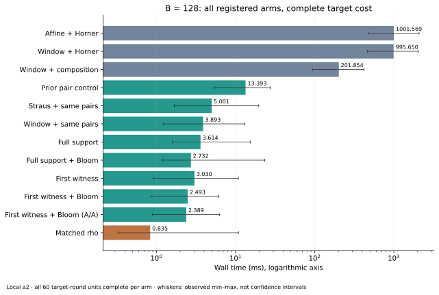
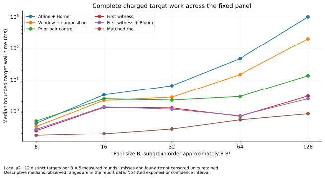
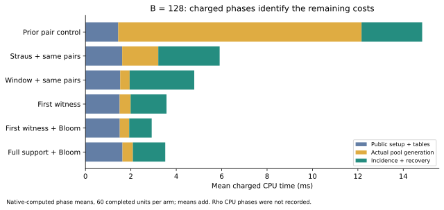

# Local runtime measurement — 17 November 2026

The new batched/Bloom pair path gives a **5.27× median paired wall improvement** over the prior pair control at B128. The composition route gives **4.99×** over same-generator Horner. All preceding misses, public setup/tables, actual labels/rejections and recovery are charged. [pcc:unverified]

These are provisional local measurements, registered as **PCC-20261117-c1a1e9** with unsigned standing. The user explicitly authorized local execution and temporary local checkpoint/raw custody. No S3 admission or upload is claimed.

[Run report PDF](reports/run-20261117T051441Z/RUN_REPORT.pdf) · [Results PDF](reports/run-20261117T051441Z/RESULTS_REPORT.pdf) · [Native report data](results/report-data.json) · [Raw custody and hashes](results/LOCAL_CUSTODY.json)

## Complete target costs at B128

Wall and CPU entries below are medians over 60 target-round units (12 distinct targets × five measured rounds), all completed. RSS is median peak process KiB. These are complete-call intervals; process startup/output is separately retained at coarse GNU-time resolution. [pcc:unverified]

| Arm | Wall (ms) | CPU (ms) | Peak RSS (KiB) |
|---|---:|---:|---:|
| Affine + Horner | 1001.569 | 999.210 | 7208 |
| Window + Horner | 995.650 | 994.348 | 7252 |
| Window + composition | 201.854 | 201.730 | 7220 |
| Prior pair control | 13.393 | 13.381 | 6506 |
| Straus + same pairs | 5.001 | 5.015 | 6632 |
| Window + same pairs | 3.893 | 3.896 | 6632 |
| Full support | 3.614 | 3.615 | 6728 |
| Full support + Bloom | 2.732 | 2.743 | 6744 |
| First witness | 3.030 | 3.042 | 6528 |
| First witness + Bloom | 2.493 | 2.512 | 6520 |
| First witness + Bloom (A/A) | 2.389 | 2.422 | 6524 |
| Matched rho | 0.835 | unavailable | 1676 |

The median of matched prior-pair/new ratios is 5.2655; it differs from dividing the two marginal medians. The new/rho median paired ratio is 3.0599: this is measured progress toward the registered reference, without parity. [pcc:unverified]

## Ablations and observed spread

| Matched B128 comparison | Median wall ratio | n |
|---|---:|---:|
| Existing backend / Straus | 2.6887 | 60 |
| Straus / batched window | 1.2773 | 60 |
| Prior / window, same pair kernel | 3.4207 | 60 |
| First witness / Bloom | 1.2347 | 60 |
| Full support / Bloom | 1.2800 | 60 |
| Identical-source A/A | 1.0118 | 60 |
| New Bloom / rho (cost ratio) | 3.0599 | 60 |

These are descriptive paired ratios. At B128 the same-generator Horner/composition ratio has median 4.9883; generic full-support enumeration remains 56.5550× cheaper than composition in the paired comparison. Full-support and first-witness tasks are separate. The A/A range is 0.7740–1.7945 (median 1.0118), and small-input losses remain in individual comparisons. No confidence interval or fitted exponent is inferred. [pcc:unverified]

## Protocol and checks

- Source: `f1549fc821220641406b51a60324ef4ec81ab69b`; parent [protocol](../accelerated/PROTOCOL.json), [local amendment](LOCAL_PROTOCOL.json), [timer amendment](LOCAL_AMENDMENT_2.json), [authorization](AUTHORIZATION.json).
- Host: AMD EPYC 9V74 managed shared CPU, one pinned CPU, four-CPU quota, 16 GiB limit; no L2 claim. Exact qualified binaries reused, with distinct rho source c0176f942 and binary provenance retained.
- Same 60 public natural targets across B8,16,32,64,128, three curves and four targets per size. Subgroup order is approximately 8B³. These are small prime fields; no cryptographic-size ECDLP result is claimed.
- Fresh actual `alpha*P+beta*Q` pools; no validation-secret input and no free structured-base labels. Up to four fixed-seed attempts; stop at first informative relation. All prior misses and rejected draws charged.
- One warmup/five measured rounds, all 11 arms plus registered rho. Full matrix: 8346 rows, 1391 warmups, 6955 measured, 4320 target-round-arm units. No timed-row execution failure. [pcc:unverified]
- Every IC arm completes 275/300 measured units and censors 25 after four misses; rho completes 300/300. B8 has 50/60 IC completions; B16/32/64 have 55/60; B128 has 60/60. Bounded-work medians at smaller B include censored units. [pcc:unverified]
- Native post-check replays 3990 public scalars using the separate frozen pair arithmetic, checks 2904 complete-support agreements, and checks 7260 generation/existence agreements. Binary and dependency pre/post hashes match. Producer checks remain unsigned. [pcc:unverified]

Phase bars use native-computed means, which add. For the new Bloom path, public setup/tables account for 1.511 ms mean CPU, pool generation 0.416 ms and incidence/recovery 0.991 ms. These include preceding attempts. Rho phase CPU is unavailable. [pcc:unverified]

## Failures, custody and reproducibility

Attempt 1 stopped at its first warmup wrapper because GNU time was absent; no candidate was timed. The failed attempt is retained. Attempt 2 uses Debian GNU time with its package checksum matched (version 1.9-0.2) and completed. The first post-check parser rejected an EOF; its failed source/qualifier is retained, and a corrected copied qualifier produced the accepted output. Scientific measurements were not rerun after viewing results.

The deterministic raw archive is retained at `/workspace/crypto_pr_context/trace-local-evidence-20261117.tar.xz`, 7959176 bytes, SHA256 `42256ec1edc259dc123e8c1b5d144dfb7f1b86d28834460b96a6e69dbe9cfcf5`. It contains both attempts, raw rows/process records, all qualifiers and dependencies, both analysis attempts and local checkpoint. This is explicitly authorized **local-only custody**; no `.artifacts.json` falsely asserts an S3 object.

Extract with `tar -xJf trace-local-evidence-20261117.tar.xz`, then verify `FILES.sha256` inside `trace-local-evidence-20261117`. Run the native `postprocess.cpp` against attempt2 and the frozen study snapshot to reproduce the report data. `render_report.py` only lays out already-computed statistics.

The original dense/trace/pullback Runpod root experiment and all its graphs remain unchanged. These local incidence results do not inherit its speed ratios. Canonical benchmark index/leaderboard rows remain unchanged without the required independent signed validation and S3 custody. Copies of these descriptive reports/graphs are in `benchmarks/20261117-trace-incidence-local/`; its local record is not an admitted `bench.record/v1`.

Sources checked (KB unavailable): frozen parent native protocols and controls, existing prime_fast backend, historical composition implementation, FLINT composition/multipoint contracts, and official Debian Packages metadata for the timer. No new priority claim.
