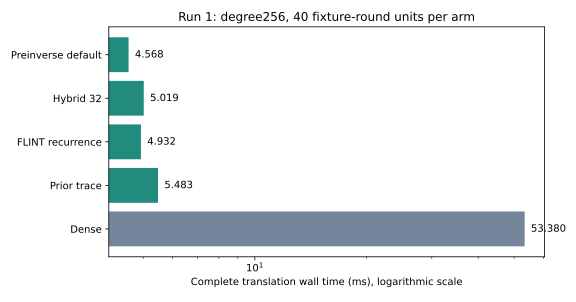
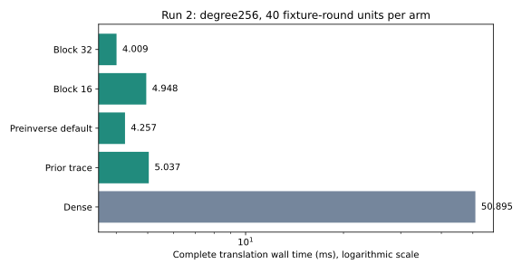
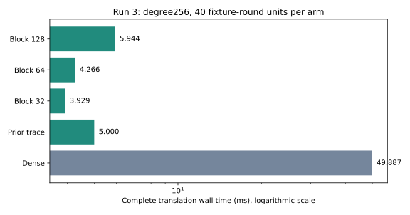
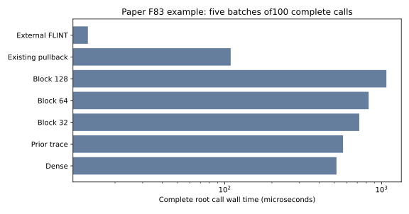

# Paper-root recurrence optimization — 17 November 2026

Three measured iterations retain the original paper-inspired trace implementation and improve its complete translation calls. [pcc:unverified] The chosen large-degree configuration uses FLINT batch recurrence, one preinverted modulus per power projection and block size32. No pinned parent source or prior result is modified.

At degree256 in run3, block32 takes **3.929 ms**, prior trace **5.000 ms**, and dense **49.887 ms** median complete wall time. Median paired gains are **1.2629×** versus prior trace and **12.7415×** versus dense, over40 matched units. [pcc:unverified]

[Results PDF](reports/RESULTS.pdf) · [Run1 PDF](reports/RUN1.pdf) · [Run2 PDF](reports/RUN2.pdf) · [Run3 PDF](reports/RUN3.pdf)

## Scope and outcome

Each run uses48 translation fixtures: two primes, degrees8–256, generic support, collisions and both exceptional signs; eight fixtures per degree. One warmup and five measured rounds rotate the translation and given-datum root arms. Each run retains1512 rows (252 warmup,1260 measured). Each native candidate also passes4160 point-set translation checks,2288 point checks and5 malformed controls. These are unsigned producer checks, not signed independent validation. [pcc:unverified]

Translation intervals include fixture parsing and nonsquare selection, input validation, power projection/recurrence, collision lifting and exceptional handling. Expected-support checking after return is retained outside the interval. Divisor construction is outside both arms. Given-datum complete roots charge datum validation on every call; isogeny arms additionally construct and validate the toy codomain datum. Given-datum root rows batch100 calls; isogeny rows make one call and use fixed arm order, a disclosed deviation from the general rotation wording.

Shared AMD EPYC9V74; CPU0 affinity; no L2 isolation or significance claim. Reported ranges are observed min–max; repeated rounds are not independent fixtures. RSS is process peak KiB and includes loading/runtime. Dependencies were not separately hashed before each run; executable/test qualifiers have matching pre/post hashes.

## Complete translation at degree256

### Run 1

| Arm | Median wall ms | Observed min–max ms | Median peak KiB |
|---|---:|---:|---:|
| Dense | 53.380 | 37.234–104.566 | 6272 |
| Prior trace | 5.483 | 4.552–13.217 | 4794 |
| FLINT recurrence | 4.932 | 4.424–6.758 | 4870 |
| Hybrid 32 | 5.019 | 4.496–8.713 | 4888 |
| Preinverse default | 4.568 | 4.200–8.469 | 4840 |

Descriptive measurements; PCC unsigned. [pcc:unverified]

### Run 2

| Arm | Median wall ms | Observed min–max ms | Median peak KiB |
|---|---:|---:|---:|
| Dense | 50.895 | 35.871–85.977 | 6310 |
| Prior trace | 5.037 | 4.569–9.630 | 4800 |
| Preinverse default | 4.257 | 3.900–7.808 | 4886 |
| Block 16 | 4.948 | 4.534–12.002 | 4874 |
| Block 32 | 4.009 | 3.594–4.954 | 4848 |

Descriptive measurements; PCC unsigned. [pcc:unverified]

### Run 3

| Arm | Median wall ms | Observed min–max ms | Median peak KiB |
|---|---:|---:|---:|
| Dense | 49.887 | 36.077–67.306 | 6276 |
| Prior trace | 5.000 | 4.568–7.572 | 4792 |
| Block 32 | 3.929 | 3.555–6.174 | 4898 |
| Block 64 | 4.266 | 3.960–14.440 | 5080 |
| Block 128 | 5.944 | 5.574–9.865 | 5148 |

Descriptive measurements; PCC unsigned. [pcc:unverified]

## Full roots and the observed frontier

The small F83 full-root example shows no gain from the trace changes. Existing pullback is4.6654× faster than dense in the run3 median paired wall comparison; external FLINT is faster still. Those controls are measured on the same input. This does not establish a fastest-general-root algorithm. [pcc:unverified]

For degree256 in run3, the observed median-time/median-RSS nondominated set is prior trace and block32. Block64 and block128 are dominated by block32 on both displayed medians. Small-degree results differ. This is a finite parameter-panel observation subject to noise, not proof that further optimization is impossible. [pcc:unverified]

The fastest labelled-pool IC engine from the previous study does not call this root kernel. Its earlier3.06× rho cost gap is unchanged by this work; no new IC/rho run or parity result is claimed. See the separate [complete IC measurements](../measure_20261117/README.md). [pcc:unverified]

## Reproduce

Build the standalone candidate with `make -C research/trace_incidence_20261116/recurrence_20261117 BLOCK=32`. Run `build/rootfinder trace ../native/paper83.datum ../native/paper83.poly` from this directory. The pullback backend remains separately selectable.

For the full experiment, run `bash build.sh NEW_BUILD`, `bash build-blocks.sh NEW_BUILD`, then `bash build-large.sh NEW_BUILD`; invoke `run.sh`, `run-blocks.sh`, `run-large.sh` with that build directory and distinct new output paths. Compile `analyze.cpp` using C++17 and nlohmann-json and run `analyze RAW_JSONL SUMMARY_JSON`. The runs are adaptive stages, never a pooled paired comparison across different runs. All old native/parent controls are preserved.

Sources checked (KB unavailable): supplied Spaenlehauer paper section8.1, retained crypto/cryptanalysis control assessment, parent native/root/pullback source, FLINT3.1.3 upstream batch-recurrence source and installed API. FLINT uses Euclidean/half-GCD reduction; these are known methods, not a novel root-finding algorithm. Avoid claiming a new full-root arithmetic bound from this implementation.

All three raw runs, binaries, checks, build logs, checkpoints and replay source are retained locally. See [custody metadata](results/LOCAL_CUSTODY.json). No canonical leaderboard or benchmark index promotion occurs without the existing signed-validation/storage gates.
