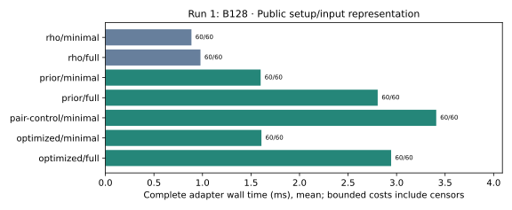
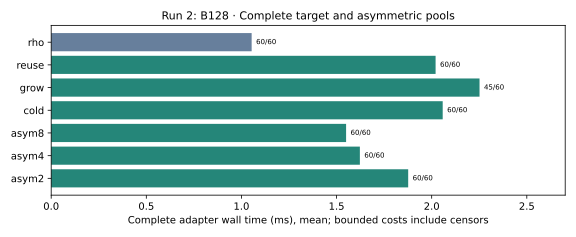
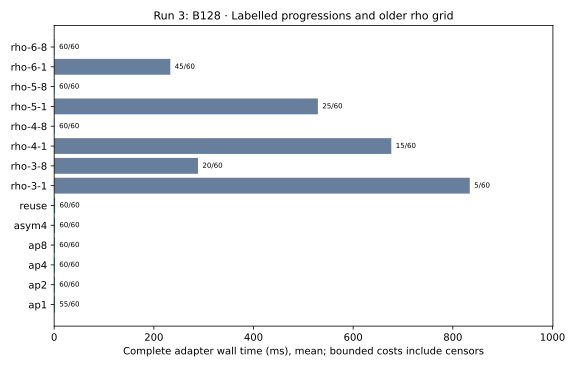
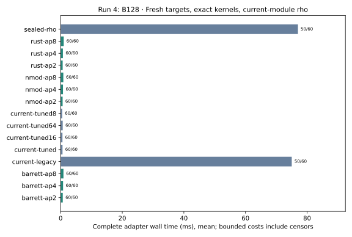
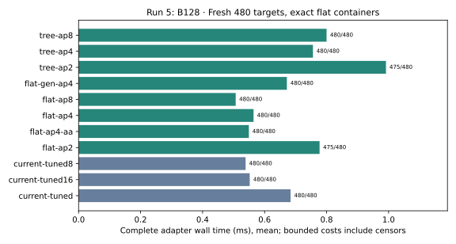
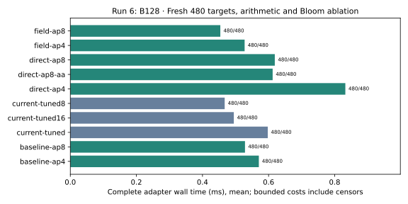
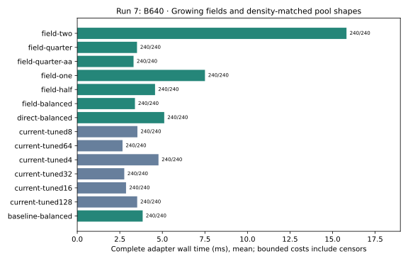
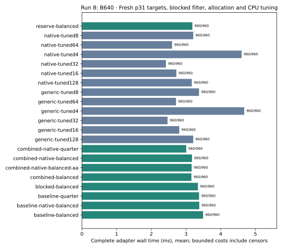
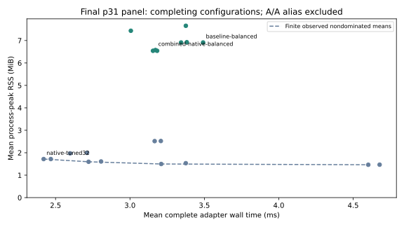
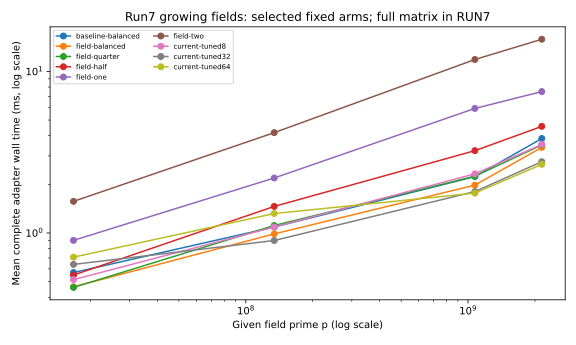

# Complete-cost trace-incidence optimization — 23 November 2026

The predeclared final primary averages 3.1714ms versus its matched baseline 3.4915ms: 1.1009× speedup, bootstrap 95% interval 1.0752–1.1300×. The fastest observed mean among the twelve tested rho controls is native tuned32 at 2.4199ms. Primary and that reference use mean process-peak RSS 6733 and 1759KiB. The primary parity criterion fails. [pcc:unverified]

Eight separately frozen native experiments preserve the previous implementations and charge complete single-target recovery. Exact flat containers, arithmetic kernels and explicitly charged labelled progressions are tested against retained controls. [pcc:unverified]

[Combined PDF](reports/RESULTS.pdf) · [Final native summary](results/summary-hot-a1.json) · [Protocols](PROTOCOL_HOT.json) · [Raw custody](results/LOCAL_CUSTODY.json)

## Accounting and scope

Each independent target pays given-input parsing, curve/subgroup checks, all actual mixed labels/steps/conversions/rejections, all pool attempts and misses, index construction, witness/scalar recovery and public scalar check. Process launch is outside the complete adapter interval; process peak RSS and wrapper time are retained separately. No reusable setup is amortized across targets. One warmup and five measured rounds rotate arms; a shared local CPU is pinned, without L2 isolation. Counts in tables are target-round units, not independent targets.

IC includes its retained affine public scalar check; rho includes its native group check. Independent affine/private-answer post-analysis and exhaustive no-timer label/oracle qualification are outside both performance intervals. All actual label construction and public checks required by the solver remain inside. Cold refers to one-target setup charging; OS caches and host are not isolated.

Unsigned producer measurements [pcc:unverified]. Every recovered scalar is replayed with retained affine arithmetic; all fresh cohorts also match private known answers. No signed independent validation, canonical counted-operation admission, global frontier proof or cryptographic-size conclusion follows from these wall times.

Whole-root validation is blocked by existing syntax errors in binary_hyperelliptic_index_calculus.rs:640 and1233; exact working blob matches origin/main. No root tests executed. Scoped native benchmark checks pass, but are not substituted for this gate. The older-compatibility module root-oracle mismatch also remains recorded. [pcc:unverified]

This resumes the independent labelled-pool incidence path. The earlier paper trace/root acceleration remains a separate component: this fastest pair engine does not call it. Structured PKM/isogeny bases do not supply these mixed labels. No free combination of their advantages is used.

The control panel has B8–640 and subgroup size approximately8B³ (the largest field has31 bits). These observations do not establish the requested prime-field breakthrough, binary-field improvement, global Pareto optimality or rho parity at cryptographic sizes. [pcc:unverified]

## Native experiments

### Run1: Public setup/input representation

Same 60 original public targets. Seven arms isolate checked-context reuse and public-input representation. Minimal input is an explicitly untimed representation ablation; full-to-minimal conversion is not credited as free end-to-end work.

[Run1 PDF](reports/RUN1.pdf)

| Arm | Mean complete ms | Median complete ms | Observed min–max ms | Solved / units | Median RSS KiB |
|---|---:|---:|---:|---:|---:|
| optimized/full | 2.9440 | 2.4571 | 0.863–6.694 | 60/60 | 6322 |
| optimized/minimal | 1.6074 | 1.4452 | 0.392–3.265 | 60/60 | 6028 |
| pair-control/minimal | 3.4086 | 2.9591 | 0.792–14.386 | 60/60 | 6276 |
| prior/full | 2.8055 | 2.5101 | 0.885–5.593 | 60/60 | 6302 |
| prior/minimal | 1.5995 | 1.4625 | 0.416–3.214 | 60/60 | 6028 |
| rho/full | 0.9793 | 0.7764 | 0.334–2.345 | 60/60 | not emitted |
| rho/minimal | 0.8863 | 0.7131 | 0.246–2.114 | 60/60 | not emitted |

All displayed observations are provisional. Complete bounded costs retain censored runs; a censor is never a speed win. [pcc:unverified]

### Run2: Complete target and asymmetric pools

Same 60 original targets. All attempts are inside each complete-target call. Reuse, third-pool expansion and retained-pool growth charge actual label construction, every preceding miss and renewed index work. The grow arm has censors.

[Run2 PDF](reports/RUN2.pdf)

| Arm | Mean complete ms | Median complete ms | Observed min–max ms | Solved / units | Median RSS KiB |
|---|---:|---:|---:|---:|---:|
| asym2 | 1.8765 | 1.6983 | 0.866–11.046 | 60/60 | 6060 |
| asym4 | 1.6225 | 1.4274 | 1.016–4.116 | 60/60 | 6208 |
| asym8 | 1.5501 | 1.4691 | 1.247–3.703 | 60/60 | 6328 |
| cold | 2.0579 | 1.7206 | 0.788–8.029 | 60/60 | 6074 |
| grow | 2.2515 | 2.2401 | 0.768–6.898 | 45/60 | 6152 |
| reuse | 2.0206 | 1.7774 | 0.801–6.839 | 60/60 | 6072 |
| rho | 1.0537 | 0.7776 | 0.327–5.540 | 60/60 | not emitted |

All displayed observations are provisional. Complete bounded costs retain censored runs; a censor is never a speed win. [pcc:unverified]

### Run3: Labelled progressions and older rho grid

Three independent mixed-label starts/steps are actually constructed, with six charged scalar combinations, projective additions and batch affine conversion. Progressions are correlated; no iid density assumption. Single-walker older rho controls have severe censoring.

[Run3 PDF](reports/RUN3.pdf)

| Arm | Mean complete ms | Median complete ms | Observed min–max ms | Solved / units | Median RSS KiB |
|---|---:|---:|---:|---:|---:|
| ap1 | 1.5094 | 1.3498 | 0.670–3.081 | 55/60 | 6272 |
| ap2 | 1.2909 | 1.0808 | 0.679–2.800 | 60/60 | 6252 |
| ap4 | 1.2864 | 1.0241 | 0.778–2.497 | 60/60 | 6388 |
| ap8 | 1.3137 | 1.1421 | 0.915–3.130 | 60/60 | 6390 |
| asym4 | 1.5588 | 1.3861 | 0.981–2.404 | 60/60 | 6388 |
| reuse | 1.8646 | 1.6827 | 0.785–3.450 | 60/60 | 6256 |
| rho-3-1 | 833.9844 | 897.4207 | 0.216–1002.784 | 5/60 | 1400 |
| rho-3-8 | 288.6125 | 419.6293 | 0.242–535.094 | 20/60 | 1608 |
| rho-4-1 | 676.5277 | 882.4078 | 0.339–981.367 | 15/60 | 1488 |
| rho-4-8 | 1.0461 | 0.8129 | 0.345–2.439 | 60/60 | 1626 |
| rho-5-1 | 529.2305 | 876.2618 | 0.434–985.586 | 25/60 | 1612 |
| rho-5-8 | 0.9765 | 0.9134 | 0.567–2.427 | 60/60 | 1864 |
| rho-6-1 | 233.0564 | 1.3486 | 0.387–1215.896 | 45/60 | 1616 |
| rho-6-8 | 1.0250 | 0.9648 | 0.602–1.952 | 60/60 | 1850 |

All displayed observations are provisional. Complete bounded costs retain censored runs; a censor is never a speed win. [pcc:unverified]

### Run4: Fresh targets, exact kernels, current-module rho

60 fresh public targets; known scalars are separate and never supplied to solvers. Three pair kernels operate on exactly equal progression streams. Current rho source module is intact but compiled against an older compatible ECC adapter crate. The broader mixed-version suite has20 passes,1 unresolved root-oracle mismatch and1 ignored test; all rho/group tests pass.

[Run4 PDF](reports/RUN4.pdf)

| Arm | Mean complete ms | Median complete ms | Observed min–max ms | Solved / units | Median RSS KiB |
|---|---:|---:|---:|---:|---:|
| barrett-ap2 | 0.6834 | 0.5032 | 0.303–4.526 | 60/60 | 6188 |
| barrett-ap4 | 0.7819 | 0.5902 | 0.401–5.237 | 60/60 | 6184 |
| barrett-ap8 | 0.9085 | 0.6652 | 0.533–5.633 | 60/60 | 6322 |
| current-legacy | 75.0172 | 1.1454 | 0.533–468.314 | 50/60 | 1956 |
| current-tuned | 0.6014 | 0.5582 | 0.244–2.078 | 60/60 | 1694 |
| current-tuned16 | 0.5824 | 0.5045 | 0.226–1.583 | 60/60 | 1636 |
| current-tuned64 | 0.6674 | 0.7312 | 0.184–1.319 | 60/60 | 1886 |
| current-tuned8 | 0.5084 | 0.3869 | 0.222–3.385 | 60/60 | 1508 |
| nmod-ap2 | 0.6364 | 0.5712 | 0.303–2.090 | 60/60 | 6180 |
| nmod-ap4 | 0.7491 | 0.5697 | 0.390–2.738 | 60/60 | 6204 |
| nmod-ap8 | 0.8654 | 0.7327 | 0.531–2.285 | 60/60 | 6316 |
| rust-ap2 | 0.6518 | 0.5564 | 0.347–2.306 | 60/60 | 6254 |
| rust-ap4 | 0.7240 | 0.6207 | 0.400–2.322 | 60/60 | 6368 |
| rust-ap8 | 0.9890 | 0.7707 | 0.578–3.504 | 60/60 | 6352 |
| sealed-rho | 77.0292 | 1.1263 | 0.534–500.620 | 50/60 | 1864 |

All displayed observations are provisional. Complete bounded costs retain censored runs; a censor is never a speed win. [pcc:unverified]

### Run5: Fresh 480 targets, exact flat containers

480 further fresh public targets:96 perB,32 per curve. Exact flat hashing changes containers only. The generator-only arm isolates rejection membership. An identical flat AP4 repeat exposes execution-order noise. Native target-cluster bootstrap uses10000 replicates and resamples within the three fixed curves; uncertainty does not cover other curves or hosts.

[Run5 PDF](reports/RUN5.pdf)

| Arm | Mean complete ms | Median complete ms | Observed min–max ms | Solved / units | Median RSS KiB |
|---|---:|---:|---:|---:|---:|
| current-tuned | 0.6839 | 0.5260 | 0.193–40.353 | 480/480 | 1820 |
| current-tuned16 | 0.5520 | 0.4906 | 0.168–5.316 | 480/480 | 1776 |
| current-tuned8 | 0.5388 | 0.4606 | 0.166–6.534 | 480/480 | 1666 |
| flat-ap2 | 0.7774 | 0.5617 | 0.206–4.388 | 475/480 | 6200 |
| flat-ap4-aa | 0.5493 | 0.4053 | 0.231–2.595 | 480/480 | 6220 |
| flat-ap4 | 0.5644 | 0.4156 | 0.228–3.399 | 480/480 | 6216 |
| flat-ap8 | 0.5068 | 0.4307 | 0.288–1.758 | 480/480 | 6340 |
| flat-gen-ap4 | 0.6719 | 0.5007 | 0.298–3.469 | 480/480 | 6236 |
| tree-ap2 | 0.9916 | 0.7259 | 0.312–3.755 | 475/480 | 6192 |
| tree-ap4 | 0.7560 | 0.5787 | 0.352–4.401 | 480/480 | 6200 |
| tree-ap8 | 0.7999 | 0.6940 | 0.516–3.213 | 480/480 | 6324 |

All displayed observations are provisional. Complete bounded costs retain censored runs; a censor is never a speed win. [pcc:unverified]

### Run6: Fresh 480 targets, arithmetic and Bloom ablation

480 further fresh targets. Barrett point generation/validation retains all checks; the separately predeclared no-Bloom candidate regresses atB128 and is not replaced retrospectively by its winning ablation. DirectAP8 passes the strict local-wall criterion only atB64 on this fixed panel.

[Run6 PDF](reports/RUN6.pdf)

| Arm | Mean complete ms | Median complete ms | Observed min–max ms | Solved / units | Median RSS KiB |
|---|---:|---:|---:|---:|---:|
| baseline-ap4 | 0.5705 | 0.4944 | 0.247–4.515 | 480/480 | 6228 |
| baseline-ap8 | 0.5286 | 0.4224 | 0.293–7.090 | 480/480 | 6340 |
| current-tuned | 0.5976 | 0.5652 | 0.211–2.087 | 480/480 | 1820 |
| current-tuned16 | 0.4948 | 0.4558 | 0.170–6.687 | 480/480 | 1772 |
| current-tuned8 | 0.4672 | 0.4456 | 0.168–2.058 | 480/480 | 1660 |
| direct-ap4 | 0.8323 | 0.6913 | 0.215–7.125 | 480/480 | 6216 |
| direct-ap8-aa | 0.6123 | 0.4634 | 0.241–8.576 | 480/480 | 6332 |
| direct-ap8 | 0.6188 | 0.4706 | 0.243–3.146 | 480/480 | 6328 |
| field-ap4 | 0.5275 | 0.4403 | 0.213–2.384 | 480/480 | 6228 |
| field-ap8 | 0.4540 | 0.3737 | 0.250–1.929 | 480/480 | 6336 |

All displayed observations are provisional. Complete bounded costs retain censored runs; a censor is never a speed win. [pcc:unverified]

### Run7: Growing fields and density-matched pool shapes

192 further fresh targets over12 ordinary prime-order curves,16 targets per curve, B128/256/512/640. Three curves use p=2147483647. Fixed pool shapes hold nominal first*second*third/r near1. Field/Bloom is retained; no-Bloom balanced is a losing control. Six tuned rho walker policies and a quarter-shape repeat remain visible. Given-input curve construction is common excluded input, not free algorithmic auxiliary-curve work.

[Run7 PDF](reports/RUN7.pdf)

| Arm | Mean complete ms | Median complete ms | Observed min–max ms | Solved / units | Median RSS KiB |
|---|---:|---:|---:|---:|---:|
| baseline-balanced | 3.8432 | 2.9329 | 1.183–24.084 | 240/240 | 7068 |
| current-tuned128 | 3.5214 | 2.9726 | 0.862–8.941 | 240/240 | 2532 |
| current-tuned16 | 2.8662 | 2.7217 | 0.595–8.731 | 240/240 | 1636 |
| current-tuned32 | 2.7625 | 2.5349 | 0.516–11.079 | 240/240 | 1764 |
| current-tuned4 | 4.7734 | 4.7065 | 0.973–14.642 | 240/240 | 1508 |
| current-tuned64 | 2.6604 | 2.6096 | 0.593–8.656 | 240/240 | 2020 |
| current-tuned8 | 3.5344 | 3.2908 | 0.416–10.399 | 240/240 | 1572 |
| direct-balanced | 5.1102 | 3.8428 | 0.899–33.450 | 240/240 | 7080 |
| field-balanced | 3.3897 | 2.6204 | 0.872–19.725 | 240/240 | 7068 |
| field-half | 4.5706 | 3.8708 | 2.956–23.574 | 240/240 | 9448 |
| field-one | 7.5030 | 6.9000 | 5.745–23.729 | 240/240 | 12716 |
| field-quarter-aa | 3.3076 | 2.8601 | 1.597–15.553 | 240/240 | 7808 |
| field-quarter | 3.5104 | 2.9185 | 1.601–22.070 | 240/240 | 7812 |
| field-two | 15.8183 | 14.6200 | 12.225–42.470 | 240/240 | 20348 |

All displayed observations are provisional. Complete bounded costs retain censored runs; a censor is never a speed win. [pcc:unverified]

### Run8: Fresh p31 targets, blocked filter, allocation and CPU tuning

192 further fresh p31 targets,64 per curve. Exact blocked Bloom, buffer reservation/reuse and generic/CPU-native compiler builds preserve each point and label stream. Twelve generic/native rho policies are matched. Primary combined-native-balanced and its same-code repeat are predeclared; all allocation/filter/compiler ablations remain visible. Partial selector counters are not complete primitive-operation counts.

[Run8 PDF](reports/RUN8.pdf)

| Arm | Mean complete ms | Median complete ms | Observed min–max ms | Solved / units | Median RSS KiB |
|---|---:|---:|---:|---:|---:|
| baseline-balanced | 3.4915 | 2.6284 | 0.921–22.002 | 960/960 | 7068 |
| baseline-native-balanced | 3.3820 | 2.5328 | 0.921–17.686 | 960/960 | 7080 |
| baseline-quarter | 3.3754 | 2.7095 | 1.554–36.415 | 960/960 | 7804 |
| blocked-balanced | 3.3435 | 2.5127 | 0.859–24.368 | 960/960 | 7068 |
| combined-balanced | 3.1546 | 2.3390 | 0.866–31.464 | 960/960 | 6692 |
| combined-native-balanced-aa | 3.1621 | 2.3295 | 0.814–32.682 | 960/960 | 6732 |
| combined-native-balanced | 3.1714 | 2.3455 | 0.826–18.760 | 960/960 | 6728 |
| combined-native-quarter | 3.0059 | 2.4428 | 1.459–15.478 | 960/960 | 7612 |
| generic-tuned128 | 3.2075 | 2.9225 | 0.492–17.632 | 960/960 | 2532 |
| generic-tuned16 | 2.8058 | 2.5600 | 0.404–14.081 | 960/960 | 1636 |
| generic-tuned32 | 2.4680 | 2.3336 | 0.401–8.852 | 960/960 | 1756 |
| generic-tuned4 | 4.6777 | 4.2109 | 0.661–19.148 | 960/960 | 1508 |
| generic-tuned64 | 2.7116 | 2.3699 | 0.334–15.907 | 960/960 | 2020 |
| generic-tuned8 | 3.3750 | 3.0032 | 0.644–15.049 | 960/960 | 1568 |
| native-tuned128 | 3.1659 | 2.8346 | 0.486–22.964 | 960/960 | 2530 |
| native-tuned16 | 2.7220 | 2.4949 | 0.377–11.861 | 960/960 | 1640 |
| native-tuned32 | 2.4199 | 2.2770 | 0.379–13.195 | 960/960 | 1764 |
| native-tuned4 | 4.6014 | 4.1026 | 0.659–31.849 | 960/960 | 1512 |
| native-tuned64 | 2.5978 | 2.2949 | 0.332–13.749 | 960/960 | 2024 |
| native-tuned8 | 3.2100 | 2.8697 | 0.656–10.675 | 960/960 | 1512 |
| reserve-balanced | 3.1826 | 2.3497 | 0.800–24.412 | 960/960 | 6688 |

All displayed observations are provisional. Complete bounded costs retain censored runs; a censor is never a speed win. [pcc:unverified]

## Predeclared final result

The primary combined-native-balanced arm passes the frozen all-twelve-reference local-wall criterion: **False**. This is the native recorded criterion, not a global Pareto or cryptographic-size assertion. [pcc:unverified]

## Growing-field confirmation: uncertainty and completion

The primary statistic is candidate/reference ratio of empirical mean complete costs, averaging five rounds within each target. Native stratified target-cluster bootstrap resamples64 targets independently within each of the three curves perB. The frozen scoped timing criterion requires no censors and one-sided95% upper ratio≤1. The table reports B640 against the CPU-native current-module tuned64 policy; all twelve generic/native rho policies and all fixed ablations are retained in JSON. [pcc:unverified]

| Candidate / native tuned64 rho | Mean-cost ratio | Bootstrap 95% interval | One-sided upper95% | Incomplete pairs | Criterion |
|---|---:|---:|---:|---:|---|
| baseline-balanced | 1.3440 | 1.1948–1.5114 | 1.4844 | 0 | False |
| reserve-balanced | 1.2251 | 1.0781–1.3896 | 1.3601 | 0 | False |
| blocked-balanced | 1.2871 | 1.1416–1.4483 | 1.4202 | 0 | False |
| combined-balanced | 1.2143 | 1.0683–1.3775 | 1.3494 | 0 | False |
| baseline-native-balanced | 1.3019 | 1.1498–1.4719 | 1.4423 | 0 | False |
| combined-native-balanced | 1.2208 | 1.0753–1.3853 | 1.3549 | 0 | False |
| baseline-quarter | 1.2994 | 1.1785–1.4370 | 1.4151 | 0 | False |
| combined-native-quarter | 1.1571 | 1.0476–1.2821 | 1.2614 | 0 | False |
| combined-native-balanced-aa | 1.2172 | 1.0741–1.3781 | 1.3506 | 0 | False |

### Primary arm against every rho build/policy

| Reference | Mean reference ms | Primary/reference speedup | Bootstrap95% speedup interval | Mean reference RSS KiB |
|---|---:|---:|---:|---:|
| generic-tuned4 | 4.6777 | 1.4750 | 1.2972–1.6731 | 1503 |
| generic-tuned8 | 3.3750 | 1.0642 | 0.9391–1.2061 | 1570 |
| generic-tuned16 | 2.8058 | 0.8847 | 0.7819–0.9995 | 1649 |
| generic-tuned32 | 2.4680 | 0.7782 | 0.6899–0.8773 | 1760 |
| generic-tuned64 | 2.7116 | 0.8550 | 0.7568–0.9667 | 2043 |
| generic-tuned128 | 3.2075 | 1.0114 | 0.8943–1.1454 | 2582 |
| native-tuned4 | 4.6014 | 1.4509 | 1.2732–1.6471 | 1499 |
| native-tuned8 | 3.2100 | 1.0122 | 0.8947–1.1447 | 1534 |
| native-tuned16 | 2.7220 | 0.8583 | 0.7592–0.9697 | 1635 |
| native-tuned32 | 2.4199 | 0.7631 | 0.6770–0.8604 | 1759 |
| native-tuned64 | 2.5978 | 0.8191 | 0.7219–0.9300 | 2019 |
| native-tuned128 | 3.1659 | 0.9983 | 0.8817–1.1321 | 2578 |

Speedup is reference/primary ratio of means, calculated natively; greater than1 favors the primary. Same-code repeat and exact pair-coordinate counts remain in the final native summary. [pcc:unverified]

### Finite observed frontier

- native-tuned16: mean complete 2.7220ms, mean process-peak RSS 1635KiB. [pcc:unverified]
- native-tuned32: mean complete 2.4199ms, mean process-peak RSS 1759KiB. [pcc:unverified]
- native-tuned4: mean complete 4.6014ms, mean process-peak RSS 1499KiB. [pcc:unverified]
- native-tuned8: mean complete 3.2100ms, mean process-peak RSS 1534KiB. [pcc:unverified]

Nondominance is computed natively over completing measured configurations, with A/A aliases excluded from frontier selection but retained in raw reports. This is a finite observed mean wall/RSS frontier, without uncertainty-adjusted dominance or proof that no further optimization exists.

Ratios above1 indicate greater candidate cost. Intervals condition on the fixed curves and observed target population. With any censor, the finite-budget ratio is not an unconditional expected solve-time estimate. Median ratios, ratio of means and means of ratios answer different questions and are kept separate.

## Complexity and prior art

Sources checked (KB unavailable): repository wrapper exits127 and no KB MCP is exposed. The bounded fallback is the pinned [crypto/cryptanalysis assessment](../historical/repo_controls/repository_assessment.json), supplied Spaenlehauer paper arXiv:2610.32508v1 section8.1, retained quotient/GCD and pair controls, FLINT modular arithmetic, and current `src/cryptanalysis/prime_fast.rs`. Existing stride-start construction appears at lines1370 and3993. Progressions, Barrett reduction, batch inversion and flat hashing are established techniques; no new complexity bound or priority claim is made.

[Complexity derivation](COMPLEXITY_NOTES.md): standard unbalanced meet-in-the-middle uses m≈r^(1/4), C≈sqrt(r), with nominal density m²C/r≈1 and square-root main work/storage under the stated sampling/hash assumptions. A second-moment argument treats correlated progressions and an explicit union bound treats rejected/exceptional points. This matches known generic time–memory balancing; it is not a new sub-square-root ECDLP result or a signed formal proof. [pcc:unverified]

The current rho module and all configuration fields are retained with source/compatibility hashes. It is not a whole-current-root-crate build or proof that every external implementation was beaten. The final root Cargo attempt reaches the compiler and fails on pre-existing mismatched/unclosed delimiters in `src/cryptanalysis/binary_hyperelliptic_index_calculus.rs:640,1233`; its blob matches origin/main. No root unit tests execute. See `results/root-cargo-gate-final.json`. The unresolved broad-suite root-oracle mismatch is recorded in `results/current-rho-suite.json` and raw logs. No failing test is discarded or counted as passing.

## Reproduce and custody

Build `build.sh`, `build-target.sh`, progression/kernel siblings and `build-flat.sh` using the sealed FFI/static dependency cache specified in source. `build-current-rho.sh` uses the exact current module plus sealed older compatibility rlibs. Retained executables permit native replay; a source rebuild needs those external caches, whose hashes and limitations accompany the raw archive. New-output guards prevent overwriting runs.

Run `qualify-flat.sh BUILD PUBLIC NEW_QUAL_DIR`, then `run-flat.sh BUILD PUBLIC CURRENT_RHO NEW_RUN_DIR`. Compile `analyze-flat.cpp` with the native affine translation object and FLINT; invoke `analyze-flat ROWS PUBLIC PRIVATE_VALIDATION SUMMARY`. Solvers never receive the private file. `render.py` performs layout only. Immutable per-stage source manifests and pre/post executable/dependency hashes accompany each run.

All rows, warmups, misses, build errors, broad-test failures, input fixtures, qualifier binaries, source checkpoints and native analysis are retained under the authorized temporary local raw-custody exception. No S3 custody or signed result promotion is claimed. Reports and graphs are copied byte-for-byte into `benchmarks/20261123-trace-complete-cost`; canonical benchmark index and leaderboard rows remain unchanged pending admission.

## Requirements remaining

| Requested item | Status and evidence |
|---|---|
| Run and optimize complete labelled-pool recovery | Eight native matrices; complete cold adapters and retained controls; producer checks unsigned |
| Independently check fast trace, collisions and exceptional points | Prior retained [recurrence study](../recurrence_20261117/README.md); no change to its proof subjects |
| Improve implicit incidence GCD over existing controls | No improved asymptotic bound established; pair control remains separate from root speedup |
| Auxiliary curve/isogeny/twist end-to-end advantage | Prior toy paper routes retained; no new charged mixed-label transfer construction |
| Establish rho parity and global Pareto frontier | Recorded scoped criterion above; strongest whole-system reference/counting admission, cryptographic-size result and global proof remain open |
| Runpod execution | This continuation uses the already authorized local CPU/raw-custody exception; no new paid pod |
| Prime-field breakthrough / binary-field speedup | Not established by this bounded prime-field panel through31 bits; no new binary-field run |

## Observed time and memory

The recorded nondominated set contains rho configurations. None of the tested IC configurations enters that finite observed mean frontier. This is a descriptive result for these inputs/builds/host, with no global optimality proof. [pcc:unverified]

## Growing-field measurements

Fixed selected arms are plotted without a fitted exponent. Each point uses48 target clusters over three curves at that field and five timing rounds. All other rho policies and unbalanced shapes remain in RUN7 and its native summary; no per-target best arm or cross-stage pooling. [pcc:unverified]
