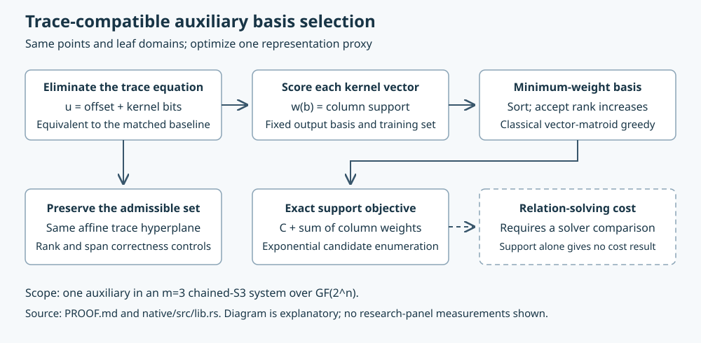

# Trace-kernel auxiliary basis selection

This component implements a native minimum-weight basis selector for an
explicit coefficient-support objective in an m=3 chained-S3 presentation.
It keeps the auxiliary trace hyperplane and all three leaf domains fixed.
Trace-adapted coordinates themselves are the same substitution as eliminating
the known trace equation in an ordinary basis. [pcc:unverified]

The construction, objective and exchange argument are in [PROOF.md](PROOF.md).
The executable is an isolated dependency-free Rust crate under [native/](native/).
It is a reference coefficient constructor, not a relation solver or a
production integration. No root library source, curve database, cost ledger,
benchmark record or solver default changes.



## What the selector optimizes

For a fixed offset o, write u=o+sum_j b_j*z_j, with the b_j a basis of the
trace kernel. Each of the two Boolean-reduced S3 equations is affine in the
auxiliary bits. Distinct bits label disjoint monomials. The total descended
coefficient support therefore has the form C+sum_j w(b_j). We enumerate all
nonzero kernel vectors, sort by (w,encoded value), and keep rank-increasing
vectors. Standard weighted vector-matroid greedy selection minimizes this
finite additive objective. This is an application of an established algorithm,
not a new greedy theorem. [pcc:unverified]

The search enumerates 2^(n-1)-1 candidates. That cost is part of preprocessing;
it does not give a scalable way to optimize a large cryptographic field.
The result minimizes training coefficient support, not elimination fill,
solving degree, root-search work, memory or cost per independent relation.

## Development qualification and unresolved requirements

| Requirement | Status / evidence |
|---|---|
| Native replacement of the relevant coordinate path | Rust field arithmetic, trace charts, S3 compiler and selector in `native/src/` |
| Same auxiliary points across bases | rank/span controls and exact trace-hyperplane enumeration |
| Trace adaptation versus ordinary elimination | polynomial-coefficient equality controls in the library tests |
| Correct symbolic equations | all assignments of the small control checked against direct field evaluation |
| Additive objective and minimum selection | structural support checks and all rank-three subsets under 32 weight assignments |
| Reproducible source qualification | final commands, stdout/stderr and source hashes in `evidence/` |
| Three-size training/held-out support panel | **Not executed**; [protocol](PROTOCOL.md) and CLI implemented |
| Actual solving and independent relation cost | **Not measured**; requires a subsequent native solver/collection adapter and matched pricing |
| Lean / signed proof standing | **Unavailable / pending**; `lake` is not installed; see proof map |
| Binary-field identity certificate | **Unsupported by current IDC1 v1**, which evaluates only over the fixed odd prime 2^61-1 |

The development controls are producer observations, not independently signed
PCC verdicts. No timing from the earlier standalone Python experiments is
repriced as a native result. No low-/high-weight or actual relation-collection
experiment was performed in this component. [pcc:unverified]

## Reproduction

```sh
cargo test --release --locked --manifest-path research/trace_kernel_basis_20261124/native/Cargo.toml --all-targets
cargo clippy --locked --manifest-path research/trace_kernel_basis_20261124/native/Cargo.toml --all-targets -- -D warnings
cargo fmt --manifest-path research/trace_kernel_basis_20261124/native/Cargo.toml -- --check
```

The `--inspect` CLI is the research panel, not a hidden unit-test stage.
Do not run it to bypass checkpoint or EKS admission. The protocol fixes its
inputs and conditions before execution. At this checkpoint the S3 resume
transport and known paid-budget balance are absent; no research job has
been submitted or rerouted locally. The existing
[successful-work problem](../../problems/factor-base-shape-to-successful-work.md)
tracks the unresolved transition from a representation proxy to actual work.

## Sources checked

KB unavailable: MCP tools were not loaded, and `scripts/research-kb status`
returned "no executable found". Fallback sources:

- Kosters–Yeo, [Notes on summation polynomials](https://arxiv.org/abs/1503.08001),
  Proposition 4.2 and Section 5; primary paper read. It supplies the subgroup
  trace constraint and warns against equating an early degree fall with
  complete solving cost.
- Edmonds, [Matroids and the greedy algorithm](https://doi.org/10.1007/BF01584082),
  Mathematical Programming 1 (1971), 127–136, especially paragraphs 5–7 and
  19–28; primary PDF read. It supplies the minimum-weight column-basis method.
- [Factor-base shape search](../notes/index-calculus/RESEARCH_FACTOR_BASE_SHAPE_SEARCH.md),
  especially the trace split and matched m=3 discussion. It requires the
  same trace information in all controls.
- [Hamming ideals review](../notes/index-calculus/RESEARCH_HAMMING_IDEAL_PDP.md).
  It separates compact membership representation from actual oracle cost.

The narrow contribution is the explicit additive auxiliary-column objective,
its native implementation and finite correctness controls. No originality
claim is made for the trace condition or matroid optimization.

## Reporting and graph scope

[report.typ](report.typ) and [report.pdf](report.pdf) summarize this source
component with the same diagram. The visual is explanatory: there is no
executed multi-arm panel to plot. Canonical performance/IC graphs and their
mirrors remain unchanged because no admitted measurement or new priced row
exists. No `benchmarks/` speed entry or ecdb update is warranted by these
development checks.
