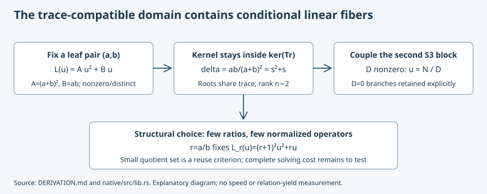

# The structure inside the trace-compatible set

The concrete structure is a family of **Artin–Schreier linear operators
indexed by the ratio of two leaf coordinates**. For a generic S3 block its
one-dimensional kernel lies inside the trace kernel. The subgroup trace bit
therefore does not choose between the two auxiliary roots. A basis change
cannot change that rank or root ambiguity. [pcc:unverified]

This continues merged PR5121 without modifying any of its hash-bound source
or evidence. [native/](native/) supplies a conditional scalar-fiber adapter
and development controls; [DERIVATION.md](DERIVATION.md) gives the argument.
It is not a solver for unknown leaf coordinates or a relation collector.



## 1. The operator and its trace-zero kernel

On the normalized binary model y²+xy=x³+a2*x²+beta, fix x1=a and x2=b.
The S3 equation in the auxiliary coordinate u is

    A*u² + B*u + C = 0,
    A=(a+b)², B=a*b, C=(a*b)²+beta.

Squaring and multiplication by fixed field elements are linear over GF(2).
If a,b are nonzero and distinct, the homogeneous kernel is {0,delta}, with

    delta = a*b/(a+b)² = s²+s,  s=a/(a+b).

Hence Tr(delta)=0. Restricting this operator to ker(Tr), of dimension n-1,
gives rank n-2. Its image on any trace coset is an affine set of codimension
two. Whenever two roots exist, they differ by delta and have the SAME trace.
These are conditional operator facts, not extra independent filters on a
pair of already-valid rational subgroup points. [pcc:unverified]

A concrete adapted basis puts delta FIRST and completes it to a basis of
ker(Tr). The first operator then has an explicit zero column; only n-2
coordinates affect it. The second S3 block resolves the remaining bit in the
generic case. `aligned_trace_basis` constructs this chart. It exposes known
rank structure rather than changing the rank, and needs the pair or ratio
to be fixed before it can be used. [pcc:unverified]

For odd n, the roots come from standard half-trace: put h=A*C/B². If
Tr(h)=0, then u=delta*(H(h)+epsilon), epsilon in GF(2). Both epsilon values
have the same trace. Even degree needs another Artin–Schreier solver;
the implementation uses binary Gaussian elimination and makes the odd-degree
restriction on the half-trace route explicit. [pcc:unverified]

## 2. Two blocks usually determine the auxiliary uniquely

For S3(a,b,u)=S3(z,t,u)=0 write their coefficients as (A1,B1,C1) and
(A2,B2,C2). Eliminating u² gives D*u=N, where

    D=A1*B2+A2*B1 = (a*z+b*t)*(a*t+b*z),
    N=A1*C2+A2*C1.

When D is nonzero, u=N/D is the only candidate; both original S3 equations
must still be checked. D=0 is a separate branch, not a denominator that may
be silently dropped. Under the nonzero/distinct premises, it is exactly the
case where the two kernel directions agree. Zero coordinates and linear or
constant polynomials require the additional cases handled by the adapter.
This is elementary conditional elimination related to the standard resultant
construction, not a new Semaev algorithm. [pcc:unverified]

## 3. A structural choice to investigate: a small quotient set

Fix the ratio r=a/b, b!=0, and divide the block by b²:

    (r+1)²*u² + r*u + r²*b² + beta/b² = 0.

The linear operator now depends only on r, not on b. Its row reduction,
image tests and right-inverse data can be reused for that ratio class.
The kernel direction is r/(r+1)², unchanged by r -> 1/r.
[pcc:unverified]

A concrete candidate coordinate set is

    S = {alpha*g^i : 0<=i<L} intersect {Tr(x)=tau}
        intersect {x(P) : P in the intended subgroup, P!=O}.

For nonzero alpha,g, every ratio of two retained coordinates is g^(i-j),
so |S/S|<=2L-1 even AFTER trace and point filtering. Thus the number of
distinct normalized operators can be small relative to the number of ordered
pairs. This is a multiplicative progression SET, not the additive span of
field powers from the older shape sweeps. [pcc:unverified]

What remains to test is whether this reuse pays. No density |S|/L is assumed;
the trace/rationality intersection may retain too few points. The candidate
also loses the cheap subspace membership representation. Enumerating every
pair is still quadratic, and fixing unknown ratios can merely move the search.
Selection, all branches, lifting/sign verification and independent relation
rank must be charged against a size-matched trace-compatible reference.
The reference must include standard half-trace/precomputed linear solving
and exact signed-point addition where applicable, not only repeated Gaussian
elimination: half-trace itself is already a reusable field-wide linear map.
The root adapter does not establish any of those cost savings.

## Native component and scope

The native library reuses the unchanged field module from PR5121 and adds:

- complete scalar roots of A*u²+B*u+C by GF(2) row reduction;
- an independent odd-degree half-trace route;
- determinant-based coupled-fiber elimination, including every D=0 branch;
- an explicit final trace-class filter and ratio-operator normalization.
- a kernel-aligned trace basis whose first operator column is zero.

Development controls compare exact root sets with exhaustive evaluation in
small fields, compare both solvers, check restricted ranks, determinant and
numerator identities, and cover degenerate routes. They are producer checks,
not a faithful Lean proof, signed PCC standing, or runtime comparison.
[pcc:unverified]

```sh
cargo test --release --locked --manifest-path research/trace_linearized_fibers_20261124/native/Cargo.toml --lib
cargo clippy --locked --manifest-path research/trace_linearized_fibers_20261124/native/Cargo.toml --all-targets -- -D warnings
```

The scalar adapter checks only polynomial roots. A full decomposition
adapter must also handle identity partial sums, actual signed subgroup points
and the original target equation. No research panel or paid run was launched.
The existing [successful-work problem](../../problems/factor-base-shape-to-successful-work.md)
remains open. The frozen inputs and scientific cost requirements of PR5121
are unchanged.

## Sources and proof standing

KB unavailable again: no loaded MCP and the wrapper reports no executable.
Conductor is also absent. Fallback sources read:

- Kosters–Yeo, [Notes on summation polynomials](https://arxiv.org/abs/1503.08001),
  Proposition4.2 and the binary trace discussion.
- Taverne et al., [Software implementation of binary elliptic curves](https://cacr.uwaterloo.ca/techreports/2011/cacr2011-07.pdf),
  Section2.4 for the standard half-trace quadratic solver; primary PDF read.
- [Target-conditioned symmetric-kernel review](../factor_base_kernel_lead_20261029/README.md)
  for the distinction between conditional linear solving and actual point
  splitting/verification; [shape-search note](../notes/index-calculus/RESEARCH_FACTOR_BASE_SHAPE_SEARCH.md)
  for matched trace controls.

No novelty claim is made for Artin–Schreier solving, trace, resultants, or
small-ratio-set constructions. The implementation and the explicit reuse
criterion make the proposed next test concrete. The written proof map is in
DERIVATION.md. Lean/lake remain absent; IDC1v1 only handles its fixed odd
prime and cannot certify these binary identities. No wrong-field certificate
is issued. [report.pdf](report.pdf) and its editable source include the
explanatory diagram. Canonical performance graphs are unchanged because no
new admitted cost measurement exists.
