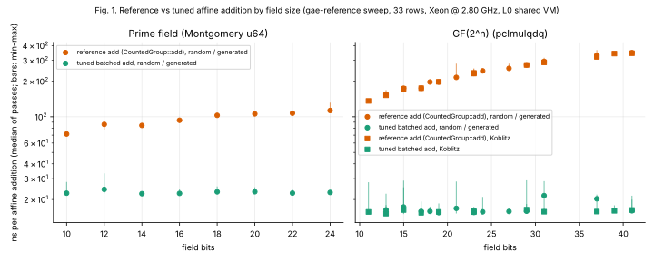
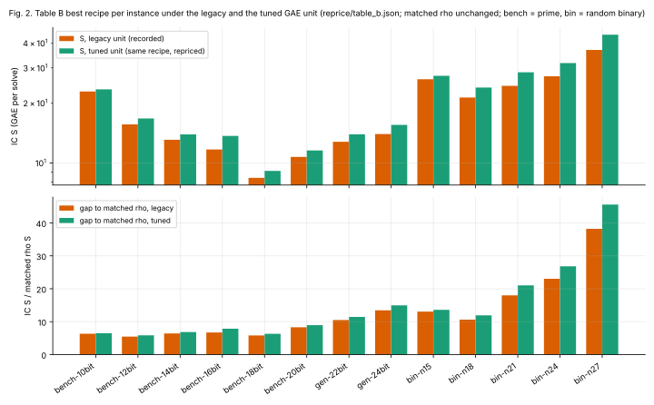
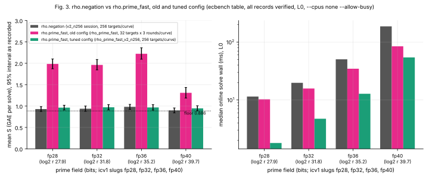

# Is ecbench's rho legitimate, and is its per-step cost fair? Tuned-GAE study, 2026-10-20

Branch `claude/tuned-gae-20261020`. Host for every measurement below: Intel Xeon
@ 2.80 GHz, 4 logical CPUs, Linux 6.18.44 (a shared cloud VM), isolation level L0
throughout (`--cpus none --allow-busy` for ecbench sessions). PDF of this report:
[`REPORT.pdf`](REPORT.pdf). Run report (observations only):
[`reports/run-20261020T1630Z/report.pdf`](reports/run-20261020T1630Z/report.pdf).
Copies for browsing: [`benchmarks/20261020-tuned-gae/`](../../benchmarks/20261020-tuned-gae/).

Every number is labelled **measured** (read from a harness record), **recorded
derived** (computed by the repository's own Rust tool and stored in a committed
file) or **read** (copied from a committed file by the plotting or report layout).
Nothing in this study is computed in Python; `figures/make_figures.py` only lays
out recorded values.

## 1. Question

The index-calculus (IC) results are priced in group-addition equivalents (GAE):
one GAE is the time of `ic_boundary::calibrate_group` timing `CountedGroup::add`,
the repository's reference affine addition. Two things could make the comparison
with Pollard rho unfair:

1. the unit itself, if the reference addition is slow compared with what a
   competent implementation does, every native IC operation (a square root, a
   Legendre symbol, a row operation, a table lookup) is priced as a *larger*
   fraction of a GAE than it would be against a fast addition; and
2. the rho reference, if `rho.negation` (the counted and wall reference) is slow
   or wasteful per step, the IC-to-rho gap is understated.

## 2. Answer

- **The unit is untuned, and re-pricing makes IC look worse, not better.** A tuned
  batched affine addition, cross-checked addition by addition against the
  reference, is 3.16 to 4.93 times faster on prime curves (10 to 24 bits) and 8.68
  to 21.69 times faster on binary curves (11 to 41 bits) than the reference add
  that defines the GAE (measured, `sweep/gae_reference.jsonl`, 33 rows). Native
  work that does not speed up by as much costs more tuned-GAE. Re-pricing the
  recorded Table B recipes under the tuned unit raises IC's S by 2 to 19 percent
  and **widens the gap to the matched rho on all 13 instances** (for example
  6.34 to 6.49 at `bench-10bit`, 38.21 to 45.59 at `random-binary-n27`).
- **This is an accounting correction, not an improvement.** Under the repository's
  success criterion ("Relabelling and accounting changes are not improvements") it
  is recorded honestly and is not reported as progress. It is *proposed*, not
  canonical: `Calibration::pin`, `ecbench::band` and `ecbench::full_price` still read
  the legacy tables.
- **The prime rho reference was step-inefficient in wall time, not in counted work;
  the fast one is a measured speed-up of the rho reference.** `rho.prime_fast` (new
  ecbench method) does the same counted work as `rho.negation` (operations ratio
  1.027 [0.983, 1.075] over 1,024 pairs, so no ranking either way) at a median
  online wall of 0.2175 of `rho.negation`'s. Its first configuration needed 2.05
  times the operations; that was start-up cost, fixed in the tuned configuration.
  That is an improvement to the rho side: it moves the *wall* distance from IC to
  rho, and no IC row.
- So the repository's counted rho (`rho.negation`) is legitimate as a counted
  reference (its S is 0.88 to 0.98 against the theoretical floor 0.886, read from
  `tables/`), and a wall comparison must use `rho.prime_fast` on prime curves.
  The per-step cost of the GAE unit is not fair in the sense above, in the
  direction that was *not* favouring rho.

## 3. Method

1. `src/bin/gae_reference.rs` (+ `field.rs`, `tables.rs`): a tuned affine add
   (Montgomery u64 on prime curves; pclmulqdq fold multiply on GF(2^n); 256-lane
   batched inversion), timed beside `ic_boundary::calibrate_group` on
   `CountedGroup::add` (median of 3), and verified addition by addition against the
   reference (`verified_additions` and `verified_restarts` in every row).
2. Field-level speedups per unit (`gae-reference field`, `sweep/field.jsonl`).
3. `gae-reference retable`: the tuned tables
   [`docs/ic/calibration_tuned.json`](../../docs/ic/calibration_tuned.json) (25 rows) and
   [`src/cryptanalysis/ecbench/full_prices_tuned.json`](../../src/cryptanalysis/ecbench/full_prices_tuned.json)
   (8 rows), both stamped `"gae_definition": "tuned-batched-affine-add/v1"`. The
   legacy tables are untouched.
4. `gae-reference reprice-ledger`: `reprice/table_b.json`. The legacy table
   reproduces every recorded S (13 instances, all recipes, within 1e-9; `reproduced_all`
   is true and `mismatches` is empty), then the same counts are priced under the
   tuned table.
5. `rho.prime_fast`: `prime_fast::rho_parallel` with `RhoConfig::tuned` (look-ahead,
   cycle escape by doubling, stride starts, walker and distinguished-point sizing).
   Three ecbench sessions against `rho.negation`, alternating order, same targets:
   [`rho_prime_fast`](sessions/rho_prime_fast) (old configuration, 32 targets x 3
   rounds per curve), [`rho_prime_fast_v2`](sessions/rho_prime_fast_v2) (tuned, 32 targets x 3 rounds
   per curve) and [`rho_prime_fast_v2_n256`](sessions/rho_prime_fast_v2_n256) (tuned,
   256 targets per curve). Read-outs: `target/release/ecbench table --dir <session>`
   (saved in [`tables/`](tables)) and the saved
   `comparisons/rho-neg__rho-fast.json`.
6. Figures: `figures/make_figures.py` (matplotlib, recorded files only).

## 4. Results

### 4.1 Reference versus tuned addition (Fig. 1; `sweep/gae_reference.jsonl`, measured)

Prime, ns per add reference / tuned: bench-10bit 3.16x (71.5 / 22.6 ns) rising to generated-24bit 4.93x (113.0 / 22.9 ns). Binary 8.68x (Koblitz K_1, 11
bits) to 21.69x (the 41-bit random binary curve). The tuned time is flat in
field size (about 15 to 25 ns); the reference time grows with it. Each tuned bar in
Fig. 1 is the min to max over 15 passes; the reference is the median of 3.

Field-level speedups (`sweep/field.jsonl`, measured, same host): batched inversion
3.63 to 7.22x (prime) and 12.31 to 48.07x (binary); the modular row operation is
0.76 to 1.42x, i.e. **not** faster and in about half the rows slower in the tuned
kernel. The tables credit a class (b) unit with the measured field speedup F, and
where F is below 1 they use 1 (`F: 1.0` beside `F_measured: 0.86` in
`calibration_tuned.json`), which is the conservative direction for IC.

### 4.2 Classification of the priced units (`calibration_tuned.json`, derivation)

| class | meaning | units (rows) | tuned ratio |
|:--|:--|:--|:--|
| a | counted group operation, unchanged | `ns_per_double` (25) | stays about 1 GAE |
| b | native work on untuned field arithmetic; credited the measured field speedup F | `ns_per_row_op` (25), `ns_per_inversion` (8), `ns_per_sqrt` (8) | old x R / F |
| c | already tuned or field-independent | lookup (25), word XOR (25), Frobenius (17), Artin-Schreier solve (17), S4 pair (7), canonicalisation (12), Legendre (8) | old x R |

R is the row's reference / tuned addition ratio (section 4.1). A unit that does not
get faster is a larger fraction of a faster addition, which is why every class (b)
and (c) price rises. Example (read): `bench-10bit` Legendre 0.257 to 0.814 GAE;
`random-binary-n27` S4 pair 3.09 to 50.05 GAE.

### 4.3 Table B re-priced (Fig. 2; `reprice/table_b.json`, recorded derived)

Best legacy recipe per instance, S in GAE per solve, gap = IC S over the matched rho S
(the matched rho is unchanged under the tuned unit; it counts group operations only).

| instance | recipe | S legacy | S tuned | x | gap legacy | gap tuned |
|:--|:--|--:|--:|--:|--:|--:|
| bench-10bit | mitm_m2_negfold_walk_balanced | 22.85 | 23.41 | 1.025 | 6.34 | 6.49 |
| bench-12bit | mitm_m2_negfold_walk | 15.62 | 16.72 | 1.071 | 5.47 | 5.86 |
| bench-14bit | mitm_m2_negfold_walk_balanced | 13.07 | 13.91 | 1.064 | 6.43 | 6.84 |
| bench-16bit | mitm_m2_negfold_walk_balanced | 11.68 | 13.67 | 1.170 | 6.71 | 7.86 |
| bench-18bit | mitm_m2_negfold_walk_balanced | 8.41 | 9.12 | 1.085 | 5.82 | 6.31 |
| bench-20bit | mitm_m2_negfold_walk_balanced | 10.72 | 11.55 | 1.078 | 8.30 | 8.94 |
| generated-22bit-3290411 | mitm_m2_negfold_walk_balanced | 12.77 | 13.92 | 1.090 | 10.50 | 11.45 |
| generated-24bit-10935329 | mitm_m2_negfold_walk_balanced | 13.97 | 15.53 | 1.112 | 13.46 | 14.96 |
| random-binary-n15-b524b | mitm_m2_negfold_walk | 26.31 | 27.39 | 1.041 | 13.07 | 13.60 |
| random-binary-n18-b6507 | mitm_m2_negfold_walk_balanced | 21.30 | 23.91 | 1.122 | 10.62 | 11.92 |
| random-binary-n21-b1b6f3b | mitm_m2_negfold_walk_balanced | 24.39 | 28.52 | 1.169 | 17.99 | 21.03 |
| random-binary-n24-b5fc9da | mitm_m2_negfold_walk_balanced | 27.24 | 31.73 | 1.165 | 23.03 | 26.82 |
| random-binary-n27-b845462 | mitm_m2_negfold_walk_balanced | 36.93 | 44.06 | 1.193 | 38.21 | 45.59 |

The x column is `tuned_over_legacy` as recorded for the legacy-best recipe. At
`random-binary-n21` the best recipe *under the tuned unit* is `mitm_m2_negfold_walk`
(S 27.26, gap 20.10); that is still wider than the legacy 17.99. The gap to the matched rho remains 5 to 46 times; it is the
distance remaining, not a pass/fail.

### 4.4 `rho.prime_fast` versus `rho.negation` (Fig. 3; ecbench sessions, measured)

| session | configuration | targets per curve | ops fast / negation, 95% | median wall fast / negation |
|:--|:--|--:|:--|:--|
| ECBS1h3e27cfbb061d `rho_prime_fast` | old | 32 x 3 rounds | 2.052 [1.897, 2.226] | 0.821 [0.783, 0.855] |
| ECBS1h3da70394827f `rho_prime_fast_v2` | tuned | 32 x 3 rounds | 1.097 [0.996, 1.210] | 0.224 [0.210, 0.237] |
| ECBS1h522578c510c4 `rho_prime_fast_v2_n256` | tuned | 256 | 1.027 [0.983, 1.075] | 0.2175 (interval degenerate as recorded) |

Mean S per curve for the tuned configuration (v2_n256): 0.963, 0.972, 0.968, 0.947
against `rho.negation` 0.930, 0.938, 0.982, 0.898 (curves `icv1-fp28-tm24531-24294e5d`,
`icv1-fp32-t93403-ef655380`, `icv1-fp36-t360541-9f646956`, `icv1-fp40-tm62443-8b49d5b3`);
all records verified in every session (384, 384 and 1,024 pairs), 8 exact replays per session (as stated in the commit message of the session). The ops ratio is
a lower-bound count (canonicalisations are unpriced on both arms), so under AGENTS.md
section 5a no ranking is made between the arms; the two are indistinguishable on
counted work. The v2_n256 wall interval equals its median: that is what the harness
recorded and it is not a precision claim. The wall ratio is admitted at L0 by the
spec, not an isolated measurement (`quality.score` 0; no A/A control).

Note on the small-curve wall: part of the `rho.negation` wall at 28 to 32 bits is not
its solve; see section 6.

## 5. What is and is not an improvement (success criterion)

| item | class | improvement? |
|:--|:--|:--|
| Tuned GAE unit; Table B re-price | accounting | **No.** Counts unchanged, the unit changed, every gap widened. Recorded honestly. |
| `gae_reference` tuned affine add | engineering, a tool | Not an IC improvement; it is the measurement that justifies the re-price. |
| `rho.prime_fast` | engineering on the rho reference | A measured speed-up of the *rho implementation* (median wall about 0.22x at equal counted work, L0). It does not lower any IC S; it **raises the bar** the wall comparison must clear. |
| IC S, any row | | Unchanged in the legacy unit (tables A to C untouched). |

The leaderboard therefore carries these as their own section ("Tuned GAE unit
(proposed, not canonical)"), outside tables A to C.

## 6. Finding (not fixed): glibc malloc consolidation in `rho.negation`'s timed window

About 9 ms of `rho.negation`'s timed solve window at small sizes is
`malloc_consolidate`, triggered by the 51,216-byte `fast_map(1024)` allocation after
the JSON parse. With `GLIBC_TUNABLES=glibc.malloc.mxfast=0` the working agent saw
`solve_wall_ns` fall from about 9.5 ms to about 0.17 ms on a 16-bit curve. **No
session record of this is committed**, so it is an observation to reproduce, not a
measured result of this PR; the workload it was seen on is
[`specs/fixed_wall_probe.json`](specs/fixed_wall_probe.json) (a 16-bit prime curve, 64
targets). Consequence: the reference arm's small-curve wall (28 to 32 bits: 11.5 and
19.8 ms median in v2_n256) includes allocator cost the fast arm does not pay, so the
0.2175 median wall ratio overstates the algorithmic gain at the small sizes; the
fp40 curve (187 vs 54 ms, ratio about 0.29) is the least affected.

## 7. Sensitivity and limits

- **Cross-host assumption.** The tuned ratios multiply the legacy ratios (measured on
  a 2.10 GHz Xeon; the Koblitz GF(2^23) K_0 legacy row came from an Apple M4 Pro under
  load) by this host's R and F. That assumes (unit time) / (reference add time)
  transfers between hosts. This host's own ratios differ from the legacy ones: the
  per-unit median drift (this host over legacy, `calibration_tuned.json`
  `sensitivity`) is 1.77x for Legendre, 1.78x sqrt, 1.60x word XOR, 1.52x
  Artin-Schreier solve, 1.13x row operation, and 0.77x to 0.99x for canonicalisation,
  inversion, Frobenius and doubling. The 1.5 to 1.8x drifts are on the units
  that set the widening; they are as large as the effect, so the sign of the change
  (a widening) is robust only because the addition speedup R (3 to 22x) dominates;
  the size of the widening (2 to 19 percent) is not host-independent. Re-pinning on
  the isolated ledger host is the open follow-up (`SWITCH_PLAN.md`, step 4).
- **Concurrency.** The `rho_prime_fast` session (16:30:46 to 16:32:30 UTC) and the sweep (16:31:29 to 16:32:15) overlapped on the same 4-CPU VM; no contention telemetry was recorded for the sweep, so its ns figures may carry some interference (the tuned min to max band in Fig. 1 is wide on some rows). The tuned session 2 and 3 ran at other times.
- **L0 only.** Nothing here is an isolated (L2 or higher) measurement; wall figures are
  descriptive. The sweep ran on a shared 4-CPU VM; the tuned min to max band in Fig. 1
  shows the pass-to-pass noise.
- **Pricing band.** Table B S values are the ledger's own priced figures with the unit
  swapped; the section 5a 0, 0.1, 1 GAE band was not re-run for this study, and no
  ranking between two arms is made from it. The rho comparison is counted-work
  equivalence (interval contains 1) and wall at L0.
- **Scope.** Prime 28 to 40 bits for `rho.prime_fast`; the legacy Table B instances
  for the re-price. Binary and Koblitz curves keep their wall reference
  `rho.signed_frobenius_strong` (already strong); no binary rho was re-timed.
- **Success criterion.** Distance remaining to the matched rho, now larger under the
  tuned unit: 5.86 to 45.59 across Table B. The next improvement to try is a real
  one: lower IC's native work (square roots, Legendre symbols, row operations) so
  S falls under either unit.

## 8. Open follow-ups

1. **Switch plan** ([`SWITCH_PLAN.md`](SWITCH_PLAN.md)): carry `gae_definition` on
   every record, select the table from the record, re-pin on the isolated host.
2. **Prime `vs_rho` branch**: `ecbench claim build` has no prime branch, so the wall
   reference `rho.prime_fast` is named in AGENTS.md but not wired into claims.
3. **Binary and Koblitz wall reference** is already a strong rho
   (`rho.signed_frobenius_strong`); confirm it is not paying the same allocator cost.
4. **Harden the reference arm's timed window**: pre-allocate or `mallopt` before
   the solve marker so small-curve walls do not include `malloc_consolidate`;
   commit a record for the finding in section 6.
5. Re-run the n256 session at L2 or higher to give the wall ratio a real interval.

## 9. Files and sources

| what | path |
|:--|:--|
| tuned add and sweep | `src/bin/gae_reference.rs`, `src/bin/gae_reference/`; `sweep/` (`RUN.md` lists commands and exit codes) |
| tuned tables | `docs/ic/calibration_tuned.json`, `src/cryptanalysis/ecbench/full_prices_tuned.json` |
| re-price | `reprice/table_b.json` (inputs: round-5 ledger sha256 `28aadc91...`, `docs/ic/calibration.json` sha256 `f0c0a873...`) |
| rho sessions | `sessions/`, `specs/`, `tables/` |
| graphs | `figures/` (SVG, PNG 150 dpi, `make_figures.py`) |
| reports | `REPORT.typ`, `REPORT.pdf`, `reports/run-20261020T1630Z/` |
| leaderboard section | `docs/ic-leaderboard.html` (`#tuned-gae`), `docs/ic/LEADERBOARD.md`, `docs/ic/leaderboard.json` |
| graphs checked and left unchanged | `docs/index-calculus-scoreboard.html`, `docs/ic/progress-timeline.json`: no whole-pipeline S moved (legacy unit retained) |
