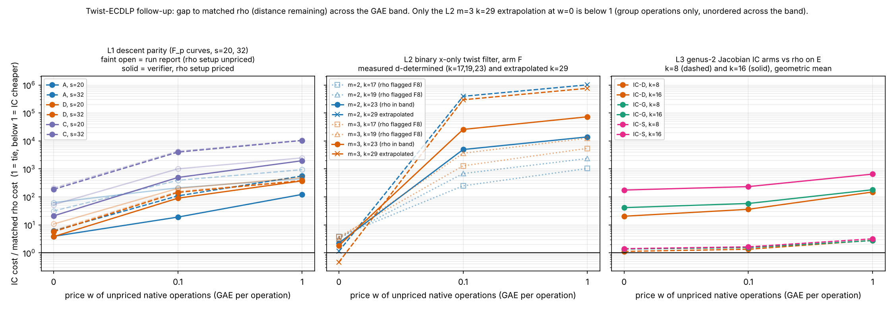

# Twist-ECDLP follow-up study: L1, L2, L3 and the re-replication of the original study

Written 2026-11-07. Scope: three new leads (L1 descent parity, L2 binary x-only twist filter, L3 genus-2 measured arm) run under frozen preregistrations in PARI/GP (L2 also Rust), the mechanical re-replication of the original ten experiments (E0-E6, G1-G3), and the GAE-band pricing of the original arms. Sizes are toy (F_p up to 2^32, binary k up to 31, genus-2 k = 8..16). Operation counts are the metric; wall times are contention-affected and not used. Every number is copied from a recorded file (RESULTS.md, results.json, VERIFICATION.json, COMPARISON.md, GAE_BAND.md). The labels below are the adversarial verifiers' corrected conclusions, not the run agents' own `prediction_confirmed`.

## Bottom line

**No measured improvement over any real baseline.** Per the owner's success criterion (distance remaining, not a pass/fail gate): every IC arm in L1, L2 and L3, and every twist arm of the original study, costs more than its matched rho at every price of unpriced native work (0, 0.1, 1 GAE per operation). The one point below 1 is an extrapolation (L2 m=3, k=29, w=0, gap 0.46, group operations only, unordered across the band). The two internal wins (L1 "A beats B", L2 "F beats U") are against deliberately handicapped arms of the same instrument and are not improvements over a baseline. No row here carries a validation-gate certificate (VALIDATION.json), so none goes to the IC leaderboard or `benchmarks/`.

Figure: `summary.svg` / `summary.png`, drawn by `plot_summary.py` from recorded values only. One panel per lead, IC cost over matched-rho cost at w = 0, 0.1, 1, log scale, 1 = tie.

## Verdict table (verifier-corrected labels)

| lead | corrected label | what holds | what does not |
|---|---|---|---|
| L1 | PARTIALLY CONFIRMED, controls failed (stats verdict refuted, major; math not refuted, minor) | D(R)=1 exactly; rho cheaper than every IC arm at every size and price | H4 window falsified; NC2 literally failed (NC2b defined after seeing it, D5); NC3 excludes 1 in 2 of 12 cells; gap magnitudes overstated (rho setup unpriced) |
| L2 | zero-waste lemma SUPPORTED; filter gain NOT an improvement (math not refuted, minor; stats not refuted, major issues) | 0 twist-coordinate solutions in 98,764 binary solutions; F < U in operation counts | registered stop rule failed for m=2; rho baseline redesigned post hoc (F8 fails k=17, 19); k=29, 31 gaps are extrapolations; open check O1 |
| L3 | NEGATIVE RESULT with several preregistered misses, NOT confirmed (math not refuted, minor; stats refuted, major) | no Jacobian IC arm beat matched rho on E at any price, k = 8..16; construction verified on 54 curves | H4, F2 baseline validity, PC-B at k=8, PC-C at k=10 and 12, NC-A all missed; rho is about 96% table setup |

## L1: descent parity (F_p curves, odd #E(F_{p^2}), sizes s = 20, 24, 28, 32)

For E defined over F_p and odd #E(F_{p^2}), every R decomposes uniquely as (R + piR)/2 + (R - piR)/2, so D(R) = 1 is an exact identity (the group splits as E(F_p) x E'(F_p)). The census (79,980 of 79,980 targets with D(R) = 1, A rate 1.000) is therefore a code-consistency check, not a discovery; the verifier reproduced it by brute force over all 2062 points at p = 1031. Total IC runs 4848, 0 failures.

- A beats B only against an artificially halved factor base of its own arm: attempts ratio A/B 0.350, 0.341, 0.293, 0.529 at s = 20, 24, 28, 32 (naive model 0.5, structure model 0.354; s = 32 CI [0.31, 0.61] contains both). This is not an improvement over any real baseline.
- H4 (priced A/B in [0.30, 0.45]) is falsified: priced A/B including comb precomputation is 0.880, 0.782, 0.653, 0.756 at c = 0, and at s = 32 also 0.589 (c = 0.1) and 0.582 (c = 1) are outside the window.
- Gap to matched rho (IC/rho, median, c = 0 / 0.1 / 1). The run's figures leave rho setup unpriced while charging the IC comb precomputation, so they are overstated by up to about 16x at c = 0. The verifier's repriced values (rho setup included) are the ones to use.

| arm, size | run report (rho setup unpriced) | verifier, rho setup priced |
|---|---|---|
| A, s=20 | 62 / 212 / 447 | 3.9 / 19 / 123 |
| A, s=32 | 31 / 393 / 943 | 6.1 / 109 / 562 |
| D, s=20 | 10.8 / 201 / 491 | 3.8 / 90 / 375 |
| D, s=32 | 6.3 / 157 / 389 | 5.7 / 145 / 381 |
| C, s=20 (lower bound, oracle solver) | 53 / 1008 / 2483 | 21 / 495 / 1966 |
| C, s=32 (lower bound, oracle solver) | 208 / 4314 / 10620 | 186 / 3989 / 10407 |

Rho cheaper than every IC arm at every size and every price; the smallest fully priced IC/rho is about 3.8 (A and D, s = 20, c = 0). Other caveats: A and B have redundant factor-base columns when the cofactor h > 1 (5 of 30 instances at s = 20 carry 5x too many columns); s = 32 rests on 3 curves with instance-level resampling; C is a modelled solver. Replication (VERIFICATION.json): reproduced; all 44 CSVs match outside wall time, results.json (133 items) matches exactly; a reduced run differs only in bootstrap CI endpoints (shared random stream).

## L2: binary x-only twist filter (m = 2, 3; k = 17..31)

- Zero twist-coordinate solutions in 98,764 unique binary solutions over 9 cells (95% upper bounds 1.8e-4 to 1.4e-3 per powered cell; m=3, k=29 underpowered, 659 solutions) and 0 in 8 prime cells. This is an exact consequence of the separation-lemma analogue, so it is a check of the instrument rather than a new fact. The independent verifier re-derived it by exhaustive m=2 search at k=11 and an independent m=3 solver at k=13, with a twist-target mirror control that can fail.
- Filter gain: U/F native-operation ratio 1.31 to 1.34 (m=2) and 1.67 to 1.75 (m=3). It is measured against a deliberately naive unfiltered arm U that pays an Itoh-Tsujii inversion per attempt to learn a bit (the trace test is Tr f(x1) + Tr f(x2)) that is a precomputable per-factor-base table lookup. A baseline with cached type bits equals F. It is not an improvement unless a real baseline does that inversion. **Open check O1:** does the repository's IC baseline already filter non-lifting x-values or cache the type bit? Until O1 is answered the gain is a relabelling or accounting change.
- Registered stop rule failed for m=2 (full column rank in 0 of 10 instances at each of k = 17, 19, 23); for m=3 it succeeded in 10, 4, 6 of 10. All IC-vs-rho gaps rest on the exploratory d-determined stop rule (dP = Q verified in 60 of 60 complete solves).
- Rho baseline was redesigned post hoc (D-01, D-02: the registered distinguished-point rule can never fire in this basis). F8 sanity band fails at k = 17 (mean G 3.62x reference) and k = 19 (2.53x); k = 23, 29, 31 give 1.50, 1.32, 1.49.
- Gap to matched rho, arm F, quoted from F8-valid rho rows only (k = 23). The k = 17, 19 rows (smallest 1039 at c = 1) are against a flagged rho and are not headlined; k = 29 and 31 are extrapolations, not measurements.

| row | status | gap at w = 0 / 0.1 / 1 |
|---|---|---|
| m=2, k=23, arm F | measured, d-determined | 2.2 / 4.9e3 / 1.4e4 |
| m=3, k=23, arm F | measured, d-determined | 1.8 / 2.6e4 / 7.3e4 |
| m=2, k=29, arm F | extrapolated, exploratory | 1.1 / 3.9e5 / 1.0e6 |
| m=3, k=29, arm F | extrapolated; group operations only, about 1.4e11 native operations ignored; unordered across the band | 0.46 / 3.0e5 / 7.6e5 |

Other caveats: H3 agreement is largely self-consistency with the instrument's own cost model; the F6 tolerance was loosened after the fact (D-07), and the strict variant fails the prime m=2, k=31 cell; the gain is a constant factor on a Theta(q) enumeration phase and does not change the exponent. The original VERIFICATION.json replication block is stale (reproduced false, "not yet run"); it was not edited. Re-replication of this run: reproduced, 112,189 numbers compared (same-seed replay bit-identical in all 19 TSVs). The seed-offset replay (L2SEED_XOR=777) differs by design; its verdicts reproduce the original pattern except F6 fails in one prime call-ratio cell and F8 is flagged at k = 17, 19.

## L3: genus-2 measured arm (k = 8..16, 24 instances per size, 54 curves)

No Jacobian IC arm beat matched rho on E at any price, k = 8..16 (F1 did not fire). The label is not "confirmed": H4, F2 (baseline validity), PC-B at k=8, PC-C at k=10 and 12 and NC-A all missed. IC arm over rho-on-E (R_E), geometric means:

| k | IC-D w=0 / 0.1 / 1 | IC-G w=0 / 0.1 / 1 | IC-S w=0 / 0.1 / 1 | R_J/R_E (w=0) |
|---|---|---|---|---|
| 8 | 1.127 / 1.347 / 2.805 | 1.369 / 1.546 / 2.753 | 1.413 / 1.642 / 3.179 | 0.965, unresolved |
| 12 | 2.962 / 4.762 / 18.698 | 5.239 / 7.103 / 21.579 | 8.818 / 11.752 / 34.534 | 1.018, unresolved |
| 16 | 20.414 / 36.058 / 149.993 | 41.440 / 58.207 / 180.692 | 176.056 / 233.510 / 653.445 | 0.953, unresolved |

- Rho inside the transferred Jacobian is unresolved against rho on E at every size (0.953 to 1.044), so the transfer alone gains nothing (in operation counts, at kappa_J = 1; with measured Jacobian-to-curve field cost 2.8 to 6.0 it costs about 4x the field work).
- Rho is about 96% table setup (95.6 to 97.2% at k >= 9; the walk is 66.7 group operations at k = 16), so the ratio 1.1x to 20x is a loose lower bound on the distance to a well-implemented rho. The phase-only ratio is 6.3 (k=8) to 476 (k=16).
- Misses, reported not edited: H4 slope for k >= 10 is 0.604 [0.579, 0.628] against band [0.35, 0.60]; H4 point values (>= 5 at k=8, >= 30 at k=16) were 1.127 and 20.414; F2 R_E step slope 0.297 [0.224, 0.367] fires "baseline broken" (post hoc: steps scale with l, not q); PC-B 423 of 432 pooled but R_E and R_J solve 20 of 24 and 21 of 24 at k=8 (per-size reading fails, F4); PC-C IC-D/plain at w=1 is 0.997 [0.732, 1.352] (k=10) and 1.409 [1.062, 1.836] (k=12), so the negative ranking is scoped to raw counts and exponents; NC-A pooled glued/random 1.034 [0.958, 1.118] (H5 not confirmed).
- The k=8 cell is marginal (IC-D/R_E CI [1.001, 1.265]; 4 R_E runs unsolved, censored at the cap). Construction verified independently: #Jac = #E x #E' on 54 of 54 curves, L-polynomial of C' is the product (x^2 - tx + q)(x^2 + tx + q), 648 of 648 IC solves verified. Replication: the run's own VERIFICATION.json block says not done; this run's mechanical replication reproduced everything (full and reduced raw files 34 + 20, results.json, summary.txt, posthoc.txt and RESULTS.md identical on non-timing fields). It is a determinism check, same code and seed. Sizes are toy; no extrapolation to cryptographic size is supported.

## Re-replication status of the original study (E0-E6, G1-G3)

Mechanical re-replication of each frozen command set, originals untouched. Basis: each directory's `rereplicate/COMPARISON.md` and `VERIFICATION.json`; `original_study_followup/REREPLICATION.json` is the snapshot taken mid-run and is stale for E1, E5, E6 and G2 (placeholder `reproduced: false`), copied unedited.

| experiment | reproduced | note |
|---|---|---|
| E0 | yes | second full run identical (VERIFICATION.json) |
| E1 | yes (306 compared) | validate_results 52 PASS; **data loss:** the original `reduced/` directory was deleted by a mistaken run of run_reduced.sh without E1_RED_DIR; partial files quarantined in `E1-mixed-solution-census/rereplicate/quarantine_mistaken_reduced_run/reduced/`; the original cannot be recovered here and must be regenerated by its owner (raw/, results.json, summary.tsv, RESULTS.md untouched) |
| E2 | yes (15,352) | frozen opcounts.sh failed first on invalid JSON from GP "x e-5" spacing; documented sed fix applied; no number differed |
| E3 | yes | VERIFICATION.json, no mismatches |
| E4 | yes (31,953) | only timing-derived differences excluded (NC1 time band, median CPU-time ratio) |
| E5 | yes | 89 of 89 cell files and all counts byte-identical; every non-timing number matches |
| E6 | yes (301) | out/ also holds files the frozen commands do not produce; SHA256SUMS report run.sh FAILED (edited after the sums, documented) |
| G1 | no (52,397 compared) | two b36 NC1 control cells (n1sab, n1c2, instance 1) differ: the original hit the 840 s cap (12 and 10 trials, rc=124), the replicate ran 20 trials each (rc=0); common prefix identical; 64 of 66 cells identical; all ranked arms identical |
| G2 | yes | every non-timing number identical; plot binaries (pdf, svg) differ in bytes and were not content-checked |
| G3 | yes | 13 of 13 subset files byte-identical (VERIFICATION.json) |

The run summary lists per-experiment compared counts 112,189 (L2), 54 (L3, 34 full plus 20 reduced raw files), 306 (E1), 121, 301 (E6) and 105 without labels; 121 and 105 belong to two of E5, G2 and L1 and are not attributed here. L1: reproduced (44 of 44 CSVs, 133 of 133 results items, see above). Replication of every experiment is a same-code check; none is an independent re-implementation.

## GAE-band summary of the original study (`original_study_followup/GAE_BAND.md`, `gae_band.json`)

Every arm priced at w = 0, 0.1, 1 GAE per unpriced native operation; two arms are ranked only where the order holds at every w (AGENTS.md section 5a). Nothing re-run; arithmetic over recorded counts.

| experiment | matched baseline | order across the band | gap |
|---|---|---|---|
| G1 | N1 sound negation-map rho | K-pure dearer than N1 at every I/M (1.37 to 8.19); K-mix dearer at I/M = 3, 10; K-mix vs N1 unresolved at I/M = 30, 100; A0 vs N1 unresolved (0.67 at w=1 to 1.32 at w=0) | K-mix 5.9x (I/M = 3, w=0) to 0.98x (I/M = 100, w=1, interval [0.91, 1.07]) |
| E5 | A0 additive rho | K-pure dearer at every I/M; K-mix dearer at I/M = 3, 10, 30, unresolved at 100; twist arm no interval, not ranked | K-mix 1.00x to 4.6x |
| E2 | rho on E (measured) | relation phase dearer than rho in all 63 runs; joint table never cheaper than two separate runs | at least 8.04x (w=0), 20.2x (w=0.1), 80.8x (w=1) |
| G2 | D_m | D_m cheaper than P and PF at every w; D_2m and X dearer at every w > 0 | model counts |
| E3, E4 | D, A_E | X and A_S dearer at every w > 0 (28.6 per relation; 2.0246); w = 0 degenerate (no group-operation count) | not matched to rho |
| E6 | model rho only | not rankable | model distance only |
| E0, E1, G3 | none | not applicable (verification and census tiers) | none |

No arm of any experiment is a verified improvement over its matched baseline anywhere in the band. Counters named but not emitted (E2 rho selector hash, E3 and E4 group operations, E5 native counters, G1 START priced at 1) make several arms lower bounds; the L1 and L3 findings add that unpriced rho setup (L1) and a table-dominated rho (L3) make the gaps to rho loose.

## Open items

1. O1 (L2): check whether the repository's IC baseline already filters non-lifting x-values or caches the type bit; if it does, the filter gain is a relabelling.
2. Rerun L2 with the rho baseline fixed before the data (so F8 holds at k = 17, 19) and the stop rule registered as d-determined.
3. Re-price L1 rho with its setup and use a prime-order factor base; compare against the repository's real IC arm rather than a halved copy of the same arm.
4. L3 with a rho whose setup is amortised (so the walk, not the table, dominates) and at k beyond 16.
5. E1: regenerate the deleted original `reduced/` directory with `run_reduced.sh` and `E1_RED_DIR` set.
6. G1: rerun the two capped b36 NC1 cells under the original cap or document the cap as the only difference.
7. All replications are same-code, same-seed checks; independent re-implementations are still missing.

## Files

- `README.md`, `report.pdf` (built by `gen_report_typ.py` and typst), `summary.svg`, `summary.png`, `plot_summary.py`
- `original_study_followup/`: `GAE_BAND.md`, `gae_band.json`, `REREPLICATION.json`
- Leads: `L1-descent-parity/`, `L2-binary-xonly-twist-filter/`, `L3-genus2-measured-arm/` (PREREGISTRATION.md, RESULTS.md, results.json, DEVIATIONS.md, VERIFICATION.json; replication under `replicate/`)
- Original study: `../twist_ecdlp/` (per-experiment `rereplicate/COMPARISON.md`)

## Note on E1 `reduced/`

During re-replication a run started without `E1_RED_DIR` cleared the scratch copy of E1's `reduced/` directory. The committed copy in `research/twist_ecdlp_20261027/E1-mixed-solution-census/reduced/` (merged in PR #2688) was never touched and is the authoritative one; the scratch copy was restored from it.
