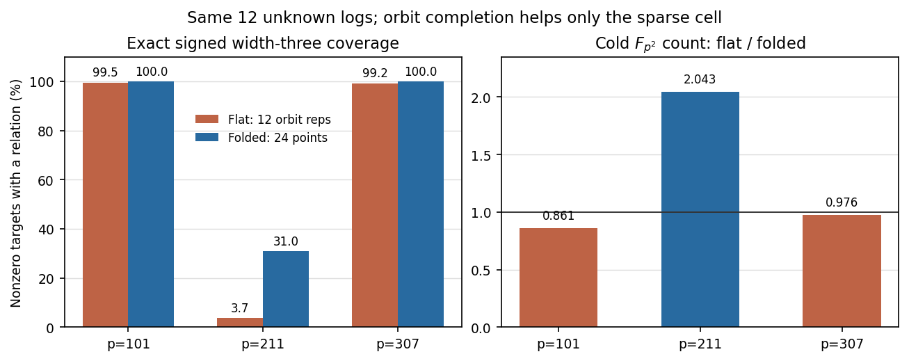

# Orbit-distinct equal-column control: exact run receipt

21 October 2026 UTC. This is a **post hoc** control of the frozen GLS v2
panel. It compares the first 12 orbit representatives as a 12-column flat
base with all 24 members of those exact orbits as a 12-column folded base.
The flat control performs the same 24-point orbit scan and geometry checks
before discarding each partner for its pair table. Its `lambda` search is
omitted because the flat algorithm does not use the eigenvalue. Both arms
use the same signed distinct-index width-three oracle, generator query
sequence, and target scalars. The native control is self-contained: its
arithmetic block was copied from the sealed v2 producer so that the v2
source and raw records remain immutable.

## Commands and receipts

Toolchain: `rustc 1.99.1 (58cf8f9c3 2026-10-13)`.
Run from this directory:

```sh
rustc -D warnings -O gls_distinct_control.rs -o gls_distinct_control
./gls_distinct_control > gls_distinct_control_v1.ndjson
./gls_distinct_control > gls_distinct_control_v1_aa.ndjson
rustc -D warnings -O gls_distinct_verify.rs -o gls_distinct_verify
./gls_distinct_verify \
  gls_symmetry_results_v2.ndjson \
  gls_distinct_control_v1.ndjson \
  > gls_distinct_verify_v1.txt
./gls_distinct_verify \
  gls_symmetry_results_v2.ndjson \
  gls_distinct_control_v1_aa.ndjson
python3 audit_gls_equal_columns.py
```

Both native runs and both independent verifications exited 0 with empty
stderr. The A/A check compared all 12 JSON records after removing every
`*_ns` field; all remaining fields agreed exactly. The control includes
three exact censuses and nine full one-target solves. The separate verifier
uses the independently written field and group law of the existing GLS
verifier. It reconstructs the selected orbits, all signed triple sums and
coefficient rows, checks every row's scalar identity, then recomputes
their rank and coverage, the sequential full-rank stop,
the online query count, and each recovered scalar. It does **not**
independently rederive the producer's resource counters or wall times.

| `p` | Covered / nonzero targets | Raw nonzero witnesses | Flat rank | Queries to rank | Recovered targets |
| ---: | :---: | ---: | :---: | ---: | ---: |
| 101 | 398 / 400 | 1,758 | 12 / 12 | 7 | 3 / 3 |
| 211 | 1,658 / 44,220 | 1,760 | 12 / 12 | 860 | 3 / 3 |
| 307 | 504 / 508 | 1,754 | 12 / 12 | 5 | 3 / 3 |



The [editable SVG](gls_equal_columns_v2.svg) and
[renderer](render_gls_equal_columns.py) use the same audited CSV.

## SHA-256 pins

```text
Frozen GLS v2 raw input
ec4d77908b179b44a758af3e7b8b0539019e41b96faa2653acd45bc3b85bf23b
Native distinct-control source
52b1cac8e67a849cab0da0d0c53c6ba35cb8cde014dd7271630c23ef0687a046
Native distinct-control v1 raw
7dcfa338936afab79f0c8dcb3f3cbacc87aa2586b3724cbae511886ec671f75c
Native distinct-control A/A raw
877ad9ec0494d51fc573c93a3670588774b1aa7fc04a17798b46c8b45b5fd617
Independent verifier source
3e556c25d708c3911119a8d966d69a3a11ff6dfd5a66e2b6dc0e2e7fbd008723
Independent verifier receipt
92422493fdf00ba6ff9e959896ae9a8d0dbbce6472d88bc569e9a207fa953d29
Paired-audit source
0ee4e38478c2db32f6506712fbdf6c27ecd65547e47379b6efddd0e17f853fb5
Six-row paired CSV
629397d1c96eecc9d1e12662e7ea8c1d1eba1b1693df3d5762dd7ff6164fee17
Graph renderer source
8a6e1a725c9767b8cf7423cab69ee71f0f225f495be611a72c78da8862264394
Equal-column SVG
76532a6b78a28a07b976ecdaca8f43723c3ea2c0dd29a413c69175b5cd8e53d4
Equal-column PNG
49127d79112ea989db82da1be28939948218b2ec2ff2dd389ca9f98585326076
```

The CSV reports both the orbit-distinct and original paired-flat baselines
against the folded 24-point base. Raw witness totals count **all nonzero
triple sums across targets**; the roughly 9.2-fold folded increase comes
from the 9.2-fold larger `choose(B,3)` candidate set. The cost comparison
remains a recorded-operation diagnostic, with a shared-host L0 wall clock
and several operations unpriced. It does not establish a polynomial
relation-finder or a cryptographic-size attack speedup.
