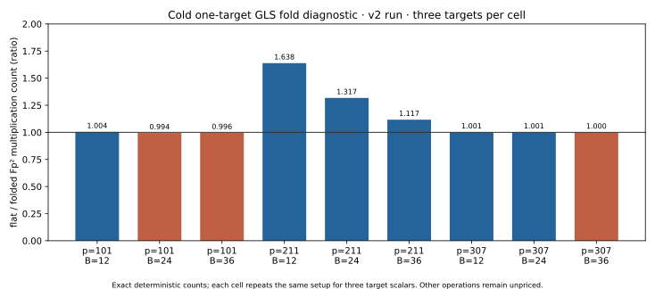

# Twist-derived Frobenius symmetry in an exact index-calculus pipeline

21 October 2026 · research result and limitation record

## Question and scope

The requested question is whether a **twist supplies symmetry that helps
relation finding or index calculus**, particularly for a factor base with
points on a curve over an extension field. The earlier
[mixed-component study](MIXED_REPORT.md) addressed rational targets on the
original curve; this study attacks DLP targets **already on the GLS twist**.
It executes an exact signed width-three relation oracle, complete relation
censuses, one-target matrix solves and descents, and matched negation-rho
controls. It does **not** execute a Semaev polynomial-system solver.

| Requested aspect | Evidence and status |
| --- | --- |
| Mixed-component extension base, unique traces and matrix rank | [Earlier exhaustive study](MIXED_REPORT.md): exact enumerations and projection obstruction for odd-order rational targets. Complete for its stated models and width, not a general polynomial-solver benchmark. |
| Twist symmetry on a subgroup where it genuinely acts | [Frozen GLS protocol](GLS_SYMMETRY_PROTOCOL.md), [v1 raw](gls_symmetry_results_v1.ndjson), [v2 raw](gls_symmetry_results_v2.ndjson): three curves, three physical base sizes, three target scalars, two IC arms and rho. Executed. |
| Relation yield and orbit quotient | All 9 exact censuses, independently replayed; witness orbit and row covariance checked on every signed width-three triple. Executed. |
| One-target full solve, cost, rho | 54 IC solves and 27 matched rho solves; all scalars independently verified. Counter and L0 timing diagnostics only. A calibrated whole-method speed comparison remains open. |
| Polynomial relation finder and asymptotic cryptanalytic claim | Open. Exact group meet-in-middle relation search does not measure Gröbner/Semaev solving, descent complexity at large security sizes, or an external fastest implementation. |

## Geometry and the mechanism

For `E0/Fp: y²=x³+ax+b`, choose a nonsquare `c` in `Fp²` and use the
quadratic twist `E_c: y²=x³+a c²x+b c³` over `Fp²`. Put
`alpha=c^((1-p)/2)`. The transported Frobenius is

`psi(x,y) = (alpha² x^p, alpha³ y^p)`.

Since `alpha^(p+1)=c^(-(p²-1)/2)=-1`, applying `psi` twice fixes `x` and
negates `y`: `psi²=[-1]`. A direct substitution in the curve equation
shows that `psi` maps `E_c` to itself. On a selected cyclic prime-order
subgroup `⟨G⟩` stable under `psi`, the checked eigenvalue is
`psi(G)=[lambda]G` and `lambda²=-1 mod r`. The independent verifier checks
the action on **every point of each selected subgroup**, not only `G`.

For orbit pair `P_j,psi(P_j)`, a physical relation has coefficients
`a_j,b_j`. Its folded coefficient is `a_j+lambda b_j mod r`. Thus the
number of unknown factor logs is `B/2` rather than `B` for a base of `B`
physical points. This is a valid column reduction only because the DLP
target, base points and relation sums all lie in the same invariant subgroup.
The factor-orbit validator rejects a deliberately corrupted partner in
all 9 negative controls.

The exact group relation search is identical in the flat and folded arms.
Hence **raw relation yield cannot improve from row folding alone**. This is
an important correction to any earlier suggestion that more twist points
automatically create more useful rational-target relations. For rational
`E0(Fp)` targets the earlier projection theorem still applies; this GLS
study supplies no target transport from those DLPs.

## Exact panel and exhaustive census

`Fp²=Fp[u]/(u²-d)` uses the least positive nonsquare `d`; `c` is the first
extension-field nonsquare in the frozen lexicographic scan. Curves, orders,
generators and eigenvalues are in the [curve records](gls_symmetry_results_v2.ndjson).
The independent [native verifier](gls_symmetry_verify.rs) recounts every
curve order by field norm character, reconstructs each base, enumerates
every signed distinct-index triple, computes direct group sums using an
independently written group law, and recalculates both ranks.

| `p`; `r`; cofactor | `B` | Covered nonzero target scalars / `r−1` | Raw signed triple hits | Flat rank / columns | Fold rank / columns |
| --- | ---: | ---: | ---: | ---: | ---: |
| 101; 401; 25 | 12 | 392 / 400 | 1,752 | 12 / 12 | 6 / 6 |
| 101; 401; 25 | 24 | 400 / 400 | 16,152 | 24 / 24 | 12 / 12 |
| 101; 401; 25 | 36 | 400 / 400 | 56,980 | 36 / 36 | 18 / 18 |
| 211; 44,221; 1 | 12 | 1,680 / 44,220 | 1,760 | 12 / 12 | 6 / 6 |
| 211; 44,221; 1 | 24 | 13,708 / 44,220 | 16,192 | 24 / 24 | 12 / 12 |
| 211; 44,221; 1 | 36 | 32,784 / 44,220 | 57,120 | 36 / 36 | 18 / 18 |
| 307; 509; 185 | 12 | 508 / 508 | 1,756 | 12 / 12 | 6 / 6 |
| 307; 509; 185 | 24 | 508 / 508 | 16,160 | 24 / 24 | 12 / 12 |
| 307; 509; 185 | 36 | 508 / 508 | 57,012 | 36 / 36 | 18 / 18 |

Both arms see precisely the same physical base, relation oracle and raw
hits. All four signed conjugates of each nonzero witness are in the census.
The [extended independent audit](gls_symmetry_audit_v2.json) checks that
each orbit has size four, the conjugated sum equals `[lambda]` times the
original sum, its folded row equals `[lambda]` times the original folded
row, and keeping one representative per orbit preserves folded rank.
The nonzero witness-orbit counts are exactly 438, 4,038, 14,245 for `p=101`;
440, 4,048, 14,280 for `p=211`; and 439, 4,040, 14,253 for `p=307`
at `B=12,24,36` respectively. These are `raw_hits/4`, not extra
independent relations.

For a pair of physical coefficients `(a,b)`, conjugation sends them to
`(-b,a)`. Its folded value is `-b+lambda a`, which equals
`lambda(a+lambda b)` because `lambda²=-1`. The same scalar multiplies the
right-hand side. Consequently, after folding the four equations in a
witness orbit span only one row. A source-linked
[identity certificate](gls_row_covariance_identity.certificate.json),
`IDC1hfa7f1de676984669`, seals the unconditional polynomial identity
`(-b+lambda a)+(lambda²+1)b = lambda(a+lambda b)`; the separate group audit
checks the subgroup premise `lambda²+1=0`. This rules out the specific
idea of getting four independent folded equations for one relation-search
success.

## Cold one-target results

The two IC arms rebuild their bases and pair tables cold for each
target. Each of the 27 `(curve,B,target)` workloads has targets
`[37]G,[113]G,[271]G`, and a rho run on the same target. Collection uses
`[a]G`, `a=1,2,...`; descent checks `Q+[b]G`, `b=0,1,...`; every recovered
scalar is independently checked. There were no failures or exhausted
searches. The same setup is intentionally repeated for the three target
scalars in each cell, so the setup trial counts are **one deterministic
trajectory per cell**, not three independent trials.

The table uses the [native summary](gls_symmetry_summary_v2.csv). `M` is
the *recorded* cold `Fp²` multiplication count, including base creation,
relation search, linear algebra and online solve. `flat/fold M` is a
diagnostic ratio of those counts. Timings are L0 shared-host medians in
milliseconds for three targets, with other processes present; they are
descriptive and are not an isolated benchmark verdict.

| `p` | `B` | Collection queries flat / fold | Flat / fold `M` | Flat/fold `M` | Flat / fold / rho median ms |
| ---: | ---: | ---: | ---: | ---: | ---: |
| 101 | 12 | 8 / 6 | 13,118 / 13,063 | 1.004 | 0.667 / 0.645 / 0.062 |
| 101 | 24 | 1 / 1 | 16,470 / 16,565 | 0.994 | 0.865 / 0.826 / 0.058 |
| 101 | 36 | 1 / 1 | 22,005 / 22,100 | 0.996 | 1.310 / 1.180 / 0.056 |
| 211 | 12 | 829 / 254 | 110,453 / 67,414 | 1.638 | 6.159 / 3.889 / 0.826 |
| 211 | 24 | 160 / 37 | 74,699 / 56,704 | 1.317 | 4.288 / 3.342 / 1.566 |
| 211 | 36 | 52 / 19 | 68,243 / 61,102 | 1.117 | 4.064 / 3.721 / 1.352 |
| 307 | 12 | 4 / 2 | 96,977 / 96,877 | 1.001 | 7.115 / 7.116 / 0.063 |
| 307 | 24 | 2 / 1 | 101,353 / 101,253 | 1.001 | 7.419 / 7.444 / 0.062 |
| 307 | 36 | 1 / 1 | 107,167 / 107,217 | 1.000 | 7.844 / 7.680 / 0.304 |

The main positive finite experiment is `p=211`: row folding reaches full
rank after fewer generator queries and uses fewer counted `Fp²`
multiplications in all three base sizes. At `p=101,307` the cold base and
table costs dominate, making the multiplication counts almost equal or
slightly worse for the fold. Rho uses fewer counted multiplications than
either IC arm in every panel cell; this panel does not establish an IC
attack advantage against rho.

The [query-orbit audit](gls_query_orbits_v2.csv) checks whether the
sequential collection asks twice for target scalars related by `psi`.
Only `p=211,B=12` has repeats before rank: 15 of 829 flat queries and
2 of 254 folded queries. The other eight cells have none. Thus changing
query scheduling might avoid those duplicate orbit classes, but this audit
does not measure a rescheduled solve or a polynomial-system solver.

## Cost boundary and controls

The [v1 run](gls_symmetry_results_v1.ndjson) charged a full extension-field
enumeration for every cold solve and an individual scalar replay for each
folded base point. It remains immutable. The protocol's explicitly marked
[post-run v2 amendment](GLS_SYMMETRY_PROTOCOL.md) early-stops the same
lexicographic base scan and charges identical geometry checks on both
arms; a separate independent audit still validates the eigenvalue on
every factor. V1 and v2 have identical curve/census/rank/trial/hit/online
query/recovered-scalar fields under the exact
[comparison selector](GLS_RUN_COMPARISON.md); v2 is a post hoc implementation refinement.
The [v2 repeated A/A record](gls_symmetry_results_v2_aa.ndjson) agrees
byte-for-byte on all non-timing fields after stripping time fields, as
recorded in the same comparison receipt.

The raw records expose group additions, `Fp²` multiplications and
inversions, `psi` evaluations, pair-table probes, modular row operations,
modular inversions and square tests, and phase times. Group-add counts
**nest** field operations, so they cannot simply be added to the
field-operation totals. The [sensitivity CSV](gls_symmetry_summary_v2.csv)
shows `M+w·(recorded extra events)` for `w=0,0.1,1` in formal
`Fp²`-multiplication-equivalent units. It is not a hardware calibration:
`Fp²` additions, base-field arithmetic inside field operations, hash
construction and allocations are not exhaustively counted. The frozen
protocol's stronger requirement to price every unpriced operation in
group-addition equivalents is therefore **not met**; this is an open
measurement requirement. The L0 timings also lack CPU isolation and an
external fastest-implementation baseline. No speedup claim or canonical
IC leaderboard promotion follows. The [visual benchmark copies](../../benchmarks/20261021-gls-twist-index-calculus/)
remain available, but the current `VALIDATION.json` admission rule excludes
this study from the `benchmarks/README.md` results table until independent
headline recomputation and a fully priced strongest-rho reference exist.
The earlier [mixed-study copies](../../benchmarks/20261021-twist-mixed-ic/)
are held out for the same reason. We checked
`docs/index-calculus-scoreboard.html`, `docs/ic/progress-timeline.json`,
`docs/ic-leaderboard.html` and study-local graphs; their published
performance conclusions do not change.

The v2 producer identifies `lambda` by scanning `x=1..r−1` for
`x²=-1 mod r` and then checking `[x]G=psi(G)`. Its modular-square tests
and scalar checks are charged in the toy cold run, but this **linear scan
is not a scalable eigenvalue algorithm**. A large-prime implementation
would compute the two square roots of `−1 mod r` using modular square-root
arithmetic, then test both on `G`. That implementation and its map/setup
cost are not benchmarked here; the toy ratios must not be extrapolated
to large `r` on the basis of this code.

## Other twist routes, with discriminating conditions

| Mechanism | What the twist could provide | Status and discriminating test |
| --- | --- | --- |
| Mixed components on `E0(Fp²)` for an `E0(Fp)` target | More candidate abscissas | [Projection proof and exhaustive controls](MIXED_REPORT.md) show the anti-invariant contribution vanishes on the odd-order rational component. No independent rational-target log columns arise under those hypotheses. |
| Attack a twist-group target directly | Twist points become legitimate factors | This GLS panel implements the direct subgroup case and finds order-four orbit folding. Relation yield is unchanged at fixed physical base. |
| Twist-induced Frobenius factor-base orbits | Fewer unknown logs and rows needed for rank | Validated exactly in all 9 census cells and 54 IC solves; cold count benefit varies with base cost and relation density. |
| Lift every relation through the automorphism | Four relations from one search hit | Every signed witness has four conjugates, but the four folded augmented rows are scalar multiples; no extra folded rank. Independent exhaustive audit and identity certificate. |
| Quotient relation-search target orbits | Avoid repeat polynomial solves on equivalent targets | Only 15/829 and 2/254 repeats in the sparse `p=211,B=12` sequential prefixes. A phase-aware, orbit-scheduled solver remains to be implemented; the current count is only an upper bound on avoidable repeated queries. |
| Invariant Semaev polynomial system | Smaller Gröbner basis or fewer solver branches | Mathematically plausible only if the transformed target and factor-base constraints are tracked consistently. The exact group oracle does not implement or cost this; separate system-size, solve-time, success-probability and descent tests are required. |
| Isogeny transport to a twist model | Move a DLP into a subgroup with the useful symmetry | Needs an explicit computable map, subgroup order compatibility, kernel exclusion and map cost. The earlier [isogeny control](REPORT.md) covers one small case, not a general bridge. |
| Extra automorphisms (`j=0,1728`) or higher-degree Frobenius | Larger orbit quotient | Requires the actual subgroup scalar action and a compatible factor base; special automorphisms can also help rho, so the same-target baseline must use them. Not tested here. |
| Weil descent or trace-zero representation | A lower-dimensional polynomial system over a subfield | Separate extension-degree and target-family assumptions; no inference from this quadratic GLS panel. |

The relevant primary literature includes the original
[GLS construction](https://eprint.iacr.org/2008/117),
[subfield-curve index calculus](https://pure.royalholloway.ac.uk/files/39395430/Accepted_Manuscript.pdf),
[summation-polynomial symmetries](https://eprint.iacr.org/2014/806.pdf),
and [GLS with GHS Weil descent](https://arxiv.org/abs/2106.09967).
Those papers motivate different settings; none licenses transferring this
toy ratio to a prime-field ECDLP or to a modern curve.

## Proof map and reproducibility

The readable proof of `psi²=-1` is above and the concrete formula is
checked exhaustively by the native verifier on the three finite
subgroups. The abstract generator-to-subgroup and coefficient-folding
lemmas are formalized in [GLSSymmetry.lean](GLSSymmetry.lean), pinned by
[lean-toolchain](lean-toolchain). `eigenvalue_on_cyclic_subgroup` and
`fold_from_generator` use only standard `propext` among printed axioms;
`fold_relation_pair` prints no axioms. The Lean file assumes the group
action laws and eigenvalue premise; it does **not** formalize the
particular `Fp²` curve, nonsquare criterion, `psi²=-1` derivation or
rank/cost conclusion. The full concrete formal theorem remains open.

Reproduce with `rustc -D warnings -O` on
[producer v2](gls_symmetry_ic.rs),
[verifier](gls_symmetry_verify.rs),
[summarizer](gls_symmetry_summarize.rs) and
[query-orbit counter](gls_query_orbits.rs). Their outputs are the linked
NDJSON/CSV/JSON files. The producer command and hashes are in the
[v2 run report](reports/run-20261021T1533Z-gls-symmetry/README.md);
[v1](reports/run-20261021T1530Z-gls-symmetry/README.md) and
[A/A](reports/run-20261021T1536Z-gls-symmetry/README.md) have separate
records. All three runs exited successfully with empty stderr. The
figure's editable [render source](render_gls_visuals.py) reads the native
CSV only; its [PNG](gls_fold_cost_v2.png) is the same 150 dpi render.
